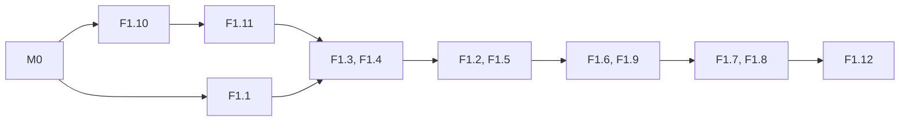

# Project Nublar Beta plan: engineering backlog

Mirror of the shared page sub-tab "Engineering backlog" under "Beta and Release 1 project plan". Back to the [roadmap](../project-plan.md).

This page is the master backlog for the Beta and Release 1 of Project Nublar. It sets the milestones, the work packages, their scope and their order.

- **In game:** a playable Beta of Project Nublar runs on Fabric and NeoForge for Minecraft 26.2. Release 1 follows and adds plants and four species.
- **Page status:** draft for the lead's review, rebuilt by milestone.
- **Master copy:** the "Engineering backlog" tab of the shared Codebase Analysis page. This file mirrors it. The overview tab holds Beta at a glance, the gameplay loop, the player journey and the species roster. The Art list tab tracks every art asset.

> **For agentic workers:** do not implement from this file alone. When you take a work package, first write its detailed task plan ("How to use this plan", step 3). Then implement it with `superpowers:subagent-driven-development` or `superpowers:executing-plans`. Steps use checkbox (`- [ ]`) syntax.

## Status on 2026-10-19

- **Nothing is started.** No milestone or work package is merged.
- **Nothing blocks M0.P0.** The lead committed the herd and movement redesign on branch `kash's-slop` (based on 1.20.1). Commit 582fbb0 holds the code. Commit 4e90174 holds docs and research notes only.
  - Herd steps P1 to P13 are done and reviewed. 32 herd classes are in `J/entity/ai/behaviour/social/`.
  - Step P12c (cliff edges, `GroundSupport` and its changes to `BodyFit` and `FenceAwareNodeEvaluator`) is in 582fbb0 but not built, tested or reviewed. Playtest 6 ran. The lead has not reported its results. M0.P0 builds and tests it, and the lead decides keep or revert.
  - The worktree `.claude/worktrees/herd-leader-sample` keeps 65 uncommitted files as a frozen backup. Never edit it.
  - Handoff: `docs/superpowers/handoffs/2026-10-10-herd-p13-p12c-handoff.md`. Ledger: `.superpowers/sdd/2026-10-08-herd-movement-redesign/progress.md`.
- **Open decisions.** The register's Status column is the only source of what is open. Blocked by the lead's choice: D08 (guns), D09 (licence) and D14 (animation speed). D91 waits on the artist. D274 and D275 wait for the lead to confirm the controller's choice. D277 to D283 come from the lead's playtest of 2026-10-24 and wait for the lead's choice. Every other row is answered, and each feature spec states the current rule.
- **Spec wins.** `docs/codebase-analysis.md` section 11 is the design that the lead confirmed. If this plan and section 11 differ, section 11 wins and this plan has a bug.

## How to read this page

- **Paths:**
  - `J/` is `common/src/main/java/net/dumbcode/projectnublar/`.
  - `R/` is `common/src/main/resources/`.
  - `F/` is the Forge module, `neoforge` after M0.
  - `MOD` is `R/assets/projectnublar`.
  - `REPO` is the asset repository `Dumb-Code/ProjectNublar-Assets`.
  - Line numbers refer to commit 4244f62 and go stale after M0.
- **Section numbers** ("section 11.16", "Section: 2.6") refer to `docs/codebase-analysis.md`.
- **Survey ids** (entity survey S1 to S27, tech survey T1 to T15, JC3 J1 to J23) name clean-room specifications in the survey reports.
- **"(proposal, lead decides)"** marks a value that the lead has not confirmed. It applies until the lead answers.
- **Architecture:** one MultiLoader project with the modules `common`, `fabric` and `neoforge`. Game logic lives in `common`. Each loader module holds only registration glue, platform services, datagen and the client entrypoint. Balm carries energy and fluid storage. Species data, fossil sets, diets and gene effects are datapack JSON. Global balance numbers are one TOML file.
- **Tech stack:** Java 25, Minecraft 26.2, Fabric Loader and Fabric API, NeoForge, GeckoLib 5, SmartBrainLib 2, Forge Config API Port, Balm (energy and fluid storage only), JUnit 5, the vanilla GameTest framework. Networking uses the vanilla custom payloads: packets and codecs live in `common`, and each loader module registers them in one class of its own (D263). No Architectury and no Common Networking. Gradle is the version that ModDevGradle and fabric-loom support for Java 25 at port time (Gradle 9 or later).

---

## Global constraints

Every work package follows these rules.

### Platform and data

- **Loaders.** Fabric and NeoForge. Both must be playable at the Beta release. No single-loader shortcut.
- **Version.** Minecraft 26.2 and Java 25. Check loader and library releases again before the port starts.
- **Config split:**
  - TOML for global balance numbers (yields, times, chances, power).
  - Datapack JSON for per-species data (stats, fossil sets, diets, gene effects).
  - Tags for the items of other mods.
  - If the split is not clear, pick the simpler format.
- **Playtest numbers.** Every number that the lead marked "tune in playtest" is a config value with the stated default. Never hard-code it.
- **Ids.** Block and item ids can change. No world-compat shims. Apply the renames of register row D251. Fix the block entity id `carrnivore_feeder_one`.
- **Stats.** The Tyrannosaurus card values are approved. The interim values of section 11.16 are the working values for the other five species. Do not invent stats. State the basis of every number.
- **Numbers.** Do not invent a number that no source gives. Write "not set" and add a register row.
- **Spawning.** Dinosaurs never spawn naturally. Cloning is the only source.
- **Not decided.** Do not open again, unprompted, the decisions that the lead marked "not decided" (guns, licence). Do not change `LICENSE` or the `license` value until the lead decides.

### Assets and parity

- **No stand-ins.** An asset counts only when it is the right one for that thing.
  - A Tyrannosaurus roar is not a Velociraptor sound.
  - A clip from another species, or a byte copy of another file, counts as missing.
  - A work package that ships a placeholder is not done.
- **Work-in-progress code proves nothing.** Code on any branch shows the current state only. A requirement is met only when its acceptance test passes in the work package that owns it.
- **Cloning parity.** Machine screen contents, flow, timings and machine behaviour match the 2022 Cloning Guide video (https://youtu.be/W9cMQUB4EdM).
  - Where `_Cloning Process.docx` ("the spec") or a section 11 decision differs from the video, the spec or the decision wins.
  - Each machine work package cites the video times that it matches.
- **Machine looks are not part of parity.** The machine models and textures changed since 2022.
  - The current models and textures in the mod are the target (`geo/block/*.geo.json`, `textures/block/*.png`, `textures/gui/*.png`).
  - Animations drive the bones of the current models.
  - A screen matches the video in its contents (slots, gauges, tabs, buttons, tooltips) and uses the current GUI texture for its art.
  - Where an animation needs a part that the current model lacks, the package adapts it to existing bones or asks the artist (Art list questions 12 and 13).
- **Machine animation.** Animation state that players see the same is server-owned and synced. Timers use game time. Nothing counts frames or partial ticks.
  - The Egg Printer and the Incubator animate in code. The original 1.12.2 and 1.16 behaviour is the reference. Do not copy its bugs: client-only state and frame-rate timing.
- **Species art scope.** Animations per species are the 2020 board's clip list for that species, plus every clip that a Beta behaviour needs. All Dino VFX are in Beta. The Beta skin sets are complete, with every layer for both genders.
- **Art status.** Art status lives only in the Art list. This backlog holds no art counts and no asset status.
  - Each work package lists "Art: see Art list → <thing>".
  - A package is not done until each of its Art list rows is "Done" (no Placeholder, no To check).
  - A "Shared, to confirm" row counts as not done until the artist confirms it.

### Code

- **Code style:**
  - Javadoc on every public type and every public method that is not an override.
  - No `System.out` or `System.err`. No chat messages for debugging.
  - No `Minecraft.getInstance()` in common or server code.
  - All player-facing text goes through translation keys in `en_us.json`.
- **Code quality.** These apply to every work package and every review:
  1. Keep the code as simple, well formatted, clean, documented and readable as possible.
  2. Keep the codebase as light as feasibly possible: optimized, efficient, performant, and in line with the basics of OOP. No speculative abstractions. No utility layer for one caller. No new dependency when the JDK or Minecraft has the function. Measure before you optimize, but never leave known per-tick waste.
  3. Review your own work as an adversary does. Do not add or remove code only for the sake of it.
  4. A human must be able to continue from where you stopped. Javadoc, a short package note and tests that explain intent make this possible.
- **Libraries first.** If SmartBrainLib 2, GeckoLib 5 or Balm gives a hook, call the library. Do not copy library code. Do not write a second version of a library feature. Examples:
  - SmartBrainLib 2 ticks the brain. Remove the manual brain tick.
  - Gate sensors with `onlyScanIf` and set a scan rate per entity. No always-on block scan.
  - Use the built-in sensors and behaviours for nearby entities, players, hurt-by, attack targets, flee, follow and breeding.
  - Use GeckoLib 5 triggered animations, additive controllers and bone updaters. GeckoLib 5 applies the scale attribute.
  - Write Nublar code only where no hook exists (stamina chases, dominance, nests, herd formation, the incubator arm solver). Build it on the library's base classes. Use the library's extension points. Do not fork a library.
- **Three rules for the mod's own code** (tech survey, section 12.2):
  1. Still things use static geometry. Fence posts, wires and idle machines draw from the chunk mesh or a block model, not from a block-entity renderer every frame.
  2. One network object runs each power grid. Posts, pylons and conduits do not tick.
  3. Work happens only on change. A block update or a packet goes out only when a value changes.
- **Game time.** Timers use game time, not tick counts. A server that skips ticks of far entities must not slow needs, cooldowns or herd travel.
- **Performance gates.** Every fps or tick-time number in an acceptance list is measured on the reference setup in `docs/performance-baseline.md` (M0.P1 writes it). Server gates for one paddock use half the tick budget: under 25 ms. The full-park gate (100 dinosaurs at 20 ticks per second) is BH.1's Load B.
- **Optimization mods.** Follow the compatibility duties per optimization mod in `docs/codebase-analysis.md` section 12.2 from the first port build. A compat item ships only when the other mod has a 26.2 build for that loader.
- **Packets.** Every client packet validates on the server: menu open, slot range, value range.
- **Payload size.** Payloads stay under the vanilla limits: 32,767 bytes client to server, 1 MiB server to client.
- **Datagen.** Output in `common/src/generated/resources` is regenerated, never edited by hand, in the same commit as the provider change.

## Cross-cutting risks

No single work package owns these inputs. The owner adds the test.

| # | Risk | Owner |
| --- | --- | --- |
| 1 | A dinosaur from `/summon` or a spawn egg has zero behaviour data | F2.1 |
| 2 | A dedicated server crashes because common code loads client classes | M0.P1, M0.P2 |
| 3 | A player loses items when a block breaks | F1.10, F1.3, F1.4, F1.7, F1.8, F3.3 |
| 4 | Worldgen floods a chunk with fossils | F1.1 |
| 5 | The server never checks a genome edit | F1.5 |
| 6 | Block-scanning sensors cost too much tick time | F2.4 |
| 7 | Tick skipping breaks tick-count timers | F2.4, F2.5, Beta hardening |
| 8 | Colour layers cost most of each frame | F2.2 |
| 9 | Client-only animation state | F1.7, F1.8 |
| 10 | Stand-in assets hide missing art | F2.2, F2.3, every package with an Art line |

1. **Zero behaviour data.** The dinosaur starves or divides by zero.
   - Test: summon each species. Stats load from species data. A species with no record uses the M0 fallback record and logs one line.
2. **Client classes on a dedicated server.** Causes:
   - `Minecraft.getInstance()` in `IncubatorMenu`.
   - `distmarker` imports in five common files.
   - The Forge entry point loads `ClientLevel` (a crash was seen).
   - Forge `@OnlyIn` in common classes breaks the Fabric build. M0.P1 fixes the Fabric build. M0.P2 owns the full cleanup.
   - Test: a dedicated server runs the full machine chain in a GameTest.
3. **Lost items.** The sequencer drops 3 of 9 slots. The feeder saves nothing. The printer forgets its sensor and chip.
   - F1.10 owns the master drop rule. Each machine package and F3.3 apply it.
   - Test: fill every slot, break the block, count the drops.
4. **Fossil floods.** A vein attempt per chunk per stone, and a rarity test that always passes.
   - Test: a unit test on the rarity math, and a fossil count over 100 chunks against the config target.
5. **Unchecked genome edit.** `UpdateEditInfoPacket` has no range, menu or content check.
   - Test: a packet with 300 % and a packet with a locked gene are both rejected.
6. **Sensor cost.** About 22 ms per tick at 100 dinosaurs, with aligned spikes near 440 ms (estimate).
   - Fix: a feeder registry per level, a water sensor that runs only while thirsty, `onlyScanIf` gates, a start offset per sensor.
   - Test: 20 animals in one paddock keep the server tick under 25 ms on the reference setup. BH.1 Load B tests 100 dinosaurs at 20 ticks per second.
7. **Tick skipping.** Far animals then recover stamina and lose needs too slowly.
   - F2.4 owns needs and cooldowns. F2.5 owns herd queues and stall thresholds. Beta hardening owns the test matrix.
   - Test: skip ticks of a far dinosaur. Its needs and cooldowns follow game time.
8. **Colour layers.** 20 Gallimimus draw 23 model passes each and run at 26 to 28 fps.
   - Test: 20 Gallimimus on screen reach at least 120 fps on the reference setup.
9. **Client-only animation state.** The original incubator arm kept its state in each client's renderer and counted frames. Players saw different eggs turn at different rates.
   - Test: two clients see the same egg turn at the same game tick, at 30 fps and at 144 fps.
10. **Stand-in assets.** Today the T. rex roar plays for every species. Some files are byte copies of other files (the Art list names them).
    - Test: a unit test fails when two species register the same sound file or clip, or when two texture files are byte-equal across genders or species.
    - Exception: a layer that species data marks `shared_by_genders` after the artist confirms it.

---

## How to use this plan

This section is for a human developer and an AI agent. Follow the steps in sequence.

### 1. Pick work by milestone, then by work package

- Milestones run in this order: M0, M1, M2, M3, M4, Beta hardening, Release 1.
- Each milestone ends with a playtest gate. The next milestone starts when the lead accepts the gate.
- Inside a milestone, take work packages. A work package starts when every item in its `Depends on` is merged.
- Inside a milestone, the work packages finish together: the gate tests them as one.

### 2. Check the gate of the work package

Do not start a work package until each dependency is merged into the integration branch. If a dependency is only partly merged, tell the lead and wait, or pick another work package.

### 3. Write the detailed task plan first

This file gives scope, not steps. Before any code:

- [ ] Read the work package and the section 11 sub-sections that it cites.
- [ ] Read the survey specifications that it cites (entity survey S1 to S27, tech survey T1 to T15, JC3 J1 to J23).
  - They are clean-room specifications. Build each from its description only.
- [ ] For a machine: watch the video at the cited times. Read the animation section of its work package and of its feature spec. They hold the original 1.12.2 and 1.16 motion numbers.
- [ ] Read the Art list rows named in the Art line.
- [ ] Read the current code for every path under `Touches`. Fix wrong paths.
  - Remember that the code proves nothing (global constraints).
- [ ] Write `docs/superpowers/plans/YYYY-MM-DD-<wp-id>-<name>.md` in the `superpowers:writing-plans` format.
  - Content: file list, interfaces, and bite-sized TDD tasks with real test code and real implementation code. No placeholders.
- [ ] Put every config key with its default in that plan and in `docs/config-reference.md` (M0.P1 creates it).
- [ ] Get a review of the task plan from the lead or a reviewer before implementation.
  - An agent sends it to the lead and waits.

### 4. Implement on a branch

- [ ] Branch name: `<wp-id>/<short-name>`, for example `f1.1/fossil-worldgen`, from the integration branch.
- [ ] One commit per task, with a conventional prefix (`feat:`, `fix:`, `test:`, `docs:`, `refactor:`).
- [ ] Write the test first for every piece of pure logic (math, data records, NBT round trips, rules, solvers, timelines).
- [ ] Run `./gradlew build` for all modules before every push.
  - A compile failure on either loader blocks the push.
- [ ] Run both clients and the dedicated server for every work package that touches blocks, entities, screens or packets.
  - Record what you did in the PR.

### 5. Definition of done

A work package is done when all of these are true:

- Every `In scope` item is implemented, or the PR names the cut item and the reason.
- Every `Acceptance` item passes. The PR lists each one with "pass" or "fail" and the evidence.
- It compiles and runs on Fabric and NeoForge. The feature was exercised in both clients.
- Unit tests for its pure logic pass in `./gradlew :common:test`.
- No debug output, no TODO without an issue number, no dead code added.
- Config keys are in `docs/config-reference.md` with defaults and the section 11 reference.
- `en_us.json` has every new key. Datagen ran again if a provider changed.
- Every Art list row in its Art line is "Done" (no Placeholder, no To check).
- Every row in its "Recipe rows" line ships with the ingredients of the recipe table.
- For a machine: the PR shows each screen and animation next to the video frame at the cited time. It lists each difference and the spec or section 11 rule that causes it.
- The PR links this plan and the work package id. It names the open decisions that it worked around.

### 6. When you find a design gap

- Do not infer the answer from silence or from an unselected option.
- Build the version with the smallest gameplay commitment. Put any value behind a config key.
- Write the question, an in-game example and your choice into the PR under "Decisions for the lead".
- An agent also asks the lead through its question tool, with multi-select on.
- Add the question to the decisions register.

### 7. Reviewer checklist

A reviewer (a human, or a fresh agent that did not write the code) checks:

- [ ] The task plan was followed, or the PR explains each change.
- [ ] Both loaders build, and the PR shows runs on both.
- [ ] Every "tune in playtest" number is a config value.
- [ ] Packets validate on the server.
- [ ] No common-code reference to loader or client-only classes.
- [ ] Tests exist and fail without the implementation.
  - Spot-check: revert one line and run the tests.
- [ ] Translation keys, datagen and config docs are current.
- [ ] No asset is a stand-in: no other species' clip or sound, no byte copy.
- [ ] Shared animation state is server-owned and uses game time.
- [ ] Nothing outside the work package changed without a reason in the PR.
- [ ] The four code quality standards hold.

---

## Milestones at a glance

| Milestone | Goal | Work packages | Exit gate (playtest) |
| --- | --- | --- | --- |
| M0. Port and foundation | One codebase on 26.2, both loaders, config and species data. No new gameplay | M0.P0, M0.P1, M0.P2, M0.B00 | All 1.20.1 features work on 26.2, both loaders, dedicated server |
| M1. Fossil to egg | Survival path from fossil to hatched baby. All four machines complete | F1.1 to F1.12 | A fresh survival world reaches a hatched baby on each loader |
| M2. Dinosaurs | Six species live, grow, eat, drink, rest, socialise and breed | F2.0 to F2.7 | A paddock of each species runs a full growth cycle |
| M3. Park | Fences, power grid, feeders and their recipes | F3.1 to F3.4 | A powered park of fenced paddocks with feeders holds its animals |
| M4. World and vehicles | Digsites, villagers, illager sites, maps, vehicles | F4.1, F4.2, F4.3 (blocked) | A map leads to a digsite. A Ford Explorer runs a tour |
| Beta hardening | Performance, cleanup, balance, release | BH.1 (cleanup and performance), BH.2 (release) | Outside testers play the full loop. The Beta jars ship |
| Release 1 | Plants and wood, four species, their fossils | R01, R02, R03 | Each R package passes its acceptance |

- M1 gate: each machine also matches the video.
- M2 goal: each species has its own art. M2 gate: each species uses its own clips, sounds, skins and effects.

---

## M0. Port and foundation

M0 moves the mod to one codebase on Minecraft 26.2, Fabric and NeoForge, with the herd work, config and species data. It adds no new gameplay.

#### At a glance

- **Same game, new version.** Everything that worked on 1.20.1 works on 26.2, on both loaders and on a dedicated server.
- **One build.** The machine chain, fences, fossils and the herd behaviour are in one branch.
- **Server owners tune the game.** A balance number lives in one TOML file. A species value lives in a data pack.

**Exit gate (playtest):** on the client and the dedicated server of each loader, a tester:

- Runs the 1.20.1 machine chain from fossil to hatched T. rex.
- Powers and repairs a fence.
- Watches a Gallimimus herd form and travel.
- As a server owner, changes a species value in a data pack and a balance value in the TOML. Both apply.

Work packages in order: M0.P0, M0.P1, M0.P2, M0.B00. M0.P2 blocks every later work package.

### M0.P0: Branch integration

- **Size:** L
- **Section:** 2.6
- **Depends on:** nothing.
- **Touches:** the whole tree.
  - `J/init/*` becomes `J/registry/*`.
  - `J/entity/ai/**` becomes `J/entity/dinosaur/ai/**`.
  - `J/api/*` splits.
  - The `nublar-gui` module appears.
- **Produces:** the integration branch.
- **Config:** none. **Art:** none.

**In game:** no new gameplay. One 1.20.1 build holds the machine chain, fences, fossils and the herd behaviour. It builds on Forge and Fabric.

#### In scope

- Order: `1.20.1-ai`, then `rft/adversing`, then a port of the fossil design. Do not merge `fossils-1.20.1`.
- The herd work on `kash's-slop` is in commit 582fbb0 (4e90174 holds docs and research notes only). It holds 32 herd classes in `social/`, the unbuilt P12c cliff-edge code (`GroundSupport`, changes to `BodyFit` and `FenceAwareNodeEvaluator`), a new `entity/dinosaur/animation/` package, DebugStick changes, Gallimimus textures and a Forge `HerdGameTests` class with 6 structure files. Never take files from the frozen worktree.
- [ ] Create `integration/1.20.1` from `1.20.1-ai` (4244f62).
  - Remove `hs_err_pid20864.log` in the first commit.
- [ ] Bring in the committed herd work from `kash's-slop` (582fbb0).
- [ ] P12c: build it, run `GroundSupportTest` and the Forge `HerdGameTests`, and record the results in the PR. The lead decides keep or revert before M0.P1 counts the tests. Until the lead decides, the herd acceptance baseline is the P13 state (playtest 6).
- [ ] Merge `rft/adversing` with `git merge -X find-renames=30%`.
  - Resolve the 13 shared files.
  - Move `NearestFeederSensor`, `EatFromMeatFeeder` and `WalkToNearestFeeder` to `entity/dinosaur/ai/{sensor,task}`.
- [ ] Fix the two Javadoc blocks with a raw `->` (`ProjectNublar.java`, `api/fossil/FossilCollection.java`) so doclint passes.
- [ ] Check the swapped previous and next arguments at the two fence connection sites from commit 59d9518.
  - Write a unit test on `Connection` ordering before the fix.
- [ ] Build both loaders. Fix compile errors before any behaviour work.
- [ ] Forge client: build a 4-post fence and power it.
  - Break a wire and repair it with the spool. Break a post. Record the result.
- [ ] Port the fossil design from `fossils-1.20.1` by copy, not by merge:
  - `FossilBlock` with the `Quality` block state, `FossilBase` and `FossilFeature`.
  - The `fossil_filter` and `fossil_height` placement modifiers, the overlay textures and the datagen providers.
  - Keep all six species registered. Keep `BehaviourDataReloadListener` and the diet lookup.
  - Fix the quality roll (missing `break`) and the rarity test (`nextDouble() < 1.0 / chance`), with unit tests.
  - Use the worldgen `RandomSource`, not `new Random()`. Remove the `System.err.println`.
- [ ] Regenerate `common/src/generated/resources`.
  - Do not merge the fossils branch's generated files.
- [ ] Forge client: a new world has fossil blocks, a mined one drops a fossil item, and the Fossil Processor accepts it.
- [ ] Forge client: a Gallimimus herd forms, follows the leader and travels as on `kash's-slop`.
- [ ] Open a PR to the default branch.
  - After the merge, ask the lead to make the integration branch the default.

#### Out of scope

- Fabric parity (M0.P2). M0.P0 must not make Fabric worse.

#### Acceptance

- `./gradlew build` passes for `common`, `forge`, `fabric` and `nublar-gui`.
- Forge client: a fossil is mined, processed, sequenced, synthesised, printed, incubated and hatched.
- Forge client: a fence powers, hurts, breaks and is repaired.
- Forge client: a Gallimimus herd behaves as it did on `kash's-slop`.
- The Fabric client at least starts to the title screen.
- No `hs_err_*`, `forge/dataRun/**`, `G/.cache/**` or `.ai/` file is in the tree.

**Changed since last review:** The lead committed the herd work on `kash's-slop`. M0.P0 takes it from those commits, never from the frozen worktree.

### M0.P1: Repository hygiene and CI

- **Size:** S
- **Section:** 3.5, 8.4
- **Depends on:** M0.P0
- **Touches:** repo root, `.gitignore`, `README.md`, metadata files, Gradle files, `.github/`, GameTest classes.
- **Produces:** CI, the unit test set, common GameTests, `docs/config-reference.md`.
- **Config:** none. **Art:** none.

**In game:** no new gameplay. Each change builds on both loaders in CI. A new contributor builds and runs the mod from the README alone.

#### In scope

- [ ] Remove `shapes/*.txt`, `J/mixin/ExampleMixin.java` (if rft did not), the `com.example` service files and the empty `.ai/mcp/mcp.json`.
  - Add `hs_err_*.log`, `*/dataRun/` and `*/.cache/` to `.gitignore`.
- [ ] Replace `README.md`.
  - Content: what the mod is, the Beta scope in one paragraph with a link to section 11, how to build and run each loader, how to contribute (links to this plan).
- [ ] Fix the metadata.
  - `mod_author`, `description`, `credits`, `pack_format`, placeholder URLs and the missing logo in `fabric.mod.json`.
  - Dependency declarations with the right sides (GeckoLib, SmartBrainLib, Forge Config API Port, Balm).
- [ ] Remove `toml4j` from `common/build.gradle` and `fabric/build.gradle`.
- [ ] Remove `@OnlyIn` from common classes so CI builds both loaders.
  - M0.P2 owns the full client-class cleanup.
- [ ] Add a `common` unit test source set: JUnit 5 on `./gradlew :common:test`.
  - Add real JUnit 5 dependencies. Gradle has none today.
  - Move the existing unit tests in (353 at the last green run before P12c; M0.P0 records the count after its P12c decision). Remove `tools/junit-standin/run.sh` when all of them run through Gradle.
  - Write `docs/performance-baseline.md`: the reference machine (CPU, GPU, RAM, Java flags), the fixed client settings (render distance 12, fancy graphics, no shaders, no optimization mods) and the test world. Every fps and tick-time gate in this plan runs on that setup.
  - Add first new tests: `Quality` ordering and the fossil rarity math.
  - The set is pure Java. Tests that need Minecraft are GameTests.
- [ ] Move the GameTests from the Forge module into `common`, with one small registration shim per loader.
- [ ] Add `.github/workflows/build.yml`.
  - On every PR and push: install the toolchain, run `./gradlew build :common:test`, upload the two jars, cache Gradle.
- [ ] Add `.github/PULL_REQUEST_TEMPLATE.md` with the Definition of done.
- [ ] Add `docs/config-reference.md` with the header `Key | Default | Type | Section 11 ref | Added by`.
- [ ] Do not touch `LICENSE` or `license=`.

#### Out of scope

- Gameplay.

#### Acceptance

- CI is green on the integration branch for both loaders.
- `git status` is clean after a build.
- The README answers "how do I run this" without the Gradle files.
- `./gradlew :common:test` runs every moved test and they pass. `tools/junit-standin/run.sh` is gone. `docs/performance-baseline.md` exists.
- No build file declares `toml4j`.
- The GameTests compile from `common` and run on each loader through its shim.

### M0.P2: Port to Minecraft 26.2

- **Size:** XL
- **Section:** 11.17
- **Depends on:** M0.P1
- **Blocks:** every later work package
- **Touches:** the build, every module, `J/**` for API moves.
- **Produces:** the 26.2 build, Balm storage on eight block entities, the platform service layer.
- **Config:** none. **Art:** none.

**In game:** no new gameplay. Everything that worked on 1.20.1 works on 26.2 on Fabric and NeoForge, and on a dedicated server: the machine chain, fences, the six species and the Gallimimus herd.

**Target:** 26.2, Fabric and NeoForge, Java 25, unobfuscated (no Parchment).

#### Before you start

Check on that day the current stable versions. Write them with dates and URLs into the task plan:

- NeoForge for 26.2. Pin the `26.2.x` branch, because the default branch is now `26.3.x`.
- Fabric Loader, Fabric API, GeckoLib, SmartBrainLib, Forge Config API Port, ModDevGradle, fabric-loom, the MultiLoader Template branch for 26.2, and the Gradle version those plugins need for Java 25.
- On 2026-10-10 these 26.2 builds existed: Balm 26.2.0.9, GeckoLib 5.5.6, SmartBrainLib 2.0.3, Forge Config API Port, Team Reborn Energy 5.0.0.

#### In scope

**Build and storage**

- [ ] Branch `m0.p2/port-26.2` from the integration branch.
- [ ] Replace the build with the MultiLoader Template for 26.2 (`common`, `fabric`, `neoforge`, `buildSrc`).
  - Move `forge` into `neoforge`. Keep `nublar-gui` as a source set.
  - Set `java_version=25` and `minecraft_version=26.2`. Remove Parchment.
- [ ] Replace Botarium with Balm, for energy and fluid storage only:
  - Balm `common` gives `EnergyStorage`, `FluidTank`, `BalmEnergyStorageProvider`, `BalmFluidTankProvider`.
  - On NeoForge, Balm 26.2.0.9 bridges to the 26.2 `EnergyHandler` and `ResourceHandler` capabilities, not to `IEnergyStorage` or `IFluidHandler`.
  - On Fabric, Balm bridges energy to Team Reborn Energy only when it is installed. Balm does not bundle it. Fluids go to the Fabric Transfer API.
  - Record these facts in the task plan. Do not write an in-house adapter.
  - Keep Forge Config API Port for config. No Architectury and no Common Networking (D263).
- [ ] Networking on vanilla custom payloads (D263):
  - Every packet is a record with a codec in `common`. A platform service in `common` gives "send to server" and "send to player".
  - `fabric` registers the list with the Fabric API payload registry and its play networking. `neoforge` registers it in the payload handlers event. One class per loader.
  - Every client packet validates on the server (global constraints).
  - The 8 users: `Connection`, `BlockEntityElectricFencePole`, `DinosaurFeederBlockEntity`, `EggPrinterBlockEntity`, `GeneratorBlockEntity`, `IncubatorBlockEntity`, `ProcessorBlockEntity`, `SequencerBlockEntity`.
- [ ] Check Common Storage Lib (Terrarium) again on the start day.
  - On 2026-10-10 its newest branch was `1.21.x`.
  - If it has a stable 26.2 release, compare it with Balm (API fit, cable compat, maintenance) in the task plan.

**Loader-neutral common code**

- [ ] Replace every Forge-only API in `common`:
  - The five `distmarker` imports and remaining `@OnlyIn`.
  - The `ClientLevel` load in the Forge entry point (risk 2).
  - The model data in `BlockEntityElectricFence*Mixin`, and `GeoMultiBlockItemMixin`.
  - `ForgeConfigSpec`: use Forge Config API Port's spec class on both loaders, or Night Config.
- [ ] Give Fabric what section 3.4 lists as missing.
  - Client entrypoint, reload listeners, death message hook, spool repair handler, the `fossil` and `test_tube` model loaders, fence model data, dependency declarations.
  - Register reload listeners in `common` through a platform service.
- [ ] Move `IncubatorMenu`'s `Minecraft.getInstance()` call to the client screen.

**Libraries**

- [ ] Upgrade GeckoLib 4.7 to GeckoLib 5:
  - Imports move from `software.bernie.geckolib` to `com.geckolib` (31 files).
  - `AnimationState`, `CoreGeoBone`, `Color`, `EntityModelData` and `RenderProvider` no longer exist. Rewrite predicates, bone code, render layers and item renderer providers.
  - Move head look and sway to bone updaters, which run after the controllers.
  - Use `setAnimationSpeed` (the speed handler is gone). Remove manual entity scaling, because GeckoLib 5 applies the scale attribute.
  - Keep the current look. Look changes belong to F2.2.
- [ ] Upgrade SmartBrainLib 1.15 to SmartBrainLib 2:
  - `BrainUtils` is gone (30 files use it). `BrainActivityGroup` is gone, and `ActivityBuilder` replaces it. `SBLLoader` is gone.
  - Seven classes moved package: `ExtendedBehaviour`, `DelayedBehaviour`, `OneRandomBehaviour`, `FirstApplicableBehaviour`, `PredicateSensor`, `SquareRadius`, `SmartBrainProvider`.
  - Remove the manual brain tick, so a dinosaur thinks once per tick. Flip the `PredicateSensor` argument order in the three custom sensors.
  - Keep brain behaviour as it is. Brain changes belong to M2.
- [ ] Port the herd code:
  - Rewrite `FenceAwareNodeEvaluator` for `PathType` and `PathfindingContext`. Keep the evaluator override on both loaders (Fabric's `LandPathTypeRegistry` has no mob parameter).
  - Use the step height attribute in place of `setMaxUpStep(1.0F)`.
  - Keep `BodyFit` the one herd block reader.

**26.x API changes**

- [ ] Move every block-entity render box to its renderer, because 26.x keeps it there.
  - NeoForge: `getRenderBoundingBox` on the renderer.
  - Fabric: per renderer, pick the EntityCulling interface or `shouldRenderOffScreen`, and record it.
- [ ] Port `neighborChanged` to the 26.x `Orientation` signature. Remove the empty override in `ElectricFenceBlock`.
- [ ] Store genome and DNA drive data as data components with a `StreamCodec`. Give `DinoData` an `equals`.
- [ ] Add a `"version"` integer to the root of every custom NBT compound.
- [ ] Record in the task plan the 26.x API shapes from a shipping 26.1.2 mod. Check each on 26.2.
  - `Identifier`, `ValueInput` and `ValueOutput`, `SavedDataType`, `hurtServer`, `EntitySpawnReason`, `PathType`, `InterpolationHandler`, extract-and-submit rendering, `ResourceHandler`, `Orientation`.
- [ ] The client stores the recipe map when recipes arrive, so recipe viewers work.
  - NeoForge: `RecipesReceivedEvent`. The task plan finds the Fabric equivalent.

**Datagen, CI and docs**

- [ ] Port datagen to run on NeoForge with the same output. Add a Fabric datagen entrypoint only if needed.
- [ ] Update CI for Java 25 and the new module names.
- [ ] Update `docs/codebase-analysis.md` sections 3.1 and 3.4. Keep its STE style.

#### Out of scope

- Any gameplay change.

#### Acceptance

- `./gradlew build` passes for `common`, `fabric` and `neoforge`.
- On the client and dedicated server of each loader:
  - The machine chain from fossil to hatched T. rex works.
  - Fences power and repair.
  - The generator powers machines.
  - A GeckoLib dinosaur renders and animates.
- GameTest `machine_chain_smoke` runs on both loaders in CI. It places a creative generator, the four machines and a creative fossil, and asserts that an egg appears.
- A third-party energy cable connects to the generator on each loader when a cable mod has a 26.2 build for that loader (section 12.2). Otherwise a GameTest-only cable block that uses the loader's energy API stands in: Team Reborn Energy on Fabric, the NeoForge energy capability. The PR names which.
- Each species renders with its layers and plays walk, idle and attack on both loaders.
- The brain does what it did before: a T. rex drinks, eats dropped meat and hunts a cow (GameTest or recorded manual check).
- A Gallimimus herd forms, follows its leader and travels on both loaders.
- These return nothing: `grep -r "software.bernie.geckolib" common neoforge fabric`, `grep -r "net.minecraftforge" common/src`, `grep -r "botarium" .`.
- `grep -rl "net.blay09" common/src` lists only the eight storage block entities and the platform service.
- After login, the client recipe map holds the Nublar machine recipes on both loaders.

### M0.B00: Config foundation and species data

- **Size:** M
- **Section:** 11.17, 4.6, 6.4
- **Depends on:** M0.P2
- **Touches:** `J/data/*ReloadListener`, `J/api/DinoBehaviourData`, `R/data/projectnublar/config/dinosaurs/*.json`, `R/data/projectnublar/diet/`, new `J/config/`.
- **Produces:** `NublarConfig` getters, `NublarFeatures` and the data-load condition, `SpeciesData`, `SpeciesRegistry.get(EntityType)` and the client projection, the id redirect table, the reload-listener platform service.
- **Art:** none.

**In game:** no new gameplay. A server owner changes a balance number in one TOML file or a species value in a data pack, and the change applies on both loaders. `/reload` applies species changes. A disabled system costs nothing per tick, and old worlds still load.

- **Today in the code:** every dinosaur's stamina maximum is 0 because of a key mismatch. This package removes both keys.

#### In scope: config files

- Three TOML configs: common, server, client.
- `config/projectnublar-common.toml` holds every global balance number unless a package names the server or client file.
  - Sections: `features`, `fossils`, `processor`, `sequencer`, `editing`, `incubation`, `power`, `fences`, `needs`, `breeding`, `vehicles`, `ai`, `detection`, `vanilla`, `worldgen`.
- The server config holds scan intervals, size caps and fast-path switches (BH.1). Scan intervals and size caps live there from day one.
- The client config holds the hover-box switch (F1.10) and the low-effects switches (BH.1, F2.3).
- Forge Config API Port loads TOML on Fabric. NeoForge's config loads it on NeoForge. `J/config/NublarConfig` wraps both with typed getters.

#### In scope: feature switches

- A server owner disables a system with one switch. `NublarFeatures` reads `features` at start-up.
- The only feature switch is `features.breeding`.
- For a disabled feature:
  - Its blocks and items stay registered so saves load. They do not show in creative tabs.
  - Its tick paths return at their first line. Its event handlers and sensors are not registered.
  - Its recipes, loot additions and advancements do not load. One data-load condition type on both loaders reads a switch.
  - The server's values win over the client's.

#### In scope: species data

- `J/api/dinosaur/SpeciesData` loads from `data/projectnublar/species/<species>.json` through one reload listener on both loaders.
- `SpeciesData` replaces `config/dinosaurs/*_config.json` and `DinoBehaviourData`. Remove `default_stamina` and `default_energy_capacity`.
- Id redirects for renamed species and genes, so old saves load.
- The join sync sends the client only a projection of species data: size, name, variants.

**Fields:**

- id, clade
- stats: `max_health`, `health_regen_ticks_per_half_heart`, `attack_damage`, `defense`, `speed`, `energy`, `hunger`, `thirst`
- `group_size_min`/`max`, `egg_clutch_min`/`max`, `hatch_success` (nest), `lab_hatch_success` (lab egg), `growth_days`
- `base_height_blocks`, `height_range_min`/`max`, `gender_size_weights`, `incubation_minutes` (30 for every species in Beta)
- `diet` tag id, `prey_preferences` (clade to weight)
- `fossil_set` id, `amber_weight`, `biomes` (biome tag to percent), `period`, optional `depth_min`/`max`. A species with no depth pair takes a default band from `period`.
- `egg_model`: the asset repo egg model of the species (F1.9)
- `variants` (F2.2)
- `stress_threshold` (F2.4): default 50, no gender split
- `flee_or_stand` (F2.6)
- `personal_space_radius` (F2.6). It replaces `territory_radius`. Start values by body size are in the table below.
- `activity_window` (F2.4): diurnal, nocturnal or cathemeral. It replaces the `nocturnal` flag.
- `sleep_windows` (F2.0): the two cathemeral windows per species, in ticks
- `shifted_sleep_windows` (F2.0): the cathemeral windows of a herbivore that the nocturnal gene shifts
- `call_interval_ticks` (F2.0)
- `young_size_ratios`: hatchling 0.08, infant 0.32 of adult height, for every species
- `follow_range`, `flee_list`, `reach_band`, `idle_weights`, `view_cone_degrees`
- `dominance_weights`: age 0.5, size 0.3, aggression gene 0.2. Today these are constants in `Dominance.java`.
- `intelligence_rating` from the design doc byte values. F2.6 reads it for the detection chance. Beta has no scent.
- `default_special_gene`: hyper intelligence for the Velociraptor, poison for the Dilophosaurus. Empty for the others.
- `risk_behaviours`: stress threshold −20, activity window flipped, group-averse (maximum group 1), aggression +30 %.
- a tracking range in chunks (proposal, lead decides): 8 for Gallimimus, Velociraptor, Dilophosaurus. 10 for Tyrannosaurus, Triceratops. 12 for Brachiosaurus. All use 10 today.
- `attack_reach` in blocks, for the hit tick

**Per-species values:**

| Species | `activity_window` | `sleep_windows` (ticks) | `personal_space_radius` | `growth_days` |
| --- | --- | --- | --- | --- |
| Tyrannosaurus | cathemeral | 16,000 to 21,000 and 7,000 to 9,000 | 10 | 45 |
| Velociraptor | cathemeral | 20,000 to 23,000 and 6,000 to 8,500 | 6 | 29 |
| Dilophosaurus | cathemeral | 2,000 to 5,000 and 8,000 to 10,000 | 6 | 31 |
| Gallimimus | diurnal | - | 5 | 31 |
| Triceratops | diurnal | - | 8 | 47 |
| Brachiosaurus | diurnal | - | 10 | 57 |

| Species | `shifted_sleep_windows` (ticks) |
| --- | --- |
| Triceratops | 18,000 to 22,000 and 5,000 to 7,000 |
| Brachiosaurus | 19,000 to 22,000 and 9,000 to 10,000 |
| Gallimimus | 17,000 to 21,000 and 3,500 to 5,000 |

| Species | Clutch | Nest hatch rate | Hunger | Thirst | Flee or stand |
| --- | --- | --- | --- | --- | --- |
| Tyrannosaurus | 12 to 24 | 0.06 | from card | from card | Stands or retreats by threat and group size |
| Velociraptor | 8 to 13 | 0.25 | 27 | 23 | Stands or retreats by threat and group size |
| Dilophosaurus | 12 to 24 | 0.16 | 27 | 23 | Stands or retreats by threat and group size |
| Gallimimus | 15 to 30 | 0.15 | 40 | 35 | Flees |
| Triceratops | 15 to 25 | 0.11 | 67 | 58 | Stands |
| Brachiosaurus | 15 to 30 | 0.06 | 160 | 140 | Defends: stands, with tail whip and stomp |

- Personal-space radii are in blocks.
- Tyrannosaurus hunger and thirst come from its card (section 7.8).
- Depth and biome per species: the F1.1 table.

**Filling the files:**

- Fill the six species files. Tyrannosaurus from its card (section 7.8). The others from section 11.16.
- A `"_basis"` field names the source of each block. Each clutch `_basis` names the clutch draft.
- The height targets and the section 11.16 stats stay interim values.

#### In scope: validation

- An unknown field or a value that breaks a value rule fails loudly at load. The log names the file, the field, the value and the rule.
- Value rules after the codec decode:
  - Each `_min` ≤ its `_max`.
  - Eye height ≤ body height.
  - Sizes 0.01 to 15 blocks.
  - No negative stat.
  - Speeds inside a species-wide range.
  - `hatch_success` 0 to 1.
- A broken file logs one line, and the game leaves that species out.
- A load error names the bad file. Today the message prints `{}` because of string concatenation with SLF4J placeholders (`BehaviourDataReloadListener.java:107,112`).
- A summoned dinosaur with no species record loads with one fallback record. The log names the species once.
- The package note keeps a table of species keys and the package that reads each. A key with no reader carries "planned: <wp-id>".

#### In scope: fossil depth and worldgen switches

- A species with only a `period` gets a fitting depth.
  - A largest-remainder split divides the fossil column into one band per period, by period length.
  - Each band gets at least 1 layer, youngest on top.
  - Build the map once at reload, immutable.
  - Column top and bottom are config. A species with its own depth pair keeps it.
- A server owner disables fossil ore or amber, and new chunks have none.
  - One placement modifier type with one field (the switch name) returns no positions when false.
  - It goes first in every Nublar placed feature.
  - `docs/config-reference.md` says the switch applies to new chunks only.

#### In scope: docs

- `docs/config-reference.md` lists every key.
- For server owners it also lists tracking ranges, the server broadcast property, and Nublar ids for Immersive Optimization, EntityViewDistance and Chloride.

#### Out of scope

- Any gameplay change. Values move unchanged, except where section 11.16 gives other working values.

#### Config (defaults)

| Key | Default | Note |
| --- | --- | --- |
| `features.breeding` | true | The only feature switch |

#### Acceptance

- `/reload` after a species JSON edit changes a summoned animal's max health on both loaders.
- A TOML edit and a restart change a processor run time on both loaders.
- Unit tests: `SpeciesData` codec round trip, every shipped species file parses, a key typo fails.
- `grep -r "DinoBehaviourData" common/src` returns nothing.
- A recipe with the data-load condition does not load while its switch is false, on both loaders.
- A save with an old species id loads through a redirect.
- A broken species file logs a message that names the file.
- Unit test: `group_size_min` above `group_size_max` fails, and the log names file, field, value and rule.
- Unit test: every codec field has a row in the species key table.
- A summoned dinosaur with no record loads with the fallback record and one log line, on both loaders.
- Unit test: the depth band split gives each period at least 1 layer and uses every layer.
- With the fossil ore switch false, 100 new chunks hold no fossil ore. An older chunk keeps its ore.

**Changed since last review:** `features.breeding` is the only feature switch. Personal-space radius replaces territory radius. Activity window replaces the nocturnal flag: the three carnivores are cathemeral. Brachiosaurus defends. Carnivores stand or retreat by threat. Clutches, hatch rates and growth days set.

---
## M1. Fossil to egg

M1 takes a survival player from a fossil to a hatched baby dinosaur.

- The player finds fossils and amber, extracts and edits DNA, synthesises, prints and incubates an egg, and hatches a baby.
- All four machines are complete: building, screens, upgrades, power draw, animations, sounds, recipes and art.

### Exit gate (playtest)

- On each loader, a tester starts a fresh survival world and reaches a hatched baby with no creative item and no trade. The tester records the time.
- Every machine is built from parts and runs on one Basic Generator.
- A reviewer plays the 2022 video next to the game.
  - Each screen's contents, flow step, timing and machine behaviour matches at the cited times, except where the spec differs.
  - The reviewer does not compare machine looks. The current models and textures are the target.
  - The reviewer lists each difference with its rule.
- The reviewer records two times at base tier. First, from a 100 % tube to a hatched baby (target about 50 minutes: synthesis 10, print 10, incubation 30). Second, from the first fossil to a 100 % tube, with the fossils needed for 50 % on an iron filter (target about 6 fossils; no time target yet).
- `machine_chain_smoke` passes on both loaders with all four machines on the F1.10 framework.
- Every Art list row for the four machines, the lab items, fossils and amber, and eggs is "Done" (no Placeholder, no To check).
- Each machine shows the approved upgrade looks.

### Packages and order

**One package per machine.** Each machine package delivers its whole machine: part list and building steps, screen, upgrades and their looks, power draw, animations, sounds, recipe rows, art and acceptance. No machine package merges with a placeholder.

- F1.3: Fossil Processor.
- F1.4 to F1.6: Sequencer (sequencing, editing, synthesis).
- F1.7: Egg Printer.
- F1.8: Incubator.
- F1.10: only the shared code that every machine needs first.

**Order inside M1** (from the `Depends on` lines):

F1.10 and F1.1 first, side by side. Then F1.11, then F1.3 and F1.4, then F1.2 and F1.5, then F1.6 and F1.9, then F1.7 and F1.8, and F1.12 last. F1.9 comes before F1.7 because the egg items and models do not need the printer.

**M1 uses the M0 dinosaur.** A few M1 items need an M2 package:

- the growth-step hook (F2.1)
- the per-animal layer render (F2.2)
- the risk behaviours that F2.4 to F2.6 read.

Each such item says "(lands with F2.x)". Its acceptance runs in that M2 package.

### F1.1: Fossils and amber

F1.1 puts fossil and amber ore in the world and turns it into fossil items, amber, DNA tubes and a fossil pouch.

- **Size:** XL
- **Depends on:** M0
- **Spec:** feature specs F1.1
- **Touches:**
  - `J/worldgen/` (from M0.P0), `J/block/FossilBlock`, `J/api/fossil/`, `J/item/FossilItem` (new), `J/api/DNAData`, `J/api/FossilCollection` (remove), `J/api/loot/functions/*`
  - `J/block/AmberBlock`, `J/item/AmberItem`, new `J/item/FossilPouchItem`, the test tube item
  - biome modifiers in both loader modules, `F/datagen/ModWorldGenProvider` (now `neoforge`), loot providers, item textures

**In game:** fossil ore generates in four forms in stone, sandstone and deepslate, and biome and depth decide the species. A mined fossil is an item that knows its species, piece, quality and biome, and shows its DNA percent.

#### At a glance

- **Quality before mining.** Each block shows its quality before the player mines it.
- **Varied overlay.** The overlay takes its tint from the host stone. Its tint strength, opacity and rotation change from block to block.
- **Amber hides the species.** Amber ore drops amber that shows no species. The tube from an amber also hides its species until the Sequencer sequences it.
- **Fossil pouch.** A fossil pouch collects fossils by itself.
- **DNA labels.** Every DNA tube shows its percent and its DNA state.

#### Not in Beta

- Terracotta host, trace and generic fossils, the generic "unidentified" fossil piece, rock strata by age.
- Nest-site sediment, nest fossils, trackways and petrified logs.
- Skeleton exhibits. A jacket step. The drill extractor.
- Amber that drops a plant sample.
- One species per amber deposit.
- The Identification Tag.

#### Worldgen

- Four forms, each a configured feature: `single_ore`, `small_cluster`, `skeleton_cluster`, `digsite_deposit`.
  - F4.1's structure places the last one.
- One cluster is one species. A skeleton cluster is one animal.
  - Piece presence follows the piece weights of the fossil set.
  - The card's "quantity max" is the usual maximum. `fossils.over_max_chance` (default 0.05) lets a piece exceed it.
- Rarity formula: ore rarity × period rarity × species share × piece share × quality share.
  - One pure class, `FossilRarity`.
  - Its tests reproduce the design example: a pristine skull is about 1 in 200 T. rex ores.
- Biome percentages scale the amount per biome group.
  - A species never generates in an unlisted biome.
  - Biome groups are biome tags under `data/projectnublar/tags/worldgen/biome/`.
  - Biome percentages per species and the biome group lists: spec F1.1 table.
- Depth per species comes from `SpeciesData` (table below). The Dilophosaurus is the only Beta fossil in deepslate.
- Species share: an equal share for each species valid at the place.
- Period rarity: Cretaceous 2.95, Jurassic 2.8. The Dilophosaurus uses the Jurassic rarity, 2.8.
- Every species has a pelvis piece.
  - The T. rex pelvis has its own sprite. The other species share one generic pelvis set.
- Quality: a cluster rolls a base quality. Each block rolls near it with `fossils.quality_spread`.
  - 70 % base, 15 % one tier up, 15 % one tier down, clamped.
  - Quality is a block-state property.
- Each quality has its own overlay texture. Fix the shared fragmented and poor art.
- Host stones: stone, sandstone, deepslate. Deepslate features target deepslate depths.
- The block stores its biome group as a block-state property, so the drop carries it.
- Block layout (proposal, lead decides): one block per host stone and species.
  - Piece, quality and biome group are properties.
  - About 4,600 states in total.
- Overlay looks from `Fossil Ore Aesthetics.docx`: tint from the host stone with a random strength of 0 to 90 %, and random rotation.
  - Each overlay has one of four opacity levels: 15, 43, 72 and 100 %.
  - Build the levels as weighted model variants.
  - The four levels and random rotation are in Beta.
- Draw the overlay as a baked model with randomness from the position seed.
  - No block entity and no block-state property for the look.
- A unit test counts the states per fossil block and the fossil block total.
- Worldgen is thread safe with C2ME.
  - Build lookup maps once on the main thread as immutable maps, published with one assignment.
  - Use only the generator's `RandomSource`.
  - Place blocks only inside the given region, with no drops and no entity spawns.
  - No lazy cache in a feature config. Keep features as data with codecs.
- Placement reads the immutable maps, not the public static `HashMap`s in `FossilCollection.java:20-22` and `ProjectNublar.java:15`.
- Fabric `BiomeModifications` and NeoForge biome modifiers both place the features.
- One fossil pocket holds one species, stable across reloads.
  - Seed a random source from the world seed and the cell `(x >> 3, y >> 3, z >> 3)`.
  - Pick from the species valid at that depth and biome group, weighted by `FossilRarity`.
  - No block entity stores the pick.
- A cell with no valid species tries the other layers of the same cell, then the nearest depth band.

##### Depth per species

| Species | Fossil y range |
| --- | --- |
| T. rex | 40 to 75 |
| Triceratops | 55 to 75 |
| Gallimimus | 50 to 72 |
| Velociraptor | 45 to 70 |
| Brachiosaurus | 35 to 55 |
| Dilophosaurus | −20 to 30 |

#### Items and drops

- One `FossilItem` with components: species, piece, quality, biome group. Tooltips show all four.
  - Quality ladder: fragmented, poor, common, pristine.
- The T. rex fossil set has a neck piece. A T. rex skeleton cluster can hold a neck.
- The fossil tooltip shows its DNA yield in percent.
  - The tube that the Processor makes from it shows that value times the filter multiplier (F1.3).
- Drops come from loot tables. Remove the `getDrops` override.
  - Fortune gives a chance of one tier up (`fossils.fortune_tier_up_chance`, +7.5 % per level).
  - Silk Touch drops the ore block.
- DNA yield per quality in TOML: 5, 7.5, 10 and 30 %.
  - Special pieces (skull, tooth, claw) multiply it by `fossils.special_piece_yield_multiplier`, 1.5.
- Fix the yield lookup in `DNAData.java:46-52`, with F1.5.
- Item art: generic bone sprites per piece, shared across species.
  - Species sprites for the skull, the tooth and the claw.
  - The Art list rows give the file for each.
- Translation keys for every piece and quality.
- The creative tab holds every fossil item of every species and piece, in all four qualities, and amber.
- The tag `projectnublar:special_pieces` marks special pieces for trades (F4.1). No recipe uses special pieces.
- Remove the static maps of `FossilCollection`, the `COLLECTIONS.put` return bug and the empty-list `.get()` in `FossilItemFunction`.

#### Amber

- Amber ore in the three host stones, placed by the fossil feature set with its own rarity.
  - The block stores depth band and biome group.
- The amber item carries only depth band and biome group. Its tooltip says "Unknown species".
- The Fossil Processor accepts amber. Fix the `dna_percentage` tag check (with F1.3).
- At run end, the Processor rolls the species and the yield (with F1.3).
  - Species: from `amber_weight` of every species valid at that depth and biome.
  - Yield: uniformly from 0 to `fossils.amber_max_yield` (default 80).
  - Amber has no quality tiers.
- The amber tube stores the rolled species but stays Unidentified, and its tooltip hides the species.
  - Only sequencing reveals it: the Sequencer names the species on the drive entry (F1.4).
- No valid species: the run gives the nearest-depth-band species.

#### Fossil pouch

- A fossil pouch item holds 27 slots.
  - Store the contents in the vanilla container contents component. No block entity, no tick.
- Auto pickup: while the pouch is in any slot of the player's inventory, a picked-up fossil goes into the pouch first.
  - It merges with equal stacks (same species, piece and quality).
  - A full pouch passes the item to the normal inventory.
- Amber also goes into the pouch.
- Manual insert: the player can put fossils and amber into the pouch by hand, with a slot click or a drag (D145).
  - The pouch refuses every other item.
- Take-out: the player opens the pouch with use and takes items out.
  - Use on a Fossil Processor with the pouch in hand moves its fossils into the Processor's input, as many as fit.
  - Hoppers do not reach the pouch. It is an item, not a block. Hoppers feed the Processor directly.
- The pickup hook is a loader event or a small mixin per loader. The task plan picks it.
  - The hook returns at its first line when the player has no pouch.

#### DNA labels

- Every test tube with DNA shows its DNA percent in its tooltip, with decimals.
  - The icon has no percent label.
- DNA items carry a DNA state: Unidentified, Identified or Full (just synthesised). The tooltip shows the state.
- State rules:
  - Only an amber tube has the Unidentified state, and its tooltip hides the species.
  - A fossil tube and a DNA syringe show their species and have the Identified state.
  - An amber tube stays Unidentified. Its DNA becomes Identified only on the drive, when the Sequencer sequences it (F1.4).
  - Synthesis output (F1.6) is Full.
  - The state does not change what a machine accepts.

#### Config (defaults)

| Key | Default |
| --- | --- |
| `fossils.over_max_chance` | 0.05 |
| `fossils.quality_spread` | 70 / 15 / 15 % |
| `fossils.yield.<quality>` | 5, 7.5, 10, 30 % |
| `fossils.special_piece_yield_multiplier` | 1.5 |
| `fossils.amber_max_yield` | 80 |
| `fossils.fortune_tier_up_chance` | 0.075 per level |
| `fossils.species_share` | equal for every valid species |

#### Produces

- `FossilBlock` with `QUALITY`, `BIOME_GROUP` and `PIECE` (`PIECE` follows the proposed block layout).
- `FossilSet` records in `data/projectnublar/fossil_sets/`.
- `FossilRarity`.
- `FossilItem` accessors `species()`, `piece()`, `quality()`, `biomeGroup()`.
- `DNAData` gains `biomeGroup`, `source` (FOSSIL, AMBER, SYRINGE, REMAINS, EGG) and `state` (UNIDENTIFIED, IDENTIFIED, FULL).
- `AmberItem`. `SpeciesSelector.rollAmber(depth, biomeGroup, random)`. `FossilPouchItem`.

#### Recipe rows and art

- **Recipe rows:** fossil pouch. This package adds the row from the approved recipe table.
- **Art:** see Art list → Fossils and amber, Lab items (test tube states, fossil pouch). Not done until those rows are Done (no Placeholder, no To check).

#### Acceptance

- 100 chunks in a listed biome at the right depth give fossil blocks within 20 % of the config target. An unlisted biome gives zero (GameTest or a debug count removed before merge).
- A debug count over a badlands column finds Dilophosaurus only from y −20 to 30, and no Beta fossil from y 31 to 34.
- Unit tests: rarity shares, over-max chance, quality spread, piece selection never outside the set.
- Unit test: states per fossil block and the block total match the layout (about 4,600 under the proposed layout).
- A 200-chunk run with C2ME on Fabric has no crash and no region warning.
- Visual check on both loaders: tint, opacity and rotation change per block, and the overlay shows the quality.
- Unit tests: the same seed and cell give the same species. The cell pick never returns an invalid species.
- GameTest: over 200 breaks per quality, with no enchantment, Fortune III and Silk Touch, the drops match the expected distribution.
- Unit test: yield per quality and for a special piece.
- The creative tab shows each fossil item in all four qualities.
- A Processor run on a pristine T. rex bone that is not a special piece, with a new iron filter, gives 34.5 % (30 % × 1.15). A pristine T. rex skull gives 51.75 % (30 % × 1.5 × 1.15, D01). The tube shows that percent, on both loaders (with F1.3).
- Amber (with F1.3, F1.4):
  - Unit test: the amber roll distribution with two species.
  - GameTest on both loaders: the Processor processes amber. The tube hides its species.
  - After the Sequencer sequences it, the drive entry names a species valid for its biome.
- Pouch:
  - A player with a pouch in any inventory slot mines 40 fossils. They go into the pouch and merge.
  - A click puts a fossil or amber in and refuses any other item.
  - Use on a Fossil Processor with the pouch moves its fossils into the input.
  - A full pouch sends the rest to the inventory.
- Each DNA item shows its state.
  - A tube from a fossil shows its species.
  - A tube from amber shows "Unidentified" and no species. The species shows only on the drive after sequencing.
  - An embryo syringe from synthesis shows "Full" (with F1.6).

#### Today in the code

- 910 fossil blocks exist for two species. Six species would make 3,000 to 3,600 (`FossilCollection.java:35-52`).
- Every fossil gives 0 % DNA, because the yield lookup in `DNAData.java:46-52` is in comments.

**Changed since last review:** No Identification Tag: only sequencing identifies amber DNA. Equal species share. Dilophosaurus uses the Jurassic rarity. Depths per species set. Shared generic pelvis. Fortune +7.5 % per level. Four opacity levels in Beta. No percent label on the tube icon.

### F1.2: DNA from animals

F1.2 lets the player draw DNA from vanilla animals with a syringe.

- **Size:** S
- **Depends on:** F1.1, F1.4
- **Spec:** feature specs F1.2
- **Touches:** `J/item/SyringeItem`, the Sequencer input filter.

**In game:** each draw deals 1 HP, and many draws can kill the animal. The filled syringe goes straight into the Sequencer, and the empty syringe comes back.

#### At a glance

- **DNA draw.** A syringe on a vanilla animal gives a filled syringe with 0 to 100 % DNA.
- **Embryo draw.** A syringe on a chicken, parrot or turtle in love mode gives an Embryo Syringe. Its tooltip names the donor.
- **Not a donor.** Some animals give no usable DNA, and the tooltip says so.
- **Video parity:** 3:49-4:27 (draw and Sequencer input), 11:22 (embryo syringe).

#### Not in Beta

- Syringes on dinosaurs, remains, egg samples, raw meat (F2.7).
- Sea lamprey ore as a marine source.
- The Identification Tag. Sequencing identifies amber DNA (F1.1, F1.4).

#### Scope

- Syringe on a vanilla mob: a random yield of 0 to 100 %, a small damage hit (`sequencer.syringe_damage`, default 1.0), no cooldown.
  - Draws can kill the animal. Example: 10 draws kill a 10 HP cow.
- The filled syringe tooltip reads like the video: "DNA Filled Syringe", "Contains 64 Red Parrot DNA".
  - Variants (parrot colour, cat breed) stay apart.
- A syringe on a mob with no donor row gives a syringe with no usable DNA. The tooltip says the animal is not a donor.
  - Allay, strider, tadpole, happy ghast and sulfur cube are in this group.
  - A trader llama uses the llama row.
- A syringe on a thing that is not alive gives nothing.
- A syringe on a chicken, parrot or turtle in love mode gives an Embryo Syringe. F1.6 takes it.
  - One item serves all donors.
  - Its tooltip names the donor, for example "Embryo Syringe (Turtle)".
  - An embryo draw has no effect on the animal: it stays in love mode and takes no damage.
- A syringe draw has no sound of its own. It plays an existing vanilla sound.

#### Config, produces, recipes, art

- **Config (defaults):** `sequencer.syringe_damage` 1.0.
- **Produces:** filled syringes with `DNAData.source = SYRINGE`, the Embryo Syringe (bird or turtle).
- **Recipe rows:** syringe. This package adds the row from the approved recipe table. Beta has no Identification Tag and no Identified tube recipe.
- **Art:** see Art list → Lab items (syringe states). Not done until those rows are Done (no Placeholder, no To check).

#### Acceptance

- A filled syringe from a cow enters the Sequencer, adds its DNA, and the empty syringe returns to the leftover slot, on both loaders.
- Unit test: the yield range is 0 to 100 %.
- A syringe on an allay gives no usable DNA, and the tooltip says so.
- A syringe on a minecart does nothing.
- A syringe on a chicken or a turtle in love mode gives an embryo syringe. A chicken not in love mode gives DNA.
- 10 draws on a 10 HP cow kill it.
- A turtle embryo gives an Embryo Syringe whose tooltip says "Embryo Syringe (Turtle)".

**Changed since last review:** Turtle added as an embryo donor. One Embryo Syringe names its donor. Embryo draws do no harm. Draws can kill. Vanilla draw sound. No Identification Tag. New non-donor mobs listed.

### F1.3: Fossil Processor

F1.3 delivers the whole Fossil Processor: the machine that turns one fossil or amber into one DNA tube.

- **Size:** L
- **Depends on:** F1.1, F1.10, F1.11
- **Spec:** feature specs F1.3
- **Touches:**
  - `J/block/ProcessorBlock`, `J/block/entity/ProcessorBlockEntity`, `J/menutypes/ProcessorMenu`, the Processor screen, `J/item/FilterItem`
  - `J/client/renderer/ProcessorRenderer`, `geo/block/processor.geo.json`, the Processor part items
  - Balm fluid tank, loader item storage, sound events
- **Video parity:** 0:23-2:16 in total. Building 0:23-0:38. Screen and flow 1:07-2:05. Run times 2:00-2:11. Tank looks 1:40-2:10.

**In game:** the player builds the Fossil Processor from four parts and runs it as the video shows, with the spec's changes. It takes one fossil or amber, water, an empty test tube and a filter, and gives one DNA tube plus by-products in a 3×3 grid.

#### At a glance

- **Built from parts.** Base, body, lid and tanks. The model grows part by part.
- **Tank upgrades** change its model.
- **Power** only while it runs.
- **Automation.** Hoppers and pipes run it with no player.
- **Sounds.** It makes its own sounds when it starts, runs, finishes and loses power.

#### Not in Beta

- A mixed queue, parallel upgrades, a refined-processing upgrade.
- Dust or water particles.
- A netherite Processor tank.

#### Parts and building

- Four parts, in this order: base, body, lid, tanks.
  - The lid and the tanks can face either way.
- Each build step shows its placed part.
  - The tanks show as the tank bones.
  - The base, the drum and the lid cap are cubes of the root bone `FossilProcessor` today. They need bones of their own (bone split below).
- The F1.10 master and part code places each part. The model grows part by part. Only placed parts show.
- The full machine looks like the current model `geo/block/processor.geo.json` with `textures/block/processor.png`.
  - Bones: `FossilProcessor`, `water_port`, `power_port`, `base_tanks`, `iron_tanks`, `gold_tanks`, `diamond_tanks`.
- A creative-only item places a full Processor (F1.10 rule).

#### Bone split (developer, no new art)

- In `processor.geo.json` and its .bbmodel, move the base, drum and lid cap cubes out of `FossilProcessor` into bones of their own.
  - Keep each cube's position, size and UV. The texture does not change.
  - Reason: each build step shows its placed part. GeckoLib shows and hides bones, not single cubes.

#### Screen and flow

- Left column, top to bottom:
  - the filter slot (empty: a grey mesh disc)
  - the bucket slot (empty: a grey bucket)
  - the water gauge: a slim tube with tick marks and animated water that rises on fill and falls while the machine runs.
- The fossil input slot sits at the top centre.
  - A down-arrow under it fills as progress runs.
  - Hover shows time left and percent, for example "3m 53s (3%)".
- The 3×3 output grid sits under the arrow. The empty test tube slot sits in the right column.
- The gauge tooltip shows "500mB / 2000mB" style text.
- A worn filter shows a durability bar.
- A status bar runs down the left outside edge, as on every machine screen.
- Screen art: the current `textures/gui/processor.png`.
- The finished tube tooltip names the species and the DNA percent with decimals.
- The Processor tab icon for the F1.10 tab host: a bone, in an active and an inactive look.

#### Numbers

- One run always gives one tube. Results keep decimals.
  - `processor.rounding` sets NONE, HALF or WHOLE. Default NONE.
- Run time: 4 minutes by default. Chips: iron 3, gold 2, diamond 1 minute.
- Tanks: 2 buckets by default, iron 3, gold 4, diamond 8.
  - Video difference: the video shows 4,000 mB for its second upgrade.
- Water per run: `processor.water_per_run_mb`, a config value.
  - The task plan proposes the start value, and playtests set it.
- Filters add a boost on top of the fossil yield: iron ×1.15, gold ×1.20, diamond ×1.25. Each better filter adds less.
  - A worn filter keeps a quarter of its boost: multiplier = 1 + boost × (0.25 + 0.75 × remaining durability).
  - Fix NaN for `dev_filter`.
  - Durability in config: iron 150, gold 250, diamond 500 runs.
- By-products: sand, gravel, iron nugget, gold nugget, rarely diamond. Weights in TOML.
  - About 70 % sand or gravel, 25 % nuggets, 1 % diamond (about 1 diamond in 100 runs).
- One input at a time. No mixed queue, no parallel upgrade.
- Inputs: fossil, amber (F1.1), remains and raw meat (F2.7) as `ProcessorInput` sources.

#### Automation

- Hopper and pipe support on both loaders.
  - Item storage per side (input, filter, tube, output).
  - Balm fluid tank provider.
  - Water from pipes and buckets.

#### Upgrades and their looks

- Tank tiers change the model. The renderer shows one tank bone per tier.
  - `base_tanks` (default), `iron_tanks`, `gold_tanks`, `diamond_tanks`. These bones exist in the current model.
- Chips are the 3 shared chips of F1.10. Chip tiers change the look by a texture swap on an existing bone.
  - No new part.
  - The artist proposes the bone, and the lead approves it.
- Filters sit in a slot. They are not model upgrades.

#### Power draw

- The Processor draws `power.machine_draw.processor.<chip>` only while a run makes progress. It draws zero while idle.
- Draw: 20 FE per tick at base, 28 with an iron chip, 44 gold, 92 diamond (the F1.10 run-cost rule).
  - Filters cost no extra power.
- With no power, the run pauses and keeps its progress.

#### Animation

- No animation. No part of the model moves.
- The fault effect (smoke, dark model) and the idle static model use the F1.10 code.
  - This package supplies the Processor's dark model and idle-pose model.

#### Sounds

- Sound events per state: start, working loop, finished, power-down.
  - The loop plays only while the machine is active.
  - Each event has its own file.
  - Known Processor sound names: "Active" and "Finished".
- Sound assets: each event uses the Processor's own asset where one exists, and a generic lab sound for the rest.
  - The artist also makes sounds of its own for each machine.

#### Faults

- The Processor raises these in the F1.10 fault mask. Each shows its reason in the warning tab.
  - NO_POWER
  - NO_INPUT (no fossil, water or tube)
  - WRONG_FILTER (no filter or a spent filter)
  - OUTPUT_FULL

#### Config (defaults)

| Key | Default |
| --- | --- |
| `processor.rounding` | NONE |
| `processor.time_minutes.<chip>` | 4, 3, 2, 1 |
| `processor.tank_buckets.<tier>` | 2, 3, 4, 8 |
| `processor.filter_boost.<tier>` | 0.15, 0.20, 0.25 |
| `processor.filter_durability.<tier>` | 150, 250, 500 runs |
| `processor.water_per_run_mb` | set in the task plan, tuned in playtest |
| `processor.byproduct_weight.<item>` | sand and gravel 70, nuggets 25, diamond 1 |
| `power.machine_draw.processor.<chip>` | 20, 28, 44, 92 FE per tick (F1.11 power numbers) |

#### Produces, recipes, art

- **Produces:** `ProcessorBlock` with its part list, `ProcessorBlockEntity` side handlers, `ProcessorInput` (fossil, amber, remains).
- **Recipe rows:** Fossil Processor base, body, lid and tanks (assembly part). Iron, gold and diamond filters. Test tube (3 per craft).
  - This package adds the rows from the approved recipe table.
  - Chips and tank upgrades are shared items of F1.10.
- **Art:** see Art list → Fossil Processor, Lab items (filters, test tube, Processor part sprites), Screens (GUI) (Processor screen, tab icon). Not done until those rows are Done (no Placeholder, no To check).

#### Acceptance

- `machine_chain_smoke` passes on both loaders after this machine moves onto the F1.10 framework.
- A survival player builds the Processor from its four parts in the video's order, on both loaders. A part out of order is refused.
- Breaking any part of a full Processor drops every slot once and returns the other parts as items (GameTest).
- The screen has every content item of the video at 1:07-2:05, with the current GUI texture (screenshots in the PR).
- A hopper chain feeds fossils and pulls tubes for 10 runs with no player, on both loaders.
- Unit test on the rounding modes. The by-product weights add up to the expected sum.
- A base-tier run takes 4 minutes. With each chip, 3, 2 and 1 minute.
- Each tank tier shows its model and holds 2, 3, 4 or 8 buckets. Each chip tier shows its texture swap.
- Filters:
  - A diamond filter gives about 1.09 × the DNA of an iron filter (×1.25 against ×1.15, D257).
  - A worn filter keeps a quarter of its boost. A worn iron filter gives ×1.0375.
  - An iron filter lasts 150 runs, gold 250, diamond 500.
- The energy meter falls only while a run makes progress. A gold chip draws more than an iron chip.
- With no power, the run pauses, the warning tab says "No power", and the machine smokes and goes dark. With no filter, the warning tab names the filter.
- No part of the model moves while it runs.
- After the bone split, each build step shows only its placed part, and the full machine looks the same as before. The texture is unchanged.
- Each state plays its own sound event. The loop stops when work stops.
- Each recipe row crafts in survival.

#### Today in the code

- The base, drum and lid cap are cubes of the root bone `FossilProcessor`.
- All three filters have a durability of 100.
- `1.20.1-ai` applies the filter as a cut, not a boost: tube DNA = yield × filter factor (iron 0.25, gold 0.5, diamond 1.0) × wear (1.0 new to 0.25 worn), floored to a whole percent. The lead's playtest of 2026-10-24 found the low tubes that this gives. The boost in "Numbers" (D257) replaces it.

**Changed since last review:** Filter durability 150, 250, 500 runs. About 1 diamond in 100 runs. Power draw 20, 28, 44, 92 FE per tick. No netherite tank. No animation. Water per run is a config value. Own sound per event with generic fallback.

### F1.4: Sequencer: sequencing and drives

F1.4 delivers the Sequencer block, its frame screen and the Sequence tab. F1.5 adds the Edit tab and F1.6 the Synthesis tab.

- **Size:** L
- **Depends on:** F1.1, F1.10, F1.11
- **Spec:** feature specs F1.4
- **Touches:**
  - `J/block/SequencerBlock`, `J/item/DiskStorageItem`, `J/api/DiskStorage`, `J/block/entity/SequencerBlockEntity`
  - `J/client/screen/SequencerScreen`, `J/client/renderer/SequencerRenderer`, `geo/block/sequencer.geo.json` (chip bones, split by the developer in F1.6)
  - the Sequencer part items, sound events
- **Video parity:** Sequence tab 2:45-4:50. Isolated view 7:48-10:30. Building 2:17-2:33. Dye 2:35-2:44. Popups 2:48-3:05 and 5:45. Drive times 2:54.

**In game:** the player builds the Sequencer from four parts, puts in a drive and DNA, and a cyan double helix grows as each sample runs. The list shows each species and variant with its percent.

#### At a glance

- **Built from parts** and the player can dye it.
- **Isolated view** shows each gene and the animals still needed.
- **Moving parts.** The door swings open while a player has the screen open, and the monitor glows while it works.
- **Reuse.** The empty tube or syringe of each sample comes back.
- **Power** only while it sequences.
- **Small sync.** A drive with 100 species syncs about 2.4 KB instead of 15 to 24 KB (estimate).

#### Not in Beta

- A DNA carrier with 3 synthesis charges.
- The DNA server block.
- The Ender SSD.

#### Parts and building

- Four parts: base, door, computer, monitor.
  - The door and the computer go in either order. The monitor comes after the computer.
- The F1.10 master and part code places each part. Only placed parts show.
- The full machine looks like the current model `geo/block/sequencer.geo.json` with `textures/block/sequencer.png`.
  - Bones: `Sequencer` (base), `computer`, `monitor_primary`, `mainBody`, `Door`.
  - Behind the door the model has a tube tray, 3 system racks and 4 chip cubes.
- A creative-only item places a full Sequencer (F1.10 rule).

#### Screen frame (all Sequencer tabs)

- Screen art: the current `textures/gui/sequencer.png` (frame and tab shapes) and `center_pieces.png` (ring arcs and "PN" logo).
  - The "PN" logo sits in the middle with ring arcs that turn slowly.
- Three angled tab buttons at the top: "Sequence", "Edit", "Synthesis". The chosen tab is brighter.
- The status bar on the left edge.
- White Minecraft font. Positive values green, negative red, zero white.
- Clicking a slot opens a small popup with a title and one slot. The main screen dims behind it.
  - "Insert Hard Drive", "Insert Genetic Material", "Collect Leftover Item".
- The Sequencer tab icon for the F1.10 tab host: DNA, in an active and an inactive look.

#### Sequence tab

- A "Regular | Isolated" toggle under the tab bar.
- A drive slot at the top left.
- A list box of "Name: N%" rows that scrolls.
  - Hover or select shows a turning model of the animal and a card with its name, time period and diet.
  - The card shows real species data.
  - For a vanilla animal it shows the time period "Modern" and the real diet of the animal. Each vanilla animal has one data entry for this.
  - Remove the "Cretaceous/Apple" placeholder.
- Bottom row: an input slot at the left, a double-helix track across, and a leftover slot at the right.
  - While sequencing, a cyan helix grows along the track.
  - Hover shows time and percent ("9s (13%)").
- Each sample adds its DNA percent to the species entry.
  - An Unidentified amber tube adds its DNA to the entry of its stored species, and the entry shows that species.
  - Sequencing is the only step that identifies amber DNA.
- The run uses up the sample's DNA. The empty tube or syringe goes to the leftover slot, and the player can use it again.

#### Isolated view

- A left list of genes with the percent covered. A right list of the animals that the selected gene needs, each with its percent.
- Colour isolation needs a sample of each of the 15 tropical-fish colours except black.
  - The drive records each colour.
  - `geneCompletion(colour)` = colours sampled ÷ 15.

#### Drives

- Drive data: a map of species-or-variant id to percent (capped at 100), plus the biome-group share per species.
  - No capacity limit.
  - HDD: 10 s per sample. SSD: 5 s.
- Drive data is a compact data component with a `StreamCodec`, not NBT.
- Size target: test at 1,000 entries. Players have no entry limit.
- Variants (parrot colours, cat breeds, other vanilla variants) keep separate entries.
- A second tube of the same species must not reset progress.
- A broken Sequencer drops all 9 slots. Fix `getContainerSize`.
- Fix the NaN from `DiskStorageItem.getGeneCompletion` for genes with no donor (gender).

#### Upgrades and their looks

- Dye: right-click with a dye recolours every section of the current texture that is black today, as the spec says.
  - The colour saves and syncs.
- Drives are inputs, not upgrades. The Sequencer's chips and tanks act on synthesis, so F1.6 owns them.

#### Power draw

- The Sequencer draws `power.machine_draw.sequencer.sequence` only while a sample runs. It draws zero while idle.
  - 20 FE per tick with a Hard Drive, 42 with an SSD.
- With no power, the sample pauses and keeps its progress.

#### Animation

- Door: the `Door` bone turns 90° about Y on its hinge.
  - The pivot [23.5, 13.5, -2] already sits on a vertical door edge (asset repo `Sequencer.bbmodel`: origin x -7.5, door x -8 to 8).
  - The open door shows the racks and chips inside.
- The door opens while any player has the Sequencer screen open and closes otherwise.
  - The block entity syncs one "screen open" flag on change.
- Open and close each take 10 ticks, linear. A flip in the middle of a move starts from the current angle.
- The renderer reads the synced flag and game time. It counts no frames.
- Screen: the helix grows with progress. The frame rings turn slowly, one turn per 20 s.
- Monitor glow: a lit texture on bone `monitor_primary` shows while the Sequencer works.
- The fault effect and the idle static model use the F1.10 code.
  - This package supplies the Sequencer's dark model and idle-pose model.

#### Sounds

- Sound events per state: start, working loop (computer sound), finished, power-down, door open, door close. Each event has its own file.
- Sound assets: each event uses the Sequencer's own asset where one exists (the working loop), and a generic lab sound for the rest.
  - The artist also makes sounds of its own for each machine.

#### Faults

- The Sequencer raises NO_POWER and NO_INPUT (no drive or no sample) in the F1.10 fault mask while it sequences.

#### Config (defaults)

| Key | Default |
| --- | --- |
| `sequencer.drive_seconds.<drive>` | 10 (HDD), 5 (SSD) |
| `power.machine_draw.sequencer.sequence` | 20 (Hard Drive), 42 (SSD) FE per tick (F1.11 power numbers) |

#### Produces, recipes, art

- **Produces:**
  - `SequencerBlock` with its part list.
  - `DriveData` with `percent(id)`, `biomeShare(species)`, `geneCompletion(gene)`.
  - The "screen open" sync flag, reused by F1.7 and F1.8.
  - The Sequencer screen frame, reused by F1.5 and F1.6.
- **Recipe rows:** Sequencer base, door, computer and monitor. Hard drive (HDD). SSD.
  - This package adds the rows to the recipe provider when the recipe table gives their ingredients.
- **Art:** see Art list → Sequencer, Lab items (drives, Sequencer part sprites), Screens (GUI) (Sequencer frame, Sequence tab, tab icon). Not done until those rows are Done (no Placeholder, no To check).

#### Acceptance

- `machine_chain_smoke` passes on both loaders after this machine moves onto the F1.10 framework.
- A survival player builds the Sequencer from its four parts in the video's order, on both loaders. The monitor is refused before the computer.
- A broken Sequencer drops every item and returns the other parts as items, on both loaders.
- The Sequence tab and the Isolated view match the video at 2:45-4:50 and 7:48-10:30 (screenshots in the PR).
- Sequencing two parrot colours gives two entries.
- The biome share changes after a tube from a desert fossil.
- Unit tests on addition and the cap.
- A drive with 1,000 entries round-trips and syncs under the payload limit.
- Unit test: 3 tropical-fish colours give a colour completion of 3 ÷ 15. Black adds nothing.
- Amber and reuse:
  - An Unidentified amber tube, sequenced, adds its DNA to the drive entry of its species, and the entry names the species.
  - A sequenced tube adds its DNA, and the empty tube comes back in the leftover slot.
  - The player can fill that tube again in the Processor.
- The door opens in 10 ticks when a player opens the screen, and two clients see the same angle at the same tick.
- The monitor shows its lit texture while a sample runs and its plain texture when idle. The rings make one turn per 20 s.
- Dye turns every black section to the dye colour. The colour stays after a reload.
- The energy meter falls only while a sample runs. With no power, the warning tab says "No power".
- Each state plays its own sound event.
- Each recipe row crafts in survival.

**Changed since last review:** Sequencing is the only step that identifies amber DNA. Empty tubes and syringes come back. Vanilla cards show "Modern" and real diet. Power draw 20 (HDD) and 42 (SSD) FE per tick. Door animation and monitor glow added. No Ender SSD.
### F1.5: Sequencer: gene editing

F1.5 is the Edit tab of the Sequencer: the player mixes donor DNA, edits isolated genes and colours, and sees the risk before synthesis.

- **Size:** XL
- **Depends on:** F1.4
- **Spec sections:** 11.6, 4.3, 4.6, 7.2, 7.5
- **Touches:** `J/api/DinoData`, `J/api/GeneData`, `J/api/Genes`, `J/registry/GeneInit`, `J/network/c2s/UpdateEditInfoPacket`, `J/client/widget/GeneButton`, `J/client/widget/ColorWheelWidget`, `F/datagen/GeneDataProvider` (now `neoforge`), `J/client/screen/SequencerScreen`, `nublar-gui` widgets, `J/menutypes/SequencerMenu`. New: `J/api/gene/GenomeEffects`, `GenomeRisk`, `EditRules`.

**In game:** the Edit tab matches the 2022 layout (video 4:50-10:25), with the section 11.6 thresholds and controls. An edit changes the animal in all four gene groups, and the server checks every edit and saves it in the genome.

#### At a glance

- **Basic view.** The player mixes donors with sliders and sees the effects.
- **Advanced view.** The player edits isolated genes and colour layers.
- **Risk panel.** It shows the chance of failure before synthesis.
- **Server check.** The server checks every edit and saves it in the genome.
- **Stats once.** An edited animal gets its new stats once, with no per-tick stat work.

#### Not in Beta

- The machine tabs (F1.10). Disease risk. Hybrids. Special-gene effects (F2.7). Skin rendering (F2.2).
- Gene JSON. Gene definitions stay a Java registry in Beta. Data-pack gene editing comes after Beta.
- Size-linked stats.
- Mutation in the Sequencer.

#### In scope: thresholds and edit rules

- [ ] Thresholds in TOML: clone at 50, edit at 70, gender sure at 80, with a 30 % random result below 80.
  - Donor slots open at 50, 75 and 100, maximum 3. These override the video's 3, 5 and 9 rows.
- [ ] From 50 % the player can move the donor sliders. Gene sliders unlock at 70 %.
- [ ] Attack and defense edits need 90 %.
- [ ] Clone-count limit: each 3 clones hatched add one edit slot.
  - The hard drive stores the count, so a shared drive shares its unlocks.
  - A new drive starts with 2 edit slots.
  - The count rises the next time the drive is in a Sequencer.
- [ ] `DinoData` saves `layerColors`, the base species, the rolled variation (after hatch) and the overrides.
  - `toNBT`, `fromNBT` and `copy` carry them. The genome sync carries them.
- [ ] The server checks `UpdateEditInfoPacket`, and rejects and logs a bad packet. The checks:
  - the menu is open
  - the percentages add up to 100
  - the base is at 50 % or more for a clone, 70 % or more for an edit, 90 % or more for an attack or defense edit
  - the edit count fits the drive's edit slots, and the donor count fits the slots
  - only an isolated gene takes an override, inside its range
  - a gender choice below 80 % keeps the 30 % random rule
  - a special-gene choice uses one slot at most

#### In scope: genes and their effects

- [ ] Gene registry additions: `thirst`, `energy`, `egg_clutch`, `gestation_time`, `stress_tolerance` (D173, basic number gene, donors cat and sheep). Keep `immunity`, which acts on Poison. No vision gene: night sight is part of `nocturnal` (D262).
- [ ] `GenomeEffects` maps every gene to an attribute or a `SpeciesData` modifier. All four groups do something visible:
  - core stats: health, regen, strength, defense, speed, size
  - needs: stomach, eat rate, thirst, energy
  - behaviour: aggression, intelligence, herd/pack size, tamability, nocturnal
  - breeding and survival: fertility, clutch, gestation, immunity, underwater, heat, jump
- [ ] Behaviour genes feed the memories that F2.4 to F2.6 read (lands with those packages).
  - The F2.0 `BehaviourGenes` reader maps each gene to its behaviour parameter (spec F2.0 "How genes change behaviour").
- [ ] Effective value = species base × (1 + gene % ÷ 100) × growth fraction × clone variation.
- [ ] `GenomeEffects.apply` is the one rebuild function for derived stats.
  - It runs at spawn, on a genome change, on a data pack reload and on a growth step.
  - It has a "data not loaded" guard and a version stamp.
  - The growth-step call and the size scaling of the growth end point land with F2.1.
- [ ] The `jump` gene raises jump height. A strong edit can clear the 3-block low-security post.
  - The cap stays below the 8-block high-security post.
- [ ] The `heat_resistance` gene cuts fire and lava damage by its percent.

#### In scope: risk and trade-offs

- [ ] Risk model: a pure `GenomeRisk` returns three values from donor share and edit count, with TOML coefficients.
  - The values: incubation failure chance, a stat trade-off list, an abnormal-behaviour chance.
  - s = donor share ÷ 50 %. The donor share is the total share of all donors (proposal, lead decides).
  - incubation failure = 25 % × s² + 2 % per edit
  - abnormal behaviour = 10 % × s² + 1 % per edit
  - trade-off strength = min(100 %, 20 % + 60 % × s² + 5 % per edit). It is the share of a stat gain that its paired stat loses.
  - Example: a 40 % bee donor with no edits gives 16 %, 6 % and 58 %.
- [ ] Stat trade-offs: five pairs in data. The trade-off strength above grows with donor share and edit count.
  - speed up lowers health
  - strength up raises hunger
  - size up lowers speed and raises hunger
  - defense up lowers speed
  - health up lowers regen
- [ ] At hatch, the abnormal-behaviour chance picks one entry from the species `risk_behaviours`.
  - Every risk behaviour keeps the warning before an attack. The Debug Stick names it.
  - The list: stresses easily (threshold −20), flipped day and night, loner (maximum group 1), more aggressive (+30 %).

#### In scope: per-clone variation and colour rolls

- [ ] Per-clone variation rolls at hatch, not at synthesis. An egg carries no rolled values. F1.9 calls the roll.
  - Stats within `editing.variation_percent`.
  - Size with the gender weights.
  - Layer colours.
  - Albino or melanistic at `editing.morph_chance` (0.05).
- [ ] The colour roll at hatch picks a palette by weight, then a hue, saturation and lightness inside its ranges.
  - A palette has hue, saturation and lightness ranges and a weight (default 10).
  - Each species lists about 6 palettes per colour layer, as a species key ("planned: F1.5").
  - A morph replaces the roll.
- [ ] An outline layer may carry an HSL offset from another layer.
- [ ] A random roll never gives neon: hue 0 to 359, saturation 20 to 35, lightness 26 to 38.

#### In scope: donor gene data

- [ ] Regenerate gene data from the reconciliation's donor catalogue. `Vanilla Animal DNA Effects.txt` wins where sources differ.
  - Unsigned values count as plus.
  - Fix 15 values, add 16 missing effects, fill 4 empty entries. Delete the allay entry.
  - Villager DNA randomises every gene per use.
  - Add frog, camel, sniffer, armadillo, nautilus and villager.
- [ ] Mob variants share the base animal's gene effects and keep their own palette. Wolf variants use the wolf entry.
  - Add the eight wolf variant palettes.
- [ ] Green parrot DNA gives a raptor a green colour shift. No skin has the name "Delta".
  - Cosmetic extras stay: a greener skin from turtle DNA, a higher albino chance from rabbit DNA.
  - Stat numbers come only from the new table.
- [ ] Horse and frog jump effects skip Tyrannosaurus, Triceratops and Brachiosaurus.
- [ ] One gene scale: percent deltas, as the DNA Effects table writes them. A neutral donor adds 0.
  - Fix the turtle, rabbit, spider, cat and chicken entries, which store multipliers.
- [ ] Donor effect = table value × min(1, share ÷ 0.5).
- [ ] Fix `GeneButton`, which writes 0 into `advancedGenes` on select.

#### In scope: screen (with parity)

##### Basic view

Matches video 4:50-7:00, with the section 11.6 changes.

- [ ] A base row and donor rows.
  - To pick a donor, the player clicks an empty donor row, then clicks an animal in the DNA list on the right.
  - The player drags the slider of the row to set its share. The total stays 100 %.
- [ ] A turning preview of the animal with a player for scale.
  - The client makes the preview with vanilla `EntityType.create`, with no server entity.
  - The whole animal fits inside the preview frame at every size and growth stage. The preview scales the animal to the frame, so nothing is cut off.
  - The preview turns on its own, and the player can turn it. The player model beside it reacts and does not hold one fixed pose (D277).
- [ ] Below 30 % DNA the preview hides the look of the animal. The animal shows obscured, for example black with no texture and a light censor effect (D277).
- [ ] A list of sequenced animals.
- [ ] An effect panel in two columns. Each effect has a title ("Speed +3%") in green, red or white and a colour bar.
  - A large edit names the paddock effect, for example "Size +40 %: needs the high fence".
- [ ] Each donor colour bar has two swatches. A click puts that colour on the primary or the secondary layer.
  - By default the first colour is primary and the second secondary. The swatch swap stays.

##### Advanced view

Matches video 6:35-10:25, with the section 11.6 changes.

- [ ] A grid of gene bars. Dull bars cannot be edited. Purple bars are isolated and editable. The selected bar is red. Hover shows the gene name.
- [ ] Number genes: a box with the percent and a slider limited to the gene's range ("Immunity +40%").
  - The range grows with the DNA %: ±10 % of the species base at 70 %, growing in a line to ±30 % at 100 %.
  - Example: ±17 % at 80 %.
- [ ] Choice genes (gender, skin variant, special gene) from a list.
  - Gender is a button that cycles Male, Female, Random, with a "Reset Gene" button.
- [ ] Colour: a colour wheel with a brightness strip and a tinted backdrop.
  - Per layer: saturation, opacity and tint strength.
  - Primary and secondary mode is the default colour mode.
  - Fixed layers (claws, teeth, nostrils, eyes, mouth) are not listed.
- [ ] The skin variant list unlocks at 100 %. Below that it shows the biome-decided variant, read-only.

##### Risk panel

- [ ] It shows incubation failure chance, stat trade-offs and abnormal-behaviour chance from `GenomeRisk`.
  - It shows the chance only, never the behaviour.
  - Position: a strip under the effect panel in both views, plus a one-line summary on the Synthesis tab.

##### Apply, copy and widgets

- [ ] The player tries colours on the preview and commits them with Apply. A badge shows "Unapplied changes" until then.
  - Button presses use the vanilla menu button route, checked on the server.
  - Natural and random rolls use the server random. Reset returns the species default.
  - Only Apply changes the genome, through the checked edit packet.
- [ ] A player copies colours between items of the same species.
  - A copy between species, or from an item with no colours, fails with a reason.
- [ ] Widgets live in `nublar-gui`. Menus have no `Minecraft.getInstance()`.
- [ ] Build the colour-wheel texture once and share it.

#### In scope: power, animation and sounds

- **Power draw:** none. Editing runs no process, and a machine that does no work uses no power.
- **Animation:** screen only. The preview turns, and the F1.4 frame rings turn. No model motion.
- **Sounds:** none of its own. Every button, Apply included, uses the vanilla click.

#### Recipe rows

None. The Edit tab adds no item.

#### Config (defaults)

| Key | Default |
| --- | --- |
| `editing.clone_threshold` | 50 |
| `editing.edit_threshold` | 70 |
| `editing.gender_sure_threshold` | 80 |
| `editing.gender_random_chance` | 0.30 |
| `editing.donor_slot_thresholds` | 50, 75, 100 |
| `editing.attack_defense_threshold` | 90 |
| `editing.clones_per_edit_slot` | 3 |
| `editing.variation_percent` | set in the task plan |
| `editing.morph_chance` | 0.05 |
| `editing.slider_range` | ±10 % at 70 % DNA, ±30 % at 100 % DNA, linear |
| `editing.risk.failure` | 25 % × s² + 2 % per edit |
| `editing.risk.abnormal` | 10 % × s² + 1 % per edit |
| `editing.risk.tradeoff` | 20 % + 60 % × s² + 5 % per edit, at most 100 % |

#### Produces

Complete `DinoData`, `GenomeEffects.apply(Dinosaur)`, `GenomeRisk.evaluate(DinoData)`, `EditRules`.

#### Art

See Art list → Screens (GUI): Edit tab, colour wheel background and blip, value bar side and middle, risk panel. Not done until those rows are Done (no Placeholder, no To check).

#### Acceptance

**Unit tests**

- Donor slot count per percent. The gender rule. Risk rises and never falls.
- `DinoData` NBT round trip with colours and base species.
- A second rebuild with an unchanged stamp changes nothing.
- A drive with 3 hatched clones has one more edit slot than a drive with 2. A second player who uses the same drive gets the same edit slots.
- A 40 % bee donor with no edits gives 16 % failure, 6 % abnormal behaviour and 58 % trade-off.
- At 80 % DNA a number gene slider stops at ±17 %.
- A turtle donor raises health. A neutral donor adds 0. A donor at 25 % gives half its value.
- Horse or frog DNA adds no jump to the three large species.
- 1,000 natural rolls stay inside the palette ranges. A morph replaces the palette result.

**Unit test and GameTest**

- The server rejects out-of-range, non-isolated and forged edits, a sure gender below 80 % and a second special gene.
- It also rejects an attack or defense edit below 90 % and an edit beyond the drive's edit slots.
- A GameTest per gene group: an edit changes the value that the gene's reader uses (behaviour group lands with F2.4 to F2.6).

**In game**

- At 60 % the player moves a donor slider, and no gene slider moves.
- On both loaders: a +30 % speed edit changes the movement speed attribute.
- A herd size edit changes the group memory, and a fertility edit changes the clutch roll (lands with F2.5).
- An animal with the maximum jump edit clears the 3-block low-security post and does not clear the 8-block high-security post.
- The Edit tab matches the video at 4:50-10:25 except the section 11.6 changes (screenshots in the PR).
- Every control round-trips to the server and back after the screen opens again.
- A reviewer edits speed, gender and a layer colour. The hatched animal shows all three (colour lands with F2.2).
- Opening the Edit tab again allocates no new colour-wheel texture.
- A size edit that needs the high fence names it in the effect text.
- An unapplied colour roll leaves the genome unchanged after the screen closes. A colour copy between species fails with its reason.
- The preview shows the whole adult Brachiosaurus and the whole adult Tyrannosaurus inside its frame. Below 30 % DNA it shows the animal obscured.

#### Today in the code

- Layer colours are never saved and never reach the client.
- Each screen allocates a new 400 × 400 colour-wheel texture (640 KB) in `ColorWheelWidget.java:45,110`.
- The preview cuts off large animals and does not turn. The player model beside it looks up in one fixed pose (lead playtest 2026-10-24).

**Changed since last review:** Gene sliders unlock at 70 %, donor sliders at 50 %. Attack and defense edits need 90 %. Clone count unlocks edit slots. Jump can clear the low post. Risk curve and slider range set. Donor pick by click. Risk panel position set.

### F1.6: Sequencer: synthesis

F1.6 is the Synthesis tab of the Sequencer: it turns a bird-embryo syringe and four ingredients into a dinosaur-embryo syringe that carries the genome.

- **Size:** M
- **Depends on:** F1.2, F1.5
- **Spec sections:** 11.7, 11.8, 4.4, 7.4
- **Touches:** `J/block/entity/SequencerBlockEntity` (synthesis), `J/client/screen/SequencerScreen` (Synthesis tab), `J/client/renderer/SequencerRenderer` (upgrade looks), new `J/item/EmbryoSyringeItem`, sound events.

**In game:** the Synthesis tab matches the video (7:00-7:45). This package delivers the whole synthesis part of the Sequencer.

#### At a glance

- **Fill and start.** The player fills water, sugar, bone matter and plant matter, puts in the bird-embryo syringe and presses Begin.
- **Progress.** An embryo picture fills with cyan.
- **Output.** A dinosaur-embryo syringe that carries the genome.
- **Upgrades.** Chips make it faster and tanks hold more. Each upgrade shows on the model.
- **Power.** It draws power only while it runs.

#### Not in Beta

- A sped-up synthesis animation on the model (an idea only in the spec).
- The video's artificial egg and crafting step.

#### In scope: screen and flow

Matches video 7:00-7:45, with the section 11.7 changes.

- [ ] The F1.4 frame. Four corner groups, each with a slot, a label and a bar that is bright cyan when full:
  - Water top left, Sugar bottom left, Bone Matter top right, Plant Matter bottom right.
- [ ] A centre picture of an embryo in a DNA helix fills with cyan from the bottom as the run goes.
- [ ] A "Begin" button that reads "Cancel" while running. Hover shows time and percent ("9m 59s (0%)").
- [ ] At the bottom: the input slot, an arrow that fills, the output slot.
  - Slot popups: "Insert Water", "Insert Bone Matter", "Insert Syringe".
- [ ] The risk summary of F1.5 shows before the player presses Begin.

#### In scope: function and numbers

- [ ] Synthesis takes a bird-embryo syringe and gives a dinosaur-embryo syringe that carries `DinoData`.
  - This overrides the video's empty test tube input and test tube output.
- [ ] The output's DNA state is Full (F1.1).
- [ ] Ingredients (video 7:08-7:20): water, sugar, bone matter and plant matter.
  - Bone matter: bone meal, or a bone block that counts as 9 bone meal.
  - Plant matter: the item tag `projectnublar:plant_matter`, a list in config. It holds leaves, saplings, wheat, kelp, grass and flowers, and the same items of other mods.
- [ ] Use per run: the task plan reads the amounts from the video at 7:20-7:35 and ships them as config defaults. Playtests set the final values.
- [ ] Cancel gives back the bird-embryo syringe and the ingredients that the run did not use. A cancelled run uses no DNA from the drive.
- [ ] Time: 10 minutes by default. Chips: iron 7, gold 4, diamond 2 (video 11:00-11:11).
- [ ] Tanks (buckets and matter): default 1 and 16, iron 1.5 and 24, gold 2 and 32, diamond 2.5 and 40, netherite 3 and 48.
  - Fill steps of 500 mB (video 10:41-10:57).
- [ ] A player cannot start a run that will fail. Synthesis accepts only a genome at or above the clone threshold of `EditRules`.
  - Use a vanilla slot filter.
- [ ] Parse `DNAData` on a slot change, not twice per tick.
- [ ] The creative tab holds one dinosaur-embryo syringe per species, at 100 % DNA with the species default genome. Its sprite: D283 (the 1.12 `embryo_filled_syringe` texture).

#### In scope: upgrades and their looks

- [ ] Chips (iron, gold, diamond) and tanks (iron to netherite) are the shared upgrade items of F1.10. This package sets their effect on synthesis.
- [ ] Every upgrade changes the look, with no new part.
  - Chips: the current model has 4 chip cubes (`computer_chip01` to `04` in the asset repo) inside `mainBody`, behind the door. A developer moves them into bones of their own (bone split below).
  - More chips show at higher tiers (proposal, lead decides). The original added a computer part per chip tier.
  - Tanks: a texture swap on an existing bone. The artist proposes the bone, and the lead approves it.

#### In scope: bone split (developer, no new art)

- [ ] In `sequencer.geo.json` and its .bbmodel, move the 4 chip cubes (`computer_chip01` to `04`) out of `mainBody` into 4 child bones of their own.
  - Keep each cube's position, size and UV. The texture does not change.
  - Reason: GeckoLib shows and hides bones, not single cubes. Each chip tier shows its chips this way.

#### In scope: power draw

- [ ] Synthesis draws `power.machine_draw.sequencer.synthesis.<chip>` only while a run makes progress. It draws zero while idle.
  - Values: 20 FE per tick at base, 30 iron, 55 gold, 115 diamond (the F1.10 run-cost rule).
  - The power numbers assume one Sequencer job at a time, sequencing or synthesis (power draft check E2). If both can run at once, the peak is 115 + 42 FE per tick.
- [ ] With no power, the run pauses and keeps its progress.

#### In scope: animation

- Screen only: the embryo fills, the arrow fills, the frame rings turn (F1.4) (video 7:19-7:30).
- No model motion. The upgrade looks are bone visibility changes.

#### In scope: sounds

- [ ] Sound events: synthesis start, synthesis loop, synthesis done, power-down. Each has its own file.
- [ ] Begin and Cancel use the vanilla button click.
- [ ] Sound assets: each event uses the Sequencer's own asset where one exists, and a generic lab sound for the rest. The artist also makes sounds of its own for each machine.

#### In scope: faults

- [ ] Synthesis raises NO_POWER, NO_INPUT (a missing ingredient or syringe) and OUTPUT_FULL in the F1.10 fault mask.
- [ ] When a run cannot start, the Begin button names the condition, for example "No power" (D276).

#### Recipe rows

None of its own. Chips and tanks are shared items of F1.10. The Embryo Syringe comes from F1.2. The dinosaur-embryo syringe is a machine output with no recipe.

#### Config (defaults)

| Key | Default |
| --- | --- |
| `sequencer.synthesis_minutes.<chip>` | 10, 7, 4, 2 |
| `sequencer.ingredients_per_run.<ingredient>` | read from the video at 7:20-7:35 in the task plan |
| `sequencer.tank_buckets.<tier>` | 1, 1.5, 2, 2.5, 3 |
| `sequencer.tank_matter.<tier>` | 16, 24, 32, 40, 48 |
| `power.machine_draw.sequencer.synthesis.<chip>` | 20, 30, 55, 115 FE per tick (F1.11 power numbers) |

#### Produces

`EmbryoSyringeItem` with `DinoData`.

#### Art

See Art list → Sequencer (synthesis tab, chip and tank looks, synthesis sounds), Lab items (bird and dinosaur embryo syringes), Screens (GUI) (Synthesis tab). Not done until those rows are Done (no Placeholder, no To check).

#### Acceptance

- The Synthesis tab matches the video at 7:00-7:45 except the section 11.7 changes (screenshots in the PR).
- A base-tier run takes 10 minutes, 7 with an iron chip, 4 with a gold chip and 2 with a diamond chip.
- A bone block adds 9 bone meal. Wheat, a sapling and a modded leaf block each count as plant matter.
- Cancel at 57 % returns the bird-embryo syringe and the unused ingredients. The drive keeps its DNA.
- Each tank tier holds its buckets and matter.
- Each chip and tank tier shows its approved look.
- After the bone split, each of the 4 chips shows and hides on its own. The texture is unchanged.
- A genome below the clone threshold cannot start, on both loaders.
- The output syringe carries the edited genome and shows "Full".
- The energy meter falls only while a run makes progress. A gold chip draws more than an iron chip. With no power, the warning tab says "No power".
- Each state plays its own sound event.

#### Today in the code

- The diamond chip has a synthesis time of −1 in `ItemInit`, so `SequencerBlock` refuses it. The plan sets 2 minutes ("function and numbers").
- The 1.20.1 build has no netherite tank upgrade. "Function and numbers" and F1.10 list it.

**Changed since last review:** Diamond chip added (2 minutes). Bone block counts as 9 bone meal. Plant matter is an item tag. Cancel returns unused ingredients and keeps the DNA. Power values set. Sound events set.

### F1.7: Egg Printer

F1.7 is the Egg Printer: a multi-part machine that prints an unincubated egg from a dinosaur-embryo syringe and bone meal.

- **Size:** XL
- **Depends on:** F1.6, F1.9, F1.10, F1.11
- **Spec sections:** 11.7, 11.8, 4.4, 7.4
- **Touches:** `J/block/EggPrinterBlock`, `J/block/entity/EggPrinterBlockEntity`, the printer screen, `J/recipe/UnincubatedEggRecipe` (remove), new printer renderer, `geo/block/egg_printer.geo.json` and its .bbmodel (bone split by the developer, no art change), the Egg Printer part items, sound events.

**In game:** the Egg Printer matches the video in behaviour (11:12-12:33) and prints the egg in code. This package delivers the whole machine.

#### At a glance

- **Build.** The player builds the Egg Printer from a base and three parts.
- **Print.** The needle sweeps in a raster over the platform, the platform lowers as the egg grows, and the egg grows from the bottom up.
- **Lid.** The lid opens while a player has the screen open or an egg waits.
- **Output.** The unincubated egg. An idle printer shows a ghost egg outline.
- **Failure.** A failed print breaks the egg with an effect and gives a cracked artificial egg, the bone meal and the empty syringe.
- **Power.** It draws power only while it prints.

#### Not in Beta

- Dyeing the printer (original only, not in section 11 or the spec).
- The video's artificial egg output and crafting step. The artificial egg stays only as the failed-print result.

#### In scope: parts and building

Matches video 11:12-11:33.

- [ ] The base first. Then the needle, the platform and the body, in any order.
  - These are the video names, not the design doc's Chassis, Lid, Printer Frame and Dome.
- [ ] Parts in the current model: platform = bone `Panel`. The base, the body, the cross-rail and the needle are cubes inside bone `Body`.
  - The developer splits them into bones (bone split below).
- [ ] The F1.10 master and part code places each part. Only placed parts show.
- [ ] The full machine looks like the current model `geo/block/egg_printer.geo.json` with `textures/block/egg_printer.png`.
  - Bones: `Printer` (root), `Panel` (platform, 16 by 14 px, y 2.5-3.5), `Body`, `Egg` (y 3.5-13.5), `Door` (glass lid).
- [ ] A creative-only item places a full Egg Printer (F1.10 rule).

#### In scope: bone split (developer, no new art)

- [ ] In `egg_printer.geo.json` and its .bbmodel, move cubes out of `Body` into new bones:
  - The cross-rail cube (a plane at y 15.5, x 0 to 16) goes into bone `rail`.
  - The needle cube (x 7.5-8.5, y 13.5-15.5, under the middle of the cross-rail) goes into bone `needle`, a child of `rail`.
  - The base cubes go into bone `base`.
  - The side-rail planes (x -2.5 and x 18.5, y 16-18, z -5 to 6) stay in `Body`.
- [ ] Keep each cube's position, size and UV. The texture does not change. No artist work is needed.
  - Reason: GeckoLib animates bones, not single cubes. The raster moves the needle and the rail apart, and the base is its own build step.

#### In scope: screen

Matches video 11:38-12:33.

- [ ] Screen art: the current `textures/gui/egg_printer.png`, `bonemeal_bar.png` and `egg.png`. The status bar on the left.
- [ ] Left column: a slim bone-meal gauge that fills as bone meal goes in, the bone meal slot, the syringe slot.
- [ ] Centre: a large egg picture with progress lines.
- [ ] Right column: the egg output and the empty syringe output.
- [ ] Hover shows time and percent ("10m 0s (0%)").
- [ ] The Egg Printer tab icon for the F1.10 tab host: an egg, in an active and an inactive look.

#### In scope: function

- [ ] The printer takes the dinosaur-embryo syringe plus bone meal and gives the unincubated egg and the empty syringe (video 12:16-12:17).
  - Remove `UnincubatedEggRecipe` and the crafting step.
- [ ] Without the Leveling Sensor, a print fails at a 10 % chance. The sensor removes the chance (video 11:55-12:03).
- [ ] A failed print: the embryo dies. The egg on the platform plays an egg-break effect.
  - The output gets a cracked artificial egg, and the player gets the bone meal and the empty syringe back.
  - The artificial egg item stays in the game only as this failed-print result.
- [ ] Time: 10 minutes by default. Chips: iron 8, gold 6, diamond 4 (video 12:11-12:20).
- [ ] The printer saves its sensor and chip.
- [ ] Use bone meal and refill on events, not one item per tick with a block update.
- [ ] Bone meal per egg: 16, so a stack of 64 prints 4 eggs.
- [ ] Delete the uncracked artificial egg sprite `artificial_egg.png`. The cracked artificial egg stays as the failed print.
- [ ] The cracked artificial egg crafts into bone meal (recipe table row, proposed). The creative tab holds the cracked artificial egg.
  - The unincubated and incubated egg sprites need their own art first (Art list).

#### In scope: upgrades and their looks

- [ ] Chips (shared F1.10 items) set the print time. The Leveling Sensor removes the break chance.
- [ ] Every upgrade changes the look. The chips and the sensor each get a texture swap on an existing bone. No new part.
  - The artist proposes the bones, and the lead approves them.

#### In scope: power draw

- [ ] The printer draws `power.machine_draw.printer.<chip>` only while a print makes progress. It draws zero while idle.
  - Values: 20 FE per tick at base, 26 iron, 37 gold, 58 diamond (the F1.10 run-cost rule).
  - The Leveling Sensor costs no extra power.
- [ ] With no power, the print pauses and keeps its progress. The needle stops.

#### In scope: animation (new)

Matches video 11:44-11:55.

- [ ] Bones of the current model, after the bone split above. No new part is needed.
  - Platform = `Panel` (pivot [8, 0.5, 0]).
  - Lid = `Door` (pivot [8, 16.62, 7.17], the back top edge, turns about X).
  - Egg = `Egg` (pivot [8, 0.5, 0]).
  - Cross-rail = `rail`, and needle = `needle` (child of `rail`).
- [ ] Platform travel: `Panel` lowers by progress × 0.5 px, at most 0.5 px.
  - The original lowered the platform one egg length (6.5 px) over the print.
  - In the current model `Panel` has only 0.5 px of room below it. The `Body` floor top is at y 2, the `Panel` underside at y 2.5.
- [ ] Three states, each blended linearly over 10 ticks. A flip in the middle of a blend starts from the current value.

  | State | Active when | Active target | Idle target |
  | --- | --- | --- | --- |
  | Platform (`Panel`) | A job runs, or the output holds an egg or a cracked artificial egg | Lowers by progress × 0.5 px | At rest (0 px) |
  | Needle raster | The job runs with power and is not finished | X ±2 px per 20 ticks. Z ±2 px per 4 ticks | X 0, Z 0 |
  | Lid (`Door`) | A player has the screen open, or the output holds an egg | 60° about X | 0° |

  - Needle raster: `needle` moves along X on the cross-rail, and `rail` moves along Z on the side rails.
  - Each axis is a triangle wave. X makes one back-and-forth per 20 ticks, Z one back-and-forth per 4 ticks.
- [ ] The egg grows from the bottom up with progress.
  - A clip plane or a scaled and masked `Egg` bone cuts it. The cut face is solid cream (`0xFFF7F1DD`).
  - The egg sits on `Panel` and moves down with it. With an egg in the output, progress shows as 1.
- [ ] The printed egg is the species' egg model with the printed texture. It lands with F1.9. The original always showed one round egg.
- [ ] With no job and no output, the platform shows a ghost egg outline.
- [ ] A failed print plays the egg-break effect on the platform egg.
- [ ] The server syncs "printing", the job start game time, total time and "output present" on change only.
  - The client computes progress from game time plus the partial tick. It counts no frames.
- [ ] Body lamps: the lamps of the current texture glow while the printer prints. The green lamp is lit while it prints.
  - The red lamp is lit while a fault stops it (proposal, lead decides).
  - The emissive texture is an Art list row.
- [ ] The fault effect and the idle static model use the F1.10 code. This package supplies the printer's dark model and idle-pose model.

#### In scope: sounds

- [ ] Sound events: start, printing loop, finished, broken egg, lid open, lid close and power-down. Each event has its own file.
- [ ] Sound assets: each event uses the printer's own asset where one exists, and a generic lab sound for the rest. The artist also makes sounds of its own for each machine.

#### In scope: faults

- [ ] The printer raises NO_POWER, NO_INPUT (no syringe or no bone meal) and OUTPUT_FULL in the F1.10 fault mask.

#### Recipe rows

- Egg Printer base, needle, platform and body. Leveling Sensor. Bone meal from the cracked artificial egg (proposed).
- This package adds the rows to the recipe provider from the approved recipe table.
- Chips are shared items of F1.10.

#### Config (defaults)

| Key | Default |
| --- | --- |
| `printer.minutes.<chip>` | 10, 8, 6, 4 |
| `printer.break_chance` | 0.10 |
| `printer.bone_meal_per_egg` | 16 |
| `power.machine_draw.printer.<chip>` | 20, 26, 37, 58 FE per tick (F1.11 power numbers) |

#### Produces

`EggPrinterBlock` with its part list. `UnincubatedEggItem` with `DinoData`. The printer's synced animation state.

#### Art

See Art list → Egg Printer, Eggs and hatching (printed textures), Lab items (Leveling Sensor, Egg Printer part sprites), Screens (GUI) (printer screen, tab icon). Not done until those rows are Done (no Placeholder, no To check).

#### Acceptance

- `machine_chain_smoke` passes on both loaders after this machine moves onto the F1.10 framework.
- A survival player builds the Egg Printer from the base and its three parts, on both loaders. A part before the base is refused.
- A broken printer drops its sensor, chip and slots once and returns the other parts as items.
- The screen and the print animation match the video at 11:38-12:33 except the section 11.7 changes (screenshots and a clip in the PR).
- A base-tier print takes 10 minutes. With chips, 8, 6 and 4.
- Over 200 prints with no sensor, about 10 % fail. With the sensor, none fail.
- A failed print plays the egg-break effect. The output holds a cracked artificial egg, and the bone meal and the empty syringe come back. No embryo comes out.
- An idle printer with an empty output shows the ghost egg outline. During a print the platform shows the species' egg model with the printed texture.
- Each chip tier and the sensor show their approved texture swaps.
- Two clients see the same platform height, needle position and egg height at the same game tick, at 30 fps and at 144 fps.
- Unit tests: the triangle waves, the 10-tick blend and the platform travel against progress.
- After the bone split, the needle and the rail move independently: the needle along X, the rail along Z. The base shows alone at the base build step. The texture is unchanged.
- The energy meter falls only while a print makes progress. With no power, the needle stops, the warning tab says "No power", and the machine smokes and goes dark.
- Each state plays its own sound event.
- Each recipe row crafts in survival.

#### Today in the code

- The bone meal per egg is already 16.
- The unincubated and incubated egg sprites are byte copies of `artificial_egg.png`.
- The base, the body, the cross-rail and the needle are cubes inside bone `Body`.
- No part of the printer moves. The lead's playtest of 2026-10-24 saw no animation. "In scope: animation (new)" holds the motion.

**Changed since last review:** Egg printed in code on the current model. Failed print gives a cracked artificial egg and returns inputs. Uncracked artificial egg sprite deleted. Bone meal per egg is 16. Ghost egg outline when idle. Body lamps glow. Sensor costs no power.
### F1.8: Incubator

F1.8 delivers the whole Incubator: a five-part lab machine that holds printed eggs, turns them with a robotic arm and incubates them with power and plant matter.

- **Size:** XL
- **Depends on:** F1.7, F1.9, F1.10, F1.11
- **Spec sections:** 11.7, 11.8, 4.4, 7.4
- **Touches:** `J/block/entity/IncubatorBlockEntity`, `J/block/IncubatorBlock`, `J/menutypes/IncubatorMenu`, the incubator screen, `J/registry/ItemInit` (container upgrades), `J/network/c2s/UpdateIncubator*Packet`, the incubator renderer (now inline in `ClientRegistrationHolder.java:71-93`), new `IncubatorArm` solver and timeline classes, the Incubator part items, sound events.

**In game:** the player builds the Incubator from five parts, as in the video. Each egg goes on a leaf bed in the screen and appears at that spot in the nest, and the robotic arm turns each egg every 5 minutes.

#### At a glance

- **Build.** Five parts in order: base, nest, lid, arm base, arm.
- **Fill.** The Incubator holds 3, 6 or 9 eggs. It needs power and plant matter.
- **Time.** Every species incubates for 30 minutes at the base lamp. Bulbs make it faster.
- **The arm.** The lid opens, the arm reaches the egg wherever it lies, turns it and folds back.
- **Light.** The built-in lamp is the base bulb. It glows at light level 9, and each bulb upgrade raises it: 11, 13, 15.
- **Wobble.** Eggs wobble now and then while they incubate (F1.9).

#### Not in Beta

- A bedding block that speeds a natural hatch (deferred).
- Light that warms an egg outside an Incubator.
- A failed run that spawns a hostile mob.
- A temperature slider for the male chance.
- Live-bearers.

#### Parts and building

- [ ] Five parts, in this order: base, nest, lid, arm base, arm.
  - These are the parts of the current model (`body`, `nest`, `cover`, `arm_base`, `RoboticHand1` with its chain) and the mod's part items.
  - No lift step. The current model has no lift part, and the lid lifts without one.
- [ ] The F1.10 master and part code places each part. Only placed parts show. The arm sits on the left side, facing the player.
- [ ] The full machine looks like the current model `geo/block/incubator.geo.json` with `textures/block/incubator.png`.
  - The claw has two fingers.
  - The lid (`cover`) is a glass dome with a lamp cap and two small tabs on one edge.
  - The glass stays translucent with shaders.
- [ ] The hitbox matches the model. Breaking one block does not chain-break neighbours. No z-fighting on top.
- [ ] A creative-only item places a full Incubator (F1.10 rule).

#### Function

- [ ] Capacity 3, 6 or 9 eggs. Fix the `ContainerUpgradeItem` registration (the spec flags the 6-egg tier "NEEDS FIXING").
- [ ] It needs power and plant matter. It stalls without either one.
  - The built-in lamp is the base bulb, so it runs with no bulb item.
- [ ] An egg that stays stalled for `incubation.stall_death_minutes` (default 5) dies.
- [ ] Plant matter capacity: 100, 150, 200 by tank tier. The plant matter tag `projectnublar:plant_matter` of F1.6 sets the items.
- [ ] Plant matter drains per machine, not per egg, at `incubation.plant_matter_per_minute`.
  - The task plan proposes the start value, and playtests set it.
  - Target: about one stack per run.
- [ ] Time: 30 minutes for every species in Beta, scaled by the bulb.
  - Bulb scale: default 1, warm 25/30, warmer 20/30, hot 15/30 (30, 25, 20, 15 minutes).
- [ ] Incubation failure comes from `GenomeRisk`. Roll it at completion, apart from hatch success.
- [ ] Progress syncs as a fraction, not as ticks, so the bar never wraps past 32,767 ticks.
- [ ] `UpdateIncubatorSlotPacket` checks index and position. Remove `UpdateIncubatorPacket` or use it.
- [ ] Use plant matter and refill on events, not one item per tick with a block update.
- [ ] The time left stops at 0.

#### Screen

- [ ] Screen art: the current `textures/gui/incubator.png`. It already holds the bed pane, the plant icon and the plant bar.
- [ ] A bed pane over the player inventory, with the status bar.
- [ ] Egg position in the pane = egg position on the nest.
  - While the player holds an egg, the pane turns green where it can go and red when no more fit.
  - A placed egg can be dragged to a new spot.
- [ ] A plant matter icon (a sprout outline when empty) with its number and a bar at the bottom left.
  - Inserting plant matter plays a small icon and bar animation.
- [ ] The bed in the bed pane fills with plants as plant matter goes in, as in 1.12: bare wood when empty, then dark green, then leaves when full. The fill follows the plant matter fraction.
  - The mod has an unused bed shader (`shaders/core/incubator_bed.*`). Today the screen draws a plain texture.
- [ ] Egg tooltip: species, percent, time left, then the F1.9 tooltip lines.
- [ ] The Incubator tab icon for the F1.10 tab host: a nest, in an active and an inactive look.

#### Upgrades and their looks

- [ ] Bulbs (warm, warmer, hot) set the time scale, change the lamp glow and raise the light level.
  - The lamp cap is the top cube of `cover`. An emissive texture per tier (base lamp and three bulbs) lights it. No new part.
- [ ] Container upgrades (small for 6 eggs, large for 9) and plant tanks (iron, gold) change the capacity.
  - Every upgrade changes the look. Each gets a texture swap on an existing bone. No new part.
  - The artist proposes the bones, and the lead approves them.

#### Power draw

- [ ] The Incubator draws `power.machine_draw.incubator` only while it incubates. It draws zero with no egg.
  - Values: 20 FE per tick with the base lamp, 25 warm, 33 warmer, 46 hot (the F1.10 run-cost rule).
- [ ] Containers and plant tanks cost no extra power.
- [ ] No water-bottle input.
- [ ] With no power, incubation stalls, and the stall timer of each egg runs.

#### Light

- [ ] A powered, working Incubator gives block light, only while it incubates.
  - Levels: 9 with the base lamp, 11 warm, 13 warmer, 15 hot.
  - A block-state property carries the level and changes only on a state change.
- [ ] The lamp glow takes a colour of its own for each bulb tier, and its strength rises with the tier. Vanilla block light has no colour, so the colour shows in the emissive lamp texture. The lead asked for light when powered: D280 sets whether a powered Incubator with no egg glows.

#### The arm

##### Bones

Pivots are the file values of `incubator.geo.json`.

| Joint | Bone | Pivot |
| --- | --- | --- |
| Base yaw | `RoboticHand1` | [1.5, 19.04, -0.04] |
| Shoulder | `RoboticHand2` | [1.5, 21.5, 2] |
| Elbow | `RoboticHand3` | [1.5, 28, 2.01] |
| Wrist, hand aim, egg roll | `RoboticHand4` | [1.5, 28, 8.53] |
| Claw finger | `RoboticHand5` | [2.99, 28, 10.5] |
| Claw finger (mirror) | `RoboticHand6` | [0.01, 28, 10.5] |

- The upper and lower links are 6.5 px each.
- The hand is about 5 px from the wrist pivot to the finger tips.
- `RoboticHand4` is both the wrist helper and the hand.
- `arm_base` stays still.

##### Egg pose

- [ ] Each egg stores a nest position (from the screen click) and a pickup direction. Poses save and sync.
- [ ] The server chooses the direction once, at placement.
  - It aims from the egg toward a point at arm height minus a random 0.2 to 1.05 blocks, turned by a random yaw.
  - It accepts the direction if the point 0.25 blocks along it lies inside the arm's reach.
  - The reach comes from the 6.5 px link lengths of this model, not the original's 8.75/16 and 7/16 blocks.
  - After a capped number of tries with no fit, the egg is not placed and the pane shows red.
- [ ] The arm reaches any stored pose. There are no preset positions.
- [ ] Each egg in the nest draws at its pose, tilted along its pickup direction, with its species' egg model and printed texture (F1.9).

##### Trigger

- [ ] Each egg keeps the game time of its last turn.
- [ ] An egg is eligible when all of these are true:
  - It sits in a slot.
  - Its incubation has power and runs.
  - `incubation.arm_turn_interval_ticks` (default 6,000 ticks, 5 minutes) have passed since its own last turn.
- [ ] So each egg turns every 5 minutes, and the arm visits every egg.
- [ ] The arm picks one eligible egg with the server random. It searches when idle for more than 75 ticks, or right after a turn.
- [ ] Do not copy the original's 1,200 counted frames. That is a bug.

##### Timeline

Ticks count from the pick.

| Ticks | Phase | What moves |
| --- | --- | --- |
| 0-20 | Lid lift | `cover` lifts straight up 12.5 px with the sine ease |
| 0-20 | Turn | Base yaw (`RoboticHand1`) moves to the egg's yaw |
| 20-35 | Settle | Damped shake on base yaw (`RoboticHand1`), peak about 3° |
| 35-55 | Reach | `RoboticHand2`, `RoboticHand3`, `RoboticHand4` move to the solved angles. Hand roll goes to +90° or −90° |
| 55-65 | Grip | Nothing moves |
| 65-115 | Spin | Hand roll (`RoboticHand4`) turns 180° more (3.6° per tick) |
| 115-125 | Release | Nothing moves |

- **Lid lift.** The lid lifts while the base turns. It is fully up before the reach starts at tick 35.
- **Settle shake.** (π/30) × sin(8π i) × max(0.5 − i, 0), with i = 0 to 1 over 15 ticks.
- **Spin.** The egg turns 180° about its long axis.
- **Chain.** If another egg is eligible at tick 125, the timer jumps to 35 and the arm moves straight there in 20 ticks. The roll direction flips for each egg in the chain.
- **Return.** Joints go to rest in ticks 0-20, and base yaw goes to rest in 20-40. Then the settle shake plays. The lid stays up for 30 ticks after the last turn ends, then lowers in 20 ticks.
- **Egg removed.** An egg removed during a turn makes the arm return from its current pose.

##### Solver and interpolation

- [ ] A closed-form two-link solver (law of cosines) from the arm pivot. About 30 lines, exact, no iteration.
  - Base yaw comes from the horizontal direction to the hand target (egg position + pickup direction × hand length).
  - The hand points down, turns to the approach yaw, and takes its pitch from the pickup direction.
  - Clamp the reach so the solver never returns NaN.
  - The CHAOS FABRIK solver is not used.
- [ ] Interpolation is linear in angle, the short way round, from a snapshot of the current pose.
  - Progress clamps to 0 and 1.
  - The arm keeps even-speed moves for parity, not eased moves.

##### State and sync

- [ ] The server owns and saves the active egg, the chain step, the phase start game time, and each egg's spin angle and last-turn time.
- [ ] It sends one event at each pick (egg index, start game time, chain flag).
- [ ] Clients compute the pose from game time plus the partial tick. Two players see the same pose.

##### Lid

- [ ] The lid (`cover` bone) lifts straight up by 12.5 px and lowers the same way. The bone moves by translation, so no hinge is needed.
- [ ] The lid is up in these cases:
  - A player has the screen open.
  - An egg is active.
  - For 30 ticks after the arm last worked.
- [ ] Lift and lowering each take 20 ticks with a sine ease.
  - Height = (sin(π(x − 0.5)) × 0.5 + 0.5) × 12.5 px, with x = lid ticks ÷ 20.
  - The lid is fully up before the arm reaches.
- [ ] The two small tabs on one edge of the lid do not change the lift.

##### Claw

- [ ] The claw opens while the arm reaches, closes in the grip pause and opens at release.
- [ ] The two fingers `RoboticHand5` and `RoboticHand6` turn about Y in opposite directions.
- [ ] No arm light gradient.

##### Fault and idle models

- [ ] The fault effect and the idle static model use the F1.10 code. This package supplies the Incubator's dark model and idle-pose model.

#### Sounds

- [ ] Sound events: start, heater hum loop, egg placed, egg done, power-down, arm move (hydraulic), lid open and lid close.
  - Each event has its own file.
  - Each event uses the Incubator's own asset where one exists (the arm move), and a generic lab sound for the rest.
  - The artist also makes sounds of its own for each machine.

#### Faults

- [ ] The Incubator raises NO_POWER, NO_PLANT_MATTER and NO_EGG in the F1.10 fault mask.
- [ ] The screen shows "No power" or "No plant matter".
- [ ] No NO_BULB: the built-in lamp is the base bulb.

#### Recipe rows

Incubator base, nest, lid, arm base and arm. Warm, warmer and hot bulbs. Small and large container upgrades. Iron and gold plant tanks. This package adds the rows to the recipe provider when the recipe table gives their ingredients.

#### Config (defaults)

| Key | Default |
| --- | --- |
| `incubation.capacity.<tier>` | 3, 6, 9 |
| `incubation.plant_matter.<tier>` | 100, 150, 200 |
| `incubation.bulb_scale.<tier>` | 1, 25/30, 20/30, 15/30 |
| `incubation.stall_death_minutes` | 5 |
| `incubation.minutes` | 30, every species |
| `incubation.plant_matter_per_minute` | Set in the task plan, per machine, tuned in playtest |
| `incubation.arm_turn_interval_ticks` | 6,000 |
| `incubation.light_level.<tier>` | 9, 11, 13, 15 |
| `power.machine_draw.incubator` | 20, 25, 33, 46 FE per tick (base lamp, warm, warmer, hot) |

- The draw values follow the F1.10 run-cost rule and the F1.11 power numbers.

#### Produces

- `IncubatorBlock` with its part list.
- `IncubatedEggItem` with `DinoData`.
- The arm solver and timeline (pure classes with tests).

#### Art

See Art list → Incubator, Eggs and hatching, Lab items (bulbs, container upgrades, plant tanks, Incubator part sprites), Screens (GUI) (incubator screen, tab icon). Not done until those rows are Done (no Placeholder, no To check).

- Art list → Incubator → GUI: Bed fills with plants. Skins: the emissive lamp textures take the colour of each tier (D280).

#### Acceptance

- `machine_chain_smoke` passes on both loaders after this machine moves onto the F1.10 framework.
- A survival player builds the Incubator from its five parts in the video's order, on both loaders. A part out of order is refused.
- Breaking any part drops every egg and slot once and returns the other parts as items. Breaking one Incubator leaves its neighbour intact.
- The screen, egg placement and arm turn match the video at 12:50-13:50 and 13:38-13:46 (screenshots and a clip in the PR).
- GameTest on both loaders: a creative setup prints and incubates three eggs, one per capacity tier.
- An egg stalled for 5 minutes dies. An egg stalled for 4 minutes lives.
- An Incubator with no bulb item runs at the 30-minute base time.
- Plant matter falls at the same rate with 1 egg and with 9 eggs.
- With the interval set to 100 ticks for the test, each egg turns once per interval, and the arm visits all 9 eggs. At 30 fps and at 144 fps the turn starts at the same game tick.
- Two clients watch one Incubator. They see the same egg turned at the same tick, with the same pose.
- Nine eggs at nine different nest spots are each reached with no NaN and no clipping through the nest.
- A world reload keeps each egg's last-turn time and spin angle.
- An egg taken out during a turn makes the arm return at once.
- Unit tests: the two-link solver against known poses with the 6.5 px links, the timeline phase at each tick, the lid ease curve.
- While it incubates, the light level is 9 with the base lamp, 11 warm, 13 warmer and 15 hot. Each bulb, container and plant tank tier shows its approved look.
- Each bulb tier shows its own lamp colour. Plant matter that goes in fills the bed in the bed pane with plants, and the fill drops as plant matter drains.
- Two clients see the claw open and close at the same tick.
- An incubation longer than 32,767 ticks shows a bar that rises with no wrap.
- The energy meter falls only while an egg incubates. With no plant matter, the warning tab shows NO_PLANT_MATTER. With no power, the machine smokes and goes dark.
- Each state plays its own sound event.
- Each recipe row crafts in survival.

**Changed since last review:** Built-in lamp is the base bulb, so no bulb item is needed and there is no NO_BULB fault. Stalled eggs die after 5 minutes. Every species takes 30 minutes. Each egg turns every 5 minutes. Claw fingers move. Lid lifts straight up. Power draw values set. No water input.

### F1.9: Eggs and hatching

F1.9 delivers the egg models and textures for each species, the egg wobble in the Incubator, the egg tooltip, and the placed egg that hatches a baby.

- **Size:** L
- **Depends on:** F1.6, F1.10. The egg items and models do not need the printer. The wobble lands with F1.8.
- **Spec sections:** 11.7
- **Touches:** `J/item/IncubatedEggItem`, `UnincubatedEggItem`, a new placed-egg entity, egg models and textures, sound events, particles.

**In game:** each species has its own egg model, with a natural and a printed texture. The player places an incubated egg on the ground, it shakes and cracks in 3 stages, and 60 s later a baby steps out.

#### At a glance

- **Own egg.** Each species has its egg model from the asset repo, with a natural texture and a printed texture.
- **Wobble.** Eggs wobble now and then in the Incubator.
- **Place and hatch.** The placed egg starts to shake at once and cracks in 3 stages. 60 s after placing, a baby steps out with shell bits, a crack sound and a hatch sound.
- **Pushable.** The placed egg is an entity that dinosaurs can push.
- **Wild.** A hatchling has no owner. It stays wild until a player tames it.

#### Not in Beta

- Natural nests that speed a hatch (F2.5 deferred items).
- An owner on a hatch without sneaking.
- False eggs.

#### Egg models

- [ ] One egg model per species, from the asset repo egg folders. `SpeciesData.egg_model` names the model.

  | Species | Egg model |
  | --- | --- |
  | Brachiosaurus | `round` |
  | Tyrannosaurus | `tyrannosaurus` |
  | Triceratops | `tall_3` |
  | Gallimimus | `normal` |
  | Velociraptor | `velociraptor` |
  | Dilophosaurus | `velociraptor` |

- [ ] Natural texture: one per species (laid in a nest, F2.5). A natural (bred) egg has the colours of its own species on the shared model.
- [ ] Printed texture: one per egg model, 5 in total, plus a species tint in code.
- [ ] The artist questions on these models (shared cubes, missing `tall_3` texture, black QR textures) are Art list Q9. F1.9 is not done until the artist answers them.
- [ ] The unincubated and incubated egg items have their own sprites.
- [ ] The printer, the nest in the Incubator and the placed egg all use the same model registry.
- [ ] The creative tab holds one incubated egg per species with the species default genome, ready to place and hatch.

#### Wobble while incubating

- [ ] An egg in the Incubator rocks gently side to side, about 4°, at a random moment every 30 to 90 s (lands with F1.8).
- [ ] The egg in the claw does not rock.
- [ ] Wobble times come from a seeded random of the egg's id and the game time. Every client sees the same wobble with no packet.
- [ ] The interval and the angle are config values.

#### Tooltip

- [ ] The unincubated and incubated egg show these lines:
  - Species, donor mix and the player's edits.
  - The incubation-failure chance from `GenomeRisk`.
  - The chosen gender. Below 80 % the gender line says "may be random".
- [ ] No rolled traits.
- [ ] Translation keys.
- [ ] Cache the parsed genome so a hovered tooltip does not parse every frame.

#### The placed egg

- [ ] The player places the incubated egg. There is no wait: the shake starts at once, and the baby comes out 60 s after placing.
- [ ] Shake: 60 s in 3 stages of 20 s. Each stage rocks harder.
  - Stage 1: the egg rocks every 4 s.
  - Stage 2: it rocks every 2 s, with a first crack.
  - Stage 3: it rocks every second, with a second crack and shell chips.
- [ ] The placed egg is an entity, not a block.
  - The entity stores `hatchGameTime` and a copy of the `DinoData`.
  - It reads its crack stage from game time, with no per-tick counter.
  - Dinosaurs can push it.
  - On chunk load, an egg hatches at once if its hatch time is in the past.
- [ ] A player who breaks a placed egg gets an egg item with its `DinoData`.
- [ ] Space check: before the hatch, test free space for the baby box.
  - If blocked, retry after 100 ticks (5 s).
  - Show an action-bar message to players within 8 blocks.

#### The hatch

- [ ] Hatch beat: the baby appears with shell particles, a crack sound and a hatch sound.
- [ ] Hatch success: a lab egg uses `SpeciesData.lab_hatch_success`, the lab rate of its species.
  - It is separate from the nest rate `SpeciesData.hatch_success`, which F2.5 uses (T. rex 0.06).
  - Both are config values, and playtests tune them.
  - Start values: 0.95 for small species (Velociraptor, Dilophosaurus, Gallimimus), 0.75 for large species (T. rex, Triceratops, Brachiosaurus).
  - A failure leaves a broken egg item and remains.
- [ ] The hatch rolls the per-clone variation and the risk behaviour (F1.5) at the same moment and stores both on the animal. The behaviour effects land with F2.4 to F2.6.
- [ ] A hatch adds one to the clone count of the drive that made the genome. The count rises the next time that drive is in a Sequencer.
- [ ] A hatchling gets no owner. It stays wild until a player tames it.
- [ ] The hatched animal is a baby. M1 sets the vanilla baby state. The growth fraction 0 lands with F2.1.

#### Config (defaults)

| Key | Default |
| --- | --- |
| `incubation.hatch_seconds` | 60 |
| `incubation.crack_stages` | 3 stages of 20 s |
| `incubation.egg_wobble_interval` | 30 to 90 s |
| `incubation.egg_wobble_degrees` | 4 |
| `SpeciesData.lab_hatch_success` | 0.95 small species, 0.75 large species |

#### Produces

- The egg model registry per species.
- The placed-egg entity.
- `EggVisual` (model, texture, wobble) for F1.7, F1.8 and F2.5.

#### Recipe rows

None. Eggs are machine outputs.

#### Art

See Art list → Eggs and hatching (egg models, natural and printed textures, item sprites, crack stages, hatch particle, crack and hatch sounds). Not done until those rows are Done (no Placeholder, no To check).

#### Acceptance

- Each species shows its egg model with the printed texture in the printer and the Incubator, and the natural texture in a nest (F2.5).
- Two clients see the same egg wobble at the same tick in one Incubator. The egg in the claw does not wobble.
- A placed egg starts to shake at once and hatches 60 s after placing.
- A dinosaur walks into a placed egg and pushes it.
- A placed egg hatches a baby whose genome matches the edit.
- Two eggs printed from one genome hatch animals with different rolled values.
- The egg tooltip shows the failure chance and no rolled trait.
- An egg in a space too small for the baby does not hatch. It shows the message and hatches after the space clears.
- An egg hatches on chunk load if its time passed while unloaded.
- Unit tests on the hatch roll and the failure roll. A lab egg uses the lab rate, and a nest egg uses the card rate.
- A high-risk genome hatches animals with a risk behaviour at the configured chance. The Debug Stick names it.
- A player breaks a placed egg and places it again. The hatched animal shows the edits.

#### Today in the code

- `IncubatedEggItem` spawns an adult and never calls `setBaby`.

**Changed since last review:** The placed egg is an entity that dinosaurs push, not a block. No wait before the shake. Hatch 60 s after placing. Lab eggs use their own hatch rate (0.95 small, 0.75 large). Egg models picked per species. Printed textures per model with a species tint.

### F1.10: Shared machine framework

F1.10 is the code that every lab machine shares: parts, the master block, upgrades, power, tabs, faults, sync and rendering. It has no machine of its own and lands first inside M1.

- **Size:** L
- **Depends on:** M0. It lands first inside M1.
- **Spec sections:** 11.8, 7.1, 7.4
- **Touches:** `J/block/api/multiblock/*`, `J/block/api/MultiEntityBlock`, a new `MachineBlockEntity` base, `MachinePartItem`, the shared chip and tank upgrade items, the `nublar-gui` tab widget, the machine screen base, a machine sound helper, the hover-box overlay, the machine command.

**In game:** the player builds every lab machine from parts and opens one screen from any part. Tabs switch between linked machines, a machine with a problem says why, and a look at a machine shows its state.

#### At a glance

- **Build from parts.** Right-click places each part in order. Only placed parts show.
- **One screen.** Use on any part opens the machine's screen. Tabs switch between linked machines, and the screen stays open.
- **Faults.** A machine with a problem says why, puffs smoke and goes dark.
- **Breaking.** A broken machine drops every item.
- **Hover box.** A player who looks at a machine sees its state near the crosshair.
- **Per machine.** Each machine package fills in its own parts, looks, faults, sounds and art (F1.3, F1.4, F1.6, F1.7, F1.8).

#### Not in Beta

- Factory lanes, a six-face side screen, upgrade cards, a kept-contents cache after a break, a walled multi-block.
- A power meter block.
- One recipe type with a machine id for all machines. The task plan picks the recipe shape.
- A list of upgrades that block each other.

#### Multiblock master and part placement

- [ ] Part-by-part assembly with right-click.
  - Each machine package gives its part list and order.
  - The framework checks the order, places the part and grows the model. Only placed parts show.
  - A part shows as a bone of the current model. Where a part's cubes share a bone today (Processor, Egg Printer), the machine package splits them into bones first, with no art change.
- [ ] One master block entity per machine.
  - Use on any part opens the master's screen.
  - Breaking any part drops the master's slots once, and the other parts become part items.
  - A part whose master is missing returns to its unassembled state.
- [ ] Each part position has a small part block entity (D276).
  - A part index in the block state gives a fixed offset to the master.
  - The part block entity forwards the master's energy container, and later its fluid and item handlers. So energy enters through any block of the machine.
  - Part block entities do not tick and hold no state of their own.
- [ ] A creative-only item places a fully assembled machine. Each machine package registers its own.
  - D281 sets what the placed machine holds.
- [ ] Part names follow the video (Base, Needle, Platform, Body on the Egg Printer), not the design doc names.
- [ ] Parts of a broken machine can build another machine.
- [ ] The shape follows the placed parts. Breaking one machine never breaks a neighbour. Fewer break particles than today.
- [ ] Fix the static shape map. A public static `HashMap` filled by `computeIfAbsent` in `getShape` can throw or hang (`MultiEntityBlock.java:35,83`).

#### Shared upgrade items and the upgrade hook

- [ ] Chips (iron, gold, diamond) and tank upgrades (iron, gold, diamond, netherite) are shared items.
  - The player installs them by right-click.
  - Each machine package sets what a tier does on its machine and how it looks.
  - The 3 chips fit the Processor, the Sequencer and the Egg Printer.
- [ ] Replacing an upgrade gives the old one back to the player. Example: a gold chip over an iron chip returns the iron chip.
- [ ] The upgrade hook changes the model through GeckoLib bone visibility, the block state or a texture swap.
  - It uses bones of the current models only, with no new part.
  - The Processor tanks and the Sequencer chips use parts. Every other upgrade swaps the texture of an existing bone.
  - Each machine package fills it.
- [ ] At most 3 upgrades per machine.
  - No machine has more than 3 upgrade slots today, so the cap limits nothing.
  - No upgrade blocks another.
- [ ] Run-cost rule: only chips and bulbs cost extra power.
  - A faster tier draws base × speed × run-cost factor, rounded to whole FE per tick.
  - Speed = base time ÷ tier time.
  - The factor is 1.05 (iron chip, warm bulb, SSD), 1.10 (gold, warmer) or 1.15 (diamond, hot). So each run costs 5, 10 or 15 % more energy.
  - Filters, the Leveling Sensor, containers and tanks cost no extra power.
  - The chip times of the spec stay the defaults.

#### Power hook

- [ ] `MachineBlockEntity.powerDraw()` returns the draw for the current tier.
  - The machine extracts it each working tick from its energy storage. No power, no progress.
  - An idle machine draws zero.
  - Each machine package sets its own draw values. F1.11 supplies the generator and the network.

#### Tab host and screen base

- [ ] Cross-machine tabs: a screen shows a tab for every machine on the same conduit or generator network (F1.11).
  - A tab switch keeps the screen open.
  - Each machine package supplies its tab icon in an active and an inactive look.
- [ ] Tab position (proposal, lead decides): a row of tabs along the top-left outside edge, in chain order, like vanilla creative tabs.
- [ ] The green status bar on the left of every machine screen.
  - Its meaning is not stated. Stored energy, with the red tick showing "running" (proposal, lead decides).
- [ ] Every machine screen darkens the world behind it, as vanilla screens do, and survives a window resize.
- [ ] Shift-click works in every machine screen. A removed tube leaves the screen.
- [ ] One layout record per machine drives the menu, the screen, the item handler and any recipe viewer.
  - The record holds a name, a screen size (default 176 × 166), a slot list and the player inventory position.
  - A slot entry holds index, x, y, role, accept test, outside-insert and outside-extract flags and a side mask.
  - Roles: input, output, fluid, storage, environment, result. Output and result are extract only.
  - At construction, entry i must have index i.
  - A saved inventory with another slot count resizes and logs one warning.
  - A debug command prints a layout.

#### Fault mask and feedback

- [ ] Machine issues: the screen shows a warning tab with the reason, for example "No power" or "No plant matter".
  - One `int` issue mask with NO_POWER, NO_INPUT, OUTPUT_FULL, WRONG_FILTER, NO_PLANT_MATTER, NO_EGG and SPECIES_MISSING.
  - No NO_BULB: the Incubator lamp is the base bulb.
  - Compute it only on a slot change, a power event or a tier change.
  - Send it in one `ContainerData` slot while a menu is open.
  - Each machine package lists the bits that it raises.
- [ ] Fault effect: a machine that stops for power puffs smoke (3 puffs over 20 ticks) and shows its dark model.
  - It puffs once when it starts again.
  - Each machine package supplies its dark model.
- [ ] Hover box: a player who looks at a machine, generator or feeder for 5 ticks sees state, progress and fault ("Working 42 %").
  - It reads synced fields only.
  - A network summary for generators comes from a 20-tick server cache.
  - The box is always on. A client switch hides it and sets its offset.
  - Looking at a machine also lists its installed upgrades (D278).
- [ ] Status display (D278): a panel floats above each machine. It shows the progress of each task (processing, sequencing, synthesis, printing, and incubation per egg) and whether the machine has power.
  - It stays on until the player turns it off. A client toggle turns it off and on.
- [ ] A power symbol shows whether a machine has power, with one look for powered and one for unpowered. It shows on the machine screen and on the status display (D278).
- [ ] Machine sound helper: each machine registers its own sound events per state (start, working loop, finished, power-down, plus its own extras).
  - The server plays one-shot events on state edges.
  - The client plays the loop while the synced ACTIVE state is on.
  - No sound packet per tick.
  - Each machine package lists its events.

#### Sync rules

- [ ] Send progress through `ContainerData` while a menu is open.
  - Send block updates only on a slot or state change.
  - ACTIVE flips only on the working edge.
  - Write save data and sync data apart.
  - Coalesce world-visible changes with a short delay.
  - The active look stops 60 ticks after work stops.
- [ ] Shared animation state (F1.4 door, F1.7 print, F1.8 arm and lid) syncs a start game time and flags, never a per-tick angle. The client computes the pose from game time plus the partial tick.
- [ ] Cache the recipe lookup per input item. Clear it on `/reload`.
- [ ] No comparator output on machines and feeders. The control room in Beta is the fence switch only.
- [ ] An empty machine costs a few slot reads per tick. With no input, the tick returns before the recipe check.
- [ ] Progress syncs to the menu as a per-mille fraction (0 to 1,000), never as raw ticks, because `ContainerData` sends 16-bit values. A recipe time is any positive integer. The 30-minute Incubator run (36,000 ticks) is the longest in Beta.

#### Rendering

- [ ] The renderer builds its hidden-bone set on a state change and uses the normal frustum test.
- [ ] The master has one render box over the whole machine, so a tall machine stays visible at the screen edge.
- [ ] An idle lab draws like stone.
  - Idle machines show a static block model from the idle-pose export.
  - The GeckoLib renderer draws only while active or animating.
  - A block state `ANIMATED` flips only on the work edges.
  - Each machine package supplies its idle-pose model.
- [ ] Far machines cost no draw. The GeckoLib machine renderer has a view distance of 48 blocks (start value).
- [ ] Powered glow (D279): chosen texture elements of each machine are emissive. They light up and animate while the machine has power. Each machine package names its elements.

#### Automation and test tools

- [ ] Pipes and cables of other mods work with no compat code.
  - Each machine shows items, energy and fluids through the standard capabilities with per-side rules.
  - Machines accept outside energy.
- [ ] A tester runs a full chain in seconds.
  - `/projectnublar machine turbo on|off` (operator level 2) makes every job finish in 20 ticks, kept in memory only.
  - `/projectnublar machine rig <machine>` fills a machine with test input.
  - `/projectnublar machine kit` gives a test kit.
- [ ] A GameTest-only test machine with two parts proves the framework before any machine package uses it.

#### Recipe rows

Iron, gold and diamond computer chips. Iron, gold, diamond and netherite tank upgrades. This package adds the rows to the recipe provider when the recipe table gives their ingredients.

#### Config (defaults)

| Key | Default |
| --- | --- |
| `power.run_cost_factor` | 1.05, 1.10, 1.15 (tiers 1, 2, 3) |
| `power.machine_base_draw_fe_per_tick` | 20 (F1.11 power numbers) |
| client `hover_box.enabled` | true |
| client `hover_box.offset` | Set in the task plan |
| machine renderer view distance | 48 blocks (start value) |

#### Produces

- A `MachineBlockEntity` base with `powerDraw()`, `isIdle()`, `linkedMachines()`, the issue mask, the upgrade hook and the state sound hooks.
- `MachinePartItem`.
- The shared chip and tank upgrade items.
- The hover-box info interface: machines and generators here, feeders in F3.3, dinosaurs in F2.0.
- The layout record.
- The tab host.

#### Art

See Art list → Lab items (chip and tank upgrade sprites), Screens (GUI) (tab frame, warning tab icon). Not done until those rows are Done (no Placeholder, no To check). Each machine's own art (part sprites, dark model, idle-pose model, upgrade looks, tab icon) belongs to its machine package.

- Art list → Machine shared parts → GUI: Power symbol, powered and unpowered (D278).
- Art list → each machine's emissive texture rows (D279).

#### Acceptance

- GameTest with the two-part test machine on both loaders:
  - Parts place only in order.
  - Use on any part opens the master's screen.
  - Breaking any part drops the master's slots once and the other parts as items.
  - A part with no master returns to its unassembled state.
- A hopper or a third-party pipe on any part face reaches the master's inventory.
- A generator or a conduit on any block of the test machine delivers energy, and the machine runs (D276).
- With the status display on, each machine shows its task progress, and the Incubator shows one bar per egg. The toggle hides and shows it.
- A powered machine shows the powered symbol and lights its emissive elements. A machine with no power shows the unpowered symbol.
- Tabs switch between two test machines that share a network id from a test network provider, and keep the screen open. A machine with another id shows no tab. The real conduit network test is in F1.11.
- A gold chip over an iron chip gives the iron chip back.
- A fault bit set on the test machine shows its reason in the warning tab. A power loss puffs smoke and shows the dark model.
- The test machine draws power only while it works.
- An idle machine sends no block-entity packets and draws through the static model.
- A machine with empty input slots runs no recipe lookup (a GameTest counts them).
- Unit test: a recipe of 36,000 ticks syncs its progress as 0 to 1,000 with no wrap.
- Unit test: in each layout record, entry i has index i, and the menu slot count equals the record.
- With turbo on, `machine_chain_smoke` finishes each job in 20 ticks.
- A machine plays a start event on the work edge and stops its loop on the stop edge. No sound packet goes out while state is steady.
- `machine_chain_smoke` passes on both loaders with the test machine. Each machine package repeats it after its machine moves onto the framework.

#### Today in the code

- Each active machine sends about 20 full-NBT packets per second.
- Every machine uses `ENTITYBLOCK_ANIMATED`.
- In the lead's playtest of 2026-10-24 the machines caused visible lag. BH.1 and D282 set the machine gate.

**Changed since last review:** At most 3 upgrades per machine. A replaced upgrade returns to the player. Only chips and bulbs cost extra power, by the run-cost factor. Part names follow the video. Upgrade looks use existing bones only. No NO_BULB fault. No comparator output.

### F1.11: Lab power

F1.11 delivers the Basic Generator, the Power Conduit and the power network that carries energy from generators to machines and fences.

- **Size:** L
- **Depends on:** M0, F1.10
- **Spec sections:** 11.11, 4.5, 7.7
- **Touches:** `J/block/entity/GeneratorBlockEntity`, new `J/block/ConduitBlock`, new `PowerNetwork` and its level manager, generator model and screen, sound events.

**In game:** a Basic Generator burns furnace fuel, and Power Conduits carry its power to the machines. One Basic Generator runs all four machines at base tier and a starter fence.

#### At a glance

- **Fuel.** The Basic Generator burns any furnace fuel. Its flame glows, smoke rises, and it gives light 13 while it burns.
- **Conduits.** Power Conduits are thin cable blocks that carry the power to the machines.
- **Budget.** One generator (200 FE per tick) runs the four base-tier machines and 10 low-security fence posts.
- **Overload.** Too much load trips every generator on the network. The player builds another generator.
- **Fuel ends.** Machines run about 5 s on the buffer, then stop with "No power". Fence lamps fade.
- **Other mods.** Other mods' cables connect.

#### Not in Beta

- Rotational power, wire loss, path search, transformer limits.
- Exploding generators, a battery block, a power meter block.
- Comparator output.
- A generator thunderstorm failure.
- The Large Generator and pylons (F3.2).
- Machine draw values (each machine package sets its own draw inside the budget of this package).

#### Basic Generator

- [ ] Remove the simulate flag. Machines extract their draw each tick through the F1.10 power hook.
- [ ] The generator saves its energy.
- [ ] Basic Generator: burns any furnace fuel at furnace rate (coal 80 s), also with no load.
  - Output is `power.basic_output_fe_per_tick`, 200 FE per tick.
  - Its buffer holds 20,000 FE, 5 s of full output.
  - The Creative Generator stays.
- [ ] One constant "energy per fuel tick" sets generator output and burn time.
- [ ] Generator screen: a fuel slot, a burning flame and an energy bar. The video and the spec give no layout.
- [ ] Generator look: while it burns, the flame glows and a smoke puff rises every 2 s. It gives light 13 while it burns, like a lit furnace.
- [ ] Generator sounds: ignite, running loop and out of fuel.
  - Each event has its own file.
  - The generator gets sounds of its own, not the generic lab sounds.
- [ ] The generator sends block updates only on change.
- [ ] Save data and sync data apart.

#### Power Conduit and the network

- [ ] Power Conduit block: the mod's own thin cable block.
  - Its network also sets which machines show as tabs (F1.10).
  - A network has no capacity limit. It carries all that its generators make.
- [ ] Conduits run no tick.
- [ ] One power network object per connected group:
  - A placed member joins the network next to it. With several networks next to it, the largest adopts the others.
  - A removed member marks its network invalid. The next tick, a flood fill builds the new networks. Several changes in one tick make one rebuild.
  - A chunk full of members joins its networks in one batch per tick.
  - Each member block entity saves its own energy. Nothing saves the network.
  - Each tick, a level-wide manager visits each network once. A network with no change skips its sums.
  - A change of the `powered` flag raises a version counter and sends one event to the network's members.
  - A heartbeat every 60 ticks, offset by the network id, checks one random member against the world.
  - A flicker guard holds a network unpowered for 100 ticks after 4 flips in 100 ticks.
  - Store per-level networks in level attachments or `SavedData`. Never cache a `Level` in a static field.
  - Fence posts and pylons join the same network in F3.2.
- [ ] Overload: when the demand of a network is more than its supply, every generator on it trips.
  - A tripped generator sends no energy.
  - The hover box shows "Overload".
  - A generator starts again when the player removes load or adds a generator, so that supply covers demand. "The player has to build another generator."
- [ ] No comparator output and no power meter block. The hover box shows the generator state.

#### Other mods

- [ ] Other mods' cables connect through Balm on each loader.
  - On NeoForge, Balm bridges to `EnergyHandler`.
  - On Fabric, only with Team Reborn Energy installed.
- [ ] Generators give energy to outside cables. Machines accept it. Conduits, posts and pylons do not.
- [ ] No export cap: an outside cable can take the full output.

#### Balance

- [ ] One Basic Generator (200 FE per tick) runs the four base-tier machines (80) and 10 low-security posts (100). 20 FE per tick stay spare.
  - Each post drains 10 FE per tick and holds 350 FE.
  - A second paddock of 10 posts with the lab at work needs 280 FE per tick, so the generator trips.
  - Machine draw per tier: the F1.10 run-cost rule and the spec F1.11 table.
  - F3.2 checks the fence share.

#### Unloaded chunks and fuel end

- [ ] Grid memory: while a generator's chunk is not loaded, its fence keeps its last power state.
  - Each post saves its powered flag.
  - When the chunk loads, the generator burns fuel for the game time that passed.
  - No chunk tickets and no forced chunk loading.
- [ ] The developer decides in the task plan whether this catch-up burn makes energy.
- [ ] Fuel ends: the generator runs on its buffer for about 5 s.
  - Then the machines stop with "No power".
  - The fence lamps fade post by post over about 2 s (F3.2).

#### Recipe rows

Basic Generator (id `basic_generator`, see the F1.12 id renames). Power Conduit (16 per craft). This package adds the rows from the approved recipe table.

#### Config (defaults)

| Key | Default |
| --- | --- |
| `power.basic_output_fe_per_tick` | 200 |
| `power.basic_buffer_fe` | 20,000 (5 s of output) |
| `power.overload_trips` | true |

#### Produces

- `GeneratorBlockEntity` (basic, creative).
- `ConduitBlock`.
- The `PowerNetwork` object and manager with the `powered` flag and its version counter.
- The per-machine draw budget.

#### Art

See Art list → Power (Basic Generator model and texture, conduit block, item sprites, generator screen, sounds). Not done until those rows are Done (no Placeholder, no To check).

#### Acceptance

- GameTest on both loaders: one Basic Generator with coal runs the four base-tier machines and 10 test consumers of 10 FE per tick each (180 FE per tick). The test consumer is a GameTest-only block that stands in for the F3.2 fence post. A second group of 10 consumers with the lab at work trips it, and the hover box shows "Overload".
- Tabs switch between two machines on one conduit network and keep the screen open. A machine on another network shows no tab.
- Out of fuel: the machines keep running for about 5 s on the buffer, then stop with "No power".
- Energy survives a world reload.
- A third-party cable powers a machine, or the M0.P2 GameTest-only cable block does while no cable mod has a 26.2 build.
- A generator gives no comparator signal.
- A generator chunk unloads for 10 in-game minutes with 5 minutes of fuel left. Its network members keep their last power state meanwhile. After the load, the fuel is gone.
- 60 idle conduits run no tick method.
- A GameTest places 20 conduits in one tick. The manager counts one rebuild.
- Each generator state plays its own sound event.
- A burning generator shows its flame glow and smoke and gives light 13. An empty generator shows neither and gives no light.
- Each recipe row crafts in survival.

#### Today in the code

- The generator makes 0.2 FE per tick, and one post drains 10.
- The generator sends a block update every tick, also when idle.

**Changed since last review:** Basic Generator gives 200 FE per tick with a 20,000 FE buffer. Overload trips every generator on the network. No network capacity limit and no export cap. Fuel end gives 5 s of buffer. Generator has its own look and sounds. Grid memory for unloaded chunks.

### F1.12: Lab recipes and advancements

F1.12 makes every lab item craftable in survival from vanilla materials, adds the advancements for the lab chain and orders the creative tabs.

- **Size:** S
- **Depends on:** F1.1 to F1.11, the approved recipe table
- **Spec sections:** 11.7, 11.8, 8.1
- **Touches:** datagen `ModRecipeProvider` (shared rules only), a new advancement provider, creative tabs in `J/registry/CreativeTabInit`.

**In game:** the player crafts every lab block, part, upgrade and tool in survival from vanilla materials. No lab item comes only from loot or trades, and advancements mark each step of the chain.

#### At a glance

- **Craft everything.** Every lab block, part, upgrade and tool has a survival recipe from vanilla materials.
- **First lab.** The four machines need a Nether trip for quartz.
- **Upgrades.** The player crafts each upgrade fresh. A higher tier never uses up the lower tier.
- **Recipe book.** Lab part recipes unlock when the player picks up the first fossil or amber.
- **Advancements.** Each step of the chain has one.

#### Not in Beta

- Park items (F3.4), lysine (F2.7), feeders (F3.3), vehicles (F4.2). Their own packages own them.

#### Recipe table rules

"Recipes and progression gates" holds every grid. These rules apply:

- [ ] The four machines alone cost about 50 iron value, 4 gold ingots and 14 quartz slabs.
  - Each machine has one gold ingot in its precision part.
  - With the Basic Generator, the Hard Drive, the Iron Filter and a syringe, the first setup costs about 66.
- [ ] No lab part uses a stone material. The parts are machines and computers smaller than a player.
- [ ] The quartz slabs make the first lab need a Nether trip.
- [ ] The player crafts each upgrade fresh. A higher tier never uses up the lower tier. Only the Netherite Tank Upgrade takes a Diamond Tank Upgrade.
- [ ] Materials:
  - Copper for wiring.
  - Blaze powder in the Hot Bulb.
  - Nether quartz in the quartz-slab parts, the SSD and the Leveling Sensor.
  - Netherite only in the Sequencer tank.
- [ ] No recipe uses special pieces. Special pieces serve DNA and trades only. Beta has no emerald tank, no netherite Processor tank and no Ender SSD.
- [ ] No item is trade-only or loot-only.

#### Ids and items

- [ ] Id renames. No world-compat shims (global constraint).
  - `coal_generator` to `basic_generator`.
  - `iron_plant_tank_ugprade` to `iron_plant_tank_upgrade`.
  - `carnivore_feeder_one` and `carnivore_feeder_two` to `small_carnivore_feeder` and `large_carnivore_feeder`.
- [ ] New `*_base` part items start each machine in survival.
- [ ] The whole-machine items `processor`, `sequencer`, `egg_printer` and `incubator` become creative only.
- [ ] Each "Not crafted" item gets a creative-only mark or a source note.

#### Coverage, recipe book, advancements, tabs

- [ ] Each work package adds its own rows, as its "Recipe rows" line says. This package checks that every lab row shipped.
- [ ] Recipe book: the lab part recipes unlock when the player picks up the first fossil or amber.
- [ ] Advancements for the chain, in order:
  - First fossil, first amber, first tube, first species at 50 % and first edit.
  - Then first embryo, first egg, first hatch and first fully upgraded machine.
- [ ] Creative tabs ordered by chain stage.
- [ ] The creative tabs hold every data variant that a package lists: each fossil in all four qualities (F1.1), a dinosaur-embryo syringe per species (F1.6), the cracked artificial egg (F1.7) and an incubated egg per species (F1.9).

#### Produces

- The advancements.
- The creative tab order.
- The recipe coverage test.

#### Art

See Art list → Lab items (advancement icons use the item sprites). Not done until those rows are Done (no Placeholder, no To check).

#### Config (defaults)

None.

#### Acceptance

- A survival playthrough from a fresh world reaches a hatched animal with no creative mode and no trades. A reviewer does it once per loader and records the time.
- Unit test: every registered lab item in the creative tabs has a recipe or a creative-only mark.
- A new player who picks up a first fossil sees the lab part recipes in the recipe book.
- Each advancement fires at its step of the chain.
- The creative tabs show every data variant that the packages list.

**Changed since last review:** Recipe table approved with changes. Four machines cost about 50 iron, 4 gold and 14 quartz slabs. No stone in lab parts. Recipe book unlocks on the first fossil or amber. Ids renamed. Advancement list set.

---
## M2. Dinosaurs

**Goal:** six species live, grow, eat, drink, rest, socialise and breed. Each has its own models, skins, animations, sounds and effects.

**Exit gate (playtest):**

- One paddock per species, on each loader. Each animal grows from hatchling to adult (accelerated time), eats, drinks, sleeps and keeps its stress down.
- Every clip in the species' list (F2.3) plays in a fitting state. Every sound is the species' own. Every Dino VFX item shows.
- Every Beta skin set renders for both genders.
- A Gallimimus herd travels. A Velociraptor pack hunts. A calm pair lays a clutch. A dinosaur gives a threat display before it attacks a player.
- On the reference setup: 20 Gallimimus on screen reach at least 120 fps, and 20 animals in one paddock keep the server tick under 25 ms.

**Herds first.** Herds must move and behave properly before hunger, thirst, attack and flee join herd play. Test on the Gallimimus only. Every new behaviour is tested on the Gallimimus first. F2.5 part A comes before F2.4.

**Order inside M2** (proposal, lead decides): F2.1 part A, F2.5 part A, **F2.0 part A**, F2.2, F2.1 part B, F2.3, F2.4, F2.5 part B, F2.7, F2.6, **F2.0 part B**. F2.0 is listed first below because it sets the behaviour model that the other M2 packages fill.

### F2.0: Dinosaur behaviour model

F2.0 builds one brain skeleton for every dinosaur: an activity ladder, need and stress bands, idle acts, calls, shared feeding, a contentment score and the gene readers. Part A gives the other M2 packages this skeleton to fill. Part B proves the whole model with the healthy-state test.

- **Size:** L (part A) + M (part B) + M (feeding together, contentment, behaviour genes).
- **Depends on:**
  - Part A: F2.1 part A, F2.5 part A, M0.B00 (species data).
  - Feeding together: F2.4 (feeder registry, grazing search), F3.3 (feeder edges).
  - Behaviour genes: F1.5 (`GenomeEffects`).
  - Part B: F2.4, F2.5 part B, F2.6, F3.3.
- **Design:** codebase analysis sections 11.6, 11.9, 11.10, 11.12, 11.16, 7.3.
- **Specs:** feature spec F2.0 "Dinosaur behaviour", with its sections "Feeding together", "Contentment" and "How genes change behaviour".
- **Touches:**
  - `J/entity/dinosaur/Dinosaur` (brain activity registration), `J/entity/dinosaur/animation/AnimationChoice`, `DinoOneShots`, `OneShotAction`, `StartleWatch`.
  - `J/entity/ai/tasks/Rest`. The herd journey code (`JourneyPolicy`, `GrazeSchedule`) belongs to F2.5 part A, and F2.0 only writes the group food memory that it reads.
  - `J/item/DebugStick`, `J/util/DinoNeedsUtils` (band reads only), `SpeciesData` (M0.B00), `J/api/gene/GenomeEffects` (reads only).
  - The F2.4 feeder registry and grazing search, the F1.10 hover-box overlay.
  - New package `J/entity/dinosaur/behaviour/`: `NeedBands`, `IdlePool`, `AmbientCalls`, `HealthyState`, `FeedingSpots`, `FoodClaims`, `Contentment`, `BehaviourGenes`.
  - Species data files, `docs/config-reference.md`.

**In game:** each dinosaur does one thing at a time, and the most urgent thing wins. A fed, watered, grouped animal grazes or patrols by day, sleeps in its window, calls to its mates and fills spare time with its own idle acts.

#### At a glance

- **Shared food.** A herd gathers at one feeder or one tree. Each animal takes its own feeding spot or its own block, and the others wait their turn.
- **Idle grazing.** A content herbivore grazes when idle, gains a little hunger and leaves the block in place.
- **Body and voice.** Content animals sit, sniff and call softly. Hungry, thirsty, lonely or stressed animals pace, call more and sit less.
- **Hover box.** Every player who looks at a dinosaur sees its contentment band and its worst need.
- **Genes.** Genes change all of this. A wolf-DNA raptor needs a bigger pack and tames sooner.
- **Neglect.** Neglect ends in aggression, health loss and death, never in a fence attack.

#### Scope

- **Scope owned here, not in the other packages:**
  - The activity ladder with its priorities and its "GameTests cover each switch" acceptance (from F2.4).
  - The IDLE weighted pool, including the herbivore look at a still player within 8 blocks (from F2.4).
  - The stress-band shift of idle weights, and the idle acts in the pool (from F2.3).
  - The sleep windows by `activity_window`, per species and cathemeral (from F2.4).
  - The temperament mapping (from F2.6).
  - The feeding order at every source, carcass included (from F2.5 part B).
- **Not here (owned by):** need decay, stress meter arithmetic, cooldowns, starvation, stamina chases, grazing and water search, and the sleep mechanics (drowsy and rouse rolls, wake lock, sleep cooldown, threat box, no sleep while starving) are F2.4. Herd travel, packs, leaders, dominance, breeding and nests are F2.5. Warning displays, flee, detection, personal space and taming are F2.6. Clips, sounds and effects themselves, and the limp are F2.3. F2.4 fills FEED and REST. F2.5 fills HERD_TRAVEL, BREED and SOCIAL. F2.6 fills AVOID and the FIGHT warning.

#### Part A: the behaviour model

- [ ] **Activity ladder.** Register the SmartBrainLib 2 activities in this priority order: CORE (always), AVOID, FIGHT, HUNT, FEED, REST, HERD_TRAVEL, BREED, SOCIAL, IDLE.
  - Each activity has a start condition and a stop condition built on memories, with no per-tick polling.
  - Owner packages add their behaviours to the activity. A missing behaviour leaves the activity empty, and the next rung runs.
  - The map below links the 2024 board AI card to the activities.

  | AI card item | Activity | Beta | Owner of its behaviours |
  | --- | --- | --- | --- |
  | Hunting: Solo, Packs. Scavenging (cards) | HUNT, FEED (carcass) | In | F2.4, F2.5 part B |
  | Foraging, Eating, Drinking | FEED | In | F2.4 |
  | Herding: Herds, Flocking, Packs | HERD_TRAVEL, CORE (spacing, joining) | In. Flying flocks out | F2.5 part A |
  | Herding: Dominance/Group Leaders, Communication. Call (cards) | SOCIAL | In. Turf wars out | F2.5 part B, F2.0 (ambient calls) |
  | Group Feeding (cards) | FEED | In for every species | F2.5 part B, F2.0 |
  | Idles | IDLE | In | F2.0 |
  | Sleeping, Resting | REST | In | F2.4, F2.0 (windows) |
  | Combat: Attacking, Defense, Threatening, Aggression | FIGHT | In | F2.6, F2.5 part B (guard young) |
  | Combat: Fleeing | AVOID | In | F2.6 |
  | Taming | CORE and IDLE start conditions | In | F2.6 |
  | Neutral | Temperament mapping | In | F2.0 |
  | Movement: Walking, Running, Sprinting, Swimming, Jumping | CORE | In | F2.1, F2.3, F2.5 part A |
  | Movement: Fully aquatic swimming, Flight | none | Out | none |
  | Socializing. Play (cards) | SOCIAL, IDLE | In (see notes) | F2.0 |
  | Breeding, Mating, Nesting (MC, cards) | BREED | In | F2.5 part B |
  | Baby/Infant | CORE (follow parent) | In | F2.1 part A |

  - Socialising is in. Loneliness is a stress cause, not a need of its own.
  - Play is in: content young chase each other with existing clips, with no damage.

- [ ] **Rules across the ladder.** Each rule is a start condition with its own GameTest.
  - A follower on a journey leaves the line to eat or drink only at an urgent need (below 25 %).
  - It rests on a roaming journey only at critical stamina, and on an urgent trip when tired.
  - REST does not start while hunger or thirst is urgent.
  - A tame "stay" blocks HERD_TRAVEL, SOCIAL and BREED only. The animal may walk to food and water, then it returns to its saved spot. It sleeps on its spot.
  - A tame animal keeps its sleep window and calls. FOLLOW pauses while it sleeps.
  - AVOID and FIGHT ignore the REST schedule.
- [ ] **Need bands.** One pure function maps a need value to SATISFIED, WANTS, URGENT or HARMFUL from per-need lines in config.
  - Hunger: 0.75, 0.25, 0. Thirst: the same. Stamina: 0.75, 0.33, 0.
  - Company is not a need band of its own. The "alone" stress cause runs from the first step for an adult with no other adult of its species in its group (D271). Two or more adults together are never alone, even below `group_size_min`, so a cloned pair can breed up to a pack or herd. It shows as urgent once stress reaches the uneasy band.
  - Young do not count toward the group size until they are adult.
  - A band change is an event. It writes or clears the F2.4 need memories once, never each tick.
  - The band and the stress band reach the client only on change, inside the F2.1 debug-status bytes.
- [ ] **Stress bands.** CALM, UNEASY, STRESSED from the F2.4 meter.
  - STRESSED at `stress_threshold` and above: default 50, one value per species, no gender split.
  - UNEASY starts `needs.stress_uneasy_margin` (20) below it.
  - The F2.4 hysteresis applies to each edge.
- [ ] **Species behaviour profile in species data.** M0.B00 adds the record. F2.0 adds these keys, each with a `_basis` note:
  - `activity_window`: diurnal, nocturnal or cathemeral. Tyrannosaurus, Velociraptor and Dilophosaurus are cathemeral. Triceratops, Brachiosaurus and Gallimimus are diurnal. Today's config flags (three carnivores nocturnal) are code, not a design value.
  - `sleep_windows`: two windows per cathemeral species, in ticks (config defaults, tuned in playtest). See the table below.
  - `idle_pool`: the list of idle acts and clips the species has (table below), with weights.
  - `call_interval_ticks`: see the table below. Babies use half the interval.
  - `look_at_player`: true for herbivores, false for carnivores until F2.6 detection fires.
  - Temperament: computed from `flee_or_stand`, diet and the aggression gene. No new key unless the mapping needs one.
    - Gallimimus scared. Brachiosaurus neutral (it defends). Triceratops neutral.
    - The three carnivores are aggressive when hungry or by gene, else neutral.
    - An aggression gene of +50 % or more makes a fed neutral species aggressive.

  | Species | Cathemeral sleep windows (ticks) | Call interval (ticks) |
  | --- | --- | --- |
  | Tyrannosaurus | 16,000 to 21,000 and 7,000 to 9,000 | 6,000 (about 5 minutes) |
  | Velociraptor | 20,000 to 23,000 and 6,000 to 8,500 | 1,200 (about 1 minute) |
  | Dilophosaurus | 2,000 to 5,000 and 8,000 to 10,000 | 3,000 (2 to 3 minutes) |
  | Triceratops | n/a (diurnal) | 3,000 (2 to 3 minutes) |
  | Brachiosaurus | n/a (diurnal) | 3,000 (2 to 3 minutes) |
  | Gallimimus | n/a (diurnal) | 1,200 (about 1 minute) |

  | Temperament | Hunts | Fights back and alerts | Panics when hurt |
  | --- | --- | --- | --- |
  | aggressive | when hungry, or by the aggression gene | yes | no |
  | neutral | when hungry | yes | no |
  | passive | never | no | yes |
  | scared | never | no | yes |

- [ ] **Sleep windows.** REST switches by `SmartBrainSchedule.byDaytime` per `activity_window`. The F2.4 sleep behaviour reads the window from here.
  - Diurnal: 16,000 to 24,000.
  - Nocturnal: 4,000 to 12,000 (10:00 to 18:00, 8 h).
  - Cathemeral: the species' own `sleep_windows`.
  - Each animal rolls a fixed offset of up to ±500 ticks at hatch and saves it. A herd or pack member uses its leader's offset, so the group sleeps together.
  - A baby takes one extra nap each day and a longer night sleep (values in the task plan).
  - A diurnal herbivore that the nocturnal gene moves to cathemeral gets windows of its own, `shifted_sleep_windows`: Triceratops 18,000 to 22,000 and 5,000 to 7,000. Brachiosaurus 19,000 to 22,000 and 9,000 to 10,000. Gallimimus 17,000 to 21,000 and 3,500 to 5,000.
  - A shifted member keeps its own window and naps alone, also in a herd.
- [ ] **Lost sleep.** A missed window caps the rest part of contentment at 50 until the next full sleep (reason "tired").
  - Stamina regenerates at half rate meanwhile.
  - Lost sleep adds no stress.
- [ ] **Play.** Two or more content young of one species near each other may chase each other in IDLE with their run clip (Velociraptor: pounce). No damage. No new clip.
- [ ] **Idle pool per species.** IDLE runs one SBL `OneRandomBehaviour` over the species' `idle_pool`.
  - Each act runs for its clip length or its duration, then the pool picks again. Rare acts have cooldowns.
  - Acts with a missing clip drop out of the pool until the Art list row is Done. Never play another species' clip.
  - Start weights are below (proposal, lead decides).

  | Act | Weight | Duration or cooldown | Notes |
  | --- | --- | --- | --- |
  | Stand with main idle and code sway | 6 | 40 to 120 ticks | Herd sway stays on |
  | One clip variant (each) | 1 | clip length | See species table |
  | Look at a mate, or a still player within 8 blocks | 2 | 45 to 90 ticks | Head look, no clip |
  | Short wander | 2 | until arrival | Groupless animals and leaders only. Herd members keep graze spots |
  | Sit briefly | 1 | 200 to 400 ticks, cooldown 3,600 | Sit clip. Off for a species with no sit clip of its own (D176) |
  | Greet a mate | 1 | clip length, cooldown 1,200 | Speak clip, species that have it |
  | Sentry | leader only | clip length | Keeps its 30 % per 200 to 400 ticks |
  | Idle graze | 2 | clip length | Herbivores only. See "Idle grazing" |

  Idle clips per species (clip status lives in the Art list):

  | Species | Idle clip variants in the pool |
  | --- | --- |
  | Tyrannosaurus | look left, look right, sniff air, sniff ground, shake head, shake body, scratch, speak, startled, yawn, sneeze |
  | Velociraptor | idle 2, look left, look right, sniff air, sniff ground, shake head, shake body, scratch, speak, startled, sneeze, yawn |
  | Dilophosaurus | idle 2, curious, speak, look left, look right, sniff air, sniff ground, head shake, shake body, scratch, startled, call 2, yawn, sneeze |
  | Triceratops | idle 2, look left, look right, sniff air, sniff ground, head shake, shake body, scratch, startled, speak, yawn, sneeze |
  | Brachiosaurus | idle 2, look left, look right, sniff air, sniff ground, shake head, shake body, scratch, startled, speak, yawn, sneeze |
  | Gallimimus | idle 2, ground peck, look left, look right, sniff air, sniff ground, head shake, shake body, scratch, speak, startled, yawn, sneeze |

- [ ] **Band shifts the pool.** Weights scale by the stress band (config).
  - UNEASY: sit × 0.5 and calls × 2.
  - STRESSED: sit × 0 and calls × 3.
  - A WANTS hunger band raises sniff acts × 2. A WANTS stamina band raises yawn × 2 (proposal, lead decides).
- [ ] **Ambient calls.** One call scheduler per animal on game time, offset by entity id.
  - At `call_interval_ticks` with a ± 50 % jitter, a calm animal plays its contact call clip and its own contact call sound (F2.3). It fires the F2.5 call game event.
  - A lonely animal (the "alone" stress cause) halves the interval.
  - No ambient call while asleep, in AVOID or in FIGHT.
  - A pack or herd staggers calls so that no two mates call on the same tick.
- [ ] **Debug Stick.** The F2.1 readout adds the stress band and the band of the most urgent need, for example "Velociraptor · FEED · thirsty (wants) · calm".
  - It also shows the exact contentment score and each part (see "Contentment").
  - Creative or operators only. Every player gets the hover box.
- [ ] **Healthy-state predicate.** One pure function over the synced state.
  - It returns true when every need sits in SATISFIED or WANTS (none URGENT or HARMFUL) and stress sits in CALM.
  - It also needs company at or above `group_size_min`, no hurt in the last 2,400 ticks, and no threat memory. The place memory of a hurt (24,000 ticks) does not enter this test.
  - The GameTests use it, and the Debug Stick shows it as "healthy". No gameplay reads it. The contentment score is a separate value with its own effects.

#### Feeding together

Spec F2.0 "Feeding together".

- [ ] **Shared feeders, all kinds, all species.** A feeder never serves one animal only. `FeedingSpots` (pure) turns a source edge into spots.
  - Each eater takes a stretch of open edge equal to its fit-box width plus `feeding.spot_gap` (0.5).
  - The source takes eaters while free edge is left, so mixed sizes share one edge.
  - An edge that faces a wall, a fence, deep water or a block the eater cannot stand on gives no spots.
  - Each spot is a stand point from which the head touches the tray (F2.4 head contact).
- [ ] **Spot claims on the feeder registry.** The F2.4 per-level feeder registry gains, per feeder:
  - Its open edges. F3.3 writes them on load and on a neighbour block change.
  - A claim per spot (eater id, game time of expiry).
  - A wait queue (eater id, group id, dominance, join time).
  - A claim lasts `feeding.claim_ticks`: it frees after 100 ticks (5 s) if the animal has not arrived. The claimer refreshes it every 20 ticks while it walks to the spot or eats.
  - A claim ends when the eater is full, leaves, dies, unloads or stops the refresh.
  - No per-tick scan. Claims and the queue change only on these events.
- [ ] **Queue and turn order.** A hungry animal that finds every spot claimed joins the queue. This rule applies to every species and every source.
  - It waits within `feeding.wait_radius` (6 blocks) outside the spots and their walk lanes, with idle acts.
  - When a spot frees, the queue picks the next eater. Within one group the higher dominance goes first (the leader first), then the longest wait. Between groups and species, the longest wait goes first.
  - An eater leaves its spot when full (hunger above the WANTS line).
  - While others wait, it also leaves after `feeding.turn_limit_ticks` (600). It joins the queue again if it is still hungry.
  - A queued animal that moves more than 8 blocks away, or is no longer hungry, leaves the queue.
- [ ] **No fights at a source.** A waiting animal never pushes an eater out and never targets a mate for food.
- [ ] **Natural food: block claims with expiry.** `FoodClaims` is one per-level map from block position to claimer id and expiry.
  - The F2.4 grazing search skips a block that another animal claims. It also skips a block whose stand point lies inside a mate's spacing. The first free block wins.
  - The claim frees after `feeding.block_claim_ticks`, 200 ticks (10 s), if the animal has not arrived. The claimer refreshes it while it walks to the block or eats.
  - Eating the block (sheep rule, `mobGriefing` on) clears the claim. Chunk unload and level unload clear their entries.
- [ ] **Idle grazing.** A herbivore that is content or idle plays its graze behaviour (its eat clip) at a grass or plant block in its reach band.
  - It finds the block with the F2.4 grazing search and claims it in `FoodClaims`, as a hungry eater does. No two animals use one block.
  - Each idle graze adds `needs.idle_graze_hunger` (0.01 of the hunger maximum, proposal, lead decides), up to the maximum.
  - By default the block stays (`needs.idle_graze_removes_block` false), so a content herd does not strip its pasture.
  - A hungry animal in FEED still eats and removes the block.
  - Idle grazing is an IDLE act, so any higher rung stops it.
- [ ] **A herd gathers at one source.** Herd meals are hybrid, queue first.
  - When a herd member finds a diet source in the herd area, it writes the source position into the group's food memory. F2.5 part A owns the travel: its journey code starts a herd-meal journey to that source. F2.0 does not change how a herd moves.
  - Each member claims its own spot or block there, in its own reach band (F2.4 height band). A Brachiosaurus takes the high leaves, a smaller animal the low plants.
  - A member with no spot waits up to the 30 s turn limit. Then it may use other food inside the herd area.
  - All regroup after the meal.
- [ ] **Omnivore.** The Gallimimus eats plants and small meat (dropped meat, eggs). It queues at herbivore and carnivore feeders alike.
- [ ] **Carcasses.** The F2.1 carcass uses the same spot model: its body box gives its edge, and the spot model sets how many eat at once.
  - The carnivore rules stay: rank order and scavenging.
  - A starving animal does not eat a mate.
- [ ] **Feeder animation.** A feeder opens when the first hungry animal claims a spot or joins its queue. It closes by the F3.3 rule when no claim and no queue is left.

#### Contentment

Spec F2.0 "Contentment".

- [ ] **`Contentment` (pure).** It reads state only, never the genome.
  - Inputs: the need values, stress, health, the group count near the animal, the threat and danger memories, and whether it slept in its last window.
  - Output: seven parts (hunger, thirst, rest, company, stress, health, safety), each 0 to 100, the score, the band and up to two reason words.
  - Formula, weights, cap (lowest part + 50) and bands as in the spec, all config.
- [ ] **Update on change.** Never each tick. Recompute on:
  - a need band change or a stress band change,
  - a health change of 5 % or more,
  - a group size change,
  - a threat or danger memory change,
  - the end of a sleep window.
  - A band changes only past its line by 5 points.
- [ ] **Sync.** The band (2 bits) and the worst two reasons (one byte) join the F2.1 debug-status bytes.
  - They go to every tracking client on change only.
  - The exact score and parts go to a Debug Stick holder only.
- [ ] **Hover box for dinosaurs.** The F1.10 hover box gains a dinosaur provider.
  - Any player who looks at a dinosaur for 5 ticks within `contentment.hover_range` (24 blocks) sees its hover box.
  - The box shows icons only: the name, a coloured mood face for the band, and the icon of the worst need. Two need icons when both are below 70. No band words.
  - Need icons: hunger, thirst, tired, lonely, stressed, hurt, threatened.
  - Same client switch as machines. The Debug Stick, creative mode and operators still get exact numbers.
- [ ] **Effects of its own.** Each effect is a config value. A value of 1.0 switches it off.
  - Content: growth rate × 1.10 and natural regen × 1.25.
  - Distressed: growth rate × 0.75 and natural regen × 0.5.
  - Uneasy: none.
  - Growth reads the factor through the F2.1 growth clock, so growth stays smooth.
- [ ] **Stress stays the gate.** Breeding (F2.5), taming (F2.6) and aggression (F2.4) read stress, never contentment. A GameTest checks this.

#### Behaviour gene readers

Spec F2.0 "How genes change behaviour".

- [ ] **`BehaviourGenes`.** One reader turns the `GenomeEffects` values (F1.5) into behaviour parameters. Each owner package calls it. No behaviour code reads the raw genome.

  | Gene | Behaviour parameter | Owner |
  | --- | --- | --- |
  | Aggression | Dominance input. Temperament line at +50 %. Notice range and warning cooldown | F2.5 part B, F2.6, F2.0 |
  | Intelligence | See notes below | F2.4, F2.6 |
  | Herd size, pack size | `group_size_min` and `group_size_max` × (1 + gene %), rounded, at least 1 | F2.5 part A |
  | Tamability | Trust threshold ÷ (1 + gene %), floor a quarter | F2.6 |
  | Nocturnal | Window step at ±50 %. Edge shift up to 2 hours below that | F2.0 sleep windows |
  | Stomach capacity, eat rate, thirst, energy | Need maximum, drain, bite time, stamina maximum | F2.4 |
  | Size | Dominance input, reach band, fit-box width (feeding spots, spacing) | F2.1, F2.4, F2.5, F2.0 |
  | Speed, strength, defense | Chase speed, prey threat, retreat at a threat ratio of 2 | F2.4, F2.6 |
  | Jump, underwater capacity, heat resistance | Step and jump height (a strong edit clears the 3-block fence, stays below the 8-block fence), water path cost, fire path cost | F2.1, F2.5 part A |
  | Special genes, diet genes, quirks | As F2.7 builds them, with the behaviour rows of the spec | F2.7 |
  | Abnormal behaviour | One `risk_behaviours` entry at hatch | F1.5, F2.0 |
  | Stress Tolerance (design doc name: Lower Threshold Stress) | Raises `stress_threshold` | F2.4 |
  | Heredity | See notes below | F2.5 part B |

  - **Intelligence (I):** search radius and retry factor 0.75 + 0.05 × I. Failed-target time × (1 + 0.05 × I). Detection + I points.
  - **Heredity:** midpoint plus variation. Choice genes come from one parent. Quirks: 50 % per parent that has it. Risk behaviour: from one parent, with a 50 % chance.

- [ ] Each mapping that has no primary value carries a `_basis` note in the config reference.

#### Part B: proof

- [ ] The healthy-state GameTest per species (acceptance below), run with a sped-up clock. Gallimimus first.
- [ ] Need-band transition GameTests per need (acceptance below).
- [ ] A playtest script for the lead: one paddock per species, watched for one in-game day, with the F2.0 per-species routine table as the checklist.
- [ ] The feeding-together, contentment and behaviour-gene GameTests (acceptance below). Gallimimus first.

#### Out of scope

- Contentment as a gate for breeding, taming or aggression. Stress stays the gate.
- Contentment effects on disease. Disease is not in Beta.
- Fights or pushing at a food source.
- Fence attacks from needs or stress.
- Enclosure space and block comfort as stress inputs.
- Overcrowding stress. A group above its maximum splits instead.
- Scent trails.
- Look-around clips on the second controller (D14).
- Shelter search before sleep.

#### Config (defaults)

| Key | Default |
| --- | --- |
| `needs.band.hunger.wants`, `.urgent` | 0.75, 0.25 |
| `needs.band.thirst.wants`, `.urgent` | 0.75, 0.25 |
| `needs.band.stamina.wants`, `.urgent` | 0.75, 0.33 |
| `needs.stress_uneasy_margin` | 20 |
| `behaviour.idle.weight.<act>` | 6, 1, 2, 2, 1, 1, 2 (idle graze) (proposal, lead decides) |
| `needs.idle_graze_hunger` | 0.01 of the hunger maximum per idle graze (proposal, lead decides) |
| `needs.idle_graze_removes_block` | false |
| `behaviour.idle.sit_cooldown_ticks` | 3,600 (proposal, lead decides) |
| `behaviour.idle.greet_cooldown_ticks` | 1,200 (proposal, lead decides) |
| `behaviour.look_at_player_radius` | 8 |
| `behaviour.stress_idle_scale.uneasy`, `.stressed` | sit 0.5, call 2 and sit 0, call 3 |
| `behaviour.call_jitter` | 0.5 (proposal, lead decides) |
| Species data `sleep_windows` | per species, see part A |
| `sleep.offset_max_ticks` | 500 |
| Species data `activity_window`, `call_interval_ticks`, `idle_pool`, `look_at_player` | see part A |
| `feeding.spot_gap` | 0.5 blocks |
| `feeding.claim_ticks` | 100 (5 s), refreshed every 20 |
| `feeding.turn_limit_ticks` | 600 (30 s), only while others wait |
| `feeding.wait_radius` | 6 blocks |
| `feeding.block_claim_ticks` | 200 (10 s) |
| `feeding.herd_wait_ticks` | 600 (30 s), then other food in the herd area |
| `contentment.weights` | hunger 20, thirst 20, rest 10, company 15, stress 15, health 10, safety 10 |
| `contentment.cap_above_lowest` | 50 |
| `contentment.band.content`, `.uneasy` | 70, 40. Hysteresis 5 |
| `contentment.missed_sleep_rest_cap` | 50 |
| `contentment.hover_range` | 24 blocks |
| `contentment.effect.content.growth`, `.regen` | 1.10, 1.25 |
| `contentment.effect.distressed.growth`, `.regen` | 0.75, 0.5 |
| `genes.intelligence.search_base`, `.search_per_point` | 0.75, 0.05 |
| `genes.intelligence.failed_target_per_point` | 0.05 |
| `genes.intelligence.detection_per_point` | 1 point |
| `genes.aggression.temperament_line` | +50 % |
| `genes.tamability.threshold_floor` | 0.25 |
| `genes.nocturnal.edge_shift_hours_max` | 2 |
| `genes.retreat_threat_ratio` | 2 |

#### Produces

- The registered activity ladder with start and stop conditions.
- `NeedBands` (pure), the stress band edges, `HealthyState` (pure).
- `IdlePool` with per-species data, `AmbientCalls`.
- `FeedingSpots` (pure), `FoodClaims`. F2.4 produces the spot claims and the wait queue on its feeder registry, and F2.0 reads them.
- `Contentment` (pure), the dinosaur hover-box provider.
- `BehaviourGenes`, the extended debug-status bytes.

#### Art

See Art list → each species. Shared with F2.3.

- Idle clips: idle 1, idle 2, yawn, sneeze, sit, curious, ground peck, sentry, startled, shake body, scratch, speak.
- Contact call sounds.
- Dinosaur hover box: 3 mood faces and 7 need icons.
- The package is not done until those rows are Done (no Placeholder, no To check). A species whose idle clips are missing passes part A with a shorter pool. It does not pass part B.

#### Acceptance, part A (both loaders)

- Unit tests: `NeedBands` at 0.751, 0.749, 0.251, 0.249 and 0 for hunger. Stress band edges with hysteresis. `HealthyState` true and false cases.
- GameTest: when two activities can start, the higher rung runs, for each adjacent pair of rungs.
- GameTest: a follower on a roaming journey with hunger at 0.5 stays in line. At 0.2 it leaves for food.
- GameTest: an animal with thirst at 0.2 does not sleep in its window.
- A diurnal Gallimimus herd lies down after 16,000 and is up by 24,000, within the leader's offset. A Velociraptor pack naps together in both of its windows. A Dilophosaurus naps 2,000 to 5,000 and 8,000 to 10,000, within its offset.
- Over 2,400 ticks a calm animal plays at least 3 different idle acts, and plays no clip of another species (log check).
- With stress forced to STRESSED, sits fall to zero and calls rise, over 2,400 ticks, against the calm baseline.
- A calm Gallimimus calls within ± 50 % of its interval over one in-game day. A lone Velociraptor calls twice as often. No call plays while asleep.
- The Debug Stick shows the band, the activity and the exact contentment parts to an operator, and nothing to a survival player. A survival player sees the hover box only.
- The band byte goes out only on change: no band packet for 200 ticks with steady needs.
- Unit tests, `FeedingSpots`: a 5.25-block open edge gives 3 Gallimimus spots (1.25 wide, gap 0.5). A Gallimimus and a Triceratops share one edge by width. An edge against a wall gives none.
- Unit tests, `Contentment`: the spec example (fed, rested raptor, stress 40, thirst 30 %, no mates) gives 50, uneasy, reasons "lonely" and "thirsty". All parts at 100 give 100. The band does not change at 68 to 72 to 68 (hysteresis).
- Unit tests, `BehaviourGenes`: wolf DNA at full effect gives a Velociraptor pack minimum 5 and maximum 11 (3 and 6 × 1.75, rounded). Intelligence 7 gives a search factor of 1.10. Tamability +100 % halves the trust threshold. No reader takes the raw genome.

#### Acceptance, part B (both loaders, sped-up clock)

- **Healthy-state test.** A herd of 6 Gallimimus in a closed 48 × 48 paddock runs for 3 in-game days (72,000 ticks). The paddock has grass, water, a stocked herbivore feeder and a vanilla wall fence.
  - Every member stays CALM the whole time. No need enters URGENT.
  - Each member sleeps once per night window and wakes.
  - The herd makes at least one journey per day inside the fence.
  - Each member plays at least 3 different idle acts per 2,400 ticks.
  - HealthyState is true for every member at every 1,200-tick sample.
- **Healthy-state test, other species.** The same test for each species at its group minimum, with the right food:
  - Tyrannosaurus 1 with a stocked carnivore feeder. Velociraptor 3 with a carnivore feeder. Dilophosaurus 1.
  - Triceratops 4 with low plants. Brachiosaurus 3 with tall trees or a tall feeder in open ground.
  - The M3 gate runs it again with a powered electric fence (F3.1).
- **Thirst transitions.** Remove the water from a healthy Triceratops herd.
  - Each member passes WANTS (walks to the old water and searches), URGENT (runs, no sleep) and HARMFUL (loses health).
  - Put water back: all return to SATISFIED and CALM within one in-game day. No member attacks the fence.
- **Hunger transitions.** Empty the feeder of a healthy T. rex.
  - It searches, then runs to food below 25 %, then loses health at the F2.4 starvation rate and turns aggressive.
  - It does not attack a live fence (F2.4 test, linked here, not repeated). With the fence unpowered, the F29 fence break still follows only its own 50 % rule.
- **Company transitions.** Remove 2 of 3 Velociraptors.
  - The "alone" stress cause starts at once. The last raptor calls more, reaches STRESSED, and refuses to breed (F2.5) and to bond (F2.6). The hover box shows the lonely icon.
  - Return the pack: it returns to CALM.
  - Remove 1 of 3 instead: the pair below the minimum of 3 calls to gather but gets no alone stress, stays CALM and can breed (D271).
- **Shifted herbivore.** A Triceratops with nocturnal +60 % in a herd of 4 sleeps 18,000 to 22,000 and 5,000 to 7,000, alone. The other three sleep 16,000 to 24,000 together.
- **Stamina transitions.** A T. rex chases a sprinting player to zero stamina, stops, rests and does not hunt again during its cooldown (F2.4 test, linked).
- **Shared feeder.** Eight Gallimimus, hunger at 0.3, share one Herbivore Feeder with one open long side.
  - At most 3 eat at once (the spot count). The others wait within 6 blocks with idle acts. The leader eats in the first round.
  - All eight reach full hunger within 5 minutes (6,000 ticks, proposal, lead decides: it assumes the F2.4 bite rate fills a Gallimimus in 30 s).
  - No two animals claim one spot. No animal attacks another.
- **Shared carnivore feeder.** A Velociraptor pack of 4 and a stocked Carnivore Feeder: the leader eats first, the others follow by rank, then by wait time. A T. rex pair at one feeder eats side by side if the edge fits both, else the leader first.
- **Herd at one tree.** A herd of six Gallimimus around one oak, with grass and low leaves in their reach band, eats from six different blocks. No two claim one block at the same time. Their stand points keep the 2.2-block spacing.
- **Idle grazing.** A content Gallimimus herd of 6 with hunger at 0.9 on a grass field idles by grazing.
  - Each member grazes at least once per 2,400 ticks.
  - Hunger rises slowly by `needs.idle_graze_hunger` per graze and never passes the maximum.
  - No grass block is removed. No two members graze one block at the same time.
  - Set hunger to 0.5: the members eat in FEED and remove the blocks they eat.
- **Reach heights at one tree.** Three Brachiosaurus at one tall tree eat only high leaves. A Triceratops beside them eats only low plants. No claim of one blocks the other.
- **Carcass.** Four raptors at one carcass: the spot count follows the carcass box, the leader eats first, and a starving raptor does not eat a mate.
- **Contentment over a day.** In the healthy-state test every animal stays content. Remove the water: each animal's band falls to uneasy, then distressed, and the hover box names "thirsty". Put water back: content within one in-game day.
- **Contentment effects.** A content calf and a distressed calf of one species hatch on one tick. After 5 in-game days the content calf is larger. Turn the effects to 1.0 in config: both grow alike.
- **Stress stays the gate.** A calm but uneasy pair (thirsty, stress below the threshold) still breeds. A content animal above its stress threshold does not.
- **Lost sleep.** A raptor kept awake through one window shows the tired icon. Its rest part stays at 50 or lower until its next full sleep. Its stress does not rise from the lost sleep.
- **Play.** Two content young Velociraptors chase each other with no damage, and an adult never joins.
- **Tame stay.** A tame Triceratops on "stay" walks to food and water, then returns to its spot. It sleeps on its spot and makes no journey.
- **Behaviour genes.** A Velociraptor with wolf DNA counts as lonely with 3 mates near it (minimum 5). An unedited one does not. A Velociraptor finds a new feeder 32 blocks away sooner than a Brachiosaurus (median of 20 runs). A Triceratops with +75 % nocturnal sleeps in daytime.
- **Performance.** 20 animals in one paddock keep the server tick under 25 ms on the reference setup, with the idle pool, the call scheduler, feeding claims and contentment on (F2.4 budget).

**Changed since last review:** Feeding order applies to every species and source, with no fixed limit of 3. Company is a stress cause, not a need band. Lost sleep gives no stress. Carnivores are cathemeral. Gallimimus is an omnivore. Brachiosaurus defends. Hover box shows icons only. Contentment cap is lowest part + 50. No scent trails.
### F2.1: Species core

F2.1 gives each species its own stats, smooth growth, a carcass at death, baby behaviour, and section hitboxes with IK.

- **Size:** XL (part A) + XL (part B)
- **Depends on:** M1. Part B also needs F2.2 and F2.5 part A.
- **Specs:** part B follows `docs/dinosaur-hitboxes-and-movement-design.md` ("Hitboxes", "Anti-clipping and IK", "Cross-loader implementation").
- **Touches:** `J/entity/dinosaur/Dinosaur`, `CarnivoreDinosaur`, `HerbivoreDinosaur`, the six species classes, `J/entity/dinosaur/PartEntity`, both `DinosaurPart` classes (removed), `J/registry/EntityInit`, `MemoryModuleTypeInit`, `AttributesInit`, `J/util/DinoNeedsUtils`, `FenceAwareNodeEvaluator`, `J/init/DataSerializerInit`, the species renderers, new `CarcassEntity`, `RemainsItem`, part, pose-state and bake classes, a Gradle bake task, both loader modules.

**In game:** each species has its own stats, and a dinosaur grows smoothly with its hitbox and stats. Hits land on the visible body part, and a head hit hurts most.

#### At a glance

- **Growth.** Size, hitbox and stats grow smoothly from hatch to adult.
- **Carcass.** A dead dinosaur leaves a carcass that players and scavengers eat.
- **Babies.** Babies follow a parent and do not hunt.
- **Body parts.** Arrows and melee hits land on the head, neck, torso, legs and tail.
- **Natural pose.** Necks and tails bend away from blocks. Feet sit on the ground.

#### Not in Beta

- A live tuning command for scale and eye height.
- Baby health on a square-root curve.
- A leader stat bonus.
- Hand-authored hitbox lists per pose. This is the fallback if the bake slips.

#### Scope, part A: core

##### Stats and growth

- Attributes come from `SpeciesData` at spawn and on `/reload`, not from the egg. The dinosaur caches its `SpeciesData` reference and writes attributes on change only.
- Smooth growth: age is the growth clock minus the birth stamp, from 0 to `growth_days` × 24,000 ticks.
  - No code counts age per tick.
  - Size, hitbox and stats interpolate. No step thresholds.
  - F1.5 scales the end point by the `size` gene and the variation.
  - Fix the four flags read from one key.
- A hatched animal starts at growth fraction 0 (completes F1.9).
- A night skipped by sleep or `/time set` still grows the animals.
  - The growth clock is game time plus `skippedTicks`, saved per level.
  - Each server tick, a forward jump of the day time adds to `skippedTicks`. A backward jump adds nothing.
  - A growth serum or gene moves the birth stamp.
  - With growth off in config, a saved `frozenAge` replaces the clock.
- The birth stamp syncs once. A `skippedTicks` change sends one 8-byte packet to every client.
- Every 8 ticks the server computes the growth fraction.
  - A growth-step hook fires once when size changes by more than 0.01 blocks or a stat gets a new value.
  - F1.5's `GenomeEffects.apply` runs from it.

##### Hitbox, culling and paths

- Hitbox: `EntityDimensions` keep today's boxes, scaled through the 26.2 `scale` attribute.
  - F2.5 part A replaces them with the movement box.
  - The herd work sets the Gallimimus box to 1.2 × 2.6.
  - Re-test spinning on block edges after F2.5's arrival fix.
- Culling box comes from the posed, scaled body, under 204,800 blocks³ for Sodium.
- Apply the species tracking range (M0.B00).
- `FenceAwareNodeEvaluator` uses the mob-aware path check across the whole body width. The herd work's `BodyFit` probe already does this and ports in M0.
- Water path cost: water deeper than the animal's height costs more, scaled by the underwater gene.
  - Babies and small species go around deep water. Large ones wade.
  - It is a cost, not a wall.

##### Death and carcass

- Death: implement `tickDeath`. A carcass stays for `needs.carcass_ticks` (24,000, one in-game day), then decays.
- Drops: raw meat per species, fresh bones and tissue (remains for F2.7).
- Special drops: only the Velociraptor toe claw, the Triceratops horn and the T. rex tooth. No other species drops teeth.
- Carcass stages:
  - `CarcassEntity` is a plain entity with no AI, sized from the dead animal's box. It stores species, growth fraction and a meat pool that starts at species hunger × growth fraction.
  - Stage count = `clamp(floor(√(width × height)) × 2, 1, 10)`. Each player use takes one stage after a 10-tick gap and drops 1 to 2 raw meat plus the Looting level.
  - A scavenger bite takes one share from the pool into the biter's hunger, with no item entity.
  - Mates share the carcass by the F2.0 feeding spots. The carcass box gives the edge. Within a group the higher dominance eats first, then the longest wait.
  - The last stage leaves bones: each bone of the species fossil set drops at a 9-in-10 chance, flagged fresh, plus tissue. Then the carcass goes.
  - It decays when the pool is empty or the time ends.
  - The renderer draws the species model in its own `dead` pose (F2.3).
  - Drops spread over ticks (BH.1).

##### Babies

- Babies follow a parent, cannot hunt and need feeding. Stop `SoloHuntRoamBehaviour` for babies and herbivores.
- A bred baby follows a parent through SBL `FollowParent`: search box 8 × 4 × 8, stop at 3 blocks, stop following at 16.
- A lab hatchling searches 16 blocks for an adult of its species. With none, it stays within 8 blocks of its hatch point and counts as alone.
- Growth bands: young ≤ 0.5, adult > 0.75.
  - A non-adult has no hunt activity and no fear effect from its threat clip.
  - It bites only and never targets a player.

##### Entity setup and clean-up

- `MobCategory.CREATURE` with `persistenceRequired`, not `MONSTER`.
- Memory registry: unique ids for `HAS_GROUP` and `IS_GROUP_LEADER`. Remove the 15 unused types. Fix the trust attribute key.
- Move client-only effects from `Dinosaur.tick` to `aiStep` or server events, so off-screen animals play no footsteps or roars. Audit `Dinosaur.tick`.
- Prey tables come from `SpeciesData.prey_preferences` by clade, players and villagers included. The `canTarget` overrides respect the parent result.
- An animal that drinks does not die of thirst. Fix the dehydration counter and the extra need drain on load (`DinoNeedsUtils.java:153-208`, `Dinosaur.java:783-868`).

##### Debug status and sync

- Each animal syncs its most urgent need and current activity as two bytes on change.
- The Debug Stick shows them on the holder's action bar, in creative or for operators. No broadcast to all players.
- Sync only what the renderer needs. Keep the 12 need floats on the server.

##### Sounds with growth

- Voice and step scale with growth, with a small jitter:
  - Voice volume 0.2 to 1.0.
  - Footstep volume 0.1 to 1.0.
  - Footstep pitch 2.5 to 1.0.
- A hatchling uses its own hatchling sounds, so its voice pitch does not scale.

##### Species page

- A species page template with a stat box: health, attack, hitbox, speed, groups, the fence height that body and jump need, and whether it breaks unpowered fences (Tyrannosaurus only).

#### Scope, part B: section hitboxes and IK, in this order

- [ ] Remove the dead T. rex head-part code: both `DinosaurPart` classes and the writes to `DINOSAUR_HEAD_POS`.
- [ ] Synced pose state: animation id, start tick, loop flag.
  - The server owns it.
  - Spawn data carries it, so a late player sees a roar at the right point.
  - The server sends a death clip again after a chunk reload.
- [ ] Section parts per the layout table: square footprints, two torso parts, one per leg, chained necks and tails.
  - Sizes come from the render-scaled posed model.
  - No arm parts, no frill part.
  - Counts: Gallimimus 12, T. rex 13, Triceratops 12, Brachiosaurus 17, Velociraptor 12, Dilophosaurus 11.
- [ ] Placement uses the rest pose, yaw history and baked pose, on both sides, every tick and on load, also for `NoAI` animals.
  - Parts never sit at 0, 0, 0.
- [ ] NeoForge `PartEntity` and a Fabric part class with the MoreHitboxes-design mixin set.
  - IDs `parentId + i + 1` from a reserved block.
  - Set part IDs before tracking starts. Never swap parts or IDs while tracked.
- [ ] Damage multipliers: head ×1.5, neck ×1.25, torso ×1.0, legs ×1.0, tail ×0.5.
  - Parts filter environmental damage and forward the same `DamageSource`.
  - The parent box is not pickable. Parts pass right-clicks to the parent.
- [ ] Each attack clip has one hit tick.
  - The server keeps candidates inside `attack_reach` and inside half the arc from the body yaw. Each takes damage once.
  - Parts receive hits only.
  - Start values: arc 90° per species, turn toward target 30° per tick at most.
- [ ] Explosions find parts. Sweeps and potions return the parent once.
  - Range tests measure to the nearest part.
  - Add the typed-query hook on both loaders.
- [ ] Chunk-section part buckets on both loaders, with a NeoForge `Level.getEntities` mixin.
  - Fewer parts for far animals.
- [ ] A Gradle task bakes animation files into tables in the jar.
  - Hash check on join.
  - A golden test against recorded bone positions.
  - A build failure when an animation is newer than its bake.
- [ ] Neck and tail bend on the server tick within joint limits, with a synced bend-side byte.
  - A GeckoLib 5 updater adds the bend delta, lerped by partial tick.
  - A playtest checks for double sway and 20 Hz steps.
- [ ] Client leg and foot IK: once per tick, lerped per frame, full within 16 blocks and none past 32.
  - Use the CHAOS branch IK code with its sources, credited as the Mowzie's Mobs terms require.
  - The 2024 board's open IK items (angle constraints, model and entity integration, movement and idle cycles) are context.
- [ ] A missed part add or remove heals on the next query.
  - A part moves between buckets only when its key changes.
  - Before a query, the index compares its part count with the level's. A difference rebuilds all buckets.
- [ ] The index holds every part in the level, foreign parts too, so an Ender Dragon level keeps it on.
- [ ] Pad the query box by the largest part reach, computed at reload, sideways and below.
  - A padded box over 1,024 sections returns the full list.
- [ ] A part leaves the index with its owner. Level unload drops the level entry.
  - The index has the J13 switches.
- [ ] A clip request fails if the species lacks the clip, or if the current clip is exclusive and the new one is not.
  - Two calls: "start if not playing" and "restart".
  - A hold clip stays on its last frame until the server clears it.
- [ ] Each clip has events with a name, a tick and a side.
  - The server runs server events from the start tick (the hit tick, the spit release).
  - Clients run client events from the synced start tick.
  - A loop fires its events once per loop.
  - Use GeckoLib 5 triggered animations and keyframe events.
  - Species data holds only the events that clip files lack.
- [ ] Clips crossfade over 4 ticks through the GeckoLib transition length.

#### Config (defaults)

- `needs.carcass_ticks`: 24,000.
- Species data `young_size_ratios`: hatchling 0.08, infant 0.32 (M0.B00).
- Species data `growth_days` (M0.B00):

| Species | `growth_days` |
| --- | --- |
| Tyrannosaurus | 45 |
| Velociraptor | 29 |
| Dilophosaurus | 31 |
| Gallimimus | 31 |
| Triceratops | 47 |
| Brachiosaurus | 57 |

#### Produces

`Dinosaur.getSpeciesData()`, `getGrowthFraction()`, `getEffectiveStat(Stat)`, the growth-step hook, the young and adult bands, `CarcassEntity`, `RemainsItem`, part entities per loader, `PoseState` with clip events, the bake tables and their loader.

#### Art

See Art list → each species, and Fossils and amber. Not done until those rows are Done (no Placeholder, no To check).

- Each species: raw meat, special drops (raptor toe claw, Triceratops horn, T. rex tooth), dead pose, carcass stages.
- Fossils and amber: fresh bones.

#### Acceptance, part A

- Each summoned species has the stats of its data file.
- A T. rex reaches full size after 45 in-game days with a sped-up clock (GameTest).
- The hitbox grows with the model.
- An adult T. rex does not path through a 1-wide gap.
- A baby T. rex walks around a 3-deep pond when a land route exists.
- The Debug Stick shows need and activity to its holder only.
- A killed Triceratops leaves a carcass that drops a horn. A killed Velociraptor drops no teeth. A carcass decays after 24,000 ticks.
- A Velociraptor hatchling is 8 % of its adult height, and an infant 32 % (the T. rex ratios).
- Unit test: the stage count follows J5. A Brachiosaurus box of 3.68 × 8.87 gives 10 stages. A scavenger bite shrinks the pool.
- A Brachiosaurus with its box off screen and its neck on screen stays drawn.
- A baby follows its parent and stops beyond 16 blocks.
- Unit tests on growth interpolation and stat scaling.
- A lab hatchling with no adult near stays within 8 blocks of its hatch point.
- A dinosaur that drinks lives past day 3. A reload drains no extra need.
- A GameTest moves the day time forward by 12,000 ticks. A baby's growth fraction rises by 12,000 ÷ (`growth_days` × 24,000).
- With no day-time jump, no age packet goes out for 200 ticks.
- The last stage of a T. rex carcass drops fresh bones of its fossil set.
- A hatchling plays its own hatchling sounds, not the adult voice at a higher pitch. Footsteps of young animals still scale in pitch and volume.

#### Acceptance, part B (both loaders, GameTests in common code)

- An arrow at a Brachiosaurus neck hits the neck part for ×1.25.
- A creeper next to a T. rex tail damages it. A sweep across a tail reaches the animal.
- The head part follows a calling Gallimimus's raised head.
- A Brachiosaurus tail bends the same way on server and client.
- Parts appear for a `NoAI` animal on the first tick.
- Melee and arrows on every part resolve on a dedicated server.
- A tail in lava does not burn the dinosaur.
- The bake golden test passes within 0.1 blocks. A client with a different bake hash cannot join.
- A late player sees a roar at its elapsed time.
- A bite does not hurt a mob behind the dinosaur.
- 100 dinosaurs keep the part scan inside the spec's budget.
- A part removed with no index update is found on the next query.
- With an Ender Dragon in the level, an arrow at a Brachiosaurus neck hits the neck part.
- A look-around request during a T. rex roar fails, and the roar plays to its end.
- A client that joins during a roar hears it at the synced tick, with no sound packet.

#### Today in the code

- A Brachiosaurus neck vanishes, because the box is `sized(2, 3)` (`EntityInit.java:36`).
- All six species use tracking range 10.
- A large animal can path through a 1-wide gap.
- The debug status goes out as a broadcast to all players.

**Changed since last review:** A carcass lasts one in-game day. Only three species drop a special item, and only the T. rex drops teeth. Hatchlings use their own sounds. Mates share a carcass by feeding spots.

### F2.2: Appearance

F2.2 makes each animal render its own genome, with complete Beta skin sets and a lower render cost.

- **Size:** L
- **Depends on:** F1.5, F2.1 part A
- **Touches:** `J/client/renderer/DinosaurRenderer`, `J/client/renderer/dinosaurs/*Renderer`, `J/client/renderer/layer/DinoLayer`, `J/client/CommonClientClass` layer registration, `MOD/textures/entity/**`.

**In game:** each animal shows its own genome: layers, colours, gender texture, biome skin variant and morph. 20 Gallimimus on screen run at 120 fps or more.

#### At a glance

- **Own look.** Layers, colours, gender texture, biome skin variant and morph come from each animal's genome.
- **Complete skins.** Every Beta skin set is complete for both genders.
- **True size.** Each species renders at its target scale.
- **Fast herds.** 20 Gallimimus on screen run at 120 fps or more. Far herds animate at lower cost.

#### Not in Beta

- The JW look for Tyrannosaurus, Velociraptor and Triceratops.
- The named raptors Charlie, Echo, Delta and Blue.
- The T. rex "Big Eatie" and "Little Eatie" sets.
- A single-pass tint table with a core shader. Textures bake on the CPU, which works with shader packs.
- A packed pattern sheet.
- Pose replay for overlay passes.
- Hitboxes (F2.1).

#### Scope: layers and colour

- Each entity selects its own layers. Fix `DinosaurRenderer.createLayers`, which builds the layers once from the first entity. Layers read the entity's `DinoData`.
- Each species draws every layer of its set, the Velociraptor and Triceratops too.
- Layer colours come from `DinoData.layerColors` with saturation, opacity and tint strength. Fixed layers are never tinted.
- Gender textures for all six species.
- Skin variants: a data list per species in `SpeciesData.variants` (id, biome group, texture set).
  - The fossil biome decides the variant.
  - Variant textures go by path in resource packs, one data line per variant.
- Albino and melanistic morphs render as tints of the normal layers. No morph textures.
- Glow layers come from a `_glowmask.png` through GeckoLib 5 `AutoGlowingGeoLayer`.
  - One glow mask per species serves all its skin sets.
  - Name them without the `_e` suffix for ETF.
- Render scale: `base_height_blocks` ÷ the measured model height, computed once per species.
  - Interim targets until the real species cards exist: Triceratops 3.0 blocks (scale 1.32), Brachiosaurus 12.5 (scale 1.61), others near their current size.
  - Growth scale multiplies it.
  - The female Dilophosaurus scales larger than the male (`gender_size_weights`).
- Dilophosaurus layer cost: collapse the four frill variants into one selected layer. No second white pass when the tint is white.
- Colour-layer bake: add `docs/superpowers/specs/2026-10-08-dino-layer-baking-design.md` to the scope.
  - Each genome's layers bake into one texture, so each dinosaur draws one model pass.
  - The bake covers the design doc's layer-stitching idea.
  - Priority: next after herd work. It reads only today's layer data, so it can start early.
- Until the bake lands, cache the layer colour and index per entity. Remove about 40 per-frame `Stream` and `Color` allocations per dinosaur.
- The bake's colour step lifts each tint channel by 255 ÷ 195 and clamps at 255.
- A long neck bends with no gap at the throat. For each `neckN` bone, a `throatN` bone that is not its child takes the same rotation.
- Overlay and glow passes that the bake does not cover get a bone mask.
  - The client reload listener scans each texture off the render thread.
  - A bone draws if a cube UV box holds a texel with alpha above 0. A bone with clear cubes and a drawing child is carried.
  - Apply the mask through GeckoLib 5 bone visibility.
  - Until the scan is ready, or for a bad mask, the pass draws the whole model and logs once.
  - A reload clears every mask.
- A coverage-audit switch (development property only) counts opaque overlay texels outside every bone UV box.

#### Scope: skin sets in Beta

Each set is complete with every layer for both genders. A layer shared by both genders (eyes, teeth, claws, nostrils) is "Shared, artist to confirm" in the Art list. The Art list holds the status of every layer of every set.

| Species | Set | Genders |
| --- | --- | --- |
| Tyrannosaurus | JP/TLW (Rexy female, Buck male) | both |
| Velociraptor | Nublar | both |
| Velociraptor | Nublar with Sorna crest | both |
| Velociraptor | Sorna (JP3) | both |
| Velociraptor | Sorna with Nublar crest | both |
| Velociraptor | Nublar with arm quills | male only |
| Velociraptor | Sorna with arm quills | male only |
| Velociraptor | with quills (card set) | male only |
| Dilophosaurus | JP | both |
| Dilophosaurus | JPTG | both |
| Dilophosaurus | JWD | both |
| Triceratops | Nublar (JP) | both |
| Triceratops | Sorna (JP3) | both |
| Brachiosaurus | JP | both |
| Brachiosaurus | JP3 | both |
| Brachiosaurus | JW | both |
| Gallimimus | JP | both |
| Gallimimus | JW | both |

- The quill sets are male-only variants. Female: n/a.
- Velociraptor Sorna (JP3) has its own JP3 model `velociraptor_adult_JP3.bbmodel` and the 21-clip Sorna list.
- JW sets in Beta: Brachiosaurus JW, Gallimimus JW and Dilophosaurus JWD.
- Dilophosaurus JPTG: one body for both genders. The male tint is fainter and less vibrant than the female's (proposal, lead decides).

##### Biome group to skin set

- The table in spec F2.2 maps each biome group to a skin set.
- The biome group with the largest share of the sequenced DNA wins. A tie gives the JP/Nublar base set.
- Amber counts by its biome group. Syringe and remains DNA does not count.

##### Velociraptor looks

- A clone from Nublar biomes is Nublar with the Nublar crest.
- A clone from Sorna biomes is Sorna with the Sorna crest.
- A male Sorna clone rolls at random for "with quills" or "with arm quills".
- Mixed looks come only from Nublar × Sorna breeding, or from advanced gene editing after the player unlocks both sets.
- The mixed looks: Nublar with quills, Nublar with Sorna crest, Sorna with Nublar crest.
- Breeding: a Nublar × Sorna young takes each look trait from a random parent, one roll per trait. The traits are the base skin set, the crest and the quills.

#### Scope: render cost

- Far animals animate at lower cost with GeckoLib 5 extension points.
  - Hold the last pose beyond 32 blocks.
  - Skip frames by distance and size: skip = distance ÷ 20, divided by half the largest box side for bodies over 2 blocks.
  - Two controllers at most.
  - Expected: 50 to 75 % fewer keyframe evaluations at 32 to 96 blocks (estimate).
  - Risk: this relies on an override of `applyAnimationControllers` on an internal GeckoLib interface. If unsupported, pause far controllers instead.
- Render types stay batchable and shader-safe: one `RenderType` per texture, cached. No core shader. No `sortOnUpload` on an opaque type.
- The culling box is F2.1's. F2.2 renders inside it.

#### Config (defaults)

None in TOML. Render scale and variants are species data (M0.B00).

#### Produces

`DinosaurRenderer` that reads per-entity data, `SkinVariant`, the layer bake cache.

#### Art

See Art list → each species: skin layers per set and gender, glow masks. Not done until those rows are Done (no Placeholder, no To check).

#### Acceptance

- Two T. rex of different genders and colours render differently, on both loaders.
- Each Beta skin set renders for both genders with every layer (male only for the quill sets). No layer file is a byte copy of the other gender's file, except layers marked `shared_by_genders` after the artist confirms them.
- A Velociraptor and a Triceratops draw every layer of their set.
- A Dilophosaurus herd of 10 keeps client FPS above a baseline recorded in the PR.
- A Triceratops measures about 3 blocks at full growth.
- 20 baked Gallimimus in view reach at least 120 fps on the reference setup. Record the layers-off figure (138 fps today) and the frame time with layers on in the PR. That frame time is the F2.2 baseline that F2.3 measures against.
- A dinosaur beyond 32 blocks holds its last pose.
- A Brachiosaurus neck draws when its body leaves the screen edge.
- In the glow pass, a dinosaur draws only its masked bones. A wrong mask draws the whole model and logs one line.
- Unit test: the tint lift makes 195 into 255 and clamps higher values.
- A Brachiosaurus neck bend shows no gap at the throat, if the model has throat bones.
- The coverage audit reports no stray texels for each shipped overlay.
- A Velociraptor cloned from desert fossils is Nublar with the Nublar crest. One cloned from badlands fossils is Sorna with the Sorna crest.
- Over 20 male Sorna clones, both quill sets appear, and no clone shows a mixed look.
- A Gallimimus cloned mostly from badlands DNA shows the JW set. With equal DNA from two groups, it shows the JP base set.

#### Today in the code

- 20 Gallimimus on screen run at 26 to 28 fps.
- Each Gallimimus draws 23 passes.
- The Velociraptor and Triceratops registries draw `base` only.

**Changed since last review:** Triceratops and Brachiosaurus height targets set. Morphs are tints, with no morph textures. One glow mask per species. JW looks only for Brachiosaurus, Gallimimus and Dilophosaurus. Quill card set in Beta. DNA share picks the skin set. Velociraptor crest, quill and breeding rules. CPU bake, no core shader.

### F2.3: Animations, sounds and visual effects per species

F2.3 gives each species its own clips, sounds and visual effects, with no borrowed assets.

- **Size:** XL
- **Depends on:** F2.1 part B, F2.2
- **Touches:** `MOD/animations/entity/*`, `MOD/sounds/entity/**`, `MOD/sounds.json`, `J/registry/SoundInit`, `ThreatDisplay`, the clip and event tables of F2.1, new particle types and client effect classes, overlay layers.

**In game:** each species moves, eats, drinks, calls, sleeps, fights and dies with its own clips and its own sounds. No species borrows another's roar or clip.

#### At a glance

- **Own clips and sounds.** Every species has its full clip list and its own sound events.
- **Own warnings.** Each species warns with its own sound, not the T. rex roar.
- **Tracks.** Dinosaurs leave fading footprints and kick up dust when they run.
- **Body effects.** They drip water after a drink, breathe fog in the cold and snore Zzz in their sleep.
- **Screen shake.** The screen shakes when a big one roars nearby.

#### Not in Beta

- The mud overlay (later).
- Aquatic breach and dive effects (Release 1 and later).
- Animation speed that follows body size, and look-around clips on a second controller.
- The `tranqed` clip (F4.3).
- The crouch before a pounce (F2.5, deferred).
- A play clip. Play uses the run clip and the Velociraptor pounce.

#### Scope: clips

Each species has every clip of its 2020 board list, plus every clip that a Beta behaviour needs. Names are the board's. The task plan maps them to file clip names.

##### 2020 board clips

- **Tyrannosaurus:** Walking, Running, Drinking, Eating1, Eating2, Attack, Attack2, Calling, Calling2, Resting, Sleeping, Look L&R, Roaring1, Roaring2, Roaring3, Injured, SniffingAir, SniffingGround, ShakeHead, Limping, Death, Swimming.
- **Velociraptor:** Drink, Eat, Walk, Run, Attack, Attack2, Sleep, Sit, Jump, Idle1, Idle2, Call, Call2, Call3, Swim, Limp, Death, SniffAir, SniffGround, Look L&R.
- **Dilophosaurus:** Drink, Eat, Walk, Run, Attack1, Attack2 (Spitting), Call, Call2, Speak, Sleep, Sit, Jump, Idle1, Idle2, Swim, Limp, Death, SniffAir, SniffGround, Look L&R, Headshake, Curious.
- **Triceratops:** Drink, Eat, Walk, Run, Attack, Attack2, Call, Sleep, Sit, Jump, Idle1, Idle2, Call2, Swim, Limp, Death, SniffAir, SniffGround, Look L&R, Graze, HeadShake.
- **Brachiosaurus:** Drink, Eat, Walk, Run, Attack, Call, Call2, Sleep, Sit, Jump, Idle1, Idle2, Swim, Limp, Death, SniffAir, SniffGround, Look L&R, HeadShake, Stand on hindlegs Eat.
- **Gallimimus:** Drink, Eat, Walk, Run, Attack, GroundPeck, Call, Call2, Sleep, Sit, Jump, Idle1, Idle2, Swim, Limp, Death, SniffAir, SniffGround, Look L&R, HeadShake, Sentry.

##### Clips that Beta behaviours add

The per-species lists in spec F2.3 ("Added by a Beta behaviour", one list per species) are the master. This package does not repeat them, and the Art list derives its clip rows from the spec. Every species also gets the T. rex card extras: startled, shake body, scratch, speak. The idle pool of F2.0 plays only clips that the spec lists for that species.

What needs each added clip:

- Rest and sleep: F2.4. Get up: herd work. Dead pose: the F2.1 carcass. Flinch: hurt.
- Warnings: F2.6. Pounce and stalk: F2.5. Calls: F2.5.
- Herd clips calling, sentry and startled: herd work. Nesting: F2.5 breeding.
- Jump and fall: the jump gene. High eat: F2.4 grazing reach.
- Yawn and sneeze: the Dino VFX idle acts.

##### Own clips per species

- Own clips still to make: Brachiosaurus rest, sit and sleep, Triceratops sit, Dilophosaurus roar older and roar young. The existing clips play as placeholders meanwhile and count as missing.
- The Velociraptor threat screech gets its own clip and sounds, apart from the pack call.
- The Dilophosaurus warning plays its intimidate clip, converted from the asset repo. If the player stays, the spit follows.
- The Velociraptor Sorna model plays its own 21-clip Sorna list, with head shake.
- A clip from another species, a clip with 0 bones, or a byte copy counts as missing. The Art list names each such placeholder. Each one gets its own clip before this package is done.
- In development, a get-up with no clip plays plain idle. Beta ships each species' get-up clip.
- Nesting: only the T. rex and the Velociraptor play a nesting clip. The other four species play an idle clip while the female builds her nest.

##### Clip wiring

- REST plays the species' own `sleep` clip while the animal sleeps (F2.4).
- Rename the Triceratops `Sprint ` and `injured` clips to `run` and `flinch` if they are the same motion.
- Wire `RUN_ANIM`. Read flinch lengths from the animation file.
- Walk starts at 0.05 and run at 0.2 blocks per tick (start values). F2.4's running state reads the same signal.
- During a roar, the head-look and sway updaters scale by `1 − max(walk-block weight, action weight × suppression)`. Suppression starts at 0.75, and 0.8 for the T. rex.
- Limp is in Beta for every species. Limp replaces walk below `behaviour.limp_health_fraction` (0.30).
  - Until its own limp clip exists, the T. rex and the Triceratops play their injured clip.
  - Each species needs its own limp clip.
- Neck-reach IK waits for the eat and drink clips. The Gallimimus `eat` and `drink` clips come first in the art queue.
- Scope owned in F2.0, not here: the stress band idle weights ("Band shifts the pool") and the idle acts (sniff, look, head shake, scratch, curious, ground peck, speak) in the idle pool. F2.3 keeps the clips.

##### Art checks

- Artist checklist: box UV, whole-number cubes, root bone pivot at 0, 0, 0, a named head bone, clip names. The Brachiosaurus has `head1` and `head2`, not `head`.
- An art mistake shows as one log line.
  - Every bone lookup goes through a cache.
  - A missing bone logs once with the model's bone list.
  - A missing clip logs once per species with the expected path.
  - In a development run, a species list of required bones fails the model build.
  - A validate-on-load switch checks every clip against its model.

#### Scope: sounds

- Each species registers its own sound events from its own folder.
  - Events: roar or warning, each call (warn, gather, threaten, contact), nest call, mating call, hatchling sounds, hurt, death, idle breath, eat, drink, sleep, yawn, sneeze, snort, footsteps.
  - Hatchlings, yawn, sneeze and snort get their own sounds per species.
  - One carnivore eat sound may serve all carnivores.
- Sourcing: source the dinosaur sounds from Jurassic World Evolution 3. Shared sounds may serve as placeholders meanwhile. They count as Missing on the Art list.
- Defect: `ThreatDisplay` plays the T. rex roar for every species. Each species plays its own warning sound:
  - T. rex: roar.
  - Velociraptor: screech, apart from the pack call.
  - Dilophosaurus: hoot during the frill display.
  - Triceratops: snort (domination display).
  - Brachiosaurus: bellow.
  - Gallimimus: alarm screech.
- The snort effect needs no clip. It plays over the idle or the sniff clip.
- Footsteps play in time through GeckoLib 5 keyframe events.
  - Every walk and run clip carries footstep keyframes (Art list rows).
  - Wire every keyframe effect name to a sound event.
  - Rename the Brachiosaurus `walk2` and `eatingtall2` effects to names that match their sounds.
- Gameplay sounds (roars, calls) start from server clip events, not only from keyframes, because Dynamic FPS skips frames.
- Blocked on D91: the real T. rex recordings. Until the artist names their folder, the T. rex sounds count as Placeholder, and this package is not done.

#### Scope: Dino VFX

| Group | Effect | Trigger |
| --- | --- | --- |
| Mouth and body | Spit particles when roaring | roar clip event |
| Mouth and body | Drinking water drips | after a drink clip |
| Mouth and body | Blood drips when eating meat | eat clip on meat or a carcass |
| Mouth and body | Bloody mouth overlay | eat clip on meat or a carcass |
| Mouth and body | Bloody claw overlay after attacks | an attack hit |
| Mouth and body | Plant bits falling from the mouth | eat or graze clip on plants |
| Mouth and body | Foggy breath in cold biomes | idle breath in a cold biome |
| Mouth and body | Yawn, sneeze, snort | idle acts and sleep start |
| Mouth and body | Dilophosaurus spit: splash particles and a blob projectile with physics | the F2.6 spit |
| Movement | Slow-fading footprints, by body size and by biped or quadruped | each footstep event on a solid top face |
| Movement | Dust trail when running | the running state |
| Movement | Air trails during attack clips (arm and tail swipes) | attack clip events |
| Movement | Screen shake when a large dinosaur walks close or roars | footstep and roar events within range |
| Environment | Snow cover overlay on an animal that sits or sleeps in a snow biome | rest or sleep in snow |
| Environment | Splash rings and water ripples near large dinosaurs in water | movement in water |
| Sleep | Zzz particles and bubbles | the sleeping state |

- Species applicability follows the spec F2.3 matrix.
  - Blood drips and the bloody mouth: T. rex, Velociraptor, Dilophosaurus and Gallimimus (an omnivore).
  - Bloody claw: T. rex, Velociraptor and Dilophosaurus.
  - Screen shake: T. rex, Triceratops and Brachiosaurus. A client switch turns it off.
- Effects run on the client from synced state and clip events. No server packet per effect.
- Overlays (blood, snow) are render layers with F2.2 bone masks. They clear after a time.
- Footprints are client particles or decals. They never change blocks.
- Every effect follows the BH.1 low-effects switches: particles (all, reduced, none), screen shake, glow layers.
- Durations, ranges, sizes and fade times are config values, set in the task plan with a stated basis.
- Every row of Art list → Dinosaur effects is Beta.

#### Config (defaults)

- Effect durations, ranges and sizes, set in the task plan.
- `client.screen_shake`: true (BH.1).

#### Produces

Per-species clip and sound tables, the particle types and overlay layers, a test that no two species share a sound or clip file, apart from the shared carnivore eat sound.

#### Art

See Art list → each species (every clip and sound row), and Dinosaur effects. Not done until those rows are Done (no Placeholder, no To check).

#### Acceptance

- Each species plays every clip of its table in a fitting state (a scripted check per species in the PR, with a clip).
- A hurt animal below 30 % health limps with its own limp clip.
- Each species plays its own nest, mating, contact and hatchling sounds, and its own yawn, sneeze and snort sounds.
- Unit test: no two species register the same sound file, apart from the shared carnivore eat sound. No clip file is a byte copy of another species' clip.
- A Gallimimus warns with its own calling clip and sound. A Velociraptor's warning plays a Velociraptor sound, not the T. rex roar.
- Footsteps play in time with walk and run for all six species.
- A loaded Velociraptor clip with a missing bone logs one line that lists the model's bones.
- Each effect in the VFX table shows in its trigger, on both loaders.
- With particles off, no Nublar particle spawns. With screen shake off, the camera does not shake.
- 20 animals with all effects and clips stay within 10 % of the F2.2 baseline frame time (the layers-on figure in the F2.2 PR), on the reference setup.

#### Today in the code

- `ThreatDisplay` plays the T. rex roar for every species.

**Changed since last review:** Every species gets own clips and sounds, placeholders count as missing. Per-species warning sounds. Only T. rex and Velociraptor have nesting clips. Limp in Beta below 30 % health. Get-up idle fallback is development only. Gallimimus gets blood effects. Screen shake for three large species.
### F2.4: Needs

F2.4 gives each dinosaur hunger, thirst, stamina, sleep and stress, makes each need have results, and keeps a 100-dinosaur park at 20 ticks per second.

- **Size:** XL
- **Depends on:** F2.1 part A, F2.5 part A
- **Gate:** build the needs other than stamina into herd play only after F2.5 part A passes its playtests.
- **Specs:** design sections 11.10 and 6.2
- **Touches:** `J/util/DinoNeedsUtils`, `J/entity/dinosaur/Dinosaur` (running state, timers), `J/entity/dinosaur/ai/behavior/needs/*`, `J/entity/dinosaur/ai/sensor/*`, `NearestFeederSensor`, `WalkToNearestFeeder`, `J/entity/dinosaur/DinoOneShots`, `R/data/projectnublar/diet/` (becomes tags), `hunt_score_config.json` (remove)

**In game:** dinosaurs get hungry, thirsty, tired, lonely and stressed, and each need has results. A herbivore grazes what its head can reach, a carnivore picks its prey and scavenges carcasses, and a tired predator stops its chase.

#### At a glance

- **Own diet.** Each species eats its own diet. Other mods' food counts through tags.
- **Grazing.** A herbivore grazes what its head can reach. A herd gathers around one tree, and each animal eats from its own block.
- **Hunting.** A carnivore picks its prey and scavenges carcasses. A tired predator stops its chase, so prey and players can escape.
- **Sleep.** Animals sleep in their window, one at a time. A starving animal or an animal with a hunter near stays awake.
- **Neglect.** A starving or thirsty animal loses health, turns aggressive and dies. It never attacks a fence.
- **Performance.** A park of 100 dinosaurs keeps 20 ticks per second (BH.1 Load B tests it). This package's own gate is one paddock under 25 ms.

#### Not in Beta

- A shelter search before sleep. Herd members rest in their slots.
- Enclosure space and block comfort as stress inputs.
- Fence attacks. Unmet needs never drive them.

#### Scope owned in F2.0, not here

- The activity ladder (brain activities). F2.4 fills FEED and REST.
- The idle pool per species.
- Sleep windows by `activity_window`. The sleep behaviour below reads the window from F2.0.
- The `FoodClaims` map, the `FeedingSpots` model and the queue rule for shared food.

#### In scope: needs and stress

##### Needs

- Needs: hunger, thirst, stamina and sleep, stress.
- Loneliness is part of stress, with no bar of its own. Below the group minimum, the "alone" cause adds stress each step. The hover box shows the lonely icon when it is the main cause.
- Rates come from `SpeciesData` and genes. No source gave them, so the defaults below come from the F2.0 routines. The lead confirmed them on 2026-10-19 as config defaults, tuned in playtest (register D258 to D261):

  | Rate | Default | Basis |
  | --- | --- | --- |
  | Hunger drain | Full to empty in 2 in-game days | A healthy animal eats once or twice a day and never falls below 25 % |
  | Thirst drain | Full to empty in 1 in-game day | A healthy animal drinks once or twice a day |
  | Stamina drain | Full to empty in 60 s of running | The stamina-limited chase |
  | Stamina regen | Empty to full in 120 s at rest, 240 s while walking | The journey start needs 75 % stamina after a 2 to 5 minute gap |
  | Bite | One bite per 60 ticks. Each bite takes one food item and adds its tier value | Eight Gallimimus fill from a shared feeder within 5 minutes |

- Stamina needs a non-zero maximum. M0.B00 fixes the key.
- Running state comes from the actual movement speed each tick (F2.3's gait signal), not from a flag.
- Fix these defects:
  - `IS_HUNGRY` never clears.
  - The Drink distance differs from the walk distance. Use one close-enough distance.
  - `isSociallyDrained` reads stamina.
  - `tickSocial` is empty.
  - `IS_EXHAUSTED` is never set.

##### Gene readers

- `thirst`, `energy`, `stomach_capacity`, `eat_rate` and `nocturnal` set need rates, the stamina maximum and the activity window. They read through the F2.0 `BehaviourGenes` reader.
- `eat_rate` sets the bite time, so it sets how long an eater holds a feeding spot.
- The `nocturnal` gene moves the window one step at ±50 %.
- No `scent` gene. Beta has no scent.

##### Stress

- **Inputs in Beta:** food and water, and company. A live-bait hunt lowers stress (F3.3).
- **Meter:** one saved integer per dinosaur.
  - Once per step (1,200 ticks), offset by entity id, add `needs.stress_per_cause` for each active cause.
  - With no active cause, subtract `needs.stress_relief_per_step` instead. There is no drift. Clamp from 0 to the maximum.
  - Set `IS_STRESSED` at or above `stress_threshold`. Clear it below the threshold minus the hysteresis.
  - A live-bait kill subtracts its relief once.
  - Send the band (calm, uneasy, stressed) to the client on change only.
- **Threshold:** `stress_threshold` is one value per species, default 50, with no gender split. The Stress Tolerance gene raises it.
- **Step:** one stress step is 1,200 ticks. Each active cause adds +2 per step: hungry, thirsty, alone. Alone means an adult with no other adult of its species in its group (young not counted, D271). It counts from the first step. `group_size_min` still drives the company part of contentment and the "wants company" calls, not stress.
- **Check:** one cause alone reaches the default threshold of 50 in 25 steps (25 minutes). A full meter with no cause clears in 20 steps (one in-game day).
- **Not causes:** lost sleep is not a cause. Stress at 100 does no damage.

Stress start values for playtest (proposal, lead decides):

| Value | Start |
| --- | --- |
| Maximum | 100 |
| Fed, watered and with company | −5 per step |
| Hysteresis | 10 |
| Live-bait relief | −20 |

##### Results of unmet needs

- Results: aggression, health loss, death. Unmet needs never drive fence attacks.
- A carnivore that kills a player gets hunger back.
- **Hunger thresholds:** seek food below 75 %, run to food below 25 %.
- **Starvation:** at zero hunger, lose `needs.starvation_damage` every `needs.starvation_interval_ticks`.
  - A Velociraptor (35 HP) lasts about 2.3 minutes, a T. rex (155 HP) about 10.
  - It turns aggressive and does not attack fences.
- **Thirst damage:** at zero thirst it loses 1 health each 40 ticks.
- **Lost sleep:** a missed window halves stamina regeneration until the next full sleep. It adds no stress. F2.0 caps the rest part of contentment.

##### Need cooldown

- A met need clears its memory and starts `needs.cooldown_seconds.<need>`, 5 minutes. An urgent need skips the cooldown.
- Build it as a memory with an expiry, registered with a codec. The sensor and behaviours start only while it is absent.

##### Stamina-limited chases

- A chase ends when stamina reaches zero. `needs.hunt_cooldown_seconds` passes before the next hunt. Prey and players can escape.
- Build: SBL `InvalidateAttackTarget.invalidateIf(stamina <= 0)`, then `HUNT_COOLDOWN` with an expiry and rest.
- A new hunt needs the cooldown over and stamina above 0.33.
- A pack hunt needs the leader's cooldown over and half the members above 0.33.
- Each member that bites the kill gets hunger and the live-bait relief.
- The cooldown counts down in one place.
- Playtest that every carnivore still feeds.

##### Sleep

- `SmartBrainSchedule.byDaytime` switches to REST in the species window.
- Sleep starts when the sleep need is low, no danger memory exists and the animal stands on ground, not in water.
- A sleeper does not move, and its need recovers.
- Damage wakes it and sets `WAKE_LOCK` for 200 ticks and `SLEEP_COOLDOWN` for 6,000 to 8,000 ticks (`sleep.damage_cooldown_ticks`). Only damage sets the cooldown (D272).
- In REST, each animal rolls drowsy at 1/30 and rouse at 1/240 per second, so a herd settles one at a time. A rouse ends the current sleep with no cooldown, and the animal may lie down again at once.
- **Full sleep:** `sleep.full_ticks` (6,000, 5 minutes) of unbroken sleep. A window with no full sleep counts as lost sleep.
- **Starving stays awake:** no sleep while hunger or thirst is below 25 %.
- **Hunter near:** an animal with a hunter near does not rest.
  - Every 20 ticks, test the shared nearby-entity memory for a threat in a 10 × 5 × 10 box.
  - A threat is an awake mob that targets it, or a monster. A larger mob of another species counts only when it targets the animal, so mixed paddocks can sleep.
  - A threat blocks sleep and wakes a sleeper.

#### In scope: food and water

##### Carnivores

- Prey by clade from `SpeciesData`. Players and villagers are prey.
- Scavenge carcasses and dropped meat. The item sensor looks for dropped meat only while hungry, within 16 blocks.
- **Prey pick:** once per scan, by one scored pass over the shared visible list.
  - Cache the enclosure test per target for 100 ticks.
  - Fix the block-entity test that is always false.
- **Pack threat:** the sum of adult members within the leader's follow range, capped at 4× the leader's threat. Fill the group to-do in `DinoNeedsUtils.getThreatScore` and call `CarnivoreDinosaur.canHuntWithPack`.
- **Own species:** a starving carnivore can take its own species at the card weight (T. rex 5 %), never its own group or family. A same-species carcass is food only while it starves.

##### Herbivores and grazing

- Herbivores graze blocks in a diet tag (grass, leaves, crops, flowers) and consume them. Reach comes from `SpeciesData` (Brachiosaurus high, Triceratops low).
- **Height band:** band = species reach × growth fraction, from the feet.
  - Each scan samples 16 random columns within 12 blocks every 40 ticks while hungry, under 200 block reads.
  - Read only inside the band. The first free block in the diet tag wins into `GRAZE_TARGET` with an expiry.
  - Consume it as sheep do, only with `mobGriefing` on.
- **Grazing together:** a herd gathers around one tree or plant patch.
  - The search starts near the group's food position. It skips blocks in the F2.0 `FoodClaims` map and stand points inside a mate's spacing.
  - A found block is claimed with an expiry. No two animals target one block.
  - Brachiosaurus takes the high leaves, smaller animals the low plants. F2.0 owns the claim map and the rule.
- **Idle grazing:** a herbivore that is content or idle grazes a grass or plant block in its reach with its eat clip.
  - The F2.0 idle pool starts it. This search finds the block, and F2.0 `FoodClaims` claims it.
  - Each idle graze adds `needs.idle_graze_hunger`: 0.01 of the hunger maximum (proposal, lead decides).
  - By default it does not remove the block (`needs.idle_graze_removes_block` false), so a content herd does not strip its pasture.
  - A hungry animal still eats and removes the block.
- **Graze moves:** a grazer starts a graze move at 8 blocks from its spot and stops at 4.
- **Omnivore:** the Gallimimus diet tag holds plants and small meat (dropped meat, eggs). It uses both feeder kinds.

##### Head contact and arrival

- Eating and drinking count only when the head touches the food, water or feeder. Feeders follow the same rule.
- The animal finds a stand point from which its mouth reaches. Each species has a reach envelope and a contact tolerance.
- Neck-reach IK waits for the F2.3 eat and drink clips.
- **Arrival:** horizontal distance ≤ 1.75 + width ÷ 2, vertical ≤ body height + 1. Then head contact decides the bite.

##### Thirst and drinking

- Below the seek threshold, set `IS_THIRSTY`. The water sensor runs only then.
- It scans 8 by 2 blocks every 60 ticks and grows by 8 blocks per failure, up to the follow range.
- A found shore block goes into `HAS_FOUND_WATER` for 6,000 ticks.
- The animal walks there, plays its drink clip and refills. Then the cooldown starts.
- Seek below 75 %, run below 25 %.
- **Facing the water:** it turns at most 15° per tick, slides to the edge with a 0.35-block final approach, and drinks under 20° of error. It gives up after 60 ticks.

##### Diets and food tiers

- Diets are item and block tags per species under `data/projectnublar/tags/`, so other mods' food joins.
- Food value per item or tag lives in species data, with `c:` tags.
- **Food source order:** dropped items, carcasses, feeders, diet blocks in the grazing band. Water has its own source. The first source with a reachable target wins.
- **Food tiers:** five tags, scaled to species hunger. Untagged items count as farmed, untagged blocks as free.

| Tier | Ratio (start value) |
| --- | --- |
| Free | 1 |
| Farmed | 2.5 |
| Effort | 5 |
| Premium | 10 |
| Bale | 45 |

#### In scope: cost

##### Block scans and registries

- **Shared scan:** replace the three per-entity block scans with a shared chunk-section cache or a POI search, under `needs.sensor_budget_blocks` per tick.
  - Target: under 1,000 reads, under 0.1 ms, no aligned spike.
- **Feeder registry:** one per level, owned here, keyed by chunk.
  - A query reads only chunks inside its radius. Level unload clears it.
  - F3.3 registers each feeder. Until then, the existing Carnivore Feeder joins on load and leaves on removal.
- **Shared feeders:** each registry entry also holds:
  - the feeder's open edges,
  - one claim per feeding spot (eater id and expiry),
  - a wait queue (eater id, group id, dominance, join time).
- The F2.0 `FeedingSpots` model sets the spots from the edge and the eaters' body widths. The F2.0 queue rule picks the next eater.
- Claims change on events only, never by a per-tick scan. A feeder never serves one animal only.
- **Sensor offset:** offset every sensor start by entity id, for example `scanRate(e -> base + (e.getId() & 15))`.
- **Path budget:** a need walk asks for a path only while the per-level counter is under `ai.path_budget_per_tick`. Otherwise it queues for the next tick. Herd paths use the hitbox design's budget split.
- **Danger memory:** a spot where the animal took damage or a group mate died is a soft path cost within 6 blocks. It lasts 24,000 ticks, 1 in-game day.

##### Timers and logs

- Timers use game time for need decay, cooldowns, grace periods and memory lifetimes. Clamp elapsed time, for example to 40 ticks.
- Remove the 12 print calls in 6 files from `DinoNeedsUtils`, sensors and behaviours.

##### Search backoff

- Each failed search doubles the retry delay from 20 ticks (food) or 40 ticks (water), capped at 600 ticks, plus a random wait up to that delay.
- **Failed-target ring:** 64 entries, 600 ticks each.
  - A failed path, a walk over 600 ticks or more than 2 re-paths adds the target. A new failure refreshes it.
  - A throttled search (F2.5, J16) is not a failure.
- **Change map:** one per level. It stores the last change time per chunk: block place, block break, item entity join, feeder slot change.
  - A search runs early when a chunk in its radius changed after the failure.
  - Above 512 chunks, entries older than 1,200 ticks go. Level unload clears it.
- **Two more early triggers:** the need falls below 25 %, or the animal moves more than 8 blocks from the failed position (at most 2 times per failure).
- A search runs at most 6 path tests.
- Before it reads a 16-block section, a search asks the section palette for a diet-tag state. A section with none costs no reads.
- Build search timers on SBL memories with an expiry, and gate sensors with `onlyScanIf`.

##### Predator reach tests

- The prey pass tests reach for at most 6 candidates per scan. A failed target costs no test.
- While hunting, retest reach every 40 ticks. A fail ends the hunt and adds the failed target.
- After any hunt, a 50 to 69 tick lockout precedes the next pick.
- An optional species ratio skips prey whose max health exceeds ratio × own max health. Default off. JC3 uses 0.9.

#### Contentment

The needs feed the F2.0 contentment score and its hover box. Stress stays the gate for aggression, breeding and taming.

#### Config (defaults)

| Key | Default |
| --- | --- |
| `needs.starvation_damage` | 1 |
| `needs.starvation_interval_ticks` | 80 (4 s), the vanilla player rate |
| `needs.cooldown_seconds.<need>` | 300 (6,000 ticks) after eating or drinking |
| `needs.thirst_damage_interval_ticks` | 40 |
| `needs.stress_step_ticks` | 1,200 |
| `needs.stress_per_cause` | 2 per step |
| `needs.stress_relief_per_step` | 5 (a full meter clears in one in-game day) |
| `needs.stress_hysteresis` | 10 |
| `needs.hunger_drain_days` | 2 in-game days from full to empty (D258) |
| `needs.thirst_drain_days` | 1 in-game day from full to empty (D259) |
| `needs.stamina_run_seconds` | 60 s of running from full to empty (D260) |
| `needs.stamina_regen_seconds` | 120 s at rest from empty to full, twice that while walking (D260) |
| `needs.bite_interval_ticks` | 60. Each bite takes one food item and adds its tier value (D261) |
| `sleep.full_ticks` | 6,000 (5 minutes of unbroken sleep, D272) |
| `sleep.damage_cooldown_ticks` | 6,000 to 8,000, after damage only (D272) |
| `needs.hunt_cooldown_seconds` | 120 (proposal, lead decides) |
| `needs.sensor_budget_blocks` | set in the task plan |
| `ai.path_budget_per_tick` | 4 (estimate) |
| `needs.search_base_ticks.food` | 20 (start value) |
| `needs.search_base_ticks.water` | 40 |
| `needs.search_delay_cap_ticks` | 600 |
| `needs.failed_target_ticks` | 600 |
| `needs.search_path_tests` | 6 |
| `needs.food_tier.<tier>` | 1, 2.5, 5, 10, 45 |

- An urgent need skips `needs.cooldown_seconds.<need>`.

#### Produces

- `NeedsState` with getters per need.
- Memories: `STRESS_LEVEL`, `IS_STARVING`, `IS_STRESSED`, one cooldown per need, `HUNT_COOLDOWN`, `SLEEP_COOLDOWN`, `WAKE_LOCK`, `GRAZE_TARGET`.
- The per-level feeder registry with feeding-spot claims and wait queues, and the change map.

#### Art needed

See Art list → each species: eat, drink, sleep and rest clips, and eat and drink sounds. Not done until those rows are Done (no Placeholder, no To check).

#### Acceptance

GameTests on both loaders.

**Needs and stress**

- A starving T. rex loses health at the starvation rate, turns aggressive, and does not attack a live fence.
- Stamina drain returns to the walking rate after a chase. A T. rex that chases a sprinting player stops at zero stamina.
- An animal that ate does not walk to food again during its cooldown.
- A fed, watered pair has falling stress.
- A hungry, thirsty animal gains 4 stress per step. A raptor kept awake through a window gains none.
- A test skips a dinosaur's tick for 100 ticks. It loses the same hunger as one that ticks, within the 40-tick clamp.
- Unit tests on need decay and stress arithmetic.

**Food, water and sleep**

- A Brachiosaurus eats leaves at height 8, and a Triceratops does not.
- An animal eats only from a stand point where its head touches the food, water or feeder.
- Herd members in REST fall asleep and wake on different ticks.
- A starving dinosaur does not sleep in its window. A dinosaur with a monster in its box does not sleep.
- A raptor with dropped meat and a stocked feeder in range eats the meat first.

**Hunting**

- A pack of three Velociraptors hunts a prey that one skips.
- A fed T. rex never targets its own species. A starving one never targets its own group.
- A predator whose prey hides makes at most 6 reach tests per scan.

**Search and cost**

- With 20 thirsty dinosaurs, the water sensor stays under the budget.
- 20 animals in one paddock keep the server tick under 25 ms on the reference setup. The block-scan budget holds: under 1,000 block reads per animal per second, measured by a counter in the GameTest.
- A hungry animal with no food in reach searches at gaps that double from 20 to 600 ticks plus the wait (logged).
- A diet item dropped inside the radius starts a search at the next scan.
- An unreachable diet block gets no second path test for 600 ticks.
- Unit test: a section with no diet-tag state costs no reads.
- A level with 50 feeders answers a query with reads of the feeders inside the radius only.

**Feeding together (F2.0 tests, linked)**

- A herd of six Gallimimus around one oak eats from six different blocks. None overlap.
- Eight Gallimimus share one Herbivore Feeder. At most the spot count eats at once, and all reach full hunger within 5 minutes (proposal, lead decides).
- A content Gallimimus herd idles by grazing. Hunger rises slowly. No grass block is removed.

#### Today in the code

- `tickHunger` kills at the next tick at zero hunger.
- The chase flag never clears, so stamina drains double until a reload.
- Each hungry carnivore makes about 1,200 lookups and 800 allocations per tick.
- The block scans make about 735,000 reads per tick at 100 dinosaurs: about 22 ms, with spikes near 440 ms (estimates).
- Timers count `tickCount` (`Dinosaur.java:581,723,760-765`, `DinoOneShots.java:70`).

**Changed since last review:** Loneliness is part of stress, with no bar. Need cooldown is 5 minutes. Lost sleep halves stamina regeneration and adds no stress. Danger memory lasts one in-game day. Five food tiers replace clade chunks. Herds graze together and idle-graze. Feeders are shared.

### F2.5: Groups: herds, packs, leaders, breeding, nests

F2.5 makes dinosaurs move as herds and packs, pick leaders, hunt together, breed and guard their nests. Part A is movement and herd travel. Part B is social life and breeding.

- **Size:** XL (part A) + L (part B)
- **Depends on:** part A: F2.1 part A. Part B: F2.4 and part A.
- **Specs:** design sections 11.9 and 11.10. Part A follows `docs/dinosaur-hitboxes-and-movement-design.md` ("Movement", the planning half of "Anti-clipping and IK", its decisions register) and `docs/superpowers/specs/2026-10-08-herd-movement-redesign.md`.
- **Touches:** `FenceAwareNavigation`, `FenceAwareNodeEvaluator`, `J/entity/ai/behaviour/social/*` (`HerdMoveControl`, `HerdSpacing`, `HerdBodies`, `BodyFit`, `ClearanceBox`, `TravelOrder`, `LeaderTrail`, `JourneyPolicy`, `LeaderJourney`, `ContextSteering`, `FallbackBudget`, `GroundSupport`, `GroupManager`, `DinoGroup`, `Dominance`, `ChallengeGroupLeader`, `JoinGroup`, `LargeCarnivoreFight`), `Dinosaur` (growth, dimensions, turning, mating), `SetMateFromNearbyDinosaurs`, new `NestBlock`, species config

**In game:** large and long dinosaurs walk through gaps, corridors and forests without spinning, wedging or clustering. Herds travel and graze together, packs hunt together, and a calm pair builds a nest and guards its eggs and young.

#### At a glance

- **Herd travel.** A herd grazes over a wide area. Every 2 to 5 minutes the leader starts a journey. The herd follows as a wedge that turns into single file in corridors.
- **Leaders.** Each herd and pack has one leader. A rival challenges the leader with a display, and no animal gets hurt.
- **Calls.** Dinosaurs call to warn, gather and threaten.
- **Pack hunts.** A Velociraptor pack picks one prey, surrounds it and attacks together.
- **Nests.** A calm pair builds a nest from local blocks and lays eggs. Adults guard the nest and the young.

#### Not in Beta

- Turf wars and false eggs. Leave `StartTurfWar` and `LargeCarnivoreFight` disconnected with a note, or remove them.
- The crouch before a pounce, until F2.3 has a crouch clip. The JC3 pounce math is a reference for it.
- A scriptable breeding pipeline.
- Every young rolled at mating.
- A breeding cap of 4 within 16 blocks. Beta has no breeding cap.
- Leaves that cost 8 for a desperate animal.
- Mutation from sibling breeding.
- The leader's fight chase as an urgent trip. It stops being one once combat exists.
- The leader's water and food detour on a journey.

#### Boundary between the parts

- **Part A** owns group formation, joining, herd travel, spacing and the herd clips (calling at a journey start, sentry, startled).
- **Part B** owns leaders, dominance contests, calls, pack hunting and breeding.
- Part B reads part A's groups and does not change how a herd moves.
- The herd fight chase stays in part A and is deferred.

#### Starting point

- Herd steps P1 to P13 are done and reviewed: trail following, context steering, journeys, grazing, spacing, stuck and re-path, clips per state, smoothing, journey pauses.
- P12c (cliff edges, journey target within 8 blocks of height, new `GroundSupport`) is not built, tested or reviewed.
- Playtest 6 results are pending.
- The herd code is committed on `kash's-slop`. It ports with M0.P2.

#### Herd design already decided

##### Travel and journeys

- **Travel shape:** a wedge in open ground, 1 to 3 abreast, then single file where narrow. At most 3 abreast.
- **Waiting:** on a roaming journey the leader waits at most 200 ticks for followers whose slot is on the trail. It walks slowly at 0.6, never stops. Urgent trips never wait.
- **Journeys:** every 2 to 5 min, 156 to 314 blocks, in loaded legs of at most 24 blocks, to a target at most 8 blocks above or below.
- **Journey start:** the leader needs 75 % of its maximum stamina (150 for the Gallimimus). No roaming journey from sunset (day time 12,000) to morning. Walking drains 25 % less stamina.
- **Journey pauses:** a leader rest pauses a journey, which then continues to the same target.
  - In daytime, for a rest up to 400 ticks, members keep their slots and tired ones lie in them.
  - At night or for a longer rest, members may spread out and lie down.
  - The wedge re-forms when the leader is up. Night pauses a journey until morning.
- **Urgent journeys:** an unplanned walk out of the herd area is an urgent journey. A leader dragged out starts one.
- **Need detours:** a follower steps off a journey to eat or drink only at the urgent band (below 25 %), then rejoins. Fight chases are the other exception to the urgent-journey rule.
- **Rest on a journey:** on a roaming journey a follower rests only at critical stamina. On an urgent trip it rests when tired.

##### Herd area and grazing

- **Herd area:** 6 × the graze-square area (radius × √6). Gallimimus: 14.4 blocks for 5 animals, 27.4 for 20.
- **Grazing:** a member keeps a spot for 30 to 90 s, then moves a short way at a 50 % chance.
- Members avoid neighbours' spots while grazing only. A member outside the area returns.

##### Speeds

- Graze walk 0.6, leader graze move 0.8, journey 0.8, regroup and catch-up 1.2.
- Ground speed is quadratic in the speed setting through `GroundSpeed`.
- A follower ramps with the gap to its slot.

##### Spacing and bodies

- **Slot spacing** scales with body size: personal space + 2 in open ground, + 1 in tight ground.
  - Gallimimus: 4.2 and 3.2, personal space 2.2.
  - A debug-stick toggle sets tight spacing everywhere.
  - After the 0.80 movement box lands, recompute `w + 0.5` and the fit box.
- **Hard minimum spacing:** 2.2 in open ground, 1.7 (`w + 0.5`) in tight ground and beside a resting body.
- **At a food source:** the feeding spot width (`w + 0.5`, F2.0) replaces the hard minimum spacing while a member stands on its spot or waits in the queue.
- **Fit box:** the larger of hitbox and visible model width and height, times growth scale, margin 0 per side (Gallimimus 1.25 wide). Model length is not in it.
- **Hitbox:** Gallimimus 1.2 × 2.6. Others unchanged. Part A replaces the box with the 0.80 × 2.39 movement box.
- A member outside the area walks to its spot at 1.2.

##### Paths and stuck

- Box-aware nodes. Members pass through mates on fallback paths only. Vanilla pushing keeps bodies apart.
- Blocked by blocks is stuck and asks for a fallback path. Blocked by members is waiting.

##### Clips, smoothing and logs

- **Clips:** every clip of a species plays in a fitting state.
  - Calling at a roaming journey start.
  - Sentry when the leader stands watch.
  - Startled when a threat comes within 6 blocks.
- **Smoothing:** an idle sway in code for all species. Drop limit 3 blocks.
  - A sitting follower stands still. No idle variants while travelling.
  - Softer easing by default. No slow-down near walls.
  - A get-up with no clip plays idle in development only. Beta ships each get-up clip (F2.3).
- **Logs and leash:** one log line per journey end (reason, distance left, length). A leashed leader makes no graze moves. A walk that ends from a rest is not an arrival.
- GameTest time limits follow the real ground speeds.

#### In scope, part A: movement and herd travel

Build in this order.

- [ ] Read 26.2 `PathNavigation.followThePath`, `Path.getEntityPosAtNode` and `WalkNodeEvaluator` from the toolchain sources.
  - The arrival-test defect is a 1.20.1 fact only.
- [ ] A Gallimimus walks through leaves and does not freeze in a canopy.
  - One per-species block filter (pass, break, solid) for every block reader: `Entity.collide` (mixin), `BodyFit`, the node evaluator, the sweep shortcut, IK.
  - Herd and IK code read block shapes directly, never through `noCollision`.
- [ ] A wide dinosaur reaches a node and walks on.
  - An arrival test at the aim point, a box-sweep shortcut and a symmetric footprint.
- [ ] A dinosaur fits any gap that its torso and legs fit.
  - The movement box comes from the render-scaled torso and legs.
  - Growth runs through the `scale` attribute, a full `getDimensions` override and the Fossils growth guard.
  - Split the clearance box by job: torso width for paths, whole model for spacing.
- [ ] In tight ground a dinosaur stops, turns, then walks. In open ground it slows while it turns.
  - A hard turn gate, a soft gate and the anti-orbit guard.
- [ ] A stuck ladder that changes the path.
  - Its last rung snaps to a clear spot, also with a player near.
- [ ] Leaves pass or break per species config.
  - Only the main box breaks leaves, above a growth cut-off.
  - Large species break logs only when charging.
  - With `mobGriefing` off, breakers pass leaves and logs stay solid.
  - Vanilla fences and walls hold dinosaurs with normal collision, and dinosaurs cannot break them. Beta has no decorative fences.
- [ ] Capsule herd spacing with a circle broad phase.
  - The in-line pitch by the chest rule.
  - Tight spacing in corridors and big herds.
  - The trail grows with the single-file column. Animals past the trail tail follow the animal ahead.
- [ ] Corner clearance as a soft path cost.
  - A spine danger term in follower steering.
- [ ] An adult Brachiosaurus (movement box 3.68 × 8.87) stays in open ground.
  - At most one large-species path per herd per tick.
  - Its node volume is 144 cell reads, about 5 ms per path (estimate).
- [ ] `FallbackBudget` tolerates gaps between asks.
  - Stall thresholds above 20 ticks, or scaled by elapsed time (`FallbackBudget.java:30`).
- [ ] Less garbage per herd tick.
  - One roster, primitive returns, one `CollisionContext` per probe batch, an index map for the gather.
- [ ] View cones for separation and cohesion.
  - Cohesion ignores mates behind.
- [ ] Members of different herds step aside for each other. When two herds meet at one spot, each member keeps the hard minimum spacing from members of the other herd too.
- [ ] The spacing debug message names the distances it compares, in blocks: the open and the tight spacing of the clicked animal, and which one is in use.
- [ ] Inside a fence, journey targets come from the reachable area, found by a bounded fill of 6,000 blocks.
  - Open ground keeps 156 to 314 blocks.
  - A fenced herd picks targets inside its paddock only.
- [ ] When herd tests end, the Gallimimus `group_size` returns from 20 to 6 to 12.
  - Until the playtests pass, restore the `hasGroup` guard in `SetHunting`.
- [ ] A hungry carnivore group journeys to find prey.
  - Otherwise the leader roams its home area near its spot, and the pack follows in the wedge.
  - Beta has no home territory.
  - The roam radius is a config value in the task plan.
- [ ] **Herd water trip** (D273). When the leader's thirst falls below 75 % (WANTS), its next journey target is the known water (the F2.4 water memory, or a search from the herd area).
  - At the shore, each member claims a drinking spot along the water edge with the F2.0 spot model and drinks. Members with no spot wait as at a herd meal.
  - All regroup after the drink, and the herd returns to its area. No new clips: drink and walk.
  - A member whose own thirst is urgent still takes the D36 detour.
- [ ] Before each path search, set the node multiplier to `min(1, cap ÷ (max(follow range, 16) × 16))`.
  - Cap from species data, start 200.
  - Check that a 24-block leg still finds its path per species.
  - Measure the Brachiosaurus path cost again.
- [ ] A second new search in the same tick after a failure returns no path and sets "throttled".
  - A re-path to the same target stays allowed.
- [ ] A per-search column cache wraps the `BodyFit` probe.
  - Path types over the body height once per footprint column, cleared at search start and end.
  - A J13 compare switch checks it.
- [ ] Step height `max(1, ceil(height ÷ 2) ÷ 2)`: Gallimimus 1.0, Brachiosaurus 2.5.
  - A non-full block with a non-pathfindable collision shape in the step zone sets 0 for that move.
- [ ] Stuck detection.
  - Every 2 ticks add 2 to a window counter. Add 2 to a "trying" counter while a path is unfinished or the target is farther than width + 2.
  - A move of 2 blocks resets both.
  - At 60 counted ticks the animal is stuck if trying ≥ a third of the window.
  - A block by mates is waiting. Stuck starts the first ladder rung.
- [ ] A rung tests 16 directions up to 8 steps for the longest run where the body fits with ground within 2 blocks below.
  - It walks there for 60 ticks if the run is longer than 1.

#### In scope, part B: social life and breeding

- `GroupManager`, `DinoGroup`, `Dominance`, `ChallengeGroupLeader`, `JoinGroup` and `LargeCarnivoreFight` exist in the herd work and port with M0.
- **Order:** part B items that need genes, stats, hunger, thirst or attack wait until the part A herd movement passes. Test on the Gallimimus only.

##### Calls and alarms

- Calls to warn, gather or threaten. Each is a sound event (F2.3) and a game event, so F2.6 listeners hear it with no new code.
- A hurt member writes a panic timer of 100 to 199 ticks to members in an 8 × 4 × 8 box, once per event.
- A startle on a flee species writes the herd alarm, so one startled animal moves the herd.
- The alarm reaches herbivores of other species within 8 blocks.
  - Flee species run. Standing species face the threat.
  - Any herbivore that hears an alarm becomes alert and reacts by its own rule.
  - Graze spots avoid other species. No mixed groups.

##### Dominance and leaders

- Dominance comes from size, age and the aggression gene. It picks the leader. The leader chooses where the group goes.
- **Contests:** settled with `ThreatDisplay` and no damage.
  - A challenge starts when a member passes the leader by the margin with its cooldown over.
  - Both face each other and play their own display clip.
  - Higher dominance wins, a tie goes to the leader, the loser gets a cooldown.
  - Dominance comes from saved values, so a reload elects the same leader.
  - Start values (estimate): weights from `dominance_weights`, cooldown 1,200 to 2,400 ticks, margin 10 %.
- A member never starts a pack hunt. Leadership changes only through contests.
- **Feeding order:** owned by F2.0 "In scope, feeding together". This package supplies the dominance value that the F2.0 queue reads. Within a group the higher dominance eats first, then the longest wait, at every feeder, carcass and plant source.
- **Pack collapse:** a pack that loses its leader flees to safety first.
  - Then the members with the highest and second-highest dominance contest the lead.
  - A pack below its minimum flees big threats.
  - A lone member looks for another pack in range, else it counts as alone.
- **Group split:** above its maximum, a group splits into two groups, each with its own leader. Crowding gives no stress.

##### Pack hunting

- **Velociraptor pack hunting:** when the leader's target changes, the manager pushes it once to each member inside follow range.
  - It skips babies, members in a hunt cooldown and members that cannot attack it.
  - Members clear a lost target through `InvalidateAttackTarget`.
  - Slot angles from the index: leader 0°, then ±60°, ±120°, 180°, radius 6.
  - All attack when every member reaches its slot, or after 60 ticks.
  - Slots update on the 20-tick step (estimates).
- **T. rex pair hunt:** one chases, and the second circles to cut off the target from the far side (180°), with no wait.
- **Dilophosaurus:** a group hunts together, on the pack hunt rules.
- **Hunt end:** a member at 0 stamina leaves, takes its cooldown and rests. The pack hunt ends when the leader's chase ends, the target is lost, or under half the starting members still chase.
- **Target change:** after a herd alarm, the leader may change target once per hunt. The new target is a baby or a member outside its herd area within 8 blocks of the old target.
- **Unreachable slots:** a member skips a slot that it cannot stand on or reach. It takes the nearest reachable one, or follows the leader. In a small paddock the pack attacks in a line.

##### Stalking and ambush

- **Stalking:** a hungry carnivore with a target beyond 8 blocks walks at 0.5 with its walk clip, or the T. rex with its stalk clip.
  - At 8 blocks it sprints, or a Velociraptor pounces with its `pounce` clip.
  - A flee species treats a stalker as a threat only within 12 blocks.
  - The walk clip at half speed serves until crouch art exists. The Art list holds a crouch-then-leap clip for later.
- **Ambush:** a hungry Dilophosaurus or Velociraptor with no prey in sight hides in cover by a path for 600 to 1,200 ticks.
  - It picks cover near water or a feeder. Beta has no scent trails.
  - Prey within 6 blocks makes it spring out.

##### Engineering rules

- `JoinGroup` filters the shared nearby-entity memory and runs no entity query of its own.
- Entity queries use a typed query, so Lithium's fast path works.
- No log call in a per-tick or per-entity path. SLF4J with `{}` only.

##### Breeding

- Male and female within a group.
- **Flow:** a saved has-egg flag, a walk to the nest site, the nest build, the clutch, a cooldown for both.
- **Gates:**
  - a nest or a free laying spot in range,
  - the fertility roll passed,
  - both animals under `stress_threshold`,
  - both animals at full health,
  - no own young under half grown within 16 blocks.
- Neglected paddocks stop breeding.
- **Breeding cap per area:** none. The config value `breeding.cap_per_area` stays at 0.
- **Gestation:** 24,000 ticks from mating to laying. The `gestation_time` gene scales it.
- **Genes:** `fertility` sets the breeding roll, `egg_clutch` the clutch, `gestation_time` the days to laying.
- **Mate search** after the five gates:
  - The female polls every 40 to 79 ticks and rolls 1 in 20.
  - She picks the nearest eligible same-species animal of the other sex within 16 blocks with no target.
  - She tests paths for at most 6 candidates, and approaches for at most 300 ticks.
  - Mating starts when both boxes, inflated by 3 blocks, touch. Use SBL `BreedWithPartner`.
- Fix the `isMate` UUID comparison and the `nextInt(1,2)` clutch. Give each young its own genome copy.
- **Creative wands:** Breeding Wand and Birthing Wand, creative only, with the creative-only recipe mark.
  - The Breeding Wand pairs two animals of one species and other sexes. It skips age, health and cooldown, never the species test.
  - The Birthing Wand makes a female lay at once.

##### Nest and eggs

- No nest model exists. The female builds a nest from vanilla blocks that she takes from her surroundings: leaves in a forest, sand in a desert, gravel by water.
- A block tag per biome group picks the material.
- She plays her nesting clip (T. rex, Velociraptor) or an idle clip, then lays `egg_clutch` egg entities in the nest.
- The nest size follows the egg class. The nest blocks stay after the hatch, and the pair uses the nest again.
- With `mobGriefing` off, or with no room, she lays the eggs on the ground, on a floor block from a tag.
- **Hatch:** a nest egg waits 3 in-game days (72,000 ticks), then shakes 60 s and hatches at `hatch_success`. Lab eggs keep their own rules (F1.9).
- Nest eggs use the natural egg texture (F1.9).
- A nest egg with sniffer DNA hatches 15 % slower on moss.
- A failed nest egg cracks open, drops tissue (a DNA source for the Fossil Processor) and vanishes.

Clutch size and nest hatch rate:

| Species | Clutch | Hatch rate |
| --- | --- | --- |
| Tyrannosaurus | 12 to 24 | 6 % |
| Velociraptor | 8 to 13 | 25 % |
| Dilophosaurus | 12 to 24 | 16 % |
| Gallimimus | 15 to 30 | 15 % |
| Triceratops | 15 to 25 | 11 % |
| Brachiosaurus | 15 to 30 | 6 % |

##### Young and guarding

- Adults guard nests and young.
- Eggs count as young. Parents that see a player near their eggs warn and attack, as for young.
- A bred young is male or female at 50/50.
- Young do not count toward the group size until they are adult.
- Each young saves its parents' UUIDs.
- **Guards** search for a baby within 8 × 4 blocks first, then a player at half the follow range. Alerts skip babies.
- **Adults join a juvenile's fight** within half a second:
  - A young animal (≤ 0.5) that gets a target or mob damage writes the game time for its chunk into a per-level event map.
  - An adult (> 0.75, awake, not sitting, no target) checks only when its chunk or a neighbour has a newer event, at most every 10 ticks.
  - It searches 8 × 3 × 8 for a same-species young with a target and copies it. It skips creative players and its owner.
  - With no event it retries after `10 << min(failures, 8)` ticks, capped at 200.
  - Events older than 400 ticks go. Level unload clears the map.

##### Heredity

One pure function with tests.

- **Number genes:** the parents' midpoint plus the per-clone variation.
  - The midpoint runs when the egg is laid, and the egg stores it, so a syringe can sample it.
  - The per-clone variation rolls at hatch.
- **Choice traits:** colour layers, skin, special gene and morph each come from one parent, plus the normal `editing.morph_chance` roll. The default special gene comes from one parent.
- **Risk behaviour:** comes from one parent with a 50 % chance.
- **Nublar × Sorna Velociraptor:** the young rolls a random parent for each look trait: base skin set, crest and quills.
- Every bred gene clamps to the edit limits.
- Gender is 50/50 (a default).
- **Variance floor test:** run heredity on a closed pair line for 10 generations, 50 young each. Each number gene's spread stays above half the founder spread. If it fails, the lead tunes `editing.variation_percent`.

#### Config (defaults)

| Key | Default |
| --- | --- |
| `breeding.cap_per_area` | 0, no cap |
| `breeding.gestation_ticks` | 24,000 |
| `breeding.nest_egg_wait_ticks` | 72,000 |
| `breeding.nest_needs_mob_griefing` | true, else the eggs lie on the ground |

- Herd values stay in species config, as the herd spec sets them.

#### Produces

- `BlockFilter` per species.
- The shared spine definition.
- The fixed navigation.
- `GroupManager` (extended).
- `NestBlock`.

#### Art needed

See Art list → each species and Eggs and hatching. Not done until those rows are Done (no Placeholder, no To check).

- Clips: calling, sentry, startled, nesting (T. rex and Velociraptor), pounce, stalk.
- Sounds: call, nest, mating, hatchling.
- Natural egg textures.

#### Acceptance, part A

GameTests on both loaders, in common code.

- A dinosaur of whole-number width advances through every node.
- A Gallimimus walks under a 3-high canopy.
- A 20-animal herd passes a 2-wide corridor in single file and regroups.
- A growing animal next to a fence never clips into it.
- A stuck animal reaches the snap rung and continues.
- A far member with gaps of up to 20 ticks between asks still gets its fallback path.
- The server tick stays inside the budget (estimates, profile in the PR):
  - Load A, 20 Gallimimus: 2 to 3 ms.
  - Load B, 100 dinosaurs in five herds: 9 to 15 ms plus repath spikes.
  - Herd AI for 20 animals: under 1 ms on average, under 5 ms in any tick.
- A fenced Gallimimus herd makes journeys with no NO_PROGRESS end.
- Herd water trip: a Triceratops herd of 4 with its leader at 70 % thirst travels to the paddock's water on its next journey. All 4 drink within 60 s of arrival, and no member's thirst falls below 25 % (D273).
- A fed Velociraptor pack starts no journey and roams near its leader. A hungry pack with no prey in range starts a journey.
- Kill a pack leader: the pack flees to safety, then the two highest-dominance members contest, and one leads.
- 20 Gallimimus in one paddock (maximum 12) form two herds, each with a leader. Their stress does not rise from crowding.
- Two herds sent to one spot: members of the two herds step aside for each other, and no member pushes through a member of the other herd.
- A Brachiosaurus search visits no more nodes than its cap.
- A boxed-in animal fails at most one new search per tick.
- With the compare switch on, the column cache matches `BodyFit` in the corridor test.
- A Brachiosaurus climbs a 2-block bank and does not step onto a wall or fence.
- An animal held for 60 ticks starts the ladder. A member waiting behind a mate does not.

#### Acceptance, part B

Both loaders.

**Leaders and herds**

- Six Gallimimus form one herd with one leader, the animal with the highest dominance.
- A contest does no damage, and a reload keeps the same leader.
- One startled Gallimimus makes its herd flee.
- An alarm from a Gallimimus makes a near Triceratops alert. The Triceratops faces the threat and does not join the Gallimimus herd.
- At a carcass or a feeder, the leader eats first. The spot count sets how many eat at once (F2.0 test, linked).

**Hunting**

- Three raptors converge on one prey and take different slots before they attack.
- A T. rex pair approaches one target from opposite sides.
- Three Dilophosaurus in one group attack one prey together.
- A hungry Dilophosaurus waits in cover by a path and springs out when prey comes within 6 blocks.
- A pack stops when fewer than half its members still chase.
- A hungry Velociraptor walks at 0.5 toward a far target and pounces at 8 blocks.

**Breeding, nests and young**

- A T. rex pair builds a nest from local blocks. Its eggs follow the clutch and hatch rates over 20 trials (accelerated time). The eggs hatch after 3 in-game days.
- In a desert the nest is sand. With `mobGriefing` off, the eggs lie on the ground and no block changes.
- A player near the eggs gets a warning, then an attack from a parent that sees the player.
- A Velociraptor pack of 3 adults with 2 young counts as 3 for its group size.
- A stressed pair does not breed. A hurt pair does not breed. A pair with its own young under half grown within 16 blocks does not breed.
- A laid egg holds the parents' mix. A syringe sample of the egg reads it before the hatch.
- With the Breeding Wand, two adult T. rex mate within 300 ticks. The wand refuses two species. With the Birthing Wand, a female lays at once.
- A young keeps its parent UUIDs after a reload.
- A mob hits a juvenile Velociraptor. An adult within 8 blocks attacks that mob within 10 ticks. With no event, no adult runs the guard search.

**Unit tests**

- A young's genome change leaves the mother's unchanged.
- Heredity midpoint, choice genes from one parent, clamp to edit limits.
- The variance floor test passes over 10 generations.

#### Today in the code

- A young's gender change also changes the mother's, because both share one genome.

**Changed since last review:** Slot spacing scales with body size. Followers detour only at the urgent need band. A hungry pack journeys, a fed pack roams near its leader. No home territory. Dilophosaurus hunts as a pack. Nest from vanilla blocks. Breeding needs full health and no young near. Eggs count as young. Young do not count toward group size. Hatch rates raised.
### F2.6: The player: threat displays, detection, taming

F2.6 decides how a dinosaur notices a player, how it warns before an attack, and how a player tames a calm animal.

- **Size:** L
- **Depends on:** F2.1, F2.4, F2.5, F2.7
- **Specs:** sections 11.10, 6.2
- **Touches:** `ThreatDisplay`, `J/entity/dinosaur/Dinosaur` (taming), new `DetectionService`, `J/entity/dinosaur/ai/sensor/*`

**In game:** a dinosaur notices a player by sight or sound, and a sneaking player far away often stays unseen. Before it attacks a player, it stops, faces the player and plays its own warning for 2 to 4 s, so a player who retreats avoids the fight.

#### At a glance

- **Warning first.** Every species warns with its own clip and sound before it attacks a player.
- **Flee or stand.** A Gallimimus runs from threats. A Triceratops stands and charges. A Brachiosaurus roars, then whips its tail and stomps.
- **Young.** A player near a baby provokes its parents at any distance they can see.
- **Taming.** A calm animal can be tamed and takes follow, stay and defend commands.
- **Spit.** A Dilophosaurus spits and blinds.

#### Not in Beta

- Scent and scent trails. No scent config keys.
- Home territory. Personal space replaces `territory_radius` and `Mob.restrictTo` (both removed).
- Taming by stun and calming food.
- Movement-based vision.

#### Scope owned elsewhere

- The four temperaments live in F2.0 "Species behaviour profile". F2.6 keeps flee, warning, detection and taming.

#### Detection

- Detection uses sight and sound only.
- The chance is 25 to 85 % by distance and activity:
  - sneak: 25 %
  - walk or stand: 40 %
  - sprint, jump or hit: 60 %
  - loud acts (weapon, block breaking, vehicle, noise): 85 %
- The detection range stays apart from the personal space.
- Build each channel from vanilla pieces:
  - **Sight:** a 20-tick sensor over players in follow range. Sneak scales range by 0.8, floor 2 blocks. Each species has a view cone and a cached line of sight.
  - **Sound:** a `VibrationSystem` listener with a species event tag, a radius and a 40-tick cooldown.
  - **Rolls:** one roll per awareness episode, kept in a memory with an expiry. One roll every 200 ticks (10 s) for each player in range, `detection.episode_ticks`. Inside twice the personal space, the roll runs every 20 ticks, so a walking player is noticed before the personal space.
- Every "is a player near" radius is 128 blocks or less.
- At night, one sight-range factor comes from the Nocturnal gene: a nocturnal or cathemeral animal sees farther at night, and a diurnal one sees less far. There is no vision gene (D262).

##### Gene effects

`DetectionService` builds three F2.7 gene effects:

- **Camouflage:** a still animal is hard to see beyond a range.
- **Thermal detection:** it detects players through walls within a range.
- **Hyper intelligence:** +15 % detection.

#### Threat display

Connect `ThreatDisplay`:

- Display and attack run as one track: display clip, one hit tick with the cone test (F2.1), recovery. One trigger per attack, no animation packet per tick.
- A player target starts the display if the cooldown is over. The animal stops, faces the target, starts its clip by a server trigger and plays its own sound. A player who appears inside the personal space gets the display at once, with no cooldown check, and the answer follows when the clip ends.
- A hunt of a mob (stalk, pounce, ambush, pack hunt) attacks with no display.
- The display lasts the clip length. If the target leaves the personal space or follow range, the display ends with no attack.
- After damage, the display is skipped. The cooldown starts at its end, so each fight opens with one display at most.
- Start value: cooldown 200 to 400 ticks.

##### Warnings per species

| Species | Warning clip | Then |
| --- | --- | --- |
| Tyrannosaurus | `roar` | Attack |
| Velociraptor | `roar` | Attack |
| Triceratops | `roar`, then `ramwindup` | `ram` |
| Brachiosaurus | `roar` | Tail whip and stomp |
| Gallimimus | `calling` | Flees |
| Dilophosaurus | its intimidate clip | `spit` (F2.7) |

- Each warning plays the species' own sound.
- The Dilophosaurus intimidate clip is converted from the asset repo. If the player stays, it spits with `spit`.
- In a pack only the leader warns. Members hold their slots. If the player leaves during the warning, the whole pack drops the target.

#### Flee or stand

- Species data sets flee or stand.
- The Brachiosaurus stands and defends with tail whip and stomp after a roar warning.
- The three carnivores stand or retreat by threat. Each adds the summed threat of its pair or pack to its own. It stands unless the attacker's threat is more than 2 × that sum.
- A standing animal retreats from an attacker with more than 2 × its threat.
- **Aggressive mood:** notice range × 1.5 and warning cooldown halved. A standing species attacks a player outside its personal space after a warning. A fleeing species still flees.

#### Personal space and young

- Personal space is a circle around the animal of `personal_space_radius`, by body size.

| Species | `personal_space_radius` (start value) |
| --- | --- |
| Tyrannosaurus | 10 blocks |
| Brachiosaurus | 10 blocks |
| Triceratops | 8 blocks |
| Dilophosaurus | 6 blocks |
| Velociraptor | 6 blocks |
| Gallimimus | 5 blocks |

- Playtests tune the radii.
- A standing animal warns a noticed player inside its personal space, then attacks.
- A fleeing species flees at once when a noticed player enters it, with no warning.
- **Young provoke always:** a player noticed near a baby provokes its parents at any distance they can see. Eggs count as young.

#### Lost sight and fleeing

- A predator that loses sight of its target walks to the last seen spot and searches there.
- A flee species uses an avoid memory. The visible sensor tests the flee list and writes `AVOID_TARGET` for 100 to 200 ticks.
  - The animal walks to a point 16 blocks away and sprints inside 7 blocks (speeds 1.25 and 1.4).
  - It picks a new point on arrival or every 20 ticks.
- A baby of a standing species retreats from a larger predator within 8 blocks.

#### Taming

- Only calm, low-stress animals can be tamed. The owner is safe. Commands: follow, stay, defend.
- The bond breaks on hunger or stress. Owner safety ends above the stress threshold.
- **Trust:**
  - Trust rises while the player is near a calm animal.
  - Hand-feeding (use its food on it) gives a big boost.
  - Trust rises only while stress is below 20.
- **Reputation:** `PLAYER_REPUTATION` holds one capped integer per player, with a daily decay and a threshold. The `tamability` gene scales the threshold.
- **Commands:**
  - Commands are one synced value. Each owner use cycles it with an action-bar message.
  - Follow starts at 7 blocks, stops at 2 and teleports beyond 18 to a checked spot.
  - In defend mode, the animal copies the owner's last attacker or victim as its target while it follows. Use the vanilla tamable pattern.
- **Packet checks:** the owner UUID equals the sender, the distance is inside follow range, and one packet per player per tick.

#### Readout

- Every player who looks at a dinosaur sees its contentment band and worst need in the hover box (F2.0).
- Exact numbers stay on the Debug Stick, in creative or for operators (F2.1).
- Taming reads stress, not contentment.

#### Roar fear

- A roar scares passive mobs and villagers near it for a few seconds.
- Villagers flee loose carnivores as they flee zombies.
- `vanilla.mobs_fear_dinosaurs` is on by default.
- Build: a tag, a config value and a tick event, never a goal replacement.

#### Dilophosaurus spit

- It needs a target inside 10 blocks and 20 ticks of line of sight in a row.
- The `spit` clip plays through the pose state. A server event at tick 20 of the 40-tick clip fires a projectile at 1.5 blocks per tick.
- The aim rises by 0.2 × horizontal distance.
- A hit does 4 damage and 600 ticks of blindness, plus Poison with the poison gene.
- The projectile ignores the shooter's species except the target.
- The next spit waits 40 ticks. A blind target gets a bite.
- F2.3 draws the splash and the blob.

#### Config (defaults)

| Key | Default |
| --- | --- |
| `detection.episode_ticks` | 200 |
| Detection levels | 0.25, 0.40, 0.60, 0.85 |
| `taming.trust_max_stress` | 20 |
| `personal_space_radius` (species data) | Start values above |
| `vanilla.mobs_fear_dinosaurs` | true |

#### Produces

`DetectionService.chanceToDetect(animal, player)`, the personal-space check, the last-seen-spot search.

#### Art

See Art list → each species (warning clips and sounds, `ramwindup`, `ram`, `spit`, the Dilophosaurus intimidate clip), Dilophosaurus (spit particle). Not done until those rows are Done (no Placeholder, no To check).

#### Acceptance (both loaders)

- A sneaking player at 30 blocks is detected less often than a sprinting player at 10 blocks (100 samples).
- Unit test: one roll per player per episode.
- A still animal with camouflage is detected less often. An animal with thermal detection finds a player behind a wall within range.
- A dinosaur plays its threat display before the first hit. A player who leaves the personal space during it takes no hit.
- Each species warns with its own clip and its own sound. A Gallimimus warns with `calling`.
- A player who leaves during a pack leader's warning takes no hit from any member.
- A Triceratops charges after `ramwindup`. A Gallimimus flees.
- A Brachiosaurus that a player hits roars, then whips its tail. It does not flee.
- A lone Velociraptor retreats from a T. rex. A pack of four Velociraptors stands against it.
- A Gallimimus runs as soon as a noticed player enters its personal space, with no warning.
- A scared species never fights back. A neutral one does when hurt.
- A player who walks near a baby Triceratops 20 blocks from its parents provokes them, if they can see the player.
- A Velociraptor that loses sight of a player walks to the last seen spot and searches there.
- A tamed raptor follows and defends. In defend mode it attacks the mob that hit its owner.
- Hand-feeding raises trust more than standing near the animal. At stress 25, trust does not rise.
- An animal with wolf DNA reaches the taming threshold sooner.
- A command packet from a non-owner changes nothing.
- A roar near villagers makes them run for a few seconds.
- A Dilophosaurus spits at a player 10 blocks away after 20 ticks of sight. The player is blind for 600 ticks and gets Poison, because every Dilophosaurus carries poison from hatch. A blind target gets a bite.

#### Today in the code

- All species play the T. rex roar.
- No code creates `PLAYER_REPUTATION`.

**Changed since last review:** No scent. No home territory: personal space by body size replaces it. Brachiosaurus defends instead of fleeing. Carnivores stand or retreat by group threat. Young and eggs provoke at any seen distance. Trust rises below stress 20. Roar fear is on. Dilophosaurus warns with its intimidate clip.

### F2.7: Special genes and quirks, DNA from your own dinosaurs

F2.7 makes all seven special genes, the diet genes and the quirks work, and lets the player take DNA from their own dinosaurs.

- **Size:** L
- **Depends on:** F1.3, F1.5, F2.1, F2.4
- **Specs:** sections 11.2, 11.6, 11.9, 7.6
- **Touches:** `J/registry/GeneInit`, new `J/api/gene/special/*`, `J/entity/dinosaur/ai/**`, a command class, the creative tab, `J/item/SyringeItem`, `J/block/entity/ProcessorBlockEntity`, `J/item/RemainsItem`, the lysine item

**In game:** all seven special genes and the extras exist and do something, and a command gives a gene whose donor animal is not in the game. The player's own animals supply DNA: a syringe on a live dinosaur, remains from a carcass, a sample from an egg, raw meat from a butchered animal.

#### At a glance

- **Seven special genes:** poison, gender swapping, lysine contingency, camouflage, bioluminescence, hyper intelligence, thermal detection.
- **Glow with no lag.** A glowing animal causes no chunk rebuilds.
- **Missing donors.** A command and a creative-tab item give genes whose donor is not in the game.
- **Quirks.** Clucking, sound imitation, item carrying and llama spit play now and then.
- **DNA from your park.** Syringe, remains, egg samples and raw meat all give DNA.

#### Not in Beta

- Hybrids and disease.
- The scent gene, because Beta has no scent.
- Coprolites as a DNA source.
- Sea lamprey ore.
- The Lysine Pills item.
- The cocoa allergy quirk.

#### Special genes

Special genes are a choice gene. Slots: 1 at 50 %, 2 at 75 % and 3 at 100 % DNA.

- **Poison:** a bite applies Poison. The F2.6 spit reads it.
- **Gender swapping:** only in a one-gender group, with no animal of the other gender. One animal changes gender over `editing.gender_swap_days` (default 10). The skin stays.
- **Lysine contingency:**
  - A full lysine reserve lasts 3 in-game days.
  - When it is empty, the animal falls into a coma and dies 1 in-game day later (config).
  - Lysine-rich food (chicken, eggs) tops up the reserve.
- **Camouflage:** players cannot easily see the animal beyond a range while it stands still. A data list names compatible species. An ambusher with camouflage waits as long as one without it.
- **Bioluminescence:** an emissive layer only, never a moving light source. Dynamic-light mods rebuild up to 8 sections per 0.1-block move.
- **Hyper intelligence:**
  - It opens doors, takes items from chests and detects unpowered fences (the `FENCE_IS_LIVE` memory of F3.1). It gets +15 % detection.
  - F2.7 gives the gene and the reader of the `FENCE_IS_LIVE` memory. The climb-out itself (walk to the dead section, climb over the wire, F26) lands with F3.1, which depends on M2. It is an approved exception to fence parity.
  - Every Velociraptor carries it from hatch.
- **Thermal detection:** it detects players through walls within a range. A data list names compatible species.

This package registers camouflage, thermal detection and hyper intelligence. F2.6 builds their detection effects.

##### Compatible species and donors

| Gene | Compatible species | Donors |
| --- | --- | --- |
| Poison | Every Dilophosaurus carries it from hatch | Cave spider, bee |
| Gender swapping | n/a | Vanilla frog |
| Bioluminescence | All six | Glow squid |
| Hyper intelligence | Every Velociraptor carries it from hatch | Camel, parrot, wolf, fox, mule |
| Thermal detection | T. rex, Velociraptor, Dilophosaurus | Salmon, squid, glow squid, frog |
| Camouflage | T. rex, Velociraptor, Dilophosaurus | n/a |

- One glow mask per species serves all its skin sets.
- Cuttlefish, reed frog, tree frog and pit viper do not exist. `/projectnublar gene grant <player> <gene>` and a creative-tab item give their genes.

#### Other genes

- **Stress Tolerance:** a basic number gene, not a special gene. It is the design doc's "Lower Threshold Stress". It raises `stress_threshold`. Calm donors give it, for example cat and sheep.
- **Diet genes:** grass eating and mushroom eating add blocks to the diet. Sniffer DNA adds torchflower seeds to the herbivore diet, with +25 % regen while eating them.
- **Donor palette shifts:** they move layer colours by a data-defined hue shift.
- **Immunity:** it reduces Poison duration.

#### Quirks

- Quirks: clucking, sound imitation, item carrying and llama spit.
- Each quirk plays at a random moment every 2 to 5 minutes (config).
- A parent that has the quirk passes it with a 50 % chance.
- Llama quirks:
  - **Item carrying:** a tame animal carries a few items for its owner, like a llama with a chest.
  - **Spit:** a small knockback with no damage.

#### DNA from own dinosaurs

- **Syringe on a live dinosaur:** yield range `sequencer.dino_syringe_min/max` (25 to 50 %), a small damage hit, no cooldown.
- **Remains:** fresh bone and tissue drop from carcasses (F2.1). The Processor processes them at `processor.remains_yield` (50 %).
- **Egg sampling:** a syringe on an unincubated or incubated egg gives DNA of the egg's genome. It does not harm the egg.
- **Raw meat:** raw meat from a carcass carries a genome component with the species and the `DinoData`.
  - Cooked meat, and meat from a burning carcass, carries the species only.
  - The Processor accepts raw meat as a `REMAINS` source, with the same yield as remains.

#### Config (defaults)

| Key | Default |
| --- | --- |
| `editing.gender_swap_days` | 10 |
| `sequencer.dino_syringe_min/max` | 25, 50 % |
| `processor.remains_yield` | 50 % |
| `lysine.reserve_days`, `lysine.coma_days` | 3, 1 |
| `quirks.interval_ticks_min/max` | 2,400, 6,000 |

#### Produces

The seven special genes, the grant command, and tubes from live syringes, remains, egg samples and raw meat with `DNAData.source` set.

#### Recipe rows

None.

#### Art

See Art list → each species (bioluminescence glow masks, quirk sounds where they are the species' own), Lab items (gene-grant item). Not done until those rows are Done (no Placeholder, no To check).

#### Acceptance (both loaders)

- Each special gene has a GameTest or a scripted manual check in the PR. F2.6 tests the detection effects.
- The command grants a gene that a survival player cannot otherwise get.
- A bioluminescent animal that walks in view causes no chunk-section rebuilds.
- Each living source makes DNA that the Sequencer accepts.
- Unit tests on the yield ranges.
- A tube from the raw meat of an edited animal carries its genome. A tube from cooked meat carries the species only.

**Changed since last review:** No Lysine Pills: a lysine reserve with coma and death instead. Stress Tolerance is a basic number gene. Velociraptors hatch hyper-intelligent, Dilophosaurus with poison. Quirks repeat every 2 to 5 minutes and pass at 50 %. Llama quirks without cocoa allergy.

---

## M3. Park

M3 lets the player keep animals behind powered fences that play like the original 1.12.2 fence, run a power grid with pylons, and feed animals from outside the paddock.

- **Order inside M3:** F3.2, F3.1, F3.3, F3.4.

**Exit gate (playtest), on each loader:**

- A tester builds three fenced paddocks (one low security, two high security) on a Large Generator with pylons.
- The tester stocks a Small Carnivore Feeder, a Low Herbivore Feeder and a Very Tall Herbivore Feeder by hopper from outside.
- The tester also loads a Live-Bait Feeder with a led animal.
- A T. rex, a Velociraptor pack, a Triceratops herd and a Brachiosaurus live there for three in-game days.
- The T. rex breaks out only when a section is cut.
- Every fence parity test passes.

### F3.1: Fences

F3.1 makes the electric fence play like the original 1.12.2 fence on both loaders, plus a few approved additions.

- **Size:** XL
- **Depends on:** M2, F3.2
- **Specs:** sections 11.11, 2.3, 5.1, 5.2
- **Touches:**
  - `J/block/api/fence/*` (rft), `J/block/ElectricFencePostBlock`, `J/block/ElectricFenceBlock`
  - `J/block/api/BlockConnectableBase`, `J/block/api/Connection`, `J/block/api/MathUtils`
  - `client/renderer/ElectricWireRenderer`, `ElectricFenceRenderer`
  - the wire spool (becomes a block item), new Fence Remover and Creative Fence Remover, a `regenfence` subcommand
  - damage type `projectnublar:electric_fence`, a new switch block, fence sound events
  - `J/entity/dinosaur/ai/behavior/BreakFenceBehaviour`

**In game:** strings of 6 or 8 wires follow any slope between posts, and a live wire shocks players and animals through armor for ½ ♥ (1 HP). A Tyrannosaurus tears through an unpowered fence, and any mob can climb an unpowered wire.

#### At a glance

- **Wires.** Strings of 6 or 8 wires follow any slope between posts.
- **Cutting.** A player breaks one wire at a time. Its cut ends hang bent and spark.
- **Shock.** A live wire shocks players and animals through armor for ½ ♥ (1 HP).
- **Power.** Lamps light post by post as power spreads. A switch or a redstone signal cuts a section.
- **Escapes.** A Tyrannosaurus tears through an unpowered fence. Any mob can climb an unpowered wire.
- **Sounds.** A live fence hums, a shock zaps, and a wire snaps when a Tyrannosaurus breaks it.
- **Performance.** A paddock of hundreds of posts draws like ordinary blocks.

#### Not in Beta

- Gates and the overhanging fence.
- Decorative fences.
- The film's four fence kinds and wire spacings. Parity picks two heights.
- Shock that follows the grid (T3).
- Forced chunk loading.
- Reinforced blocks, a laser tripwire alarm, iron-tier block breaking.

#### 1.12.2 parity baseline

- The fence is functionally 1:1 with the original 1.12.2 fence. Each row is in scope and has a test.
- Where an earlier Beta design differs from the original, the original wins.
- Additions that change no original behaviour stay (see "Additions to parity").
- Do not copy the original bugs (see "Original bugs not copied").
- "ai" is today's branch. "rft" is `rft/adversing`.

| # | Original 1.12.2 behaviour | Rewrite today | Target |
| --- | --- | --- | --- |
| F1 | Low Security post: 3 blocks, 6 wires. High Security: 8 blocks, 8 wires | Same on ai and rft | Keep |
| F2 | Placing needs a replaceable column. Breaking any block removes the column | Same | Keep |
| F3 | Spool on post A, then post B strings wires. Posts chain. Same type only | Same | Keep |
| F4 | Maximum span 15 blocks (3D), with a too-long message | Same rule. Lang key missing (ai), literal English (rft) | Keep the rule. Add both lang strings |
| F5 | Cost: ceil(distance ÷ 20 × post height) spools | Same formula. Lang key missing | Keep. Add the lang string |
| F6 | Wires run in any direction and incline. A solid block leaves a gap | Same | Keep |
| F7 | The pole faces the bisector of its first two runs. Empty-hand click flips 180° | Same. rft uses a different angle formula | Keep the original result |
| F8 | Wires are solid to entities, with small boxes along each wire | Same, 8 boxes per wire per block (original 16) | Keep. Box count is free if wires stay solid with no gaps |
| F9 | The crosshair selects one wire. Only that wire shows an outline | Ray trace works. Outline commented out (ai) or absent (rft) | Restore the single-wire outline |
| F10 | Left-click breaks only the selected wire | Partial. Vanilla then removes the whole block | Fix |
| F11 | A cut wire hangs bent, up to 30° | ai: invisible. rft: drawn, up to about 26° | Show on both clients, up to 30° |
| F12 | A cut end on a powered run throws glowing sparks | Dead code on both lines | Fix |
| F13 | Repair 1: right-click the top or bottom face of a wire | Works (common code) | Keep |
| F14 | Repair 2: right-click a wire end | Works (common code) | Keep |
| F15 | Repair 3: spool on a block face next to a broken wire | Forge only | Both loaders |
| F16 | Repair 4: place the spool as a block in a gap | Missing. The spool is a plain item | Make the spool a block item. Restore |
| F17 | Each repair uses 1 spool and plays the place sound at pitch ×0.8 | Uses 1 item. No sound | Add the sound |
| F18 | Empty-hand click on a wire hangs a "1000 VOLT" sign | Flag saves. Nothing renders it | Render three sign looks. See below |
| F19 | First end post broken: wires stay, unpowered. Second: wires go | Works. rft also drops spools | Keep. rft's spool drops may stay |
| F20 | Fence Remover: removes one wire line. Posts stay | Missing | Add |
| F21 | Creative Fence Remover: removes the whole connected network, posts included | Missing | Add, creative tab only |
| F22 | The spool sprite shows the pending span use, in 12 stages | Missing | Add with 10 stages from the 10 asset-repo sprites |
| F23 | One source powers a whole connected fence | Same rule on both lines | Keep. F3.2's network object carries it |
| F24 | A powered post shows a lit lamp and gives light 10 (low) or 15 (high) | No lit model. No light (`getLightBlock` bug) | Fix both. Lamp model from the post art |
| F25 | A live wire does ½ ♥ (1 HP) electric damage through armor, with knockback and sparks | Damage and knockback work. Type is THORNS. No sparks | Add the damage type and the sparks |
| F26 | An unpowered wire is a ladder for every living entity. A powered wire is not | Code commented out (ai), absent (rft) | Restore for every living entity |
| F27 | Mobs path around wires and posts (always blocked nodes) | A dinosaur with every need at zero gets open nodes | Always blocked. Remove the open-node exception |
| F28 | `/projectnublar regenfence` (operator level 2) rebuilds the wire caches | Missing | Add if client wire caches stay |
| F29 | Only a Tyrannosaurus breaks fences, and only unpowered wires | ai: starving carnivore trigger. rft: broken segments, then cascade | Restore the original rule and numbers |
| F30 | A post holds 350 FE and loses 10 FE per tick | Same numbers on both lines | Keep these numbers |
| F31 | Power spreads post by post, so lamps light over several seconds | Same sharing code, no light | Keep. See below |
| F32 | Breaking a wire or a post is instant (no hardness) | Not checked | Keep instant breaking |

##### Row details

- **F1:** the Low Security post has 2 wires per block. The High Security post has 1 wire per block.
- **F2:** every block of the post column must be replaceable.
- **F3:** right-click post A with a Wire Spool, then post B. The wires string between them, and B becomes the next start, so a player chains posts. Only posts of the same type link.
- **F4:** a longer span shows "%sm is too long. The max distance is %sm".
- **F5:** spools come from the held stack, then the inventory. Free in creative. Too few shows "Not enough cable. Need a total of %s cable. (You have %s)", and nothing is built.
- **F6:** each wire fills air or replaceable blocks on its line with wire blocks.
- **F7:** test that rft's formula gives the same facing as the original.
- **F10:** the other wires in that block stay. The block goes only when no live wire is left. Today vanilla removes the whole block on both lines (inference).
- **F11:** each stub turns up to 30° in a random yaw and pitch, stable per position.
- **F12:** the sparks fire at random intervals and glow in the dark. Sparks show at a cut end while the stub still touches a powered post.
- **F13:** the nearest broken wire above or below comes back.
- **F14:** the next wire block comes back.
- **F16:** the placed spool copies the wires that cross that cell.
- **F17:** the repair uses 1 spool in survival.
- **F18 original:** the sign hangs on that wire, tilted with the incline. It works with an empty hand or a non-spool item. A second click removes it. The sign saves with the world.
- **F18 target:**
  - The three voltage-sign arts from the asset repository are the sign looks.
  - Each next empty-hand click on the wire shows the next look: 1, 2, 3, then 1 again.
  - Sneak + click removes the sign.
  - Empty-hand clicks on a post still flip the post (F7).
  - No sign item.
- **F19:** after the second end post breaks, the wires go with no drops. rft drops spools for wire left with no post. This is an improvement with no gameplay loss.
- **F20, F21:** both removers work by a right-click on a wire.
- **F22:** the original is "Item Animation" in the video. 10 stages is an approved deviation for art reasons.
- **F23:** a post stores power and passes it to the posts at the other end of its wires. A wire is live only if every block on its run is intact and one end post holds power. The network object uses the F30 numbers and the F31 spread.
- **F24:** an unpowered post is dark.
- **F25:**
  - The entity flies back from the wire (velocity set, ×0.4 in the air, vertical ×0.3).
  - 15 spark particles burst at the contact point. Dinosaurs take it too.
  - Add the damage type `projectnublar:electric_fence` with the armor-bypass tag and a death message.
- **F26:** players, mobs and dinosaurs all climb an unpowered wire.
- **F27:**
  - Wire blocks and posts are always blocked nodes.
  - Only the F29 Tyrannosaurus walks to a fence.
  - Approved exception: a hyper-intelligent animal walks to a dead section and climbs out.
- **F28:** if the rewrite keeps no client wire caches, say so in the PR.
- **F29:**
  - Each check rolls 50 %. It looks within 10 blocks for a wire block with an unpowered wire.
  - It walks to it at its speed + 0.1 and, within 1 block, breaks it once.
  - The middle block column of each run goes up to 6 blocks high, and the cells on each side up to 4 high, with drops.
  - It ignores live wires.
  - Today ai runs `BreakFenceBehaviour` for a starving carnivore that wants prey outside the enclosure. Remove the starvation trigger.
- **F30:**
  - A post accepts 350 FE per transfer.
  - A post with more than 300 FE shares up to 300 FE per tick with the posts at the far end of its runs, emptiest first.
  - A post with no supply goes dark after 35 ticks (1.75 s).
  - F1.11 and F3.2 size the generator output to these numbers.
- **F31:** the demo shows lamps lighting from 0:09 to 0:17. The network object stores energy per post and moves at most 300 FE per post per tick along the runs, so the spread stays visible.

##### Rules the parity baseline sets

- Both posts do the same shock damage: ½ ♥ (1 HP) (F25).
- Wires have no health. A player breaks a wire at once, and only a Tyrannosaurus breaks a fence (F10, F29).
- Animals other than the Tyrannosaurus never break a fence, and no animal breaks a live fence. Other animals can climb an unpowered wire (F26, F29).
- No post falls.
- A shock does damage and knockback only. It does not deter an escape.
- Starvation does damage only. A starving animal does not attack fences.
- Every living entity climbs an unpowered wire (F26). Lamps light post by post (F31).

##### Additions to parity

Outside these additions, the fence stays 1:1 with the original. Each addition changes no original behaviour, or the lead approved it.

- **Survival recipes.** The 1.12.2 posts, spool and removers came from the creative tab only. F3.4 keeps survival recipes for posts, the Wire Spool and the Fence Remover, because section 11.8 asks for a recipe for every item. The Creative Fence Remover stays creative only. The lead can remove the recipes on request.
- **The switch and the redstone cut.**
- **Fence sounds:** a hum loop, a shock zap, a wire snap, a power-up hum and a power-down click.
- **The hyper-intelligent climb-out** at a dead section, an exception to F27.
- **10 spool stages, not 12,** a deviation from F22 for art reasons.
- **Sneak-click removes a voltage sign.** The original removed it with a second click.

##### Original bugs not copied

- Spark spam from operator precedence (`pb || nb && rand < 0.02`).
- Solid boxes on broken wires.
- The yaw computed again on every block-state query.
- The global `fullBoundingBoxLadders` override. Make the ladder rule per block.

#### Scope

##### Damage, animals and the wire

- Shock damage is `fences.damage`, 1 HP for both posts (F25). Shocks draw no energy.
- Posts of 3 and 8 blocks exist. Jump checks use the live height.
- A live wire hurts players and animals (F25).
- A Tyrannosaurus breaks unpowered fences by F29, built as an SBL behaviour on the library's base classes.
- Any living entity climbs an unpowered wire (F26).
- Delete `allNeedsAtZero` from `FenceAwareNodeEvaluator` and the starving-carnivore trigger from `BreakFenceBehaviour`.
- Hyper-intelligent animals read the `FENCE_IS_LIVE` memory (F2.7). When it is false, they walk to the dead section and climb out over the wire (F26). This is the one approved exception to F27.
- The Tyrannosaurus fence scan runs only on its F29 check. Today it reads 9,261 blocks per scan, always.
- Vanilla fences and walls hold dinosaurs with normal collision. Dinosaurs cannot break them.
- A live fence stops a vehicle like a wall and shocks the driver once. F4.2 builds the vehicle side.
- Feeders can be filled from outside the paddock. A feeder in a post line keeps the wire run intact (with F3.3).
- Player guide only: escape alarms from vanilla sculk sensors, since dinosaurs emit step events.

##### Switch and redstone

- A redstone signal cuts power to a section.
- The switch looks like a vanilla lever on a metal post plate.
- The switch has a hand toggle, redstone control and an inverted mode.
- It flips the network, never each post.
- A section switch changes one block state per post, and vanilla bundles the updates. No custom packet.

##### Voltage signs

- Three voltage-sign looks from the asset art hang on wires.
- Empty-hand clicks on the wire cycle them 1, 2, 3, 1. Sneak + click removes the sign (F18).

##### Power and light

- Keep rft's connection dedupe, cascade breaks and renderer.
- F3.2's `PowerNetwork` replaces rft's `FencePowerService`.
- A powered post top glows. Set light through `lightLevel` from the state.
  - Today the post overrides `getLightBlock` and casts a shadow (`ElectricFencePostBlock.java:275-276`).
- Emissive lamp parts on the powered variant: `SecurityLightBulb`, `PoleLight1`, `PoleLight2` (high), `PoleLight` (low).
- The wire draws full-bright only while powered.
- A fence line that grows block by block causes one power rebuild per tick per network, not one per block. JC3 floods its whole power net for every placed block, the negative precedent.

##### Sounds

- A hum loop plays near a live fence. A zap plays on each shock.
- A wire snap plays when a Tyrannosaurus breaks a wire (F29).
- A power-up hum plays when a fence network gets power. A power-down click plays when it loses power.
- The task plan limits how many hum sources play at once.
- Each event has its own file.

##### Particles

- Spark particles at cut ends and on contact use a Nublar spark particle with the original numbers:
  - 8 at a break point, 30 on a shock
  - lifetime a quarter of the default
  - scale 0.25, gravity 0.75, lit

##### Fence geometry in tiers

- Posts, insulators and signs draw from block models in blockstate JSON.
- Each wire block draws only its own segment from an immutable `FenceVisual` record (connections, tier, broken flags, signs).
  - Shared geometry code lives in `common`.
  - NeoForge reads it from model data. Fabric reads it from `RenderDataBlockEntity` in `emitQuads`.
- Model data changes only for slow state. A powered tint changes at most once per 20 ticks.
- Sparks, arc flashes and a snapping wire are particles or a short effect while active.
- Draw each wire once, from the lower end, with 4 to 6 segments for a short span.
- A remaining block-entity renderer returns a box over its span and never sets `shouldRenderOffScreen`. A wire stays visible while its span is on screen.
- Port rft's Forge-only model data mixins to the platform layer.
- Today every fence block uses `ENTITYBLOCK_ANIMATED`, so 300 posts submit 300 or more renders per frame.

##### Network, config and messages

- Wire events: one event of about 20 bytes per connect, break, repair or sign change. One batch when a player starts to watch a chunk.
- One fence config block holds span and damage.
- The spool names the failure: too long, already joined, no free connection, blocked.

##### Cleanup and performance

- Remove the forced `|| true` and the 171 commented-out lines in `BlockConnectableBase`.
- Remove the all-players chat message in `BreakFenceBehaviour`.
- Remove `NORMAL_CACHE`, which keeps one entry per triangle and never clears (`MathUtils.java:121,133`).
- Remove the empty `ElectricFenceBlock.neighborChanged` override.
- Build wire collision boxes once per block entity and rebuild them on a connection change. The shock reads the network's cached powered flag.
  - Today contact costs about 1,000 allocations per tick with 10 dinosaurs.
- Wire renderers walk connections with no stream.
  - Today a 60-post paddock allocates about 1,800 objects per frame.

#### Config (defaults)

| Key | Default |
| --- | --- |
| `fences.damage` | 1 HP, both posts (F25) |
| `fences.max_span` | 15 blocks (F4) |

#### Produces

The `FenceVisual` record, the `FENCE_IS_LIVE` memory for F2.7.

#### Recipe rows

- Low-security post, high-security post, Wire Spool (iron and copper, 4 per craft), Fence Remover, fence switch.
- The voltage sign has no item.
- F3.4 adds the rows from the approved recipe table.
- The Creative Fence Remover stays creative only.

#### Art

See Art list → Fences (posts, lamp states, spool stages, removers, voltage signs, switch, sparks, sounds). Not done until those rows are Done (no Placeholder, no To check).

#### Acceptance (both loaders)

- GameTest: a Tyrannosaurus breaks an unpowered fence within 10 blocks and ignores a live one. A Gallimimus never breaks a fence (F29).
- A redstone signal cuts a section, and a Tyrannosaurus near it breaks it.
- A dedicated server runs the paddock with no client class errors.
- A wire stays visible while its span is on screen and both posts are off screen.
- A still paddock of 60 posts submits no block-entity renders per frame.
- A player who walks up to a paddock sees every wire and every broken wire.
- `grep -r "allNeedsAtZero" common/src` returns nothing. A starving Velociraptor with prey outside does not walk to the fence.
- A GameTest places 20 posts in one tick, and the manager counts one rebuild.

##### Parity tests

- Two Low Security posts 15 blocks apart on a slope get 6 wires and cost 3 spools. Two High Security posts get 8 wires and cost 6 (F1, F5).
- At 16 blocks the player sees the too-long message. With too few spools, the not-enough message, and nothing is built (F4, F5).
- A Low Security post does not link to a High Security post (F3).
- An empty-hand right-click flips a post 180°. A post with two runs faces their bisector (F7).
- Only the hovered wire shows an outline. A left-click removes only that wire (F9, F10).
- Cut ends hang bent on both clients. A cut end on a powered run sparks (F11, F12).
- Each of the four repair routes restores a wire and uses 1 spool with the place sound (F13 to F17).
- An empty-hand click on a wire hangs a voltage sign (F18).
  - The next clicks show the second and third looks, then the first look again.
  - A sneak-click removes the sign. An empty-hand click on a post flips the post.
  - The sign stays after a reload.
- A player who walks up to a live fence hears its hum. A shock plays the zap. A Tyrannosaurus that breaks a wire plays the snap. Power on plays the power-up hum, and power off the power-down click.
- After the first end post breaks, its wires hang unpowered. After the second, they are gone (F19).
- The Fence Remover removes one wire line and keeps the posts. The Creative Fence Remover removes the whole network (F20, F21).
- The spool sprite steps through its 10 stages as the pending span grows (F22).
- A fence fed at one post powers the whole connected fence. One broken wire block makes that wire dead (F23).
- A powered Low Security post shows its lit lamp and gives light 10. High Security gives 15. Unpowered is dark (F24).
- A player in full diamond armor loses ½ ♥ at a live wire, flies back and sees sparks. The death message names the fence (F25).
- A player and a Velociraptor climb an unpowered wire, and neither climbs a powered one (F26).
- A post with no supply goes dark after 35 ticks. A fence fed at one post lights post by post (F30, F31).
- Low and high security wires each do ½ ♥ (F25).
- `/projectnublar regenfence` runs at operator level 2, or the PR says why it is not needed (F28).

**Changed since last review:** The 1.12.2 fence is the baseline and wins over earlier Beta designs. Same damage for both posts. No wire health. Only a Tyrannosaurus breaks fences, with no starvation trigger. Every entity climbs dead wires. Three voltage-sign looks, sneak-click removes. Spool has 10 stages. Power-up and power-down sounds.
### F3.2: Power grid

F3.2 adds the Large Generator and pylons, and it puts fence power on the F1.11 power network.

- **Size:** M
- **Depends on:** M2
- **Touches:** `J/block/entity/GeneratorBlockEntity` (large), the Large Generator screen, new `J/block/PylonBlock`, the Wire Spool pylon link, `J/block/entity/BlockEntityElectricFencePole` draw path, `J/block/ElectricFencePostBlock` (ticker), the F1.11 `PowerNetwork`.

**In game:** a Large Generator burns fuel longer and gives more power. Pylons carry power up to 32 blocks per link with no loss, and when fuel ends the fence lamps go dark post by post within seconds.

#### At a glance

- **Large Generator.** Its own screen shows the fuel slots, the flame, the energy bar and the line status. Its green and red lights blink while it runs.
- **Pylons.** The player puts a pylon head on top of a fence pole and sets the pole height. The Wire Spool links pylons to each other and to fence posts, up to 32 blocks apart.
- **Cables.** A pylon cable follows any slope, like a fence wire. A pylon also feeds the nearest post within 4 blocks, and it hums.
- **Draw.** Lines carry power with no loss. Fences draw power post by post. An overload trips the generator.
- **Fuel ends.** The fence runs on its post buffers, and the lamps go dark post by post within seconds.
- **Unloaded chunk.** While a generator's chunk is not loaded, its fence keeps its last power state.

#### Not in Beta

- Backup generators.
- A battery block, a power meter block and comparator output.
- Forced chunk loading.

#### Scope: Large Generator

- [ ] Fuel and output.
  - Fuel lasts `power.large_fuel_multiplier` (2) times longer than in the Basic Generator.
  - Output is `power.large_output_multiplier` (4) times the Basic Generator output: 800 FE per tick.
  - Buffer 80,000 FE (5 s).
  - It runs 80 posts alone, or about 48 beside a fully upgraded lab. Playtests tune the values.
- [ ] A screen of its own: fuel slots, a burning flame, an energy bar and the line status. The task plan defines the line status.
- [ ] Lights: the green and red light textures are emissive and blink while it runs.
- [ ] Sounds: running loop and out of fuel.

#### Scope: Pylons

- [ ] Pylon design: the pylon head sits on top of the fence pole block.
  - One pole block serves as a fence pole or a pylon pole.
  - The task plan checks the REPO pylon head model (`pylon_pole_head.tbl`) on the fence post.
- [ ] Pole height: the pole is a plain block item. The player stacks it by hand, one block per click, to any height, and puts the Pylon Head on top (D266).
  - The pole block reuses the fence post model and texture. No new art.
  - A fence post comes from the fence post item at the parity heights, 3 blocks (low) and 8 blocks (high). A fence post takes a Pylon Head on top but no extra pole blocks.
- [ ] Links: the player links pylon to pylon and pylon to post with the Wire Spool, up to `power.pylon_range` (32 blocks).
  - One cable costs ceil(length ÷ 20) spools. The pole height does not count.
- [ ] A pylon cable behaves like a fence wire: any direction, any slope.
- [ ] Lines carry power with no loss. Code draws the line between two pylons.
- [ ] A pylon also feeds the nearest post within `power.pylon_feed_range` (4 blocks), with no link.
- [ ] A hum loop plays near a pylon.

#### Scope: Fence power

- [ ] Fence posts and pylons join the F1.11 power network. Fence draw per post goes through it.
  - Check that only one block of a 3-block or 8-block post drains 10 FE per tick. Else a high post drains up to 80.
- [ ] Fence posts and pylons run no tick. 300 idle posts cost 0 ticks.
- [ ] After fuel ends, the generator runs on its buffer for about 5 s.
  - Then each post runs on its own 350 FE.
  - The lamps fade post by post over about 2 s.
- [ ] Feed points: keep the parity share.
  - One feed point carries about 31 posts on a closed loop (300 FE per tick share, about 15 posts each way).
  - A large fence needs more feed points: pylons or generators.
- [ ] Overload and grid memory are F1.11 rules, and F1.11 owns their tests. F3.2 adds only the post side: tripped or unloaded posts fade as after fuel ends, and a post keeps its last power state while its generator's chunk is not loaded.
- [ ] No comparator output and no power meter block.

#### Balance check

- One Basic Generator runs the four machines plus 10 low-security posts (180 of 200 FE per tick). A second paddock trips it.
- One Large Generator runs 80 posts alone, or 72 beside a base lab.

#### Config (defaults)

| Key | Default |
| --- | --- |
| `power.large_fuel_multiplier` | 2 |
| `power.large_output_multiplier` | 4 |
| `power.large_buffer_fe` | 80,000 (5 s of output) |
| `power.pylon_cable_blocks_per_spool` | 20 |
| `power.pylon_range` | 32 blocks |
| `power.pylon_feed_range` | 4 blocks |
| `fences.post_drain_fe_per_tick` | 10 |
| `fences.post_capacity_fe` | 350 |
| `fences.post_share_fe_per_tick` | 300 |

#### Produces, recipes and art

- **Produces:** `GeneratorBlockEntity` (large), `PylonBlock`, fence membership in `PowerNetwork`.
- **Recipe rows:** Large Generator. Pylon head. Pole block. F3.4 adds them from the approved recipe table.
- **Art:** see Art list → Power (Large Generator, pylons, power lines, item sprites, sounds). Not done until those rows are Done (no Placeholder, no To check).

#### Acceptance (both loaders)

- GameTest: the F1.11 overload and grid-memory tests pass again with 10 real posts in place of the test consumers. With a second paddock added, the generator trips, and every lamp fades.
- A pylon head on a fence pole links to a pylon 20 blocks away for 1 spool. A link of 32 blocks costs 2 spools.
- One feed point on a 31-post loop lights every post. A 40-post loop with one feed point leaves its far posts dark.
- A chunk in the middle of a 100-post line unloads and loads. The powered flag then matches the supply.
- 60 idle posts run no tick method.
- After fuel ends, the lamps stay lit for about 5 s, then go dark post by post over about 2 s.
- The generator chunk of a lit paddock unloads for 10 in-game minutes with 5 minutes of fuel left. The lamps stay lit. After the chunk loads, the fuel is gone, and the lamps go dark post by post.
- Two pylons 32 blocks apart link with a spool and carry full power. At 33 blocks the link fails.
- A pylon within 4 blocks of a post feeds the nearest post with no link.
- The Large Generator screen shows the fuel slots, the flame, the energy bar and the line status. Its lights blink only while it runs.
- No generator gives a comparator signal.
- A line draws between two connected pylons on both clients and stays visible while its span is on screen.
- Each generator state plays its own sound event.
- Each recipe row crafts in survival.

#### Today in the code

- Every post ticks on both sides every tick, because `getTicker` always returns the ticker (`ElectricFencePostBlock.java:300-305`).

### F3.3: Feeders

F3.3 adds seven in-ground feeders that hoppers can stock and that open on a timer, including a Live-Bait Feeder for carnivore hunts.

- **Size:** L
- **Depends on:** F3.1
- **Touches:** `J/block/DinosaurFeederBlock`, `J/block/entity/DinosaurFeederBlockEntity`, `EatFromMeatFeeder`, `WalkToNearestFeeder`, `NearestFeederSensor`, new feeder classes, the live-bait pen and chain, feeder screens, the feeder renderer (shaft and lift), `MOD/animations/block/*feeder*`.

**In game:** seven feeders work: Small and Large Carnivore, Low, Medium, Tall and Very Tall Herbivore, and Live-Bait. On the feeding timer, the hatch doors slide apart and the food rises to the height of the feeder.

#### At a glance

- **In-ground hatch.** Only the hatch is a block. The renderer draws the shaft and the rising food.
- **Timer.** On the feeding timer, the doors slide apart and the food rises. An empty feeder closes.
- **Stocking.** A hopper or a pipe keeps a feeder stocked from outside the paddock. The gauge stores the food, and the slots hold the overflow.
- **Shared.** Every feeder serves every species of its diet. Animals take spots along its open edges and wait their turn.
- **Live bait.** A player leads a cow to the Live-Bait Feeder and right-clicks, and the feeder keeps the cow in its pen. At the set interval, the cow comes out on a chain, and a hungry T. rex hunts it.

#### Not in Beta

- The Fish Feeder. A "Dino Feed" item.
- Comparator output.
- An "any item" filter slot. A POI type for feeders. An experience-orb magnet.
- Nutrient values in a NeoForge-only data map.
- Real shaft blocks or digging.
- Release of bait on hunger or on a redstone pulse.

#### Which feeder is which

| Model | Feeder | Note |
| --- | --- | --- |
| Feeder 1 | Small Carnivore Feeder | 3 × 3 hatch. The meat platform rises 14 px |
| Feeder 2 | Large Carnivore Feeder | 5.25 × 4.88 hatch. More feeding spots. Same behaviour as Feeder 1 |
| Feeder 5 | Low Herbivore Feeder | Triceratops, Gallimimus |
| Feeder 3 | Medium Herbivore Feeder | Food rises 55 px (about 3.4 blocks). See note |
| Feeder 4 | Tall Herbivore Feeder | See note |
| Feeder 6 | Very Tall Herbivore Feeder | Brachiosaurus. F2.4 head contact applies at its lift height |
| Feeder 1 with a pole | Live-Bait Feeder | New art (Art list). Code draws the chain |
| Fish Feeder | not in Beta | |

- The Medium Herbivore Feeder lifts a potted tree.
- Medium and Tall Herbivore Feeders: any herbivore that reaches the food eats there.

#### Scope: Fix the current carnivore feeder

- [ ] Fix Feeder 1: the slot switch has `case 3` and no `case 2`, so the third slot is skipped (`DinosaurFeederBlockEntity.java:44-46,138-140`).
  - Fix item stack aliasing.
  - Save the contents.
  - Make hunger rise on eating.
  - Fix the map key type.
  - Fix the range mismatch: eat range = walk stop distance + half the species width.
  - Fix the sensor cache expiry.
  - Rename the id.

#### Scope: Block and storage

- [ ] Each feeder is a vanilla `Container` with item capabilities on both loaders.
  - Sided handlers let hoppers, Create chutes and Refined Storage exporters fill it with no Nublar code.
- [ ] In-ground hatch: y = 0 of each model is the ground. The block is the hatch only.
  - Placement needs no digging and clears no block.
  - The renderer draws the shaft and the lift below and above the block, with no blocks.
  - The render box covers the lifted food, so a tall lift stays visible while the feeder is on screen.
  - Feeding spots and head contact use the lifted food position.
- [ ] Gauge: the gauge stores the food as points, 0 to 100 %.
  - An input converts into points until the gauge is full.
  - The 3 × 3 slots hold the inputs above 100 % as an overflow buffer. The slots refill the gauge as it drains.
  - One feeder serves many dinosaurs, and each bite takes points.
- [ ] The block state holds a fill level 0 to 4 from the gauge, written on change. It drives the look only. No comparator output.
- [ ] Looks: an empty gauge shows the empty look, and any food shows the full look.
  - The artist can add in-between looks.
  - The Live-Bait Feeder shows the animal on its chain and needs no fill look.
- [ ] Hopper and pipe input. Fill from outside the paddock (with F3.1).
- [ ] A hopper fill writes the F2.4 change map, so a hungry dinosaur reacts at the next scan.
- [ ] A feeder that watches a neighbour inventory polls every 5 to 40 ticks, faster after a change, offset per feeder.

#### Scope: Food

- [ ] Carnivore feeders accept the carnivore diet tag.
- [ ] Herbivore feeders accept four tags:
  - leaves and saplings
  - crops and produce: wheat, carrots, potatoes, beetroot, melon, pumpkin, apples, berries
  - grass and ferns, also seagrass and kelp
  - hay bales. One bale gives the points of 9 wheat.
- [ ] Diet and prey lookups resolve once per reload into arrays, cleared on reload and tag updates.
- [ ] Stackable food and Nublar items carry deterministic components so they stack in storage grids.

#### Scope: Shared feeding

- [ ] Every feeder serves every species of its diet.
- [ ] Each feeder writes its open edges to the F2.4 registry on load and on a neighbour block change.
  - An edge against a wall, a fence or deep water has no spots.
  - The F2.0 spot model sets how many eat at once from the edge length and the eaters' body widths.
  - The others wait in the F2.0 queue: within a group the higher dominance first, then the longest wait.
  - An unused spot claim frees after 5 s.
  - Read each hatch edge from the model in the task plan. Feeder 1 is about 3 × 3 blocks, and Feeder 2 about 5.25 × 4.88.
- [ ] The eater stores the feeder position and checks at use that the feeder still exists.
- [ ] Each feeder registers in the F2.4 feeder registry on load and leaves on removal.

#### Scope: Feeding timer

- [ ] Every feeder screen has interval buttons of 2, 5, 10 and 20 min.
- [ ] The hatch opens when the timer fires and the gauge holds food.
- [ ] It stays open until all animals finish eating: it closes after 100 ticks with no bite.
- [ ] An empty feeder always closes.

#### Scope: Live-Bait Feeder

- [ ] Model: Feeder 1 with a pole (new art). Code draws the chain from the pole to the animal that is out, like a lead.
- [ ] Loading: a player leads a vanilla animal on a lead to the feeder and right-clicks it.
  - The animal leaves the world, and the pen count of its type rises by 1.
  - The pen saves its counts.
- [ ] Pen types: chicken, rabbit, pig, sheep, cow, horse, goat.
- [ ] Release: the screen sets the interval: 2, 5, 10 or 20 min.
  - At each interval, if no bait is out, the hatch opens and one animal comes out on the chain.
  - No new bait comes out while the last one lives.
  - The task plan picks which type comes out next.
  - The release runs on the interval only. No release on hunger or on a redstone pulse.
- [ ] The animal out carries the tag `projectnublar:bait` and is persistent, with no goal change. The chain holds it near the pole.
- [ ] Hunt: a carnivore's prey pass ranks the chained bait first when the bait fits its size.
  - A small carnivore hunts a chicken, a rabbit, a pig or a sheep.
  - A large carnivore also hunts a cow, a horse or a goat.
  - Size classes: Tyrannosaurus large, Velociraptor and Dilophosaurus small.
- [ ] A kill gives the F2.4 stress relief and counts as a hunt (hunt cooldown, stamina).

#### Screens

Three screens in the lab GUI style (`processor.png`):

- [ ] Herbivore, for all four heights: 3 × 3 food slots, a green gauge, the food %, "Eating: X of Y" and the timer buttons.
- [ ] Carnivore, shared by small and large: 3 × 3 meat slots, a red gauge and the timer buttons.
- [ ] Live-Bait: the pen count per animal type, release interval buttons (2, 5, 10, 20 min), the animal on the chain and the next release.

#### Feeder motion

The clips are the ones in each model file.

| Feeder | Open clip | While open | Closed |
| --- | --- | --- | --- |
| Carnivore (Feeders 1 and 2) | "Give me some meat" (9 s) | Holds last frame. "Idle" loops | Only the lid shows |
| Herbivore (Feeders 5, 3 and 4) | "Open Feeder" (8 s) | "idle(open)" loops | "idle" (no motion) |
| Very Tall Herbivore (Feeder 6) | "Open Feeder" (8 s) | Holds last frame | "idle" (no motion) |
| Live-Bait (Feeder 1 with a pole) | Feeder 1 open clip | Holds last frame until the animal is out | Only the lid and the pole show |

- **Open.** The open clip plays once when the feeding timer fires and the gauge holds food. On a carnivore feeder the doors slide apart and the meat platform rises. On a herbivore feeder the food rises to the feeder's height.
- **Live-Bait open.** The open clip plays once when a release fires. One animal comes out on the chain.
- **Bites.** Each bite plays the food-drop sound. A carnivore bite also shows a few food particles.
- **Close.** The close clip plays after 100 ticks with no bite, or at once when the gauge is empty. The Live-Bait Feeder closes when the animal is out (proposal, lead decides).
- **Close clip.** Each feeder gets a close clip from the artist (an Art list row). Until it exists, the open clip plays backwards through GeckoLib 5.
- **Sync.** The server owns the state (closed, opening, open, closing) and its start game time. It syncs them on change only. Clients play the clips from game time, so every player sees the same motion.

#### Sounds

- Per feeder kind: hatch open, hatch close, and a food drop on each bite (proposal, lead decides).
- A release sound plays when the Live-Bait Feeder puts out its bait.
- Each event has its own file.

#### Config (defaults)

| Setting | Default |
| --- | --- |
| Feeding timer intervals | 2, 5, 10 and 20 min, picked on the screen |
| `feeders.idle_close_ticks` | 100 (close after no bite) |
| Live-bait intervals | 2, 5, 10 and 20 min, picked on the screen |
| Live-bait stress relief | −20 (F2.4) |
| Neighbour poll | 5 to 40 ticks |

#### Produces, recipes and art

- **Produces:** the seven feeder blocks, each in the F2.4 registry, with the hover-box interface of F1.10.
- **Recipe rows:** Small Carnivore Feeder, Large Carnivore Feeder, Low, Medium, Tall and Very Tall Herbivore Feeders, Live-Bait Feeder.
  - One recipe each. Each bigger feeder uses the feeder below it.
  - F3.4 adds them from the approved recipe table.
  - New ids: `small_carnivore_feeder`, `large_carnivore_feeder`.
- **Art:** see Art list → Feeders (models, the Live-Bait pole, empty and full looks, open and close clips, three screens, sounds, item sprites). Not done until those rows are Done (no Placeholder, no To check).

#### Acceptance (both loaders)

- A hopper keeps a Small Carnivore Feeder stocked. When its timer fires, the hatch opens, the meat rises, and a T. rex eats from it with a rising hunger value.
- A Brachiosaurus eats from the Very Tall Herbivore Feeder at head height. A Triceratops eats from the Low Herbivore Feeder.
- Eight Gallimimus, hunger at 0.3, share one Low Herbivore Feeder with one open long side.
  - At most 3 eat at once (spot count, proposal, lead decides). The others wait within 6 blocks.
  - All reach full hunger within 5 minutes (proposal, lead decides).
  - An unused spot claim frees after 5 s. No two claim one spot.
- A Triceratops and two Gallimimus share one Low Herbivore Feeder by body width. A feeder against a wall gives no spot on that side.
- A Large Carnivore Feeder gives more feeding spots than a Small Carnivore Feeder.
- A feeder placed on flat grass needs no digging. Its shaft and lifted food draw with no blocks below, and the food stays visible while the hatch is on screen.
- Inputs fill the gauge to 100 %. Further inputs stay in the slots. As the gauge drains, the slots refill it.
- A hay bale fills the gauge like 9 wheat. Kelp and seagrass go into a herbivore feeder. A carnivore feeder refuses wheat.
- An open hatch closes when its gauge reaches zero. A feeder with an empty gauge never opens.
- With the interval at 5 min, a stocked feeder opens every 5 min. Three hungry Gallimimus eat. The hatch closes 5 s after the last bite.
- A Triceratops eats from the Medium Herbivore Feeder when its head reaches the food.
- A player leads a cow to the Live-Bait Feeder and right-clicks. The cow leaves the world, and the pen count for cows rises by 1. With the interval at 2 min, one cow comes out on the chain after 2 min. No second cow comes out while it lives.
- A hungry T. rex kills the chained cow. Its stress falls by the relief, and the hunt counts. A Velociraptor does not hunt a chained cow, but it hunts a chained pig.
- Each screen shows its slots, its gauge and its status. The Live-Bait screen shows the pen counts, the interval buttons, the chained animal and the next release.
- The third food slot takes food, and dinosaurs eat from it.
- A comparator next to a feeder reads 0 at every fill level.
- A hopper fills an empty feeder, and a hungry dinosaur in range starts its search at the next scan.
- An empty feeder shows its empty look. A filled feeder shows its full look.
- Two clients see the same hatch frame at the same tick. Each open, close, bite and release plays its own sound event.

#### Today in the code

- The original mod had no feeder.
- The current carnivore feeder (Feeder 1) skips its third slot and has the other faults listed under "Fix the current carnivore feeder".

### F3.4: Park recipes

F3.4 adds the survival recipes and advancements for every park block and tool.

- **Size:** S
- **Depends on:** F3.1, F3.2, F3.3, the approved recipe table
- **Touches:** datagen `ModRecipeProvider`, the advancement provider, creative tabs.

**In game:** the player crafts every park block and tool in survival from vanilla materials. Advancements mark the first paddock, the first feeder fill, the first live-bait hunt and the first Large Generator.

#### At a glance

- **Recipes.** Every park block and tool crafts from vanilla materials. Each feeder has its own recipe.
- **Wiring metal.** Copper makes the Wire Spool, the Power Conduit and the pylon head.
- **Advancements.** First paddock, first feeder fill, first live-bait hunt, first Large Generator.

#### Not in Beta

- Vehicle items in this package (F4.2 adds them).

#### Scope

- [ ] Build the park rows of "Recipes and progression gates". The lead approved Claude's draft with changes.
  - The rows are the "Recipe rows" of F3.1 (fence items), F3.2 (Large Generator, pylon head) and F3.3 (feeders).
- [ ] One recipe per feeder.
  - The Large Carnivore Feeder uses the Small Carnivore Feeder.
  - Each taller herbivore feeder uses the one below it.
- [ ] Copper is the wiring metal: Wire Spool, Power Conduit, pylon head.
- [ ] Advancements:
  - "First paddock": a closed, powered fence loop surrounds a dinosaur. The task plan defines the loop check.
  - First feeder fill, first live-bait hunt, first Large Generator.
- [ ] Survival recipes for posts, spool and Fence Remover are the parity exception of F3.1. The Creative Fence Remover stays creative only.

#### Produces, art and config

- **Produces:** the park recipes.
- **Art:** none beyond the item sprites of F3.1 to F3.3.
- **Config (defaults):** none.

#### Acceptance

- Unit test: every registered item in the creative tabs (lab and park) has a recipe or a creative-only mark.
- A survival player builds a powered, fenced paddock with a feeder from vanilla materials, on each loader.
- Each park advancement fires once in a survival test world. The triggers are a closed powered loop around a dinosaur, a feeder fill, a live-bait kill and a first Large Generator.

---

## M4. World and vehicles

**Goal:** the world teaches the player where to dig, and the park gets vehicles.

**Exit gate (playtest):** on each loader, a tester in a fresh world does these steps:

1. Buys a map from a paleontologist.
2. Follows it to a digsite.
3. Clears a Paleo-Illager site.
4. Drives the Jeep Wrangler to a paddock.
5. Rides a Ford Explorer tour of two stops.

### F4.1: Digsites, paleontologists, Paleo-Illager sites and maps

F4.1 adds digsite structures, the paleontologist villager, hostile Paleo-Illager sites and maps that lead to digsites.

- **Size:** XL
- **Depends on:** M3, F1.1
- **Touches:** new `J/worldgen/structure/*`, structure NBT and jigsaw JSON under `data/projectnublar/worldgen/`, a villager profession and POI, the map item, an illager entity variant, the POI states of the four lab machines.

**In game:** digsites have tents, fossil chests, paleontologist villagers and an iron golem. A map leads to the nearest digsite within 1,000 blocks, and Paleo-Illager sites fight back and give fossils and machines when cleared.

#### At a glance

- **Digsites.** Tents, chests with fossils, paleontologist villagers and an iron golem.
- **Paleontologist.** Trades fossils, maps, amber and tools for emeralds. Any lab machine is its workstation.
- **Golem gifts.** Paleontologists give iron golems fossil pieces. A golem drops its piece on death.
- **Maps.** A map leads to the nearest digsite within 1,000 blocks.
- **Paleo-Illager sites.** Pillagers and vindicators guard them. They fight back and give fossils and machines when cleared.

#### Not in Beta

- Paleo-Illagers in raids and patrols.
- Dialogue NPCs.
- A new workstation block.
- A flat-site grid test. "One per N chunks" placement.
- A worldgen switch for digsites. Only the breeding switch ships.
- Paleobotanists (Release 1).
- Design wishes that section 11.3 does not select (the lead assigns them): librarians selling maps, Nitwits at digsites, trailer houses, Hatchery and Paleobotany Lab structures.
- A neutrality item and the "ancient plight".

#### Scope: Digsite structures

- [ ] Digsite structures (jigsaw): a rich deposit from F1.1's `digsite_deposit`, tents, loot chests, paleontologists and an iron golem.
  - Small to large. Larger is rarer.
  - A builder of the team makes the structure files. The 2020 builds are not used.
- [ ] Data only, so `/locate` works with no code.
  - Start values: jigsaw depth 3 to 4, heightmap `WORLD_SURFACE_WG`, terrain adaptation `beard_thin`, a biome tag.
  - Spacing 42 chunks, separation 28, village exclusion 10.
  - Optional pieces use pools with an empty fallback.
- [ ] Paleontologists and golems stand at fixed spots through mob pools of one entity or a data marker.
- [ ] Each chest names its own loot table. Fossils join vanilla loot only through an inject pool. No vanilla file is replaced.
- [ ] `worldgen.chest_fossil_percent` (100, range 0 to 1,000) scales the fossil inject pools on both loaders.

#### Scope: Paleontologist

- [ ] Profession: any lab machine is its workstation: the Fossil Processor, the Sequencer, the Egg Printer or the Incubator. No new block.
  - A POI type for the assembled states of the four lab machines with one ticket, and the profession with that POI.
  - Vanilla brains claim the job site. A villager that claims a player's machine changes no machine state.
- [ ] Spawns in digsites and at a low rate in villages (lab house spawn weight 1).
- [ ] Trades for emeralds: maps, fossils, amber and special pieces bought and sold, tools and parts sold. Trades ship as data per level.
  - The trade table is in spec F4.1.
  - Vanilla format: 2 trades per level, picked at random from the list of the level.
  - The Journeyman level keeps 7 trades, with no Identification Tag trade.
  - Maps cost the vanilla map price: Digsite Map 14 emeralds and a compass, Species Digsite Map 21 and a compass.
  - Other goods cost the draft price + 25 %, rounded up.
- [ ] It also sells chips, the Hard Drive, the Gold Filter and lab machine parts.
  - A part trade rolls its part when the trade appears.
  - So a player can skip the gold gate by trade.
- [ ] A fossil that it sells is of a local species: a species valid for the fossil generation near the villager.
- [ ] Hero of the Village gift: 1 to 3 empty test tubes or 1 empty syringe.
- [ ] Golem gifts: about once per in-game day, a paleontologist within 4 blocks gives a golem one fragmented fossil of a local species.
  - The golem holds it like a poppy and drops it on death.
  - The lead accepts a possible fossil farm.

#### Scope: Lab house

- [ ] The team builder makes the paleontologist lab house for villages, in Default, Spruce and Desert styles.
- [ ] At server start, a paleontologist house joins each village house pool at `worldgen.paleontologist_house_weight`.
  - It spawns at the normal rate of a village house: the task plan reads the weight of a normal house in each pool.
  - Weight 0 adds nothing.

#### Scope: Paleo-Illager sites

- [ ] A hostile site variant, small and poor or large and rich.
  - A mix of pillagers and vindicators guards each site.
  - Clearing gives fossils, chests and machines.
  - A friendly digsite camp has an iron golem. An illager site has none.
- [ ] The Paleo-Illager extends the vanilla illager base with the vindicator goals and attributes.
  - It spawns only from site pools and spawn overrides, never in raids.
- [ ] It has its own skin on the vindicator model, by the artist. A vindicator texture does not count.

#### Scope: Maps

- [ ] An explorer map leads to the nearest digsite and can name a species.
- [ ] Sellers: paleontologists are the main sellers. Cartographers and wandering traders also sell digsite maps and species maps, at a higher price.
  - A cartographer Master trade rolls a Digsite Map (28 emeralds and a compass) or a Species Digsite Map (42 and a compass). It has 4 uses.
  - A wandering trader's rare list offers a Digsite Map for 35 emeralds or a Species Digsite Map for 53.
- [ ] Use the vanilla `exploration_map` function and treasure-map trade, so async-locate mods cover Nublar maps. No own structure search.
- [ ] Digsite spacing keeps the median distance under 800 blocks.
- [ ] Guaranteed distance: 1,000 blocks.

#### Scope: Engineering rules

- [ ] Worldgen thread rules: immutable maps built on the main thread, only the given `RandomSource`, blocks only inside the region with no drops or spawns, no lazy cache.
- [ ] A vanilla mob change uses a tag, a config value and a tick event, never a goal replacement.

#### Config (defaults)

| Key | Default |
| --- | --- |
| `worldgen.paleontologist_house_weight` | The weight of a normal village house in the same pool |
| `worldgen.chest_fossil_percent` | 100 |
| `maps.search_radius_blocks` | 1,000 |
| `villagers.golem_fossil_interval_ticks` | 24,000 |
| Trade prices | Ship as data |

#### Produces, recipes and art

- **Produces:** the digsite structures, the profession, the Paleo-Illager, the digsite map.
- **Recipe rows:** none. The lab machines serve as the workstation.
- **Art:** see Art list → Digsites and villagers (structures by the team builder, paleontologist skin, illager skin, map item and marker). Not done until those rows are Done (no Placeholder, no To check).

#### Acceptance (both loaders)

- `/locate structure projectnublar:digsite` finds one within 1,000 blocks in a fresh world.
- A bought map points to it. 20 map trades each lead to a digsite.
- An illager site attacks and, once cleared, yields fossils. Its guards are pillagers and vindicators, and it has no iron golem.
- A paleontologist next to an assembled Sequencer takes it as its job site.
- A cartographer and a wandering trader can offer a digsite map and a species map, at a higher price than the paleontologist.
- A golem that holds a fossil drops it on death. A paleontologist sells only fossils of species that generate near its village.
- No digsite overlaps a village.
- With the house weight 0, no village gets a paleontologist house.
- With `worldgen.chest_fossil_percent` 0, 50 village chests hold no fossil.

**Changed since last review:** Maps guarantee a digsite within 1,000 blocks, not 1,600. The village lab house is in scope.

### F4.2: Vehicles

F4.2 adds the Jeep Wrangler and the Ford Explorer, built part by part, and driverless Explorer tours on a road-marker track.

- **Size:** XL
- **Depends on:** M3
- **Touches:** new `J/entity/vehicle/*`, the vehicle part items and the assembly state, `J/block/TrackBlock`, `J/block/TourStopBlock`, the stop-name screen, client renderers, the input packet.

**In game:** the player builds a vehicle part by part, like a lab machine, and drives the Jeep around the park. A 1992 Ford Explorer runs driverless tours in a loop on a road-marker track and stops at named stops.

#### At a glance

- **Assembly.** The parts go on in order: a body, 4 wheels one by one and seats. The Explorer adds a Tour Computer. The body and each wheel show on the model.
- **Body decides.** A Jeep body gives a Jeep Wrangler. An Explorer body gives a Ford Explorer, which also takes a Tour Computer.
- **Drive.** When the last part is on, the vehicle becomes a driveable entity. The player drives the Jeep around the park.
- **Customise.** Dye on a vehicle tints its colours, and a Wrench cycles its variation.
- **Tours.** The Explorer follows a visible road-marker track that the player lays, and stops at stop markers. It waits for anything on the track and sounds its horn.
- **Stops.** At each stop it chimes and shows "Stop 2 of 4: Triceratops paddock", with the name that the player gave the stop.

#### Not in Beta

- Gyrosphere, monorail, aircraft, boats.
- Schedules beyond a loop. Track junctions. A timed Tour Station.
- Vehicle health, wrecks and repair (a later release). Visible damage stages, self-healing dents, breakdown after 160 ticks in water.
- Fuel.
- Abstract tour data.
- Per-box hitbox entities, custom collision, boost pads, drift, upgrades, physics bodies.
- Camera distance keys. Breaking leaves and vines.

#### Scope: Assembly

- [ ] The player assembles each vehicle with right-clicks of part items, in a set order, like the F1.10 lab machines. The stages use only the groups that the REPO models have (D267):
  1. Body: a Jeep body or an Explorer body. The player places it on the ground. The body sets the vehicle type and its box, so the placement check runs here.
  2. Wheels, one at a time, 4 in total. A developer splits each wheel into a group of its own (no art change), so each wheel shows when placed.
  3. Seats. The Explorer shows its `Salon` group with the seats and the steering wheel. The Jeep has no seat group, so its seats item shows nothing and only unlocks riding.
  4. Explorer only: the Tour Computer. It has no model part. It shows only in the tooltip and unlocks tours.
- [ ] Every part except the body serves both vehicles: wheel, seats. There is no chassis item and no engine item. The Tour Computer serves only the Explorer.
- [ ] A part placed out of order does nothing, and the player keeps the item.
- [ ] Each placed part shows on the model.
  - Asset basis: the REPO models of each vehicle "without wheels" and the Explorer `Wheels.bbmodel`.
  - The REPO models have no chassis, engine or Tour Computer group of their own, so the stages above use only the body, the wheels and the Explorer `Salon` group.
- [ ] The body item ray-traces to the hit face. It fails with a message if the box of that vehicle type hits blocks.
- [ ] The last part turns the assembly into the driveable vehicle entity. A new vehicle starts at variation 1.

#### Scope: Vehicle base

- [ ] Seats, driver input, collision, a GeckoLib model. No fuel.
- [ ] Variations: a synced variation index picks the model.
  - Jeep: 1 roll bar, 2 soft top, 3 open.
  - Explorer: 1v roof rack, 2v, 3v, 4v.
  - A Wrench (new item) used on an assembled vehicle moves it to the next index.
- [ ] Dye tints the colours of the vehicle, and the vehicle uses up the dye. The artist marks the parts that take the tint (Art list question 20).
- [ ] Vehicles have no health. No damage, wrecks or repair in Beta.
- [ ] Hits: below `vehicles.hurt_speed`, a vehicle pushes mobs and players aside with no damage. Above it, the hit does damage scaled by speed.
- [ ] A vehicle stops at an electric fence like at a wall. A live fence also shocks the driver once.
- [ ] Dinosaurs never board. `projectnublar:vehicle_may_autoboard` is empty.
  - Do not override `canCollideWith`. Override `canBeCollidedWith` only on the tour vehicle.
- [ ] A rider who leaves and joins again sits in the same seat: one synced integer per seat, a saved map from player UUID to seat.
- [ ] Headlights work with LambDynamicLights through an optional data file.
- [ ] Code drives all motion. No keyframed clips.
  - Wheel spin from the speed and front-wheel steering on the wheel groups.
  - Doors swing open when a player gets in or out, where the model has door parts.
- [ ] Sounds: engine loop, horn, door, crash, and the tour stop chime.

#### Scope: Controls and network

- [ ] The driver's client runs physics. Others interpolate over the real update interval.
  - The server clamps speed and distance per packet to the TOML top speed.
- [ ] The server reads forward, back, left, right and jump from the controlling passenger's vanilla input.
  - Extra keys (horn, driverless start) travel in one checked packet of vehicle id and one byte, sent only on change.
  - The sender must be the controlling passenger in seat 0 and not a spectator, one packet per tick at most.
  - Dismount clears the input.
- [ ] One handling record per vehicle: top speed, acceleration time, turn rate, reverse at a third of top speed, a collision speed cap, half speed in tight turns.
- [ ] The Jeep and the Explorer share one class. Boat-style controls: A and D turn, the mouse looks.
- [ ] Seats sit at model locators. A development command computes offsets.
- [ ] Animation-only values stay on the client.
- [ ] Vanilla tracking sends position. Extra state (wheel angle source, lights, horn) goes only on change, and a stopped vehicle sends one final state.
- [ ] Tracking range 10 chunks. Update interval: open, see "Open questions".
- [ ] Render distance grows while a vehicle carries passengers. The culling box covers the whole model.

#### Scope: Jeep Wrangler

- [ ] Driven, 2 seats (proposal, lead decides).
- [ ] It climbs a one-block ledge with a step height of 1.0 to 1.25 (1.5 as the upper bound).
- [ ] Handling, each tick:
  - Multiply velocity and yaw rate by the drag (start 0.8). Gravity in the air.
  - Push along the facing by top speed × (1 − drag), a third in reverse, and a small push while only steering.
  - Steering changes yaw rate by a factor times the push, clamped to 3° per tick, inverted in reverse.
  - The server clamp stays.
- [ ] The body pitches and rolls on the client from four edge probes in 0.25-block steps.
  - Each probe takes the highest collision top within 32 blocks below.
  - Probes run when moved or turned, at most every 20 ticks, offset by id.
  - Each height moves at 0.15 blocks per tick.

#### Scope: Ford Explorer and tours

- [ ] Driven by hand off the track. 4 seats. Players board at any time, also while it moves.
- [ ] The track is a visible road-marker block.
  - `TrackBlock` extends `BaseRailBlock` and reuses `RailShape` and `AbstractMinecart.exits`.
  - A tool-placed track uses flags that skip neighbour updates, then updates only around the two ends.
- [ ] Track follower: reads the track block and its `RailShape` only when its block position changes.
  - It picks the exit by shape and direction.
  - It moves at a constant track speed (start 0.25 blocks per tick) with no physics.
  - It rises and falls on slopes, and turns at a capped rate.
  - At a track end it stops and gives control to the driver.
- [ ] One backward press on a track reverses it once.
- [ ] Driverless mode is a state of the Explorer, started by the driver with a key on a track. It runs on the server with or without a driver.
- [ ] No Tour Station in Beta. The player starts each tour by hand.
- [ ] The tour forces no chunks and pauses where chunks stop ticking. It implements `isAlwaysTicking` for Immersive Optimization.
- [ ] Blocked track: every 10 ticks, test a box 4 blocks ahead for entities in `projectnublar:tour_vehicle_stops_for` (anything on the track).
  - Stop.
  - After 60 ticks, sound the horn with a growing chance, at most 5 times.
  - Start again when clear.
- [ ] Stops: a marker can set its own dwell time over `vehicles.stop_seconds`.
  - A powered marker holds the vehicle until the signal ends.
  - At each stop the vehicle plays a chime, and its riders see "Stop 2 of 4" and the stop name.
  - The player sets the name on the marker in a name field like the anvil's. The name saves with the marker.
  - The redstone lamp of the marker lights while an Explorer stands at the stop.
- [ ] Loop check: at a tour start, walk the track through each block's exits until it returns.
  - A gap shows "Track broken at x, y, z".
  - Cap the walk at 4,096 blocks (estimate) as config.

#### Config (defaults)

| Key | Default |
| --- | --- |
| `vehicles.stop_seconds` | Set in the task plan |
| `vehicles.hurt_speed` | Set in the task plan |
| Handling records | Per vehicle, see "Vehicle base" |
| Loop walk cap | 4,096 blocks (estimate) |

#### Open questions

- Update interval: the tech survey proposes 3 ticks, the entity survey 1 tick, and JC3 ships 1. The task plan picks one.

#### Produces, recipes and art

- **Produces:** the vehicle entity, the vehicle part items and the assembly state, `TrackBlock`, `TourStopBlock`.
- **Recipe rows:** Wrench, wheel (4 per craft), seats, Jeep body, Explorer body, Tour Computer, tour track (16 per craft), tour stop marker. This package adds them to the recipe provider from "Recipes and progression gates".
- **Art:** see Art list → Vehicles (models and textures for every variation, track and stop marker blocks, item sprites, vehicle sounds). Seat positions are code values per vehicle, not art.
  - The assembly stages use existing groups. A developer splits each wheel into its own group, with no art change.
  - Code drives the motion, so no clips.
  - Not done until those rows are Done (no Placeholder, no To check).

#### Acceptance (both loaders)

- A player assembles a Jeep from a Jeep body, 4 wheels and seats, in that order. Then the player drives it around a paddock. The body and each wheel show on the model when the player places them.
- An Explorer needs the Tour Computer after its seats. Before that part, it is not a vehicle that a player can drive.
- A fifth wheel used on a body does nothing, and the player keeps the item.
- The Explorer completes a laid loop with two stops unattended and carries a passenger.
- It stops for a dinosaur on the track and starts when clear.
- A tour start on a broken loop shows the broken position.
- A body does not place where the finished vehicle would sit inside a wall.
- An extra-key packet from a non-controlling player changes nothing.
- A parked vehicle sends no movement packets. A driven Jeep sends no Nublar movement packet.
- A rider who leaves and joins again sits in the same seat. One backward press reverses the Explorer once.
- On a 1-block slope the Jeep body pitches on the client with no step jump.
- A Jeep driven into a live fence stops, and its driver takes one shock.
- A Wrench used on a Jeep three times cycles it through all 3 variations and back. The variation stays after a reload.
- Red dye on a Jeep tints its marked parts red, and the player loses one dye.
- Wheels turn with speed and the front wheels steer. Explorer doors swing open when a player gets in.
- A slow Jeep pushes a cow aside with no damage. A fast Jeep hurts the cow.
- At a named stop, riders hear the chime and see "Stop 2 of 4" and the name. The lamp of the stop marker lights while the Explorer stands there, and goes off when it leaves.
- A player boards a moving Explorer.

**Changed since last review:** The player builds vehicles from parts, not as one Jeep item and one Explorer item. No vehicle health, damage, wrecks or repair. Stop markers light a lamp. No Tour Station.

### F4.3: Guns (blocked)

F4.3 will add guns. It is blocked on D08.

- **Size:** unknown
- **Depends on:** D08 (open)

**In game:** no change until the lead decides D08.

Do not start. Do not re-ask unprompted. When the lead decides, write this package's scope here, then the task plan.

#### Known inputs

- The design document's three kinds: tranquilizer, stun and capture, lethal.
- Art list → Guns lists the gun models and the ammo sprites (dart, taser cartridge, shotgun shell).
- A tranquilised state implies a `tranqed` clip per species (F2.3).
- A dart gun with a fixed sedation of 650 to 699 ticks.

#### Design direction (only after D08, not scope)

- A dart is a server projectile.
- Tranquilizer points scale down by body mass.
- Above the species threshold, a `TRANQUILISED` timer stops movement and behaviours.
- Capture stores the dinosaur in an item through vanilla entity save.
- Ammunition sits in a server-written data component.

#### Art

See Art list → Guns.

---
## Beta hardening

**Goal:** the Beta runs fast and clean next to the common optimization mods, and ships.

**Exit gate (playtest):** two players who did not build the mod play the full survival loop on each loader with the optimization mods installed. The Beta jars ship from a tag.

### BH.1: Cleanup and performance pass

BH.1 removes dead code and makes a large park run at full speed on a server.

- **Size:** M
- **Depends on:** M4
- **Specs:** section 6.4, section 10 item 14
- **Touches:** the whole `common` tree, brain sensors and behaviours (distance band), the client config, GameTest classes, CI.

**In game:** no new gameplay. A park of 100 dinosaurs keeps 20 ticks per second, and the server log stays quiet. A paddock far from every player keeps needs, growth and breeding at the normal rate. A player on a weak computer can turn off particles, screen shake and glow layers.

#### Cleanup

- Remove unused classes: `DinosaurPart` in the loader module, `IDinoPart`, `IMultiPartDino`, `DinoTexture`, and `EntityColorStore` if unused.
- Remove the `DebugStick` chat output. Check that no print call remains.
- Resolve every open rft `TODO(BUG)` or make it a GitHub issue.
- Every custom NBT root has a `"version"` integer.

#### Profiling

- Profile a park of 30 animals, 4 machines and 60 posts on a dedicated server. Record the tick time per system.
- Also profile two loads:
  - Load A: 20 Gallimimus in one herd, 1 player, 300 other entities.
  - Load B: 100 dinosaurs in 5 herds, 10 large, 3 players, 600 other entities.
- Today's load B estimate: about 28 ms plus spikes near 440 ms. Target: 9 to 15 ms plus repath spikes. Nobody has profiled 26.2.
- Use SmartBrainLib profiler sections and the herd timings.
- Profile the four lab machines at work, on the server and on the client. In the lead's playtest of 2026-10-24 the 1.20.1 machines caused visible lag. The machines meet the machine gate (D282).
- Profile the JDK vertex-allocation claim once on 26.2 with 100 creatures. Report it upstream if true. The mod has no `Unsafe` vertex code.

#### Slow-work intervals

One class holds every slow-work interval. Work is due when game time plus entity id, modulo the interval, is 0.

| Job | Interval |
| --- | --- |
| Needs and stress | 20 ticks (F2.4) |
| Group join | 40 or 200 ticks (as in `JoinGroup`) |
| Grazing scan | 40 ticks (estimate) |
| Water scan | 60 ticks (estimate) |
| Fence sensor | 100 ticks (estimate) |
| Reputation decay | 24,000 ticks (as vanilla gossip) |

#### Distance band

Far dinosaurs think less often. They still walk at full speed, and their needs change at the normal rate.

- A 20-tick sensor sets a band from the nearest player: 0 within 64 blocks, 1 within 128, 2 beyond.
- A target, a threat memory or fence contact sets band 0.
- Sensors use `scanRate(e -> base + band × base + (id & 15))`.
- Idle behaviours use a `cooldownFor` that grows with the band (100 ticks at band 2, estimate).
- Open: a simpler alternative rule uses one far distance of 128, factor 4, and a recheck every 100 ticks. The task plan picks one.

#### Server safety

- Every gameplay timer uses game time (risk 7).
- Level unload clears every per-level map: group manager, feeder registry, power networks, the need-search change map, the young-target event map, the part index.
- No static field holds an `Entity`, `BlockEntity` or `Level`.
- No tick mixin on a vanilla base class and no global per-entity hook. Two exceptions, each returning at its first line for non-Nublar entities. Profile both.
  - The F2.5 `Entity.collide` block filter.
  - The F2.1 part-query mixins.
- A carcass drop, a leaf-breaking charge or a fence cascade never freezes the server.
  - Each level queues pending units and runs 8 per tick (estimate).
  - Level unload clears the queue.

#### Fast-path switches

Each fast path has three switches. They apply to the part index, the column cache, the need-search sleep and the bone masks.

- An off switch in the server config.
- A compare switch. It runs both paths and logs any difference once, with a count.
- A JVM property that breaks the fast path in a test.

#### Low-effects config

- A client config with three low-effects switches: particles (all, reduced, none), screen shake, glow layers.
- It loads into static fields on load and on change. Renderers read the fields. F2.3's effects obey them.

#### Tests and CI

- A unit test parses every shipped JSON file.
- Every work package has GameTests in common code. CI runs the GameTest server of both loaders.
- Run the optimization-mod test matrix, one row per mod with a duty in section 12.2: Sodium, Iris, EntityCulling, ImmediatelyFast, Chloride, Lithium, Immersive Optimization, FerriteCore, C2ME (Fabric only), ScalableLux, Krypton, PacketFixer, Particle Core, Alternate Current, MoreCulling, LambDynamicLights (F4.2 headlights), and "Prefer Vulkan". A row runs only on a loader where the mod has a 26.2 build, and the PR lists the rows it skipped.

#### Out of scope

- Pathfinding on a thread pool. Measure first.
- One random block per second for slow world jobs.
- A presized visited-block set through a mixin, unless the Brachiosaurus test on 26.2 shows lag.

#### Produces, art and config

- **Produces:** the interval class, the distance band, the low-effects config, the profile records.
- **Art:** none.
- **Config (defaults):** client `particles` all, `screen_shake` true, `glow_layers` true. Server fast-path off and compare switches, all off by default.

#### Acceptance

- `grep -rn "System.out\|System.err\|printStackTrace" common/src` returns nothing.
- The PR records the profile per system for the park, load A and load B.
- With Immersive Optimization installed and the player 200 blocks away, needs and stamina change at the normal rate.
- Every row of the optimization-mod matrix passes on both loaders.
- The JSON parse test passes.
- After a level unload, no per-level map holds an entry for that level.
- With each compare switch on, the park profile logs no difference. With the break property set, the compare switch logs one.
- The PR records the vertex-allocation result.
- The four lab machines at work meet the machine gate of D282 on the reference setup.

### BH.2: Balance playtest and release

BH.2 tunes the balance with outside players and publishes the Beta.

- **Size:** M
- **Depends on:** BH.1

**In game:** no new gameplay. Two players who did not build the mod play the full survival loop on each loader. The Beta jars ship from a tag.

#### Scope

- [ ] Two outside players playtest the balance on each loader.
  - Change TOML defaults only.
  - Record each change and its reason in `docs/config-reference.md`.
- [ ] Check the "about 50 minutes per dinosaur" and "about 6 fossils to 50 % DNA on an iron filter" targets. Report the values to the lead.
- [ ] Run the optimization-mod matrix again before release, on the loaders that each mod supports.
- [ ] Optional: the CC: Tweaked park peripheral on the fence switch and a park tracker.
  - It comes after F3.1. Create and Ponder wait for 26.2 builds.
  - It pushes events on change only and uses one summary call.
- [ ] Licence (D09): the lead chooses LGPLv3 or CC0 and states the art terms.
  - Then set `LICENSE`, `gradle.properties`, `mods.toml` and `fabric.mod.json`.
- [ ] Complete `en_us`. Invite community translations after Beta.
- [ ] Enable CurseForge and Modrinth publishing with real project ids.
  - A release workflow builds and uploads both jars from a tag.
- [ ] Update `docs/codebase-analysis.md` sections 1 and 4, or replace it with a short architecture overview and archive it.
- [ ] Tag `v1.0.0-beta.1`.

#### Acceptance

- The Beta jars for both loaders are on CurseForge and Modrinth from the tag.
- Every Art list row for Beta is "Done".

---

## Release 1

**Goal:** plants and wood sets, the petrified tree, and the four Release Plan species not in Beta, with their fossils and digsites.

**Exit gate (playtest):** each R package passes its acceptance on both loaders.

Everything else "not in Beta" has no release. See "Unassigned backlog".

### R01: Plants and wood sets

R01 adds five plants, four wood sets and the petrified tree.

- **Size:** L
- **Depends on:** Beta released
- **Specs:** sections 11.12, 8.5, 8.6

**In game:** five new plants grow in the world and on farms. Four new wood sets and a petrified tree give building blocks. Herbivores eat the new plants.

#### Scope

- Five plants: Cycad, Serenna Veriformans, West Indian Lilac, Heliconia, Horsetail. Each gets growth, placement, worldgen in listed biomes and drops.
- Four wood sets (logs, planks, stairs, slabs, fences, doors, trapdoors, signs) and the petrified tree.
- Herbivore diet tags extend to the mod's plants. Plant matter recipes use them.
- Paleobotanist trades. The paleobotanist ships in Release 1 with the plants.

#### Open

- The four wood sets have no names yet.

#### Art and acceptance

- **Art:** see Art list (Release 1 rows). Not done until those rows are Done (no Placeholder, no To check).
- **Acceptance (both loaders):** each plant generates and can be farmed. A Triceratops eats a Cycad.

### R02: Release 1 species

R02 adds the four Release 1 species.

- **Size:** XL per species
- **Depends on:** Beta released
- **Specs:** section 7.3 (Release Plan), 8.5

**In game:** four new species hatch, live and behave like the Beta species. The Mosasaurus lives in water.

#### Scope

- Species: Compsognathus, Microceratus, Parasaurolophus, Mosasaurus.
- Each species needs:
  - A stat card from the lead, or interim values with a basis.
  - A species JSON and a fossil set.
  - A model and its full clip list (F2.3 rule).
  - Complete skin sets per gender, and its own sounds.
  - Diet, prey preferences and AI particulars.
- The Mosasaurus is its own XL package, R02d. Schedule it last.
  - It needs aquatic movement. The aquatic enclosure rule and the Fish Feeder come from R03 (D264).
  - Fences do not apply underwater.

#### Art and acceptance

- **Art:** see Art list (Release 1 rows). Not done until those rows are Done (no Placeholder, no To check).
- **Acceptance per species:** the M2 acceptance lists of F2.1 to F2.6 pass for the new species.

### R03: Release 1 systems

R03 adds the world data for the new species and the water systems that the Mosasaurus needs.

- **Size:** L
- **Depends on:** R02 (species data). R02d (the Mosasaurus) depends on the R03 water systems, so R03's water part lands before R02d.
- **Specs:** sections 11.13, 7.3. The Fish Feeder follows the F3.3 feeder rules.

**In game:** each new species has fossils to find and digsites that hold them. A Mosasaurus lives in a water enclosure and eats from a Fish Feeder.

#### Scope

- A fossil set and digsite entries for each new species (F1.1 and F4.1 data only). R02 owns the species data itself.
- Gene data for any vanilla animal that Minecraft adds after 26.2.
- The Fish Feeder: a feeder that floats on water and drops fish for aquatic carnivores, with the F3.3 spot model, hatch clip and sounds (D264).
- The aquatic enclosure rule: a water body is an enclosure when solid blocks or fences close its shore. A Mosasaurus never leaves water. Fences do not apply underwater.

#### Art and acceptance

- **Art:** see Art list (Release 1 rows). Not done until those rows are Done (no Placeholder, no To check).
- **Acceptance (both loaders):** each new species has fossil ore in its listed biomes and depth band, and a map finds a digsite with its fossils. A Mosasaurus in a closed water enclosure eats from a Fish Feeder and stays inside for one in-game day.

### Unassigned backlog

These items are not in Beta (section 11.13) and not in Release 1. The lead assigns each one.

- Pteranodon (the Release Plan says Release 2).
- The tablet, the DNA server, hybrids, false eggs.
- Gates, the overhanging fence, backup generators.
- Trace and generic fossils, terracotta host stone, the drill extractor.
- Turf wars, movement-based vision.
- The "Dino Feed" item, coprolites. The Fish Feeder moved to R03.
- The mod's own frog and goat and other non-dinosaur animals.
- Aircraft, boats, gyrosphere, monorail.
- The enclosure marker and park signs.
- Diseases and treatment.
- The skeletal builder and skeleton exhibits.
- JEI or similar recipe integration, a guide book, the tracking beacon.
- Gene mutation and sibling-breeding mutation.

#### Candidates (not decided)

Security and power:

- Security cameras with "no signal" in unloaded areas.
- A CCTV wall with 2 to 5 s snapshots.
- Keycards for lab doors, after gates.
- A battery block, a power meter block.
- A storm that makes fences flicker.
- Control-room redstone channels.

Tours and tools:

- A timed Tour Station, dormant tours as data.
- A ranger voice radio.
- Ponder tutorials or a guide book, Create integration.

World and lab:

- Bugs, plankton and krill for insect and filter feeders.
- Rare ruins with ready-made DNA.
- Park decoration sets: concrete, reinforced stone, glass, signs, murals.
- A live-bearer machine with four nutrient bars.
- Rail speed tiers by block.

Hybrids, aircraft, the tablet, skeleton exhibits and JEI are already in the list above.

---

## Recipes and progression gates

Every Beta item that a player crafts has an approved recipe. This section lists every recipe row, its work package and the progression stage that unlocks it.

#### At a glance

- **Vanilla ingredients only.** No ingredient comes only from loot or trades.
- **First lab costs a Nether trip.** The lab machines need quartz slabs and one gold ingot each.
- **Parts, not machines.** The player crafts each machine from parts. The whole-machine items are creative only.
- **Park before lab.** Every fence and feeder needs only iron, copper and redstone.
- **Fresh upgrades.** A higher-tier upgrade never uses up the lower tier.

#### Ownership

- The "Work package" column names the package that lists the row in its "Recipe rows" line and ships it.
- F1.12 checks the lab rows. F3.4 builds the park rows.
- F1.7 removes the only recipe of today (`unincubated_egg`).

#### Rules

- Every ingredient is a vanilla item. No ingredient comes only from loot or trades.
- Metals, gems and dusts use common tags (`#c:...`), so the metals of other mods work too.
- No lab part uses a stone material. The lab machines are machines and computers smaller than a player.
- Each lab machine has one gold ingot in its precision part.
- The player crafts each upgrade fresh. A higher tier never uses up the lower tier. One exception: the Netherite Tank Upgrade follows the vanilla netherite rule.
- Copper is the wiring metal.
- Nether materials:
  - Nether quartz: the quartz-slab lab parts, SSD, Leveling Sensor.
  - Blaze powder: Hot Bulb.
  - Netherite: the Sequencer tank only, 300 %.
- No recipe uses a special piece. No voltage sign item, no decorative fences, no emerald tank, no netherite Processor tank, no Ender SSD.
- New `*_base` part items start each machine in survival. The whole-machine items become creative only.
- The recipe book unlocks the lab parts when the player picks up the first fossil or amber.
- 26.2 reads recipes from `data/projectnublar/recipe/` (singular).
- Write every recipe in the common recipe provider, so both loaders get the same files.
- After datagen, a recipe viewer checks for grid clashes with vanilla and common mods.
- Rename these item ids: `coal_generator` to `basic_generator`, `carnivore_feeder_one` to `small_carnivore_feeder`, `carnivore_feeder_two` to `large_carnivore_feeder`.

#### Machine cost

"Iron value" counts the iron ingots in every part, vanilla parts included. Examples: a bucket is 3, an iron trapdoor 4, a piston 1.

| Item | Iron value |
| --- | --- |
| Fossil Processor | 15 |
| Sequencer | 13 |
| Egg Printer | 8 |
| Incubator | about 14 |
| **Four lab machines** | **about 50** |
| Basic Generator | 5 |
| Hard Drive | 6 |
| Iron Filter | about 4.4 |
| Syringe | about 1.1 |
| **Whole first setup** | **about 66** |

- The four machines also cost 4 gold ingots and 14 quartz slabs.
- The five quartz-slab parts take the 14 slabs, about 28 nether quartz.
- So the first lab needs a Nether trip. The lead accepted this gate.

#### Grid notation

- A grid lists its rows from top to bottom, split by " / ".
- A dot is an empty slot.
- A grid with fewer than 3 rows or columns fits anywhere in the 3 × 3 grid.
- "Out" is the count per craft, 1 when not stated.
- A row note can give a letter its own meaning in that row only.

| Letter | Ingredient | Letter | Ingredient |
| --- | --- | --- | --- |
| I | iron ingot (`#c:ingots/iron`) | Q | glass pane (`#c:glass_panes/colorless`) |
| N | iron nugget (`#c:nuggets/iron`) | S | smooth stone |
| O | gold ingot (`#c:ingots/gold`) | K | stick (`#c:rods/wooden`) |
| D | diamond (`#c:gems/diamond`) | W | any wool (`#minecraft:wool`) |
| C | copper ingot (`#c:ingots/copper`) | P | piston |
| R | redstone dust (`#c:dusts/redstone`) | T | iron trapdoor |
| L | glass (`#c:glass_blocks/colorless`) | Y | redstone torch |
| Z | iron chain (see below) | U | quartz slab (`minecraft:quartz_slab`) |
| A | any light block (item tag, see below) | | |

- Z: `minecraft:iron_chain` on 1.21.9 and later. Check the id on 26.2.
- A: an item tag of light blocks: lantern, soul lantern, the copper lanterns, redstone lamp, glowstone, the froglights, sea lantern, shroomlight, the copper bulbs.

#### Lab items (M1)

| Item | Work package | Tier | Grid and row letters | Status |
| --- | --- | --- | --- | --- |
| Fossil pouch | F1.1 | Surface | `.X.` / `HJH` / `HHH`. X = string, H = leather, J = chest | Approved |
| Syringe | F1.2 | Iron | `I` / `L` / `N` (one column) | Approved |
| Fossil Processor base (`processor_base`) | F1.3 | Iron and Nether (quartz) | `IBI` / `UUU`. B = bucket | Approved |
| Fossil Processor body | F1.3 | Gold (1 ingot) | `.O.` / `IGI` / `IRI`. G = grindstone | Approved |
| Fossil Processor lid | F1.3 | Iron | `.I.` / `III`. No glass pane and no nugget | Approved |
| Fossil Processor tanks (assembly part) | F1.3 | Iron | `LIL` / `L.L` / `LIL` | Approved |
| Iron filter | F1.3 | Iron | `.I.` / `IXI` / `.I.`. X = iron bars | Approved |
| Gold filter | F1.3 | Gold | `.O.` / `OXO` / `.O.`. X = iron bars | Approved |
| Diamond filter | F1.3 | Diamond | `.D.` / `OXO` / `.D.`. X = iron bars | Approved |
| Test tube | F1.3 | Surface | `L` / `L` / `L` (one column). Out 3 | Approved |
| Sequencer base (`sequencer_base`) | F1.4 | Iron depth (copper) | `IRI` / `CCC` | Approved |
| Sequencer door | F1.4 | Iron | `ITI`. T = iron trapdoor, not an iron door | Approved |
| Sequencer computer | F1.4 | Gold (1 ingot) | `.O.` / `RER` / `III`. E = redstone repeater | Approved |
| Sequencer monitor | F1.4 | Iron depth (copper) | `CCC` / `CQC` / `IRI` | Approved |
| Hard drive (HDD) | F1.4 | Iron | `III` / `RCR` / `III` | Approved |
| SSD | F1.4 | Gold and Nether | `ORO` / `RAR` / `ORO`. A = nether quartz (`#c:gems/quartz`) | Approved |
| Egg Printer base (`egg_printer_base`) | F1.7 | Iron and Nether (quartz) | `IXI` / `UUU`. X = dropper | Approved |
| Egg Printer needle | F1.7 | Gold (1 ingot) | `.O.` / `.R.` / `.I.` | Approved |
| Egg Printer platform | F1.7 | Iron and Nether (quartz) | `UUU` / `IPI` | Approved |
| Egg Printer body | F1.7 | Iron and Nether (quartz) | `QQQ` / `U.U` / `IRI` | Approved |
| Leveling Sensor | F1.7 | Gold and Nether | `.A.` / `CRC` / `.O.`. A = nether quartz | Approved |
| Bone meal from a cracked artificial egg | F1.7 | Lab output (failed print) | Shapeless: cracked artificial egg. Out 3 (proposal, lead decides) | Proposed |
| Incubator base (`incubator_base`) | F1.8 | Iron and Nether (quartz) | `IFI` / `UUU`. F = furnace | Approved |
| Incubator nest | F1.8 | Iron | `I.I` / `III`. See note | Approved |
| Incubator lid | F1.8 | Iron | `LAL` / `I.I`. A = any light block | Approved |
| Incubator arm base | F1.8 | Iron depth (copper) | `.C.` / `IRI` | Approved |
| Incubator arm | F1.8 | Gold (1 ingot) | `I.I` / `.I.` / `ROR`. Ingots, not nuggets | Approved |
| Warm bulb | F1.8 | Iron | `.L.` / `IRI` / `.I.` | Approved |
| Warmer bulb | F1.8 | Gold | `.L.` / `ORO` / `.I.` | Approved |
| Hot bulb | F1.8 | Nether (blaze) | `.L.` / `BRB` / `.O.`. B = blaze powder | Approved |
| Small container upgrade (6 eggs) | F1.8 | Iron | `IWI` / `WXW` / `IWI`. X = chest (`#c:chests/wooden`) | Approved |
| Large container upgrade (9 eggs) | F1.8 | Gold | `OWO` / `WXW` / `OWO`. X = chest | Approved |
| Iron plant tank (`iron_plant_tank_upgrade`) | F1.8 | Iron | `ILI` / `LXL` / `ILI`. X = composter | Approved |
| Gold plant tank | F1.8 | Gold | `OLO` / `LXL` / `OLO`. X = composter | Approved |
| Iron tank upgrade | F1.10 | Iron | `ILI` / `LBL` / `ILI`. B = bucket | Approved |
| Gold tank upgrade | F1.10 | Gold | `OLO` / `LBL` / `OLO`. B = bucket | Approved |
| Diamond tank upgrade | F1.10 | Diamond | `ODO` / `LBL` / `ODO`. B = bucket | Approved |
| Netherite tank upgrade | F1.10 | Nether (netherite) | Shapeless. See note | Approved |
| Iron computer chip | F1.10 | Iron | `RIR` / `ICI` / `RIR` | Approved |
| Gold computer chip | F1.10 | Gold | `ROR` / `OCO` / `ROR` | Approved |
| Diamond computer chip | F1.10 | Diamond | `RDR` / `OCO` / `RDR` | Approved |
| Basic Generator (`basic_generator`) | F1.11 | Iron | `III` / `CFC` / `IRI`. F = furnace | Approved |
| Power Conduit | F1.11 | Iron depth (copper) | `CCC` / `RRR` / `CCC`. Out 16 | Approved |

- **Incubator nest:** an empty bed (an iron tray), with no wool and no hay. It stays empty until the player fills it with plant matter.
- **Netherite tank upgrade:** Diamond Tank Upgrade + netherite ingot (`#c:ingots/netherite`). Sequencer only (300 %).
- **Diamond computer chip:** it fits the Processor, the Sequencer (synthesis) and the Egg Printer.

#### Dinosaur, park and world items (F2.7, F3.1 to F3.3, F4.1, F4.2)

Each vehicle part except the body serves both vehicles.

| Item | Work package | Tier | Grid and row letters | Status |
| --- | --- | --- | --- | --- |
| Low-security fence post | F3.1 | Iron | `Y` / `I` / `I` (one column) | Approved |
| High-security fence post | F3.1 | Iron | `.Y.` / `IRI` / `III` | Approved |
| Wire Spool | F3.1 | Iron depth (iron, copper) | `CIC` / `CKC` / `CIC`. Out 4. See note | Approved |
| Fence Remover | F3.1 | Iron | `I.I` / `.I.` / `K.K` | Approved |
| Fence switch | F3.1 | Iron | `.E.` / `IRI`. E = lever | Approved |
| Large Generator | F3.2 | Gold | `OOO` / `BXB` / `III`. B = Basic Generator, X = block of redstone | Approved |
| Pylon head | F3.2 | Iron depth (copper) | `CAC` / `.I.`. A = lightning rod. It sits on a fence pole | Approved |
| Small Carnivore Feeder (`small_carnivore_feeder`) | F3.3 | Iron | `ITI` / `IZI` / `IPI` | Approved |
| Large Carnivore Feeder (`large_carnivore_feeder`) | F3.3 | Iron | `TIT` / `IXI`. X = Small Carnivore Feeder | Approved |
| Low Herbivore Feeder (Feeder 5) | F3.3 | Iron | `ITI` / `IFI` / `IPI`. F = flower pot | Approved |
| Medium Herbivore Feeder (Feeder 3) | F3.3 | Iron | `IPI` / `IXI`. X = Low Herbivore Feeder | Approved |
| Tall Herbivore Feeder (Feeder 4) | F3.3 | Iron | `IPI` / `IXI`. X = Medium Herbivore Feeder | Approved |
| Very Tall Herbivore Feeder (Feeder 6) | F3.3 | Iron | `IPI` / `IXI`. X = Tall Herbivore Feeder | Approved |
| Live-Bait Feeder (Feeder 1 with a pole) | F3.3 | Iron | `IIZ` / `I..` / `IXG`. See note | Approved |
| Wrench (new item) | F4.2 | Iron depth (copper) | `.I.` / `.CI` / `I..`. Three iron, one copper | Approved |
| Vehicle wheel (both vehicles) | F4.2 | Iron (slime) | Shapeless: slime block + iron ingot. Out 4, one full set | Approved |
| Vehicle seats (both vehicles) | F4.2 | Surface | `H.H` / `HHH`. H = leather | Approved |
| Jeep body | F4.2 | Iron | `IQI` / `ITI` / `I.I`. About 10 iron value, 1 glass pane | Approved |
| Explorer body | F4.2 | Iron | `QQQ` / `IBI` / `TIT`. B = block of iron. See note | Approved |
| Tour Computer (Explorer only) | F4.2 | Gold (1 ingot) | `RXR` / `.O.`. R = redstone, X = redstone comparator, O = gold ingot | Approved |
| Tour track | F4.2 | Iron | `ISI` / `IRI` / `ISI`. Out 16. A powered-rail style guide strip | Approved |
| Tour stop marker | F4.2 | Iron | Shapeless: tour track + redstone lamp. See note | Approved |

- **Wire Spool:** a fence span costs ceil(distance ÷ 20 × post height) spools. A pylon cable costs ceil(length ÷ 20).
- **Live-Bait Feeder:** X = Small Carnivore Feeder, G = any fence gate (`#minecraft:fence_gates`).
- **Wrench:** it moves an assembled vehicle to its next variation.
- **Explorer body:** B = `#c:storage_blocks/iron`. About 20 iron value and 3 glass panes.
- **Tour stop marker:** the lamp lights while an Explorer stands at the stop. An anvil-style name field names the stop.

#### Progression gates

| Stage | The player needs | It unlocks (summary) |
| --- | --- | --- |
| 1. Surface | Wood, stone, sand, leather, string | Fossil pouch, test tubes |
| 2. Iron, copper, redstone | Iron, copper, redstone, glass, smooth stone | Basic tools, park, most parts (see below) |
| 3. Gold and the Nether | 4 gold ingots, 14 quartz slabs (about 28 nether quartz) | The first full lab (see below) |
| 4. Diamond | Diamonds and more gold | Diamond chip, diamond tank, diamond filter |
| 5. Nether fortress and ancient debris | Blaze powder, 1 netherite ingot, more nether quartz | SSD, Leveling Sensor, Hot Bulb, Netherite Tank Upgrade |

- **Stage 2** means mining to about y 15. It unlocks:
  - Syringe, Basic Generator, conduit, Hard Drive, Iron Filter and the iron upgrades.
  - Every fence item, the pylon head and all seven feeders.
  - Every machine part that has no gold and no quartz slab.
  - The Wrench, the tour track, the stop marker, and every vehicle part except the Tour Computer. The wheel also needs a slime block.
- **Stage 3:** gold comes from deep mining, badlands or the Nether. Quartz comes from the Nether. It unlocks:
  - The four precision parts and the five quartz-slab parts, so the first full lab.
  - The gold upgrades, the Large Container, the Large Generator and the Tour Computer.
- The first lab needs a Nether trip for quartz. The lead accepted this gate.
- A player can start a park before the lab is complete, because every fence and feeder needs only stage 2.
- **Trade route:** the paleontologist sells chips, the Hard Drive, the Gold Filter and lab machine parts (F4.1). A player with emeralds can skip the gold and quartz gate. The no-trade route of F1.12 stays possible.

#### Not crafted

- The voltage sign has no item. An empty-hand click hangs the sign and cycles its three looks (F18).
- Beta has no lysine item, no decorative fences and no workstation block.
- These items have no recipe by design. F1.12 and F3.4 give each a creative-only mark or a source note.
  - The four assembled-machine items.
  - The Creative Generator and the Creative Fence Remover (creative only).
  - The five `dev_*` items.
  - Fossils and amber (world drops).
  - Machine outputs: DNA tube, the Embryo Syringe and the dinosaur-embryo syringe, eggs, the cracked artificial egg.
- The assembled Jeep and Explorer have no recipe. The player builds them from parts (F4.2).

#### Related rules

These rules shape the recipes. No recipe row stays open.

- **Plant matter** is an item tag list in config: leaves, saplings, wheat, kelp, grass and flowers, also of other mods.
- **Chips:** the 3 shared chips fit the Processor, the Sequencer and the Egg Printer. Synthesis gets a diamond chip time.
- **Tanks:** no emerald tank and no netherite Processor tank in Beta. The Sequencer netherite tank stays.
- **Upgrade limit:** the design-doc cap of 3 per machine stays. It limits nothing today.
- **Part names:** the video names (Base, Needle, Platform, Body) stay.
- **The artificial egg** stays only as the failed-print result, the cracked artificial egg.
- **Filter durability:** iron 150, gold 250 and diamond 500 runs.

#### Today in the code

- The mod has 1 recipe (`unincubated_egg`).
- The original mod had no survival recipe for any part, upgrade, generator or fence item.
- All three filters have a durability of 100 runs.

**Changed since last review:** All recipes approved, including the M4 vehicle and park rows. Lab machines cost about 50 iron value plus 4 gold and 14 quartz slabs. First lab needs a Nether trip. Generator and carnivore feeder ids renamed.

---

## Art

The Art list tab lists every Beta and Release 1 asset by thing, with its status.

- Art status lives only in the Art list. This backlog holds no art counts and no asset status.
- Each work package names its Art list sections in its "Art" line.
- A package is not done until those rows are Done (no Placeholder, no To check).

---
## Decisions register

The implementation needs these decisions, and section 11 does not give them. D97 to D108 come from the F2.0 package. D109 to D112 follow them. D113 to D148 come from the M1 open-items pass of 2026-10-12. D149 and later come from the M2 open-items pass of 2026-10-12. D183 and later come from the M3 open-items pass of 2026-10-12. D204 and later come from the M4 and follow-up open-items pass of 2026-10-12. D219 and later come from the final open-items pass and the draft reviews of 2026-10-13. The lead answers. The work package's task plan records the answer. Do not start the dependent step until the lead answers. Ship a listed default as a config value, except in "Conflict" rows. The "Status" column splits the rows:

- "Answered" rows have a lead answer.
- "Blocked" rows stop their step until the lead answers.
- "Lead decision pending" rows carry a default from this plan.

D15 to D35 come from the open items of the two surveys (O1 to O21). D69 to D75 come from the JC3 survey open items O22 to O28. Their defaults are survey recommendations, not lead decisions.

D40 to D68 come from the questions Q1 to Q29 of [ai-behaviour-genetics-reconciliation.md](../ai-behaviour-genetics-reconciliation.md). Their defaults are recommendations, not lead decisions. The lead answered D64 on 2026-10-10. D76 to D78 come from the overview sections and the recipe table. D79 comes from the outside review of 2026-10-12.

**Old module codes.** Earlier drafts of this register named old modules (B00 to B27, P0 to P4). The "Work package" column now gives the feature id. Each work package's "Old module" line maps the old code to its package. Survey ids such as B25.5 inside a survey tag stay as the survey wrote them.

### D01 to D39: plan and survey decisions

| Id | Work package | Question | Default if unanswered | Status |
| --- | --- | --- | --- | --- |
| D01 | F1.1 | How much more DNA does a special piece give than a bone of the same quality? | Answered 2026-10-12 (lead, follow-up pass): 1.5 × the DNA of a bone of the same quality, a config value. Special pieces serve DNA and trades only. No recipe uses them | Answered |
| D02 | F1.1 | What happens when no species is valid for an amber's or a fossil cell's depth and biome? | Answered 2026-10-12 (lead, follow-up pass): the nearest depth band. F1.1 first tries the other layers of the same cell (JC3 survey, J2) | Answered |
| D03 | F2.7 | Does sampling an egg with a syringe harm the egg? | Answered 2026-10-12 (lead): no. An egg sample does not harm the egg | Answered |
| D04 | F2.7 | What is the yield range for a syringe on a live dinosaur and on remains? | Answered 2026-10-12 (lead): a syringe draw from a live dinosaur gives 25 to 50 %. Remains (fresh bones, tissue) in the Fossil Processor give 50 % | Answered |
| D05 | F1.9 | Hatching: egg block or egg entity? | Answered 2026-10-12 (lead): an egg entity, not a block. Dinosaurs can push it (F1.9) | Answered |
| D06 | F2.1 | Multipart hitboxes in Beta, or one scaled box? | Answered 2026-10-09: section parts in Beta (F2.1 part B). See [dinosaur-hitboxes-and-movement-design.md](../dinosaur-hitboxes-and-movement-design.md). | Answered |
| D07 | F4.2 | Do vehicles use fuel? | Answered 2026-10-12 (lead, follow-up pass): no fuel. Damage and repair: D206 | Answered |
| D08 | F4.3 | Which kinds of gun, and which models ship? | Blocked | Blocked |
| D09 | BH.2 | Licence and art terms | Blocked. Do not change files. | Blocked |
| D10 | R01 | Does the paleobotanist villager ship in Release 1? | Answered 2026-10-12 (lead, follow-up pass): yes. It ships in Release 1 with the plants. This replaces the default "not shipped" | Answered |
| D11 | F2.2 | Approve the render-scale targets (Triceratops 3.0 blocks, Brachiosaurus 12.5) and the section 11.16 missing-stat draft | Answered 2026-10-12 (lead): use the height targets, Triceratops 3.0 blocks (scale 1.32) and Brachiosaurus 12.5 (scale 1.61). They are interim values until real cards exist | Answered |
| D12 | F2.1 | Real stat cards for five species | Answered 2026-10-12 (lead): the section 11.16 interim stats stay the working values | Answered |
| D13 | M0.B00, F2.6 | Flee or stand for Tyrannosaurus, Velociraptor, Dilophosaurus and Brachiosaurus? `stress_threshold` and `territory_radius` per species? | Answered 2026-10-12 (lead): one `stress_threshold` per species in the species data, default 50, no gender split. The Brachiosaurus defends with tail whip and stomp after a roar warning (D50). A personal-space radius replaces the territory radius (D165). Follow-up pass: the three carnivores stand or retreat by threat and group size. Each animal adds its pair's or pack's summed threat to its own. It stands unless the attacker's threat is more than 2 × (D112). This replaces "the carnivores always stand" | Answered |
| D14 | F2.3 | Animation speed that follows body size, and look-around clips on the second controller (review items ANI-6, ANI-2) | Not built. The lead answered "not decided" on 2026-10-06. | Blocked |
| D15 | F2.6 | How long does an awareness episode last before a dinosaur rolls again for the same player? | Answered 2026-10-12 (lead, follow-up pass): one notice roll every 10 s (200 ticks) for each player in range, `detection.episode_ticks` | Answered |
| D16 | F2.6 | Which sources drop scent points, at what spacing, and with what cap per chunk? | Moot 2026-10-12 (lead): scent is not in Beta. A predator that loses sight of its target searches the last seen spot. This reverses the decision of 2026-10-05 | Answered |
| D17 | F1.9 | Does a hatchling get an owner? | Answered 2026-10-12 (lead, follow-up pass): no owner. The hatchling stays wild until a player tames it | Answered |
| D18 | F2.6, F2.0 | Do owners who are not operators get a status readout of their dinosaur? | Answered 2026-10-12 (lead): yes. Every player who looks at a dinosaur sees its contentment band and its worst need in the hover box (F2.0). Visible cues show the state too. Exact numbers stay on the Debug Stick, in creative or for operators (F2.1) | Answered |
| D19 | F2.6 | Do vanilla villagers and livestock flee loose dinosaurs? | Answered 2026-10-12 (lead): on. A roar scares passive mobs and villagers near it for a few seconds. Villagers flee loose carnivores as they flee zombies. Config `vanilla.mobs_fear_dinosaurs`, on | Answered |
| D20 | F2.5 | Does breeding stop above a dinosaur count per area? | Answered 2026-10-12 (lead): no breeding cap | Answered |
| D21 | F1.11, F3.2 | What powers a fence when its generator's chunk is not loaded? | Answered 2026-10-12 (lead): the grid remembers power. While a generator's chunk is not loaded, its fence keeps its last power state. When the chunk loads, the generator burns fuel for the time that passed. No forced chunk loading. This replaces the survey default (only loaded generators count) | Answered |
| D22 | F3.2 | How long does a fence stay live after fuel ends? | Answered 2026-10-12 (lead): the survey default. A buffer equal to the sum of post buffers (350 FE each), as a config value. The fence fades over seconds | Answered |
| D23 | F3.1 | Does shock strength follow the grid's energy, and does a shock drain the grid (tech survey, spec T3)? | Answered 2026-10-12 (lead): no. The shock is a fixed ½ heart (1 HP) that ignores armour, as in parity (F25). A shock uses no energy | Answered |
| D24 | F1.11 | Which blocks accept energy from, or give energy to, other mods' cables? | Answered 2026-10-12 (lead): other mods' cables connect to generators and machines only. Generators give, and machines accept. Posts, pylons and conduits accept no outside cables | Answered |
| D25 | F4.2 | What stops the Explorer? How many seats? May a player board a moving Explorer? Is a timed Tour Station in Beta? | Answered in part 2026-10-12 (lead, M4 pass): stop markers and anything on the track stop the Explorer, and it honks. The Explorer seats 4. Players board at any time, also while it moves. Players can drive it by hand off the track. Jeep 2 seats stays the plan default. Answered 2026-10-13 (lead, final pass): no Tour Station in Beta. The player starts each tour by hand | Answered |
| D26 | F4.2, F3.1 | What happens when a vehicle meets an electric fence? | Answered 2026-10-12 (lead): a live fence stops a vehicle like a wall and shocks the driver once. This replaces the survey default (no shock) | Answered |
| D27 | F1.10, F1.11 | Is the hover box always on? Is a power meter block in Beta? | Answered 2026-10-12 (lead): the hover box is always on, with a client setting. No comparator output and no power meter block in Beta. This replaces "Generators give comparator output". Follow-up pass (asker's reading of D28): no comparator output on machines and feeders either | Answered |
| D28 | Backlog | What does the control room have in Beta? | Answered 2026-10-12 (lead, follow-up pass): the fence switch only. Alarms, cameras and the status board come after Beta. No comparator outputs (D27) | Answered |
| D29 | M0.B00 | Which systems may a server owner disable? | Answered 2026-10-12 (lead, follow-up pass): only a `breeding` switch, confirmed on a second ask. No vehicle, herd-travel or per-feature worldgen switches. This replaces the survey default | Answered |
| D30 | F1.5 | Are gene definitions datapack JSON in Beta? | Answered 2026-10-12 (lead, follow-up pass): gene effects in code (a Java registry) for Beta. Data-pack editing after Beta | Answered |
| D31 | F1.1 | Where do species and piece of a fossil live? How many opacity steps does the overlay have? | Answered 2026-10-12 (lead, follow-up pass): 4 fossil fade levels: 15, 43, 72 and 100 % opacity. This refines the M1 answer "random opacity 15 to 100 %". The block layout stays the survey default: one block per host stone and species, about 4,600 states | Answered |
| D32 | F1.4 | What is the largest DNA drive the design expects? | Answered 2026-10-12 (lead, follow-up pass): tests use drives with 1,000 entries. Players have no entry limit | Answered |
| D33 | F4.1 | Which distance does the game guarantee for a digsite? | Answered 2026-10-13 (lead, final pass): a map finds a digsite within 1,000 blocks. This replaces the survey default of 1,600 blocks (the vanilla `/locate` radius) [tech survey O19] | Answered |
| D34 | After M0.P2 | Does the roadmap include optional compat modules? | Answered 2026-10-12 (lead, follow-up pass): a ComputerCraft (CC: Tweaked) peripheral after F3.1. Create support and Ponder guides wait for 26.2 builds. The guide book stays in the backlog | Answered |
| D35 | F3.1, F2.5 | Do vanilla and decorative fences hold dinosaurs? | Answered 2026-10-12 (lead): vanilla fences and walls hold dinosaurs with normal collision. Dinosaurs cannot break them. Beta has no decorative fences (gap 2 of D78) | Answered |
| D36 | F2.5 | Which other unplanned trips are exceptions to herd decision 16, besides fight chases? | Answered 2026-10-12 (lead, follow-up pass): need detours. Fight chases are also excepted. Answered 2026-10-13 (lead, final pass): a member steps off a journey only at the urgent band (below 25 %), not at "wants". This matches herd decision 8 | Answered |
| D37 | M0.P0 | How does the uncommitted herd work on `kash's-slop` enter M0.P0, under the lead's no-commit rule? | Resolved: the lead committed the herd work on `kash's-slop` on 2026-10-11 (4e90174, 582fbb0). M0.P0 is not blocked. The worktree `herd-leader-sample` keeps 65 uncommitted files as a backup | Answered |
| D38 | F3.1 | Who can climb an unpowered wire? | Answered 2026-10-10 ("1:1"): every living entity, as in 1.12.2 (fence parity F26) | Answered |
| D39 | F3.1 | Do post lamps light post by post or at once? | Answered 2026-10-10 ("1:1"): post by post, as in 1.12.2 (fence parity F31) | Answered |

### D40 to D79: reconciliation, JC3 survey and overview questions

| Id | Work package | Question | Default if unanswered | Status |
| --- | --- | --- | --- | --- |
| D40 | F2.5 | What does a fenced herd do for journeys? (reconciliation, Q1) | Answered 2026-10-12 (lead, follow-up pass): a fenced herd picks journey targets inside its paddock only. A bounded fill finds the area (6,000 blocks, T12). Open world keeps 156-314 blocks | Answered |
| D41 | F1.9 | Does the card's hatch success (T. rex 5 %) apply to lab eggs? (reconciliation, Q2) | Answered 2026-10-12 (lead): no. A lab egg uses a lab hatch rate per species, in the species data, apart from the nest (card) rate. Config values, tuned in playtest. Start values: D147. RC20 resolved | Answered |
| D42 | F2.7 | Which Beta species can take camouflage and thermal detection? (reconciliation, Q3) | Answered in part 2026-10-12 (lead): thermal detection for T. rex, Velociraptor and Dilophosaurus. Bioluminescence for all six. Follow-up pass: camouflage for T. rex, Velociraptor and Dilophosaurus | Answered |
| D43 | M0.B00, F2.7 | Do Velociraptor and Dilophosaurus carry hyper intelligence and poison from hatch? (reconciliation, Q4) | Answered 2026-10-12 (lead): every Velociraptor carries hyper intelligence from hatch. Special Genes wins over the plan default. Every Dilophosaurus carries poison from hatch (D181) | Answered |
| D44 | F1.5 | What is "abnormal behaviour"? Does it reuse the F2.7 quirks? (reconciliation, Q5) | Answered 2026-10-12 (lead, follow-up pass): a separate list (M0.B00 `risk_behaviours`). A risky genome may roll one at hatch. The list: stresses easily (threshold −20), flipped day and night, loner (maximum group 1), more aggressive (+30 %, still warns) | Answered |
| D45 | F1.5 | Which stats trade off? (reconciliation, Q6) | Answered 2026-10-12 (lead, follow-up pass): all five pairs. Speed up lowers maximum health, strength up raises hunger, size up lowers speed and raises hunger, defense up lowers speed, health up lowers regeneration. They grow with donor share and edit count | Answered |
| D46 | F2.7, F3.1 | What does a hyper-intelligent animal do when it notices an unpowered section? (reconciliation, Q7) | Answered 2026-10-12 (lead): it walks to the dead section and climbs out over the wire (F26). This is a lead-approved exception to fence parity F27. Other animals keep away from fences. RC23 resolved | Answered |
| D47 | F1.5 | Can a jump edit clear a low fence? (reconciliation, Q8) | Answered 2026-10-12 (lead, follow-up pass): yes, reversed. A strong jump edit can clear the 3-block low-security fence. High fences still hold. The jump cap stays below the high-fence height | Answered |
| D48 | F1.5 | Add a `scent` gene for the table's scent effects? (reconciliation, Q9) | Moot 2026-10-12 (lead): scent is not in Beta, so Beta needs no `scent` gene. RC9 is moot | Answered |
| D49 | F1.5, F2.4 | Does the nocturnal gene shift the window? (reconciliation, Q10) | Yes, one step at plus or minus 50 %. The lead's own windows for shifted herbivores: D182. Answered 2026-10-12 (lead): one step at plus or minus 50 %, and smaller values shift the window edges by up to 2 hours | Answered |
| D50 | M0.B00, F2.6 | Flee or stand for Brachiosaurus (D13) (reconciliation, Q11) | Answered 2026-10-12 (lead): the Brachiosaurus defends. A roar warning (its bellow), then a tail whip and a stomp. It does not flee | Answered |
| D51 | F2.7 | Special-gene slots: one, or 1-3 by sequence percent? (reconciliation, Q12) | Answered 2026-10-12 (lead): 1 slot at 50 %, 2 at 75 %, 3 at 100 % DNA, as the design doc says | Answered |
| D52 | F2.4 | Is the social need the same as the company input? (reconciliation, Q13) | Answered 2026-10-13 (lead, final pass): no. Loneliness is part of stress, with no bar of its own. Below the group minimum, stress rises over time. The hover box shows "lonely" when it is the main cause. The company part of contentment reads the group size. "Alone" becomes urgent after 3 in-game days (D106). This supersedes section 11.10 "the social need is a need of its own" | Answered |
| D53 | F2.5 | Velociraptor leap with the existing `pounce` clip, without a crouch? (reconciliation, Q14) | Answered 2026-10-12 (lead, follow-up pass): both. Raptors leap now with the existing pounce clip. A crouch-then-leap clip goes on the Art list for later | Answered |
| D54 | F2.5 | Do T. rex pairs and Dilophosaurus groups hunt together? (reconciliation, Q15) | Answered 2026-10-12 (lead, follow-up pass): T. rex pairs hunt as a team: one chases, one circles to cut off. Dilophosaurus groups hunt together. This reverses the default "Dilophosaurus hunts alone" | Answered |
| D55 | F2.4, F2.5 | When does a pack give up? (reconciliation, Q16) | Answered 2026-10-12 (lead, follow-up pass): accepted. When the leader stops, the target is lost, or under half the members still chase. No flight from a lost hunt in Beta | Answered |
| D56 | F2.6, F2.5 | Do packs make herd journeys? (reconciliation, Q17) | Answered 2026-10-12 (lead, follow-up pass): only when hungry, to find prey. Otherwise they wander their home area. This replaces the default "no journeys" | Answered |
| D57 | F2.0, F2.1, F2.5, F3.3 | Does dominance set the feeding order? (reconciliation, Q18) | Answered 2026-10-12 (lead): yes, for every species and every source (feeders, carcasses, plants). Within a group the higher dominance eats first, then the longest wait. The fixed "at most 3" goes: the source's size and the eaters' body widths set how many eat at once (F2.0). Values: D111 | Answered |
| D58 | F2.4, F2.5 | Can a full pack take prey a lone hunter avoids? (reconciliation, Q19) | Answered 2026-10-12 (lead, follow-up pass): yes. Pack threat sums the adults, capped at 4x the leader | Answered |
| D59 | F2.5 | Build stalking now with the walk clip, or wait for crouch art? (reconciliation, Q20) | Answered 2026-10-12 (lead, follow-up pass): now, with the walk clip at half speed, until crouch art exists | Answered |
| D60 | F2.5 | Is ambushing in Beta, and for which species? (reconciliation, Q21) | Answered 2026-10-12 (lead, follow-up pass): yes. Hungry Velociraptor and Dilophosaurus hide in cover by paths and spring out | Answered |
| D61 | F2.4, F2.6 | Do animals remember where they were hurt? (reconciliation, Q22) | Answered 2026-10-12 (lead, follow-up pass): yes, a soft path cost for a full in-game day (24,000 ticks). This replaces 2,400 ticks. Answered 2026-10-13 (lead, final pass): the safety part of contentment is a separate rule. It recovers 2 minutes (2,400 ticks) after a hit (D229) | Answered |
| D62 | F2.4 | May a starving animal eat its own species? (reconciliation, Q23) | Answered 2026-10-12 (lead, follow-up pass): yes, at the card weight, never its own group or family | Answered |
| D63 | F2.5 | Do alarms cross species, with no mixed groups? (reconciliation, Q24) | Answered 2026-10-12 (lead, follow-up pass): yes. Any herbivore that hears an alarm becomes alert and reacts by its own rule. No mixed groups | Answered |
| D64 | F1.2, F1.5 | Which 26.2 animals with no table entry give DNA (allay, strider, tadpole, happy ghast, sulfur cube)? (reconciliation, Q25) | Answered 2026-10-10: none of them. They give no usable DNA | Answered |
| D65 | F1.5 | Do mob variants change genes, or colour only? (reconciliation, Q26) | Answered 2026-10-12 (lead, follow-up pass): colour only | Answered |
| D66 | F1.5 | Are the unsigned table values plus? (reconciliation, Q27) | Answered 2026-10-13 (lead, final pass): yes. An unsigned donor-table value is an increase (+) | Answered |
| D67 | F1.5, F2.2 | What does "green unlocks Delta" (parrot) mean? (reconciliation, Q28) | Answered 2026-10-12 (lead, follow-up pass): green parrot DNA gives raptors a green colour shift. No skin has the name "Delta" | Answered |
| D68 | F1.5 | Do effects that only the older design doc lists still apply? (reconciliation, Q29) | Answered 2026-10-12 (lead, follow-up pass): the cosmetic extras stay (turtle greener skin, rabbit raises the albino chance). Stat numbers come from the new table only. Mule transport capacity waits for item carrying (F2.7 quirks) | Answered |
| D69 | F2.2 | Rule OC6 forbids a core shader, and the bake spec composites colour layers on the CPU. JC3 draws four tints in one pass with one core shader and a 32 KB shared tint table. Does OC6 keep its place, or may F2.2 test one creature shader? | Answered 2026-10-12 (lead, follow-up pass): pre-baked layer textures (CPU composite), no core shader. It works with shader packs | Answered |
| D70 | BH.1, F2.5 | Entity survey rule B25.5 forbids tick mixins on vanilla base classes. JC3 presizes the visited-block set of a vanilla sweep method through a required mixin. Is a small mixin with no tick allowed on a vanilla hot path? | Answered 2026-10-12 (lead, follow-up pass): measure Brachiosaurus movement on 26.2 first. Patch vanilla code only if the tests show lag | Answered |
| D71 | F2.5 | When does a bred young get its genome: at mating, at laying or at hatch? | Answered 2026-10-12 (lead, follow-up pass): at laying. The egg stores the parents' mix, and a player can sample it. A small variation rolls at hatch | Answered |
| D72 | F2.5 | Do two more gates join the lead's three breeding gates (nest, fertility, stress)? The gates are full health, and no own young under half grown within 16 blocks. | Answered 2026-10-12 (lead, follow-up pass): yes, two extra gates: full health, and no own young under half grown within 16 blocks. This reverses the default "no extra gates" | Answered |
| D73 | F1.5, F1.8 | Does the Incubator get a sex lever at hatch time, like the JC3 temperature slider? | Answered 2026-10-12 (lead, follow-up pass): no lever. Gender comes only from the gene rule | Answered |
| D74 | F1.1 | Does a fossil need a jacket step? A bare fossil drops nothing until the player encases it. Then a machine washes it. | Answered 2026-10-12 (lead, follow-up pass): no jacket step. Fortune and Silk Touch as F1.1 plans | Answered |
| D75 | F4.2 | Does a moving vehicle hurt the mobs and players that it hits? | Answered 2026-10-12 (lead, M4 pass, asker's reading: the lead picked both options): a slow vehicle pushes mobs and players aside with no damage. A fast vehicle hurts what it hits, scaled by speed. The speed threshold is a config value | Answered |
| D76 | Overview | Which species should a new player clone first? No rule makes one easier to reach or to keep. | Answered 2026-10-12 (lead, follow-up pass): no first-species rule | Answered |
| D77 | Overview | What is the long-term goal after the park runs (stage 6)? Section 11 has no endgame, park rating or milestone. | Answered 2026-10-12 (lead, follow-up pass): no endgame in Beta. Beta is a sandbox | Answered |
| D78 | F1.12, F3.4, every package with recipe rows | Which vanilla materials gate each machine, part and upgrade? See "Recipes and progression gates", including its nine gaps. | Answered 2026-10-12 (lead): all nine gaps. Answered 2026-10-13 (lead, final pass): the lead approved Claude's recipe draft with changes. Lab a third cheaper (about 45 iron value and 4 gold). Upgrades crafted fresh. Feeders build on the one below. Copper for wiring. Blaze powder in the Hot Bulb. Nether quartz in the SSD and the Leveling Sensor. Netherite only in the Sequencer tank. Test tubes 3 and Identification Tag 1 per craft. The recipe book unlocks lab parts on the first fossil or amber. Grids: "Recipes and progression gates" | Answered |
| D79 | M0.B00, F1.9, F2.5 | Clutch and hatch success for five species. Section 11.16 sets no value for Velociraptor, Dilophosaurus, Triceratops, Brachiosaurus and Gallimimus. | Answered 2026-10-13 (lead, final pass): clutch and nest hatch rate per species. T. rex: 12 to 24 at 6 %. Velociraptor: 8 to 13 at 25 %. Dilophosaurus: 12 to 24 at 16 %. Gallimimus: 15 to 30 at 15 %. Triceratops: 15 to 25 at 11 %. Brachiosaurus: 15 to 30 at 6 %. The lead raised each drafted rate by × 1.25. The T. rex card gives 5 %, and the lead accepted 6 % on 2026-10-13 (Z-8). Config values, tuned in playtest | Answered |

**Design alternatives.** The entity survey lists 16 design alternatives in its section "Gameplay loops, pacing and design alternatives". They are options for the lead. None is decided, and none changes a decision above.

### D80 and later: rebuild of 2026-10-12

These rows come from the rebuild of this plan by milestone, with the design requirements catalogue, the video parity reference, the original machine animation spec, the Art list and the skin layer audit. D95 and D96 come from the lead review of the drafts on 2026-10-12. The lead's 2026-10-12 decisions settled the processor run time: the video and the spec both give 4 minutes, so the design doc's 25 minutes per stack has no row.

| Id | Work package | Question | Default if unanswered | Status |
| --- | --- | --- | --- | --- |
| D80 | F1.8 | How much light does a working Incubator give at each bulb tier? GH#23 asks for light that rises with each upgrade and gives no numbers. | Answered 2026-10-12 (lead): 9 with the base lamp, 11 warm, 13 warmer, 15 hot, only while it incubates. Config values | Answered |
| D81 | F1.9 | How often and how far does an egg wobble while it incubates? No source gives numbers, and the original had no egg wobble. | Answered 2026-10-12 (lead): about 4° side to side at a random moment every 30 to 90 s. The egg in the claw does not rock. Before the hatch, a 60 s shake in 3 stages of 20 s. Config values | Answered |
| D82 | F1.9, F1.7 | Which of the five egg size classes does each species use? | Answered 2026-10-12 (lead), by asset repo model: Brachiosaurus `round`, Tyrannosaurus `tyrannosaurus`, Triceratops `tall_3`, Gallimimus `normal`, Velociraptor and Dilophosaurus `velociraptor`. A natural (bred) egg has the colours of its species on that model. The Egg Printer prints the model with the printed texture. Artist questions: Art list question 9 | Answered |
| D83 | F1.1, F1.2, F1.4 | What do the DNA states Unidentified, Identified and Full mean, and what does the Identification Tag do? The design doc lists the states. The 2020 board names the tag with no rules. | Answered 2026-10-12 (lead): only an amber tube starts Unidentified, with its species hidden. A fossil tube and a DNA syringe show their species. A tag and an Unidentified tube in a crafting grid give the Identified tube, and the crafting uses up the tag. Synthesis output is Full. This replaces "the processor shows the amber species on the tube" (section 11.2). Answered 2026-10-13 (lead, Z-8): the lead removed the tag from Beta. "The amber tube does not receive a species ID, the contained DNA only gets identified once it gets sequenced." An amber tube stays Unidentified. The Sequencer names the species on the drive entry. No tag item, no tag recipe and no Identified tube recipe | Answered |
| D84 | F1.1 | Fossil pouch: what does "combines fossils" mean, and how does the player take fossils out? | Answered 2026-10-12 (lead): the pouch merges equal fossils (same species, piece and quality). It works from any inventory slot. Use opens a 27-slot screen. Hoppers and the Fossil Processor can pull fossils out. Manual insert: D120 | Answered |
| D85 | F1.3, F1.4, F1.6, F1.7, F1.8 (hook in F1.10) | How does each upgrade change the look of its machine? Section 11.8 says that upgrades change the look. The current models are the target [lead 2026-10-12]. They have parts for the Processor tank tiers only. | Answered 2026-10-12 (lead): every upgrade changes the look, with no new part. Two upgrades use parts: the Processor tanks (`base_tanks` to `diamond_tanks`) and the Sequencer chips (the 4 chip cubes, F1.6). Incubator bulbs light the lamp cap (D80), and Sequencer dye stays. Every other upgrade gets a texture swap on an existing bone: Processor chips, Sequencer tanks, Egg Printer chips and Leveling Sensor, Incubator containers and plant tanks. The artist proposes each bone, and the lead approves it | Answered |
| D86 | F3.3 | Feeder 1 is the Carnivore Feeder. Does Feeder 2 also ship, as a second look of the Carnivore Feeder or as its own block? Which of Feeders 3 and 4 is the Live-Bait Feeder (Feeder 3 has cage panels), and what is the other one? Ask the artist. | Answered 2026-10-12 (lead): each feeder is a block of its own. Feeder 1 is the Small Carnivore Feeder. Feeder 2 is the Large Carnivore Feeder, with more feeding spots. Feeders 5, 3, 4 and 6 are the Low, Medium, Tall and Very Tall Herbivore Feeders. The Live-Bait Feeder is Feeder 1 with a pole and a chain (new art). The Fish Feeder is not in Beta | Answered |
| D87 | F2.2 | Are the T. rex "Big Eatie" and "Little Eatie" sets in Beta? Both sets are in the asset repo with no gender split (Art list → Tyrannosaurus). | Answered 2026-10-12 (lead): not in Beta | Answered |
| D88 | F2.4 | The design doc says males stress at 60 and females at 50, "keep stress levels above 50", and a tameable dinosaur has 0 stress. Does the threshold differ by gender, and which way does the scale run? | Answered 2026-10-12 (lead): one `stress_threshold` per species, default 50, no gender split. Higher stress is worse. The design doc's "keep above 50" is a typo. Taming uses the trust rule (D163) | Answered |
| D89 | F2.2 | Is the Dilophosaurus JWD set one of the Beta "JW sets"? | Answered 2026-10-12 (lead): yes, the JWD set is in Beta. Its art is Missing (Art list → Dilophosaurus) | Answered |
| D90 | F2.2, F2.3 | Does the Velociraptor Sorna set use its own JP3 model and the 2020 board's Sorna clip list (21 clips, adds Headshake), or the Nublar model? | Answered 2026-10-12 (lead): its own JP3 model (`velociraptor_adult_JP3.bbmodel`) and the 2020 board's Sorna clip list, 21 clips with Headshake | Answered |
| D91 | F2.3 | The 37 T. rex sounds in the asset repo are byte copies of the `distortus_rex` folder. Which folder holds the real T. rex recordings? Ask the artist. | The 37 files count as Placeholder until the artist names the real folder. F2.3 is not done until then. | Lead decision pending |
| D92 | F2.3 | When does an animal limp? Limp is in Beta: the 2020 board lists it for every Beta species. No Beta behaviour triggers it yet. | Answered 2026-10-12 (lead): limp replaces walk below 30 % health (config, tuned in playtest). The T. rex and the Triceratops use their injured clip until each species has its own limp clip | Answered |
| D93 | F1.6 | How much water, sugar, bone matter and plant matter does one synthesis use? The spec gives tank sizes only. The video shows Sugar 48 to 40 and Plant Matter 60 to 58 during one run. | Answered 2026-10-12 (lead): the F1.6 task plan reads the video at 7:20-7:35 and ships the values as config. Playtests tune them | Answered |
| D94 | F2.2 | The Velociraptor card lists two quill sets: "with quills" and "with arm quills". On 2026-10-12 the lead answered "crest and quills in Beta". Are both quill sets in Beta? | Answered 2026-10-12 (lead): yes. Both quill sets and the crest set are in Beta, each with every layer | Answered |
| D95 | F1.3 | Fossil Processor working animation: does the Processor animate while it runs? | No animation. The video and the original show none (lead 2026-10-12) | Answered |
| D96 | F1.8 | Incubator arm extras: do the two claw fingers (`RoboticHand5`, `RoboticHand6`) open and close, and do the arm parts on the lamp side light up brighter? The original claw did not move. Proposal: the claw opens while the arm reaches, closes in the grip pause and opens at release (F1.8). The current model has the fingers as separate bones, so no new part is needed. | Answered 2026-10-13 (lead, final pass): the claw opens while the arm reaches, closes on the egg and opens at release. The fingers `RoboticHand5` and `RoboticHand6` are separate bones, so no new art. No arm light gradient | Answered |
| D97 | F2.0, M0.B00 | Active hours per species? No source sets them | Answered 2026-10-12 (lead): Tyrannosaurus, Velociraptor and Dilophosaurus cathemeral, with windows per species (D98). Triceratops, Brachiosaurus and Gallimimus diurnal | Answered |
| D98 | F2.0, F2.4 | Cathemeral sleep window? | Answered 2026-10-12 (lead): two windows per cathemeral species, config defaults tuned in playtest. T. rex 16,000 to 21,000 and 7,000 to 9,000 (22:00 to 03:00, 13:00 to 15:00). Velociraptor 20,000 to 23,000 and 6,000 to 8,500. Dilophosaurus 2,000 to 5,000 and 8,000 to 10,000. Offsets: D150. The old "dawn and dusk" label was wrong: its values were midnight and noon | Answered |
| D99 | F2.0, F2.4 | Stress band edges: uneasy margin, and how the idle pool shifts by band | Answered 2026-10-12 (lead): uneasy from 20 below the threshold. Uneasy sits half as often and calls twice as often. Stressed never sits and calls three times as often. Tuned in playtest | Answered |
| D100 | F2.0 | A contentment or welfare score, as in the reference games? | Answered 2026-10-12 (lead): yes, adopted for Beta as a readout plus effects of its own. One 0 to 100 score from needs, stress, health and safety. Stress stays the gate. Which effects: D109. Formula and bands: D110 | Answered |
| D101 | F2.0 | Idle weights and ambient call rates per species | Answered 2026-10-12 (lead), call rates: T. rex about every 5 minutes. Velociraptor and Gallimimus about every minute. Triceratops, Brachiosaurus and Dilophosaurus every 2 to 3 minutes. Tuned in playtest. Idle weights stay as in Config and species data | Answered |
| D102 | F2.0, F2.6 | What does "aggressive" change? | Answered 2026-10-12 (lead): notice range +50 %, warning cooldown halved. A standing species attacks a player even outside its personal space, after a warning. A fleeing species still flees | Answered |
| D103 | F2.0, F2.4 | Does stress at 100 cause damage? | Answered 2026-10-12 (lead): no. Stress at 100 does no damage | Answered |
| D104 | F2.0, F2.4 | Thirst seek and run lines, and the damage rate at zero thirst | Answered 2026-10-12 (lead): seek at 75 %, run at 25 %. At zero thirst the animal loses 1 health each 40 ticks (2 s). Tuned in playtest | Answered |
| D105 | F2.0, F2.4 | What does lost sleep do? | Answered 2026-10-12 (lead): the rest part of contentment stays at 50 or lower until the next full sleep ("tired"). Stamina regenerates at half rate. Follow-up pass, reversed: lost sleep gives no stress. This replaces "each missed window adds one stress step" | Answered |
| D106 | F2.0, F2.5 | Overcrowding and how long "alone" takes to become urgent | Answered in part 2026-10-12 (lead): a herd above its maximum splits into two herds, each with its own leader. No crowding stress. Follow-up pass: "alone" becomes urgent after 3 in-game days (72,000 ticks) | Answered |
| D107 | F2.0, F2.5 | What is "Play" (species cards)? | Answered 2026-10-12 (lead): content young animals chase each other with existing clips (run, Velociraptor pounce). No damage. No new clip. No species has a play clip | Answered |
| D108 | F2.0, F2.6, F2.5 | Do tame animals and babies keep the species rhythm? | Answered 2026-10-12 (lead): a tame animal keeps its rhythm. It sleeps in its window and calls. Follow pauses while it sleeps. A tame "stay" blocks journeys, social moves and breeding only. Follow-up pass: it may walk to food and water, then it returns to its spot. It sleeps on its spot. Babies take one extra nap a day and a longer night sleep, and call twice as often | Answered |

### D109 and later: lead decisions of 2026-10-12 on feeding, contentment and genes

These rows come from three lead decisions of 2026-10-12: animals feed together, Beta has a contentment score, and the plan states how genes change behaviour. The lead set each rule. The rows ask only for the values that no primary source gives. The same decisions answered D18, D57 and D100.

| Id | Work package | Question | Default if unanswered | Status |
| --- | --- | --- | --- | --- |
| D109 | F2.0, F2.1 | Which effects of its own does contentment have? The lead adopted effects and did not choose them. | Answered 2026-10-12 (lead): content grows 10 % faster and heals 25 % faster. Distressed grows 25 % slower and heals at half rate. Tuned in playtest. Follow-up pass: the uneasy band has no effect | Answered |
| D110 | F2.0 | Contentment formula, bands, missed-sleep cap and hover range. | Answered 2026-10-12 (lead), after a worked example. All seven parts with weights: hunger 20, thirst 20, rest 10, company 15, stress 15, health 10, safety 10. Cap: the worst part + 50, not + 30. Bands 70 and 40, hysteresis 5. Hover range 24 blocks. Missed-sleep rest cap 50 (D105). Icons only (D149) | Answered |
| D111 | F2.0, F2.4, F2.5, F3.3 | Feeding spots and turns: the gap per eater, the turn limit, the wait ring, the claim times, the order between groups, the herd food position. | Answered 2026-10-12 (lead): gap 0.5 blocks per eater, turn limit 30 s while others wait, wait ring 6 blocks, longest wait first between groups and species. Answered 2026-10-13 (lead, final pass): a claim on a feeder spot frees after 5 s if the animal has not arrived. A claim on a plant block frees after 10 s. Herd meals are hybrid, queue first. The herd travels to one source, and each member claims its own spot. A member with no spot waits up to 30 s, then may use other food in the herd area. All regroup after | Answered |
| D112 | F2.0, F1.5, F2.4, F2.5, F2.6, F2.7 | Behaviour gene effect sizes that no primary source gives (spec F2.0 "How genes change behaviour"). | Answered in part 2026-10-12 (lead): intelligence search × (0.75 + 0.05 × I), retry ÷ the same factor, failed-target memory × (1 + 0.05 × I), detection + I points. Aggression +50 % or more makes a fed neutral species warn and attack. Tamability threshold ÷ (1 + gene %), floor 0.25. Nocturnal edge shift up to 2 hours below ±50 %. Retreat above 2 × threat. Heat resistance lowers the fire path cost. Lysine, quirks: D169, D171. 2026-10-13: a risk behaviour comes from one parent with a 50 % chance. Answered 2026-10-13 (lead, Z-8): a camouflaged ambusher waits as long as one without camouflage. Camouflage only makes it hard to see. Llama item carrying is in Beta: a tame animal carries a few items for its owner, like a llama with a chest. Llama spit is in Beta: a small knockback, no damage. The cocoa allergy is not in Beta. This replaces the proposals × 1.5 and "llama spit not in Beta" | Answered |

### D113 and later: M1 open-items pass of 2026-10-12

These rows come from the lead's answers to the M1 open items on 2026-10-12. D113 to D138 record answers that had no row. D139 to D148 hold the new questions that the answers opened. The same pass answered D05, D41, D78, D80 to D85 and D93. Where a row says "asker's reading", the asker interpreted a multiple-choice answer, and the lead did not word the rule.

| Id | Work package | Question | Default if unanswered | Status |
| --- | --- | --- | --- | --- |
| D113 | F1.3, F1.6, F1.7, F1.10, F1.12 | Does each machine take its own chip set? Does synthesis get a diamond chip tier? | Answered 2026-10-12 (lead): 3 shared chip items (iron, gold, diamond) fit the Processor, the Sequencer and the Egg Printer. Synthesis gets a diamond chip time of its own. The value: D139. This replaces the spec's "no diamond chip" for synthesis | Answered |
| D114 | F1.7, F1.10 | Part names: video names or design doc names (Chassis, Lid, Printer Frame, Dome)? | Answered 2026-10-12 (lead): the video names Base, Needle, Platform, Body | Answered |
| D115 | F1.5 | Does the design doc's 90 % gate for attack and defense edits stay? | Answered 2026-10-12 (lead): yes. Attack and defense edits need 90 % | Answered |
| D116 | F1.5, F1.9 | Does the design doc's clone-count limit on edits stay? | Answered 2026-10-12 (lead): yes. Each 3 clones hatched add one edit slot. The hard drive stores the count, so a shared drive shares its unlocks. Open parts: D140 | Answered |
| D117 | F1.10 | Upgrade cap and upgrade drawbacks. Section 11.8 sets no limit. The design doc says 2 to 3 per machine, and some upgrades block others. | Answered 2026-10-12 (lead): the design-doc cap of 3 per machine stays. No machine has more than 3 upgrade slots today, so the cap limits nothing. No upgrade blocks another. Some upgrades cost more power as their drawback (D141). This replaces "no limit" (section 11.8) | Answered |
| D118 | F1.7 | What happens on a failed print, and does the artificial egg item stay? | Answered 2026-10-12 (lead): the embryo dies. The platform egg plays an egg-break effect. The player gets a cracked artificial egg, the bone meal and the empty syringe. The artificial egg stays only as this failed-print result | Answered |
| D119 | F1.11 | Generator look, light and output, and the conduit look. | Answered 2026-10-12 (lead): flame glow and a smoke puff while it burns, light 13. The conduit is a thin cable block. Other mods' cables also work. Answered 2026-10-13 (lead, final pass): Basic Generator 200 FE per tick, buffer 20,000 FE (5 s). Machine base draw 20 FE per tick. Faster tiers: D141. Table in spec F1.11 | Answered |
| D120 | F1.1 | Fossil pouch: can the player put items in by hand? | Answered 2026-10-12 (lead): yes. D145 widened it: fossils and amber. The pouch refuses every other item | Answered |
| D121 | F1.4 | Does the Sequencer use up the sample? | Answered 2026-10-12 (lead): the run uses up the DNA. The empty tube or syringe returns to the player for reuse. Neither the video nor the design doc gives this rule | Answered |
| D122 | F1.8 | How fast does the Incubator use plant matter? | Answered 2026-10-12 (lead): plant matter drains per machine, not per egg. A config rate, tuned in playtest | Answered |
| D123 | F1.9 | How long does a placed egg wait before it shakes and hatches? | Answered 2026-10-12 (lead): no wait. The shake starts at once, and the baby comes out 60 s after placing | Answered |
| D124 | F1.3 | Filter durability and water per run. | Answered 2026-10-12 (lead): iron 150, gold 250, diamond 500 runs, as in the original. Water per run is a config value, tuned in playtest | Answered |
| D125 | F1.1 | Fortune tier-up chance per level. | Answered 2026-10-12 (lead): a config band from +5 % to +10 % per level. Answered 2026-10-13 (lead, final pass): +7.5 % per level, so Fortune III gives +22.5 % | Answered |
| D126 | F1.1 | Are random ore opacity and random rotation in Beta? Are the tier names and the T. rex neck right? | Answered 2026-10-12 (lead): random opacity (15 to 100 %) and random rotation are in Beta. The names fragmented, poor, common, pristine stay. The T. rex has a neck piece | Answered |
| D127 | F1.2 | Does a turtle in love mode give an embryo? | Answered 2026-10-12 (lead): yes, as a chicken and a parrot do. Item: D146 | Answered |
| D128 | F1.2 | Can syringe draws kill an animal? | Answered 2026-10-12 (lead): yes. 1 HP per draw, no cooldown | Answered |
| D129 | F1.3 to F1.8, F1.11 | Machine sounds: generic lab sounds, or sounds of each machine's own? | Answered 2026-10-12 (lead, asker's reading): each machine uses its own asset where one exists and a generic lab sound for the rest. The artist also makes sounds of its own for each machine. Generators get their own sounds. Style reference for the artist: Jurassic World Evolution 2 and 3 machinery sounds | Answered |
| D130 | F1.8, F1.9 | Incubation time per species. | Answered 2026-10-12 (lead): 30 minutes for every species in Beta, tuned in playtest. This sets aside "different for each species" (section 11.7) for Beta | Answered |
| D131 | F1.8 | Incubator rules: bulb item, stall death, turn interval per egg, arm speed. | Answered 2026-10-12 (lead): the built-in lamp is the base bulb, and the machine runs with no bulb item. An egg stalled for 5 minutes dies (config). Each egg turns every 5 minutes, and the arm visits every egg. The arm keeps even-speed moves (parity) | Answered |
| D132 | F1.4 | Sequencer monitor glow and screen ring speed. | Answered 2026-10-12 (lead): the monitor glows (lit texture on `monitor_primary`) while it works. The rings make one turn per 20 s | Answered |
| D133 | F1.5 | Donor sliders below 70 %, the colour swatch swap, the risk panel position. | Answered 2026-10-12 (lead): donor sliders move from 50 %, gene sliders at 70 %. The video swatch swap stays. The risk panel is a strip under the effect panel, plus one line on the Synthesis tab | Answered |
| D134 | F1.6 | Synthesis cancel, bone block, plant matter items. | Answered 2026-10-12 (lead): cancel returns the bird-embryo syringe and the unused ingredients, and uses no drive DNA. A bone block counts as 9 bone meal. Plant matter is a config tag list: leaves, saplings, wheat, kelp, grass, flowers, also of other mods | Answered |
| D135 | F1.7 | What does the printer platform show while idle and while it prints? | Answered 2026-10-12 (lead): idle, a ghost egg outline. During a print, the species' egg model with the printed texture | Answered |
| D136 | F1.10 | Does replacing an upgrade give the old one back? Which machines link as tabs? | Answered 2026-10-12 (lead): yes, the old upgrade comes back. Tabs show every machine on one conduit or generator network | Answered |
| D137 | F1.12 | Extra advancements? | Answered 2026-10-12 (lead): yes. First fossil, first DNA, first egg, first hatch, first fully upgraded machine. Open part: D148 | Answered |
| D138 | F1.1 | Depth and biome per species for the five species other than T. rex. | Answered 2026-10-13 (lead, final pass): the depth and biome table of spec F1.1. Depth: T. rex y 40 to 75, Triceratops 55 to 75, Gallimimus 50 to 72. Velociraptor 45 to 70, Brachiosaurus 35 to 55. Dilophosaurus −20 to 30, the only Beta deepslate fossil. Nine biome groups. Equal species shares. The Dilophosaurus uses the Jurassic period rarity, 2.8 (D254) | Answered |
| D139 | F1.6 | The diamond chip time for synthesis. | Answered 2026-10-13 (lead, final pass): 2 minutes (iron 7, gold 4, diamond 2) | Answered |
| D140 | F1.5, F1.9 | Clone-count limit: how many edit slots does a drive have before its first 3 clones hatch? How does the drive learn of a hatch far from the Sequencer? | Answered in part 2026-10-12 (lead): the count counts hatches. Each egg remembers its drive. After a hatch, the count rises the next time that drive is in a Sequencer. Follow-up pass: a new drive starts with 2 edit slots, +1 per 3 clones hatched from it | Answered |
| D141 | F1.10 | Which upgrades cost more power as their drawback, and how much? | Answered 2026-10-13 (lead, final pass): only chips and bulbs cost extra power. A faster tier draws base × speed × run-cost factor. The factor is 1.05, 1.10 or 1.15 for tiers 1, 2 and 3, so each run costs 5, 10 or 15 % more energy. Filters, the Leveling Sensor, containers and tanks cost nothing extra | Answered |
| D142 | F1.4 | Is the Ender SSD in Beta? The spec says "in the future". | Answered 2026-10-12 (lead, follow-up pass): not in Beta. No extra tiers in Beta | Answered |
| D143 | F1.3 | Is a netherite tank in Beta for the Fossil Processor (spec: "possible"), and with what capacity? | Answered 2026-10-12 (lead, follow-up pass): not in Beta. No emerald tank either (D78) | Answered |
| D144 | F1.2 | Does an embryo draw end the animal's love mode? | Answered 2026-10-12 (lead, follow-up pass): no effect on the animal. It stays in love mode and takes no damage | Answered |
| D145 | F1.1 | Does amber go into the fossil pouch? | Answered 2026-10-12 (lead): yes. The pouch takes fossils and amber and refuses every other item | Answered |
| D146 | F1.2, F1.6 | Does a turtle embryo use the bird-embryo syringe item, or an item and a look of its own? | Answered 2026-10-13 (lead, final pass): one item, the "Embryo Syringe", for all donors. The tooltip names the donor, for example "Embryo Syringe (Turtle)" | Answered |
| D147 | F1.9, M0.B00 | Start values of the lab hatch rate per species. | Answered 2026-10-12 (lead, follow-up pass): by size. 95 % for small species (Velociraptor, Dilophosaurus, Gallimimus), 75 % for large species (T. rex, Triceratops, Brachiosaurus). Config values, tuned in playtest | Answered |
| D148 | F1.12 | Do the earlier advancement proposals also ship: first amber, first species at 50 %, first edit, first embryo? | Answered 2026-10-12 (lead): yes. First amber, first species at 50 % genome, first edit and first embryo also ship | Answered |

### D149 and later: M2 open-items pass of 2026-10-12

These rows come from the lead's answers to the M2 open items on 2026-10-12. Most record answers that had no row. The Status column says which rows are open. The follow-up pass also changed older rows:

- D03, D04, D11 to D13, D16, D19, D20, D42, D43, D46, D48, D50, D51 and D79
- D87 to D90, D92, D94, D97 to D112, D140, D145 and D148.

Some answers live in existing rows: the contentment parts and cap (D110), the sleep windows (D98), limp (D92), special-gene slots (D51) and the Sorna JP3 model (D90). A Claude default or a Claude draft is a proposal for the lead to review, not a lead value.

| Id | Work package | Question | Default if unanswered | Status |
| --- | --- | --- | --- | --- |
| D149 | F2.0, F1.10 | Hover box content: text only, or text with band and need icons? Do exact numbers stay on the Debug Stick only? | Answered 2026-10-12 (lead, follow-up pass): icons only. The name, a coloured mood face for the band, and need icons for the worst need. No band words. Art: 3 band faces and 7 need icons (hunger, thirst, rest, lonely, stressed, hurt, threatened). This replaces the text mock-up. Exact numbers stay on the Debug Stick, in creative or for operators (asker's reading: the lead did not pick that option again) | Answered |
| D150 | F2.0, M0.B00 | Does each animal sleep at the exact window edge? | Answered 2026-10-12 (lead): each animal rolls a fixed offset of up to ±500 ticks (±30 in-game minutes) at hatch. A herd or pack uses its leader's offset, so the group sleeps together | Answered |
| D151 | F2.5 | What does a pack do when it loses its leader or falls below its minimum? | Answered 2026-10-12 (lead): it flees to safety first. Then the members with the highest and second-highest dominance contest the lead. A pack below its minimum flees big threats. A lone member looks for another pack in range, else it is lonely | Answered |
| D152 | F2.5 | One nest block for all species, or one per egg size class? | Answered 2026-10-13 (lead, final pass): reversed. No nest model exists. The female builds a nest from vanilla blocks of her surroundings (leaves in a forest, sand in a desert, gravel by water). She plays her nesting clip (T. rex, Velociraptor) or an idle clip and lays egg entities inside. With `mobGriefing` off or with no room, she lays on the ground. The nest blocks stay after the hatch, and the pair uses the nest again. The size follows the egg class. The breeding gate is a built nest or a free laying spot. This replaces "one nest block for all species" | Answered |
| D153 | F2.5 | Gestation time from mating to laying. | Answered 2026-10-12 (lead): 1 in-game day (24,000 ticks), tuned in playtest | Answered |
| D154 | F2.1, M0.B00 | Growth time to full size for five species. | Answered 2026-10-12 (lead): the draft stands. Velociraptor 29, Dilophosaurus 31, Gallimimus 31, Triceratops 47, Brachiosaurus 57 in-game days (T. rex 45, card). Neutral rate. Contentment changes it (D109). Tuned in playtest | Answered |
| D155 | F2.1, M0.B00 | Hatchling and infant sizes for five species. | Answered 2026-10-12 (lead): the T. rex ratios for every species. Hatchling 8 %, infant 32 % of adult height. Tuned in playtest | Answered |
| D156 | F2.1 | How long does a carcass last? | Answered 2026-10-12 (lead): 1 in-game day (24,000 ticks), then it decays | Answered |
| D157 | F2.1 | Which special pieces drop from a carcass? Whose teeth? | Answered 2026-10-12 (lead): only the named pieces. Velociraptor toe claw, Triceratops horn, T. rex tooth. No other species drops teeth | Answered |
| D158 | F2.1 | Hit-part layouts for five species. | Answered 2026-10-12 (lead), after a review of `docs/dinosaur-hitbox-layouts.html`: all five accepted. T. rex 13, Triceratops 12, Brachiosaurus 17, Velociraptor 12, Dilophosaurus 11 parts | Answered |
| D159 | F2.4 | Food value: five food tiers by tag, or the GH #6 clade chunks? | Answered 2026-10-12 (lead): five food tiers by tag (plan) | Answered |
| D160 | F2.4 | How long is the need cooldown after eating or drinking? | Answered 2026-10-13 (lead, final pass): 5 minutes (6,000 ticks) after eating or drinking, unless the need is urgent. This replaces the Claude default of 3 minutes | Answered |
| D161 | F2.4 | How long is one stress step? | Answered 2026-10-12 (lead): 1 minute (1,200 ticks), tuned in playtest. Follow-up pass: each active cause adds +2 stress per step. Lost sleep is not a cause | Answered |
| D162 | F2.6 | Which player activity sets which detection level? | Answered 2026-10-12 (lead): sneak 25 %, walk or stand 40 %, sprint, jump or hit 60 %, loud acts (weapon, block breaking, vehicle, noise) 85 %. Tuned in playtest | Answered |
| D163 | F2.6 | How does a player tame a dinosaur? | Answered 2026-10-12 (lead): a trust score rises near a calm animal. Hand-feeding (use its food on it) gives a big boost. Trust rises only while stress is below 20. The lead drops the design doc's zero-stress rule | Answered |
| D164 | F2.6 | Does a roar frighten other mobs? | Answered 2026-10-12 (lead): yes. A roar scares passive mobs and villagers near it for a few seconds. Villagers flee loose carnivores (D19) | Answered |
| D165 | F2.6, M0.B00 | What is the "territory" of section 11.10? | Answered 2026-10-12 (lead): a personal-space radius by body size. A standing animal warns a noticed player inside it, then attacks. Young provoke always. The detection range stays separate. Answered 2026-10-13 (lead, final pass): start values T. rex 10, Brachiosaurus 10, Triceratops 8, Dilophosaurus 6, Velociraptor 6, Gallimimus 5 blocks, config, tuned in playtest | Answered |
| D166 | F2.6, F2.5 | Does an animal also have a home territory, or its paddock as a territory? The lead did not pick either option. | Answered 2026-10-13 (lead, final pass): no home territory. Personal space and "young provoke always" stay. Eggs count as young (D219) | Answered |
| D167 | F2.4, F3.3 | Gallimimus diet: herbivore or omnivore? | Answered 2026-10-12 (lead): omnivore. Plants plus small meat (dropped meat, eggs). It uses the herbivore and the carnivore feeders, and it gets the blood effects (D174) | Answered |
| D168 | F2.7 | Gender swap trigger: only one gender, or 0 to 2 of the other gender? | Answered 2026-10-12 (lead): only in a one-gender group, with no animal of the other gender | Answered |
| D169 | F2.7 | Lysine reserve and coma. | Answered 2026-10-12 (lead): a full reserve lasts 3 in-game days. Coma when it is empty, death 1 in-game day later (config). Lysine-rich food (chicken, eggs) tops it up. Tuned in playtest | Answered |
| D170 | F2.7, F1.12 | Is a "Lysine Pills" item in Beta? | Answered 2026-10-12 (lead, follow-up pass): food only. No Lysine Pills item | Answered |
| D171 | F2.7, F2.5 | Quirk rates and heredity. | Answered 2026-10-12 (lead): each quirk plays at a random moment every 2 to 5 minutes (config). A parent that has the quirk passes it with a 50 % chance | Answered |
| D172 | F2.2, F2.7 | Bioluminescence: one glow mask per species or per skin set? | Answered 2026-10-12 (lead): one glow mask per species (6 textures), shared by all its skin sets | Answered |
| D173 | F1.5, F2.4 | Is the design doc's Lower Threshold Stress gene dropped? | Answered 2026-10-12 (lead): no. A basic number gene, not a special gene. It raises the species stress threshold. Calm donors give it, for example cat and sheep. Follow-up pass: its new name is "Stress Tolerance" | Answered |
| D174 | F2.3 | Species applicability of the Dino VFX matrix. | Answered 2026-10-12 (lead): accepted with two changes. The Gallimimus gets blood drips and a bloody mouth. Screen shake is on the T. rex, the Triceratops and the Brachiosaurus | Answered |
| D175 | F2.3 | Sound rules: shared carnivore eat sound, yawn, sneeze and snort sounds, hatchling voice, Velociraptor screech. | Answered 2026-10-12 (lead): the lead accepts one shared carnivore eat sound. Yawn, sneeze and snort get their own sounds per species. Hatchlings get their own sounds, not a pitched adult voice. The Velociraptor threat screech has its own clip and sounds, apart from the pack call. The lead sources the dinosaur sounds from Jurassic World Evolution 3. Shared placeholders may serve meanwhile, and they count as Missing | Answered |
| D176 | F2.3 | Clip reuse: Brachiosaurus rest, sit and sleep, Triceratops sit, Dilophosaurus roar older and young, the T. rex card extras. | Answered 2026-10-12 (lead): each needs its own clip. The existing clips stay as placeholders meanwhile. The T. rex extras (startled, shake body, scratch, speak) are for every species | Answered |
| D177 | F2.3, F2.6 | Which clip plays the Dilophosaurus warning? | Answered 2026-10-12 (lead): its intimidate clip, converted from the asset repo. If the player stays, it spits | Answered |
| D178 | F2.2 | Dilophosaurus JPTG layers per gender, and gender size. | Answered 2026-10-12 (lead): one shared JPTG body for both genders. The female scales larger than the male. The male JPTG tint is fainter and less vibrant (asker's reading: than the female, because the lead's note was cut off) | Answered |
| D179 | F2.2 | Albino and melanistic: tints or own textures? | Answered 2026-10-12 (lead): tints of the normal layers. No morph textures | Answered |
| D180 | F2.2 | Which biome group gives which skin set? | Answered 2026-10-13 (lead, final pass): the table of spec F2.2. The biome group with the largest share of the sequenced DNA wins, and a tie gives the base set. Amber counts by its biome group. Syringe and remains DNA does not count. The Velociraptor follows its own rule (D248) | Answered |
| D181 | F2.7, M0.B00 | Does the Dilophosaurus carry poison from hatch? The lead answered D43 for hyper intelligence only. | Answered 2026-10-12 (lead, follow-up pass): yes. Every Dilophosaurus carries poison from hatch, as every raptor carries hyper intelligence | Answered |
| D182 | F2.0, F1.5 | Each cathemeral species has its own windows. Which windows does a diurnal species get when the nocturnal gene moves it one step to cathemeral? | Answered 2026-10-12 (lead, follow-up pass): Claude drafts cathemeral windows per herbivore. Answered 2026-10-13 (lead, final pass): Triceratops 18,000 to 22,000 and 5,000 to 7,000. Brachiosaurus 19,000 to 22,000 and 9,000 to 10,000. Gallimimus 17,000 to 21,000 and 3,500 to 5,000. Config start values, tuned in playtest. A shifted member keeps its own window and naps alone, also in a herd | Answered |

### D183 and later: M3 open-items pass of 2026-10-12

These rows come from the lead's answers to the M3 open items on 2026-10-12. Most record answers that had no row. The Status column says which rows are open. The follow-up pass also answered D21 to D24, D26, D27, D35 and D86, and D78. A Claude draft is a proposal for the lead to review, not a lead value. Where a row says "asker's reading", the asker interpreted the answer, and the lead did not word the rule.

| Id | Work package | Question | Default if unanswered | Status |
| --- | --- | --- | --- | --- |
| D183 | F3.1 | Does the fence get sounds? The 1.12.2 fence had only the repair sound. | Answered 2026-10-12 (lead): yes, as an addition to parity. A hum loop near a live fence, a shock zap, and a wire snap when a T. rex breaks a wire | Answered |
| D184 | F3.1 | Spool icon (F22): does the artist draw 12 fill stages? | Answered 2026-10-12 (lead). Follow-up pass, reversed: the code shows the 10 stage sprites of the asset repo, not 12. A deviation from parity F22 for art reasons. This replaces "the artist draws 12 fill-stage sprites" | Answered |
| D185 | F3.1 | Do the design doc's four film fence kinds (Perimeter, Large Carnivore, Small Carnivore, Light Herbivore) ship? | Answered 2026-10-12 (lead): no. They stay out of Beta. Beta has the two parity posts only | Answered |
| D186 | F3.1 | What does the fence switch block look like? No art and no reference exist. | Answered 2026-10-12 (lead, follow-up pass): a lever like the vanilla lever on a metal post plate. A small new model (Art list) | Answered |
| D187 | F3.2 | Large Generator screen and motion. | Answered 2026-10-12 (lead): a screen of its own with fuel slots, a burning flame, an energy bar and the line status. The green and red lights blink while it runs. Playtests tune its values | Answered |
| D188 | F3.2 | Large Generator start values. | Answered 2026-10-13 (lead, final pass): accepted. Large Generator 800 FE per tick (4 × the Basic Generator), fuel lasts 2 × longer, buffer 80,000 FE. It runs 80 posts alone, or about 48 beside a fully upgraded lab. Other mods' cables may take the full output (no export cap) | Answered |
| D189 | F3.2 | Pylon range, how a pylon meets a fence, pylon sound. | Answered 2026-10-12 (lead): link range 32 blocks. The player links pylon to pylon and pylon to post with the Wire Spool. A pylon also feeds the nearest post within 4 blocks. A pylon hums | Answered |
| D190 | F3.3 | What are the feeder models, and how big are they? | Answered 2026-10-12 (lead), after clip playback: every feeder model is an in-ground hatch. y = 0 is the ground. A shut hatch shows only its lid. The first reading (heights 2.9 to 8.7 blocks) was mostly shaft below the ground. Feeder 1 is the small carnivore hatch (3 × 3). Feeder 2 is the large one (5.25 × 4.88), with more feeding spots | Answered |
| D191 | F3.3 | How do the four herbivore feeders differ? | Answered 2026-10-12 (lead): by the height of the food lift. Feeder 5 low (Triceratops, Gallimimus), Feeder 3 medium, Feeder 4 tall, Feeder 6 very tall (Brachiosaurus). Same behaviour. The lead named no species for medium and tall | Answered |
| D192 | F3.3 | Does a feeder need a dug shaft? | Answered 2026-10-12 (lead): no. The shaft is virtual. Only the hatch is a block. The renderer draws the rising food with no blocks below. No digging and no block clearing | Answered |
| D193 | F3.3 | When does a feeder open and close? | Answered 2026-10-12 (lead): the hatch opens on a timer (the feeding schedule) and closes after the feeding. An empty feeder always closes. This replaces the proposal "opens when a hungry dinosaur comes near" | Answered |
| D194 | F3.3 | Feeding timer interval and open time. | Answered 2026-10-12 (lead, follow-up pass): every feeder screen (herbivore and carnivore too) gets the 2, 5, 10 and 20 min interval buttons. Each opening lasts until all animals finish eating. The hatch closes after 5 s with no bite. An empty feeder always closes | Answered |
| D195 | F3.3 | Feeder screens and food storage. | Answered 2026-10-12 (lead): three screens in the lab GUI style. Herbivore (all four heights): 3 × 3 food slots, a green gauge, the food % and "Eating: X of Y". Carnivore (small and large): 3 × 3 meat slots and a red gauge. Live-Bait: pen count per type, interval buttons, the animal on the chain, the next release. The gauge stores the food up to 100 %. The slots hold the overflow | Answered |
| D196 | F3.3 | Which items does a herbivore feeder take? | Answered 2026-10-12 (lead): four groups. Leaves and saplings (tag). Crops and produce: wheat, carrots, potatoes, beetroot, melon, pumpkin, apples, berries. Grass and ferns, also seagrass and kelp. Hay bales: one counts as 9 wheat | Answered |
| D197 | F3.3 | Which model is the Live-Bait Feeder? No live-bait model exists. | Answered 2026-10-12 (lead): Feeder 1, adapted with a pole and a chain to the animal that is out. New art | Answered |
| D198 | F3.3 | How does live bait get into the feeder? | Answered 2026-10-12 (lead): the player leads the animal to the feeder on a lead and right-clicks. The feeder stores it in an internal pen, with a count per animal type | Answered |
| D199 | F3.3 | When does the Live-Bait Feeder release bait? | Answered 2026-10-12 (lead): at an interval set on its screen: 2, 5, 10 or 20 min. One bait is out at a time. No new bait comes out while the last one lives on the chain | Answered |
| D200 | F3.3 | Does the Live-Bait Feeder also release on hunger or on a redstone pulse? | Answered 2026-10-12 (lead, follow-up pass): no. Interval release only | Answered |
| D201 | F3.3, F2.4 | Which vanilla animals are bait? | Answered 2026-10-12 (lead): a small carnivore takes a chicken, a rabbit, a pig or a sheep. A large carnivore also takes a cow, a horse or a goat. The hunt lowers stress and counts as a hunt | Answered |
| D202 | F3.4 | Park recipes: one per feeder model? Who drafts the ingredients? | Answered 2026-10-12 (lead): one recipe per feeder. Claude drafts every park recipe. Answered 2026-10-13 (lead, final pass): the lead approved the draft with changes. The Large Carnivore Feeder and each taller herbivore feeder use the feeder below as an ingredient | Answered |
| D203 | F3.4 | Park advancements. | Answered 2026-10-12 (lead): "First paddock" (a closed, powered loop around a dinosaur), first feeder fill, first live-bait hunt, first Large Generator | Answered |

### D204 and later: M4 and follow-up open-items pass of 2026-10-12

These rows come from the lead's answers of 2026-10-12 to the M4 open items (F4.1, F4.2). They also come from the follow-up rounds on agent readings and survey defaults. They record answers that had no row. The same pass answered or changed many older rows:

- D01, D02, D07, D10, D13, D15, D17, D25 (in part), D27 to D32, D34 to D37, D40, D42 to D45, D47
- D53 to D56, D58 to D63, D65, D67 to D77, D78 (all gaps), D105, D106, D108 to D110, D140, D142 to D144, D147, D149
- D161, D170, D173, D181, D182 (approach), D184, D186, D194 and D200.

The D215 trade list waits as a Claude draft. Where a row says "asker's reading", the asker interpreted the answer, and the lead did not word the rule. A Claude draft is a proposal for the lead to review, not a lead value.

| Id | Work package | Question | Default if unanswered | Status |
| --- | --- | --- | --- | --- |
| D204 | F4.2 | Which vehicle variations ship, and how does a player pick one? | Answered 2026-10-12 (lead): all variations ship, one item per vehicle. Answered 2026-10-13 (lead, final pass): reversed in part. Dye tints the colours of the vehicle, and the vehicle uses up the dye. A new Wrench item moves the vehicle to its next variation. This replaces "dye cycles the variation". Answered 2026-10-13 (lead, Z-8): the player assembles each vehicle from parts (D250). This replaces "one item per vehicle" | Answered |
| D205 | F4.2 | Wheel and door motion: code or keyframed clips? | Answered 2026-10-12 (lead): code. Wheels spin by speed, and the front wheels steer. Doors swing open when a player gets in or out, where the model has door parts. No vehicle has clips, and code needs none | Answered |
| D206 | F4.2 | Do vehicles take damage, and how are they repaired? | Answered 2026-10-13 (lead, final pass): reversed. The lead tabled vehicle damage, wrecks and repair for a later release. The hit rules (slow push, fast hurt, D75) stay | Answered |
| D207 | F4.2 | What does the tour track look like? Can players see it? | Answered 2026-10-12 (lead, after the top-down diagram): a visible road-marker block | Answered |
| D208 | F4.2 | What happens at a tour stop? | Answered 2026-10-12 (lead): a chime, the line "Stop 2 of 4" and a custom stop name for the riders. The player sets the name on the marker, in a field like the anvil's | Answered |
| D209 | F4.1 | Which block is the paleontologist workstation? | Answered 2026-10-12 (lead): any lab machine (Fossil Processor, Sequencer, Egg Printer, Incubator). No new block | Answered |
| D210 | F4.1 | Who sells digsite maps? | Answered 2026-10-12 (lead, asker's reading): paleontologists are the main sellers. Cartographers and wandering traders also sell digsite maps. Answered 2026-10-13 (lead, final pass): they also sell species maps, at a higher price than the paleontologist | Answered |
| D211 | F4.1 | Does the Paleo-Illager get its own skin, and which illagers guard a site? | Answered 2026-10-12 (lead): its own skin on the vindicator model, by the artist. The guards are a mix of pillagers and vindicators | Answered |
| D212 | F4.1 | Do iron golems stand at digsites? | Answered 2026-10-12 (lead): a friendly digsite camp has an iron golem. Paleo-Illager sites have none | Answered |
| D213 | F4.1 | Who makes the digsite structures? The 2020 board marks builds as finished, and no file exists. | Answered 2026-10-12 (lead): a builder of the team makes new structures (Art list). The 2020 builds are not used. Answered 2026-10-13 (lead, final pass): the builder also makes the paleontologist lab house | Answered |
| D214 | F4.1 | Do paleontologists give iron golems fossil pieces (2020 board)? | Answered 2026-10-12 (lead): yes, in Beta. Answered 2026-10-13 (lead, final pass): the golem holds the fossil and drops it on death. The lead accepts a possible fossil farm | Answered |
| D215 | F4.1 | Paleontologist trade list and prices. | Answered 2026-10-13 (lead, final pass): the trade table of spec F4.1. Maps at the vanilla price (Digsite Map 14 emeralds and a compass), other goods at the draft price + 25 %. The paleontologist also sells chips, the Hard Drive, the Gold Filter and lab machine parts. Sold fossils are local species only. Hero of the Village gift: test tubes or a syringe. Confirmed 2026-10-13 (lead, Z-8): 2 random trades per level, as for vanilla villagers. The lab house spawns at the normal rate of a village house. The Identification Tag trade left with the tag | Answered |
| D216 | F3.1 | Where does the voltage sign click go, how do its looks cycle, and how does a player remove it? | Answered 2026-10-12 (lead): an empty-hand click on a wire hangs the sign (F18). More empty-hand clicks on the wire cycle look 1, 2, 3, then 1. Sneak + click removes the sign. Post clicks still flip the post (F7). This replaces "the click after the third look removes the sign" | Answered |
| D217 | F3.3 | Do Feeders 3 and 4 (medium and tall) ship, and for which species? | Answered 2026-10-12 (lead): both ship in Beta. Any herbivore that reaches the food can eat from them | Answered |
| D218 | F2.6 | What does a fleeing species do when a player comes near? | Answered 2026-10-12 (lead): a fleeing species (for example the Gallimimus) flees when a noticed player enters its personal space. It gives no warning | Answered |

### D219 and later: final open-items pass and draft reviews of 2026-10-13

These rows come from the lead's last open-items answers and the reviews of Claude's seven drafts on 2026-10-13. Most record answers that had no row. The same pass answered or changed these older rows:

- D25, D33, D36, D52, D61, D66, D78, D79, D96, D111, D112 (in part)
- D119, D125, D138, D139, D141, D146, D152, D160, D165, D166
- D180, D182, D188, D202, D204, D206, D210 and D213 to D215.

The lead answered D249, D250, D252 to D255 and the rest of D112 later on 2026-10-13 (open-items batch Z-8). Only D08 (guns) and D14 (animation speed) wait for the lead, and D91 waits for the artist. Where a row says "asker's reading", the asker interpreted the answer.

| Id | Work package | Question | Default if unanswered | Status |
| --- | --- | --- | --- | --- |
| D219 | F2.5, F2.6 | Do parents defend their eggs? | Answered 2026-10-13 (lead): eggs count as young. Parents that see a player near their eggs warn and attack. No separate home territory | Answered |
| D220 | F1.3 | By-product weights of the Fossil Processor. | Answered 2026-10-13 (lead): about 70 % sand or gravel, 25 % nuggets, 1 % diamond (about 1 diamond in 100 runs). Config | Answered |
| D221 | F1.4 | What does the info card show for a vanilla animal? | Answered 2026-10-13 (lead): the time period "Modern" and the real diet of the animal, from one data entry per vanilla animal | Answered |
| D222 | F1.7 | Bone meal per egg. | Answered 2026-10-13 (lead): 16 per egg, so 4 eggs per stack (today's code value) | Answered |
| D223 | F1.5 | Range of an isolated number gene slider. | Answered 2026-10-13 (lead): ±10 % of the species base at 70 % DNA. The range grows in a line to ±30 % at 100 %, for example ±17 % at 80 % | Answered |
| D224 | F1.5 | What replaces the square donor toggles? | Answered 2026-10-13 (lead): click an empty donor row, then click an animal in the DNA list on the right. Drag the row's slider for its share | Answered |
| D225 | F1.5 | Risk curve: failure, abnormal behaviour and trade-off strength. | Answered 2026-10-13 (lead), Claude's curve accepted. With s = donor share ÷ 50 %: failure 25 % × s² + 2 % per edit. Abnormal 10 % × s² + 1 % per edit. Trade-off min(100 %, 20 % + 60 % × s² + 5 % per edit). Example: 40 % bee, no edits: 16 %, 6 %, 58 %. Config, tuned in playtest | Answered |
| D226 | F1.8 | Does the Incubator take a water bottle (design doc)? | Answered 2026-10-13 (lead): no. The plan drops the input | Answered |
| D227 | F1.7 | Does the uncracked artificial egg sprite stay in the mod? | Answered 2026-10-13 (lead): no. Delete `artificial_egg.png`. The cracked one stays as the failed print | Answered |
| D228 | F1.2 | Does the syringe draw get its own sound? | Answered 2026-10-13 (lead): no own sound. It plays an existing vanilla sound. The first answer was an asker's reading, and the lead confirmed it (Z-8) | Answered |
| D229 | F2.0 | How long does the safety part of contentment stay low after a hit? | Answered 2026-10-13 (lead): it recovers 2 minutes (2,400 ticks) after a hit. The D61 place memory still lasts 1 in-game day | Answered |
| D230 | F2.3, F2.6 | The warning sound of each species. | Answered 2026-10-13 (lead). T. rex roar, Velociraptor screech (apart from the pack call), Dilophosaurus hoot during the frill display. Triceratops snort (domination display), Brachiosaurus bellow, Gallimimus alarm screech | Answered |
| D231 | F2.3 | Does the snort effect need its own clip? | Answered 2026-10-13 (lead): no. It plays over the idle or the sniff clip | Answered |
| D232 | F2.3 | Bloody claw overlays for species other than the Velociraptor? | Answered 2026-10-13 (lead): all carnivores. T. rex and Dilophosaurus join the Velociraptor | Answered |
| D233 | F1.1 | Is the pelvis a fossil piece in Beta? | Answered 2026-10-13 (lead): yes, for every species. The T. rex pelvis has its own sprite in the asset repo. The artist draws one generic pelvis set (fresh, fossilized, fragmented) for the others | Answered |
| D234 | F1.1, F1.3 | Does the test tube icon show its DNA %? | Answered 2026-10-13 (lead): tooltip only. No label sprite | Answered |
| D235 | F3.3 | Does the artist model the live-bait chain? | Answered 2026-10-13 (lead): no. Code draws it from the pole to the animal, like a lead | Answered |
| D236 | F1.9 | Printed egg textures: per species or per model? | Answered 2026-10-13 (lead): one per egg model (5 textures), plus a species tint in code | Answered |
| D237 | F1.7 | Do the Egg Printer lamps glow? | Answered 2026-10-13 (lead): yes, while it prints | Answered |
| D238 | F3.1 | Do fence power-up and power-down sounds ship? | Answered 2026-10-13 (lead): yes. A power-up hum and a power-down click | Answered |
| D239 | F3.3 | Does each feeder get a close clip? | Answered 2026-10-13 (lead): yes, from the artist. Until then, code may play the open clip in reverse | Answered |
| D240 | F3.2 | Pylon design and pylon height. | Answered 2026-10-13 (lead): the pylon head sits on top of the fence pole block. One pole block serves as a fence pole or a pylon pole. The player sets the height of each pole. Pylon cables behave like fence wires (any direction, any slope). This replaces a separate pylon pole structure. Narrowed by D253: only a pole used as a pylon takes any height | Answered |
| D241 | F3.2 | Spool cost of a pylon cable. | Answered 2026-10-13 (lead): ceil(length ÷ 20) spools for one cable. The height does not count | Answered |
| D242 | F1.11, F3.2 | What happens when demand is more than supply? | Answered 2026-10-13 (lead): the generator trips and shuts off until the player removes load or adds a generator. "The player has to build another generator, this is a gameplay decision." This replaces the draft rule "fences first" | Answered |
| D243 | F1.11 | Conduit capacity and outside cables. | Answered 2026-10-13 (lead): no capacity limit inside a network. Other mods' cables may take the full output of a generator | Answered |
| D244 | F3.2 | Posts per feed point. | Answered 2026-10-13 (lead): keep the parity share, about 31 posts per feed point on a loop. Large fences need more feed points (pylons or generators) | Answered |
| D245 | F1.11, F3.2 | Generator buffer, fence fade and the catch-up burn. | Answered 2026-10-13 (lead): a buffer of 5 s of full output, then the fence lamps fade post by post over about 2 s. Whether the catch-up burn after a chunk load makes energy is a developer choice | Answered |
| D246 | F2.5, F2.0 | Do young count toward group size? | Answered 2026-10-13 (lead): no, not until they are adult | Answered |
| D247 | F2.5 | When does a natural (nest) egg hatch? | Answered 2026-10-13 (lead): 3 in-game days (72,000 ticks) after laying, then the 60 s shake. Lab eggs keep their rule (no wait) | Answered |
| D248 | F2.2 | Velociraptor looks from fossils. | Answered 2026-10-13 (lead): fossils from Nublar biomes give Nublar with the Nublar crest. Fossils from Sorna biomes give Sorna with the Sorna crest. Both quill sets belong to the Sorna genome: a male Sorna clone rolls at random for "with quills" or "with arm quills". Mixed looks come only from Nublar × Sorna breeding, or from advanced gene editing after the player unlocks both sets. This replaces the draft's biome mapping of raptor variants | Answered |
| D249 | F2.5, F2.2 | Heredity of raptor looks: when a Nublar raptor breeds with a Sorna raptor, how does the young get its crest and its quills? | Answered 2026-10-13 (lead, Z-8): each trait (base skin set, crest, quills) comes from a random parent, one roll per trait. This replaces the plan default (crest from one parent, quills rolled as for a Sorna clone) | Answered |
| D250 | F4.2, F3.4 | Recipes for the Jeep Wrangler, the Ford Explorer, the track block, the tour stop marker and the Wrench. | Answered 2026-10-13 (lead, Z-8). The player assembles each vehicle from parts like a lab machine. Order: chassis, 4 wheels one by one, engine, body, seats. The Explorer adds a Tour Computer. Every part except the body serves both vehicles. D267 (2026-10-19) removed the chassis and the engine: the order is now body, wheels, seats, Tour Computer. Recipes: Wrench (3 iron, 1 copper). Wheel × 4 (slime block, iron). Seats (5 leather). Jeep body (about 10 iron, 1 glass pane). Explorer body (about 20 iron with a block of iron, 3 glass panes). Tour Computer (comparator, 2 redstone, 1 gold). Tour track × 16 (6 iron, 1 redstone, 2 smooth stone). Stop marker (track, redstone lamp). Grids: "Recipes and progression gates" | Answered |
| D251 | F1.12, F3.4, M0.P2 | Item id renames. | Answered 2026-10-13 (lead): `coal_generator` to `basic_generator`, `iron_plant_tank_ugprade` to `iron_plant_tank_upgrade`, `carnivore_feeder_one` and `carnivore_feeder_two` to `small_carnivore_feeder` and `large_carnivore_feeder` | Answered |
| D252 | F2.0 | Nocturnal window length. The lead reviewed only the cathemeral part of the windows draft. | Answered 2026-10-13 (lead, Z-8): 10:00 to 18:00 (4,000 to 12,000 ticks, 8 h), the same total as a diurnal sleep. This replaces the plan window 06:00 to 18:00 | Answered |
| D253 | F3.1, F3.2 | Pole height and fence parity. Does a pole with fence wires keep the parity height (3 or 8 blocks)? Then only a pylon pole takes any height | Answered 2026-10-13 (lead, Z-8): only a pole used as a pylon takes any height. A fence post keeps 3 blocks (low) and 8 blocks (high), so fence parity holds | Answered |
| D254 | F1.1 | The lead calls the Dilophosaurus Triassic. Board #4 dates it 201.3 to 182.7 Ma, the earliest Jurassic. Which period rarity applies? | Answered 2026-10-13 (lead, Z-8): the Jurassic period rarity, 2.8. Depth stays y −20 to 30 | Answered |
| D255 | F2.5, F1.9 | What does a failed natural egg leave? Most nest eggs fail. | Answered 2026-10-13 (lead, Z-8): the egg cracks open, drops tissue (a DNA source for the Fossil Processor), then vanishes. No broken egg stays in the nest | Answered |
| D256 | F1.12, F1.3, F1.4, F1.7, F1.8 | Lab part recipes and the quartz gate. Z-8 left 11 machine-part grids re-costed by Claude, and the lead had not approved them. | Answered 2026-10-13 (lead): the 17 machine-part grids of "Recipes and progression gates". No lab part uses a stone material, because the parts are machines and computers smaller than a player. Quartz slabs replace smooth stone. The Incubator nest is an empty iron tray until the player adds plant matter, with no wool and no hay. The Processor lid has no nugget and no glass pane. The Sequencer door takes an iron trapdoor. The four machines cost about 50 iron value, 4 gold ingots and 14 quartz slabs. The first lab needs nether quartz, so a Nether trip, and the lead accepted this gate. This replaces the Z-8 text (about 45 iron value, grids re-costed by Claude) | Answered |
| D257 | F1.3, F1.1, BH.2 | How do the fossil DNA yield and the filter combine? The code multiplied them (iron 25 %, gold 50 %, diamond 100 %), so a pristine fossil "yielding 30 %" gave 7.5 % on iron. | Answered 2026-10-13 (lead): the filter tops up, not cuts. Tube DNA = fossil yield × filter multiplier: iron ×1.15, gold ×1.20, diamond ×1.25, so each better filter adds less. The card yields stay (pristine 30 %), so about 6 fossils reach 50 % DNA on iron. A worn filter keeps a quarter of its boost. This replaces the 25/50/100 % efficiency rule and the "25 to 30 fossils on iron" pacing | Answered |

### D258 and later: final review of 2026-10-19

These rows come from the final plan review of 2026-10-19. D258 to D261 carry defaults derived from the F2.0 routines, which the lead confirmed the same day. The rest record the lead's answers to the review.

| Id | Work package | Question | Default if unanswered | Status |
| --- | --- | --- | --- | --- |
| D258 | F2.4 | Hunger drain rate. No source gives it. | Full to empty in 2 in-game days, `needs.hunger_drain_days`. Basis: a healthy animal eats once or twice a day and never falls below 25 %. Answered 2026-10-19 (lead): confirmed as the config default | Answered |
| D259 | F2.4 | Thirst drain rate. No source gives it. | Full to empty in 1 in-game day, `needs.thirst_drain_days`. Basis: a healthy animal drinks once or twice a day. Answered 2026-10-19 (lead): confirmed as the config default | Answered |
| D260 | F2.4 | Stamina drain and regen rates. No source gives them. | Empty after 60 s of running, full after 120 s at rest and 240 s while walking. Basis: the stamina-limited chase and the 75 % journey-start rule. Answered 2026-10-19 (lead): confirmed as the config defaults | Answered |
| D261 | F2.4, F3.3 | Bite rate at food. No source gives it. | One bite per 60 ticks. Each bite takes one food item and adds its tier value. Basis: eight Gallimimus fill from one feeder within 5 minutes. Answered 2026-10-19 (lead): confirmed as the config default | Answered |
| D262 | F1.5, F2.6, F2.7 | F2.6 and F2.7 read vision and low-light vision genes that F1.5 never registers, and the donor table gives no vision values. | Answered 2026-10-19 (lead): no vision gene. Night sight is part of the Nocturnal gene: a nocturnal or cathemeral animal sees farther at night | Answered |
| D263 | M0.P2 | Networking layer. Architectury, Common Networking and Balm overlapped on networking and config. | Answered 2026-10-19 (lead): vanilla custom payloads. Packets and codecs in `common`, one registration class per loader. No Architectury and no Common Networking. Balm stays for storage, Forge Config API Port for config | Answered |
| D264 | R02, R03 | The Mosasaurus needs a water feeder and an aquatic enclosure that no package built. | Answered 2026-10-19 (lead): R03 gets the Fish Feeder and the aquatic enclosure rule, with size, dependencies and acceptance. The Release 1 roster stays | Answered |
| D265 | F2.0, F2.4 | The stress meter drained stress ÷ 12 every 20 ticks, so no cause ever reached the threshold. "Alone" was timed three ways. | Answered 2026-10-19 (lead): no drift. One update per 1,200-tick step: +2 per active cause, −5 per step with no active cause, hysteresis 10. The alone cause counts from the first step below the group minimum. One cause reaches 50 in 25 minutes, and a full meter clears in one in-game day | Answered |
| D266 | F3.2 | How does a player build a pylon pole of any height? | Answered 2026-10-19 (lead): a plain pole block, stacked by hand one per click, with the Pylon Head on top. It reuses the fence post look. Fence posts keep the parity heights | Answered |
| D267 | F4.2 | The vehicle assembly stages used chassis, engine and Tour Computer parts that the REPO models do not have. | Answered 2026-10-19 (lead): stages use existing groups only: body first (sets the type and the box), 4 wheels (developer split, no art), seats (Explorer `Salon` group; nothing visible on the Jeep), Tour Computer (no part). No chassis item and no engine item | Answered |
| D268 | F1.10, F1.8 | A 32,767-tick recipe cap contradicted the 36,000-tick Incubator run. | Answered 2026-10-19 (lead): no cap. Progress syncs as a per-mille fraction, never as raw ticks. Recipe times are any positive integer | Answered |
| D269 | M0.P0 | Commit 582fbb0 holds the unbuilt P12c cliff-edge code. Nothing built, tested or reviewed it. | Answered 2026-10-19 (lead): keep P12c. M0.P0 built it (no fix needed), ran the unit suite (371 pass, 15 in `GroundSupportTest`) and the 13 herd GameTests headless on P12c and on P13: 5 pass and 8 fail on both, two tests flip one each way. The herd baseline is P12c | Answered |
| D270 | F1.10, F1.11, F1.7, F1.9 | The M1 order had cycles: F1.10 needed F1.11 networks and the migrated machines, and F1.7 needed F1.9 egg models. | Answered 2026-10-19 (lead): F1.10 tests tabs with a test network provider, and F1.11 owns the conduit test. Each machine package repeats the smoke test after its migration. F1.9 lands before F1.7, and the wobble lands with F1.8. F1.11 tests with GameTest-only consumers until F3.2 adds posts | Answered |
| D271 | F2.0, F2.4, F2.5 | With stress from the first step below the group minimum, a cloned pair of a social species turned stressed in 25 minutes and could never breed up to a pack. | Answered 2026-10-19 (lead): pairs count as company. The alone cause runs only for an adult with no other adult of its species in its group. `group_size_min` still drives the company part of contentment and the gather calls | Answered |
| D272 | F2.4, F2.0 | A random rouse plus a 5 to 7 minute sleep cooldown after every wake locked animals out of their sleep window, and "a full sleep" had no definition. | Answered 2026-10-19 (lead): the cooldown applies only after damage. A rouse ends the sleep with no cooldown. A full sleep is 6,000 ticks of unbroken sleep (`sleep.full_ticks`). A window with no full sleep is lost sleep | Answered |
| D273 | F2.5, F2.0 | The Triceratops routine "drinks with the herd" and the Dilophosaurus routine "naps near water" had no mechanism. | Answered 2026-10-19 (lead): F2.5 part A adds a herd water trip. When the leader's thirst falls below 75 %, its next journey goes to the known water and the herd drinks together at shore spots. The Dilophosaurus routine loses "near water" | Answered |
| D274 | M0.P0 | Fence wires: the rft rework passes `previous` as the neighbour toward `from` and `next` toward `to`, and the `Connection` constructor swaps both with the ends when it canonicalises them. The leftover `next == compared < 0` selector in `brokenSide` undid that for one orientation. | Decided 2026-10-19 (controller): fix `brokenSide` to read `next ? next : previous`; call sites unchanged. Wires saved before the rft rework keep the old order and may render their broken halves mirrored; no save migration. The lead confirms or asks for a migration | Open |
| D275 | M0.P0 | The fossils branch fell back to Tyrannosaurus when a vein's rolled species had no block for the rolled piece or period. | Decided 2026-10-19 (controller): no fallback. A vein whose species has no block for the piece, or whose origin depth is in no period band, places nothing. The species period comes from the vein origin's y. The lead confirms | Open |
| D276 | F1.3, F1.4, F1.6, F1.10 | Only the core block of a multiblock machine has a block entity, so a generator or cable delivers energy only when it touches that one block; on the other seven blocks it delivers nothing and the Sequencer's Begin button fails with no message (GameTests `MachineGameTests`, 2026-10-24). | Decided 2026-10-24 (lead): fix it fully, not with a distance rule. Every part position gets a small part block entity that forwards the core's energy container (later also its fluid and item handlers), so power enters through any block of the Processor, Sequencer, Egg Printer and Incubator. The Begin button names the condition it fails on. Lands with the machine framework work, not in M0.P0 | Answered |

### D277 and later: lead playtest of 2026-10-24

These rows come from the lead's playtest of the M0.P0 build on 2026-10-24. Each row states the lead's requirement and the choice that is still open.

| Id | Work package | Question | Default if unanswered | Status |
| --- | --- | --- | --- | --- |
| D277 | F1.5 | The Edit-tab preview cuts off large animals and does not turn. The player model beside it looks up in one fixed pose. Lead (2026-10-24): the preview fits its box, turns and feels interactive, and below 30 % DNA the animal shows obscured. What does the obscured animal look like, and how does the player use the preview? | Proposal: below 30 % the animal draws black with no texture and a light censor effect (the lead's suggestion). The preview turns slowly on its own, and the player drags it to turn it. The player model looks toward the mouse, as the vanilla inventory player does. The lead chooses | Open |
| D278 | F1.10 | Lead (2026-10-24): a persistent display floats above each machine, and the player can turn it off and on. It shows the progress of each task: processing, sequencing, synthesis, printing, and incubation per egg. A symbol shows powered or unpowered, in the machine and on the display. The lead also suggests a list of installed upgrades when the cursor is on a machine. What are the layout, the toggle and the range? | Proposal: a small panel above the machine with one bar per task and one bar per egg, and the power symbol at its left, shown within 16 blocks. A client key and a client config switch toggle it. The look-at hover box stays and adds the upgrade list. The lead chooses | Open |
| D279 | F1.10, F1.3, F1.4, F1.7, F1.8 | Lead (2026-10-24) suggests that some texture elements of the machines are emissive and light up and animate when powered. Which elements light on each machine, and do they light when powered or only while the machine works? | Proposal: the artist proposes the elements of each machine, and the lead approves them. They light while the machine has power and animate while it works. The existing glows stay: the Sequencer monitor, the printer lamps and the Incubator lamp. The Processor model stays still (D95): a texture animation is not model motion. The lead chooses | Open |
| D280 | F1.8 | Lead (2026-10-24): the Incubator lights up when powered, and its light strength and colour follow the bulb upgrade. Today it gives light only while it incubates, at 9, 11, 13 and 15. Does a powered Incubator with no egg glow, and which colour does each bulb tier show? | Proposal: the lamp glows while the Incubator has power, and block light comes only while it incubates. Vanilla block light has no colour, so the colour shows in the lamp texture: warm white for the base lamp, then yellow, orange and red-orange for the three bulbs. The artist proposes the colours, and the lead chooses | Open |
| D281 | F1.10, F1.12 | Lead (2026-10-24): creative players and testers need fully assembled machines. The plan already has a creative-only whole-machine item for each machine. What does the placed machine hold? | Proposal: all parts, no upgrades, empty slots and tanks, and no stored energy. A creative player adds upgrades by hand. The lead chooses | Open |
| D282 | BH.1, F1.10 | The 1.20.1 machines caused visible lag in the lead's playtest of 2026-10-24. The plan has gates for paddocks (25 ms) and herds, but none for machines. What is the machine gate? | Proposal: on the reference setup, the four lab machines at work add less than 2 ms to the server tick, and the client keeps at least 90 % of its frame rate with the lab in view. Each machine package meets it for its machine, and BH.1 measures the full park. The lead chooses | Open |
| D283 | F1.6, F1.2 | Lead (2026-10-24): the creative tab needs the "embryo filled syringe with its 1.12 texture". The 1.12 mod has `embryo_filled_syringe.png` (`Dumb-Code/ProjectNublar`, branch `master`). Today one sprite serves the bird Embryo Syringe, and the dinosaur-embryo syringe has no sprite. Which syringe takes the 1.12 texture? | Proposal: the dinosaur-embryo syringe, the synthesis output. The bird Embryo Syringe keeps its current sprite, which the video shows. The lead confirms | Open |

---

## Change log

- **2026-10-05:** first plan, against section 11.
- **2026-10-10:** entity survey, tech survey, hitbox design, herd spec and the 1.12.2 fence parity baseline folded in. Register D15 to D39.
- **2026-10-12 (morning):** JC3 survey and the reconciliation folded in. Register D40 to D79. Overview sections and the recipe table added.
- **2026-10-12 (rebuild):** regrouped by milestone. 27 modules became 4 M0 packages, 12 M1, 7 M2, 4 M3, 3 M4, 2 Beta hardening and 3 Release 1 packages. Machine work finishes together in M1. Cloning parity with the 2022 video, programmatic machine animations, machine sounds, Incubator light, DNA labels, the fossil pouch, egg models, egg wobble, the Dino VFX list, per-species clips and sounds with no stand-ins, and complete skin sets added. Art moved to the Art list tab. Register D80 to D94 added. Source citations shortened to tags.
- **2026-10-12 (lead review):** each machine is now one self-contained work package (F1.3, F1.4 to F1.6, F1.7, F1.8) with its parts, building, screen, upgrade looks, power draw, animation, sounds, recipe rows, art and acceptance. F1.10 became the shared machine framework and lands first in M1. Art counts and asset statuses left the backlog for the Art list. Defaults of D85, D86, D89, D91 and D92 follow the lead's scope. D95 (Processor animation) and D96 (Incubator claw) added. Feeder animation proposals added to F3.3. The register and the recipe table use work package ids.
- **2026-10-12 (machine looks):** lead rule: the machine models and textures changed since 2022, so the current models and textures in the mod are the art target. Video parity covers behaviour, timings and screen contents only. F1.3 to F1.10 now name the bones that each animation drives. Adapted: no lift post and no lift build step on the Incubator, the Incubator bulbs light the lamp cap, the Sequencer chips use the 4 chip cubes. New artist work: new parts for upgrade looks (D85). D85 and D96 updated.
- **2026-10-12 (lead corrections):** D95 answered: the Fossil Processor has no animation, as in the video and the original. The Incubator lid lifts straight up 12.5 px, as in the video and the original. It does not swing. The Egg Printer gets its original motion back: needle raster on the cross-rail and side rails, the lid opens, the egg grows from the bottom up, and `Panel` lowers 0.5 px (the room the model has). Bone splits of existing cubes (Processor build parts, Egg Printer base, cross-rail and needle, Sequencer chips) are developer tasks in F1.3, F1.6 and F1.7, with no art change. Art list questions 17 and 18 removed. Question 13 keeps only the arm reach.
- **2026-10-12 (lead: feeding, contentment, genes):** animals feed together. Feeders of every kind are shared by all species of their diet, with feeding spots by size and body width, a wait queue, and the D57 order for all species. A herd gathers around one tree or plant patch with block claims. Carcasses use the same spot model (F2.0, F2.1, F2.4, F2.5, F3.3). Beta has a contentment score with its own effects and three readouts, and stress stays the gate (F2.0, F2.4, F2.6, F1.10). The F2.0 spec states how each gene group changes behaviour, and F1.5 and F2.4 read genes through F2.0 `BehaviourGenes`. D18 and D57 answered. D109 to D112 added.
- **2026-10-12 (lead: idle grazing, F2.0 merged):** RC31 resolved: a content or idle herbivore grazes a block in its reach, with a small hunger gain (`needs.idle_graze_hunger`, proposal), and by default leaves the block (F2.0, F2.4). F2.0 joins M2 as its first package, with the items it takes from F2.3, F2.4 and F2.6. Register rows D97 to D108 added.
- **2026-10-12 (M1 open-items pass):** the lead answered most M1 open items. D05, D41, D78, D80 to D85 and D93 answered. RC20 resolved: lab eggs use a lab hatch rate per species, apart from the nest rate. Register rows D113 to D148 added: D113 to D138 hold answers, D139 to D148 hold the new questions. Work packages F1.1 to F1.12 follow the answers. Main changes:
  - F1.1: amber tubes hide their species until an Identification Tag reveals it. The pouch takes fossils by hand and lets hoppers pull them out. Random opacity and rotation are in Beta.
  - F1.2: draws can kill, and a turtle gives an embryo.
  - F1.3 to F1.8: shared chips, texture swaps on existing bones for the upgrade looks, and machine sounds per D129.
  - F1.4: the Sequencer returns an empty tube, and its monitor glows.
  - F1.5: the 90 % gate and the clone-count limit stay.
  - F1.6: synthesis gets a diamond chip time.
  - F1.7: a failed print gives a cracked artificial egg, the bone meal and the empty syringe, with a break effect. An idle printer shows a ghost egg.
  - F1.8: the lamp is the base bulb, light 9, 11, 13 and 15, 30 minutes for every species, each egg turned every 5 minutes, and a 5-minute stall death.
  - F1.9: the placed egg is an entity that hatches 60 s after placing.
  - F1.10: a cap of 3 upgrades, and tabs per network.
  - F1.11: generator glow, smoke, light 13 and its own sounds.
  - F1.12: Claude drafts the recipes, and the lead reviews them.
- **2026-10-12 (M2 open-items pass):** the lead answered most M2 open items and three M1 follow-ups. These rows are now answered or moot: D03, D04, D11 to D13, D16, D19, D20, D43, D46, D48, D50, D51 and D79. Also D87 to D90, D92, D94, D97 to D105, D107 to D110, D145 and D148. D42, D106, D111, D112 and D140 answered in part. D52 stays a conflict. RC23 resolved, RC9 moot, the D98 window conflict resolved. Register rows D149 to D182 added. Main changes:
  - Reversals: no scent trails (a predator searches the last seen spot), and personal space plus "young provoke always" for territory. The Brachiosaurus defends. Three carnivores are cathemeral, and the Gallimimus is an omnivore. Every Velociraptor has hyper intelligence from hatch. Hyper-intelligent animals climb out at dead fence sections (lead-approved exception to F27).
  - F2.0: sleep windows per species with offsets, contentment cap at the worst part + 50, effects, tame and baby rhythm, play, lost sleep, D111 values.
  - F2.1: growth times, young sizes, carcass time, named drops, five hit-part layouts.
  - F2.2 and F2.3: skin scope, morph tints, the Sorna JP3 model, own clips and sounds, limp below 30 % health, the VFX matrix.
  - F2.4 and F2.5: hunger and thirst values, thirst damage, stress step, food tiers, the need cooldown (Claude default), gestation, one nest block, pack collapse, splits.
  - F2.6 and F2.7: detection levels, trust rule, roar fear, gene slots, thermal detection, lysine, quirks, glow masks, the Lower Threshold Stress gene, yields.
  - M0.B00: species fields for personal space, sleep windows, growth and young sizes. F3.1 records the D46 exception.
- **2026-10-12 (M3 open-items pass):** the lead answered most M3 open items. D21 to D24, D26, D27, D35 and D86 answered, and gap 1 of D78. Register rows D183 to D203 added. D186, D188, D194, D200 and gap 2 of D78 stay open. Main changes:
  - Reversals: the voltage sign is the parity empty-hand click, with no item. The fence gets sounds beyond parity. The grid remembers power while a generator's chunk is not loaded (D21). No comparator output and no power meter (D27). A live fence shocks a vehicle's driver (D26).
  - F1.11: the D21 grid memory, and no generator comparator.
  - F3.1: hum, zap and snap sounds, 12 spool stages, the voltage sign cycle, and a list of the additions to parity.
  - F3.2: the Large Generator screen, blinking lights and drafted values, and the pylon range, links, feed and hum.
  - F3.3: seven in-ground hatch feeders on a timer, a virtual shaft, a gauge with overflow slots, three screens and herbivore food tags. The Live-Bait Feeder gets a pen, an interval release and bait by size.
  - F3.4: one recipe per feeder, Claude's park recipe draft, and four park advancements.
  - F4.2: the D26 shock on the driver.
- **2026-10-12 (M4 and follow-up open-items pass):** the lead answered most M4 items and the follow-up rounds on agent readings and survey defaults. D37: the lead committed the herd work on 2026-10-11, so nothing blocks M0. Register rows D204 to D218 added. Many older rows answered (see "D204 and later"). Open: D25 (Tour Station), D33, D52, D66, D111, D160, D166, D188. Main changes:
  - Reversals: lost sleep gives no stress (D105). The hover box shows icons only (D149). A strong jump clears a low fence (D47). Dilophosaurus groups hunt together (D54). Hungry packs journey (D56). The hurt-place memory lasts 1 in-game day (D61). Breeding has two more gates (D72). A fast vehicle hurts what it hits (D75). The spool shows 10 stages (D184). Only the breeding switch ships (D29).
  - M0: D37 resolved. M0.B00 keeps only `features.breeding`, and the Dilophosaurus carries poison from hatch.
  - F1.1 to F1.12: special pieces give 1.5 × DNA and go in no recipe. Four opacity levels. No jacket and no embryo-draw effect. No extra tiers. A new drive has 2 edit slots. Lab hatch start values. A gold gate for the first lab.
  - F2.0 to F2.7: the carnivore threat rule and flight in personal space. Tame stay, +2 stress per cause, and "alone" urgent after 3 days. Hover icons. Hunts, ambush, alarms and detours. Breeding gates and the genome at laying. Camouflage species, no Lysine Pills, and the Stress Tolerance gene.
  - F3.1 and F3.3: the voltage sign on the wire, with a sneak-click removal. 10 spool stages, the lever switch, and no decorative fences. Timer buttons on every feeder screen, Feeders 3 and 4, and no comparator.
  - F4.1: any lab machine as the workstation, map sellers, the Paleo-Illager skin and guards, golems, the team builder, the trade-list draft.
  - F4.2: dye variations, code motion and no fuel. Damage and iron repair, slow push and fast hurt. The road-marker track, the stop chime and names, and boarding at any time.
- **2026-10-13 (Final open-items pass and draft reviews):** the lead answered the last open items and reviewed Claude's seven drafts. The drafts: recipes, power, trades, fossil generation, clutches, skin sets by biome and the cathemeral herbivore windows. The lead approved each draft with changes. Register rows D219 to D255 added, and many older rows answered (see "D219 and later"). D52 resolved, so no reconciliation conflict stays open. Still open: D08 (guns), D14, D91, D112 (in part), D249, D250 and D252 to D255. Main changes:
  - Reversals: loneliness is part of stress (D52). The female builds a nest from local blocks (D152). Dye tints a vehicle, and a Wrench changes its variation (D204). Vehicle damage waits for a later release (D206). Detours start only at an urgent need (D36). The pylon head sits on a fence pole (D240). An overload trips the generator (D242).
  - Status and M0.B00: the final-pass bullet, personal-space radii, clutch values, shifted herbivore windows.
  - F1.1 to F1.12: the fossil generation table, Fortune +7.5 %, the pelvis and the Embryo Syringe. By-product weights, the vanilla card, slider range, donor pick and risk curve. Also synthesis diamond 2 min, 16 bone meal, printer lamps, the claw, the run-cost rule, the power numbers, the recipes and the id renames.
  - F2.0 to F2.6: the need cooldown, claims and herd meals, the safety part and shifted windows. Skin sets and raptor looks, warning sounds and bloody claws. The built nest, clutches and the 3-day nest eggs.
  - F3.1 to F3.4: fence power sounds, generator values, pylon design and cable cost, and feed points. The close clip, the code-drawn chain and the park recipes.
  - F4.1 and F4.2: the 1,000-block map, the trade table, the golem drop, the lab house, the Wrench, no Tour Station and no vehicle damage.
  - "Recipes and progression gates": every approved grid, the progression table, and the five open M4 rows (D250).
- **2026-10-13 (Last open items, Z-8):** the lead answered every row that the final pass left open, and two later points. D249, D250, D252 to D255 and the rest of D112 answered. D83 changed, and D79, D138, D204, D215, D228 and D240 updated. The five final-pass flags resolved. Only D08 (guns) and D14 (animation speed) wait for the lead, and D91 waits for the artist. Main changes:
  - Reversals: the player assembles each vehicle from parts (D250), which replaces "one Jeep item and one Explorer item". The four lab machines alone cost about 45 iron value. The cocoa allergy leaves Beta. The Identification Tag leaves Beta, and sequencing identifies amber DNA (D83).
  - F1.1, F1.2 and F1.4: no tag item, no tag recipe and no Identified tube recipe. An amber tube stays Unidentified, and the Sequencer names its species on the drive entry.
  - F1.12 and "Recipes and progression gates": 11 machine-part grids re-costed, so the four machines cost about 44 and the first setup about 61. Ten M4 rows: Wrench, chassis, wheel, engine, seats, two bodies, Tour Computer, tour track and stop marker.
  - F2.0, F2.2, F2.5 and F2.7: the nocturnal window 10:00 to 18:00, raptor looks per trait from a random parent, the T. rex nest rate 6 %, failed nest eggs that drop tissue, the camouflage wait, and llama item carrying and spit.
  - F1.1 and F3.2: Dilophosaurus Jurassic rarity 2.8. Only a pylon pole takes any height, and fence posts keep 3 and 8 blocks.
  - F4.1 and F4.2: 2 random trades per level and the normal house spawn rate confirmed. Vehicle assembly, the part recipes and the stop marker lamp.
- **2026-10-13 (lab part recipes):** the lead approved all 17 lab machine-part grids (D256). Main changes:
  - Reversals: quartz slabs replace smooth stone, and no lab part uses a stone material. The Incubator nest is an empty iron tray, with no wool and no hay.
  - The Processor lid has no nugget and no glass pane. The Sequencer door takes an iron trapdoor. The Incubator arm takes ingots, not nuggets.
  - The four machines cost about 50 iron value, 4 gold ingots and 14 quartz slabs. The first setup costs about 66. This replaces the Z-8 sum of about 45.
  - The first lab now needs nether quartz, so a Nether trip. The lead accepted this gate. Progression stage 3 needs gold and quartz.
  - New key letters: U (quartz slab) and A (any light block).
- **2026-10-13 (filter boost, D257):** the filter now adds a boost on top of the fossil yield (iron ×1.15, gold ×1.20, diamond ×1.25), not a cut. Pristine on iron gives 34.5 %, not 7.5 %. About 6 fossils reach 50 % DNA on iron. Updated F1.1, F1.3, BH.2 and codebase analysis section 11.1.
- **2026-10-19 (final review):** M1 gate split into two timings, no recipe tick cap (per-mille progress), F1.9 before F1.7, F1.10 tabs on a test provider and F1.11 on test consumers, filter and jump acceptance lines match D257 and D47, pouch takes amber and empties into the Processor. M2: stress meter without drift (+2, −5 per step), need-rate defaults D258 to D261, Stress Tolerance registered and no vision gene, F2.5 owns herd-meal travel and F2.4 the spot queue, climb-out lands with F3.1, no warning skip radius, mixed-species threats only when targeting, clip lists cite the spec. M3 to R1: pylon pole block, vehicle stages on existing groups, R03 with size, acceptance and the Mosasaurus water systems. M0: vanilla payloads (no Architectury or Common Networking), P12c build-and-test step, performance baseline file and 25 ms paddock gates, fuller optimization-mod matrix. Stale references removed. Register D258 to D270.
- **2026-10-19 (open items closed):** pairs count as company (D271), sleep cooldown after damage only and a 5-minute full sleep (D272), herd water trips and the Dilophosaurus nap without a water clause (D273), need rates D258 to D261 confirmed as config defaults. Register D271 to D273.
- **2026-10-23 (M0.P0 done on branch `m0.p0/branch-integration`):** `integration/1.20.1` created from 4244f62; the herd work, `rft/adversing` and the ported fossil design are on one 1.20.1 build that compiles on Forge and Fabric; P12c kept (D269). Register D274 (fence neighbour order) and D275 (no species fallback in fossil veins).
- **2026-10-24 (machine power):** energy must enter a multiblock through any of its blocks; part block entities forward the core's containers (D276).
- **2026-10-24 (lead playtest):** the lead's M0.P0 playtest feedback written into F1.1, F1.3, F1.5 to F1.10, F1.12, F2.5 and BH.1: Edit-tab preview fit and obscured look, part block entities in F1.10, machine status display and power symbol, powered glow, Incubator lamp colour and bed fill, creative-tab variants, a proposed bone meal recipe from the cracked egg, herds that step aside, a machine performance gate. Register D277 to D283.
