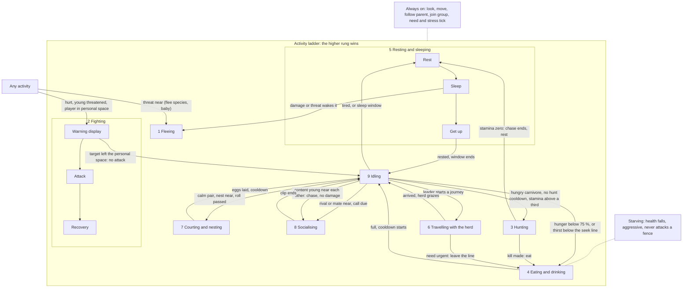

# Feature specs

Mirror of the shared page sub-tab "Feature specs" under "Beta and Release 1 project plan". Back to the [roadmap](../project-plan.md).

This page gives each feature in player terms: how it plays, what it looks and sounds like, its numbers, and what is still open. Art status lives only in the Art list.

## How to read this page

- **Cloning parity.** Cloning is 1:1 with the 2022 Cloning Guide video (https://youtu.be/W9cMQUB4EdM). Where the spec (`_Cloning Process.docx`) or a lead decision differs, the spec or the decision wins. Each machine feature lists its differences from the video.
- **Machine looks.** The video sets behaviour only: the flow, the timings, the screen contents and what each machine does. The look of each machine comes from the current models and textures (`geo/block/*.geo.json`, `textures/block/*.png`, `textures/gui/*.png`).
  - Each animation drives a bone that the current model has. If a part is missing, the spec adapts the animation to existing parts or lists an open question for the artist.
  - If the cubes exist but share a bone, a developer moves them into a bone of their own, with no art change.
  - A screen follows the video for its contents (slots, gauges, tabs, buttons, tooltips) and the current GUI texture for its art.
- **Motion.** Machine motion runs in code on game time, never on the frame rate. Every player sees the same motion.
- **Units.** 20 ticks = 1 second. 1 px = 1/16 block.
- **Not set and proposals.** "Not set" means that no source gives the value. "(proposal, lead decides)" marks a value that this page suggests. Neither is a requirement until the lead confirms it.
- **Art needed** names the things in the Art list. Only the Art list gives art status.
- **Today in the code** describes the current code only. Code never proves that a requirement is met.

## M1. Fossil to egg

M1 gives a survival player the whole lab chain: find fossils and amber, extract and edit DNA, synthesise an embryo, print and incubate an egg, and hatch a baby. All four machines are complete, with building, screens, upgrades, power, animations, sounds, recipes and art.

### F1.1 Fossils and amber

Fossil ore and amber hide in the right rock at the right depth, and each find carries a species, a quality and a DNA label.

#### At a glance

- **Learn where to dig.** Each species lies in its own biome groups and depth band. Deserts and badlands hold the most ore. Below y 35 the player finds only the Dilophosaurus.
- **See before you break.** The ore shows the bone piece and its quality before the player breaks it.
- **One fossil per break.** Fortune can raise the quality by one tier. Silk Touch drops the ore block.
- **Amber hides its species.** The amber item and its tube show "Unknown species". The species shows only when the Sequencer sequences the tube.
- **Fossil pouch.** The pouch collects fossils and amber by itself as the player mines.

#### Differences from the 2022 video

- Terracotta is not a host stone in Beta. Deepslate is. The video names stone, sandstone and terracotta.
- Amber is in Beta. The video shows no amber.
- Quality tiers, DNA labels and the pouch are new. The video fossil has a name only.

#### Fossil ore

- Fossil ore generates in stone, sandstone and deepslate.
- Four forms: single ore, small cluster, skeleton cluster, digsite deposit.
- One cluster holds one species. A skeleton cluster holds the bones of one animal.
- A skeleton cluster holds a piece above the card's "quantity max" in about 1 of 20 clusters.
- The ore shows the bone piece and its quality as an overlay, before the player mines it.
- **Overlay look:** it takes the host stone tint at a random strength of 0 to 90%. It has one of four opacity levels (15, 43, 72 or 100%) and a random rotation per block.

#### Drops

- One fossil per break. No jacket step: the broken ore drops the fossil at once.
- **Fortune** gives a chance of one tier higher, never more items. The chance is +7.5 % per Fortune level, so Fortune III gives +22.5 %. It is a config value inside the band of +5 % to +10 %.
- **Silk Touch** drops the ore block.

#### Fossil items

- A fossil item knows its species, piece, quality and biome.
- Name style: "Common Tyrannosaurus Skull Fossil".
- **Special pieces:** the skull, the tooth and the claw. They have species art and give 1.5 × the DNA of a bone of the same quality (config value).
  - Special pieces serve DNA and trades only. No recipe uses them.
  - Other bones use generic art.
- **Pelvis:** every species has a pelvis piece. The T. rex pelvis has its own art. The other species share one generic pelvis look.
- **Neck:** the T. rex has a neck piece. A T. rex skeleton cluster can hold a neck.

| Quality | Weight | DNA yield |
| --- | --- | --- |
| Fragmented | 40 | 5% |
| Poor | 20 | 7.5% |
| Common | 15 | 10% |
| Pristine | 4 | 30% |

- All weights and yields are config values.

#### Amber

- Amber ore drops an amber item. The item shows "Unknown species".
- The tube that the Fossil Processor makes from amber also hides the species. Sequencing reveals the species on the drive entry (F1.4).
- Beta has no Identification Tag.
- Amber has a random DNA yield from 0 to 80%, and no quality.
- The species rolls at the end of processing, from the species valid at its depth and biome.

#### DNA labels

- A test tube shows its DNA % in its tooltip only, not on the icon.
- DNA states: Unidentified, Identified, Full (just synthesised).
- Only an amber tube shows the Unidentified state, and it keeps that state. Its DNA becomes Identified only on the drive, when the Sequencer sequences it.
- A fossil tube and a DNA syringe show their species at once.

#### Rarity

- Rarity = ore rarity × period rarity × species share × piece share × quality share.
- Example: a pristine T. rex skull is about 1 in 200 T. rex ores.
- Species share: an equal share for each species that is valid at that depth and biome.
- Period rarity: Cretaceous 2.95, Jurassic 2.8. These are the example values of the periods table.
- If no species is valid for a depth and biome, the species of the nearest depth band applies. This rule covers amber and fossil ore.

#### Fossil generation per species

A biome cell gives the share of ore of that species in the biome group, in percent. A dash means no ore. A species never generates in a biome group that its row does not list. All values are config values, and playtests tune them.

| Species | Period and age | Depth | Desert | Badlands | Plains | Forest | Taiga | Hills | Swamp | River | Caves |
| --- | --- | --- | --- | --- | --- | --- | --- | --- | --- | --- | --- |
| Tyrannosaurus | Late Cretaceous, 83.6 to 65 Ma | y 40 to 75 | 75 | 75 | 35 | 15 | 15 | 8 | – | – | – |
| Triceratops | Late Cretaceous, 68 to 65 Ma | y 55 to 75 | 75 | 75 | 35 | 15 | 15 | 8 | – | 15 | 8 |
| Gallimimus | Late Cretaceous, 73 to 68 Ma | y 50 to 72 | 75 | 75 | – | – | – | – | – | 35 | 8 |
| Velociraptor | Late Cretaceous, 75 to 71 Ma | y 45 to 70 | 75 | 75 | 35 | – | – | 15 | 8 | 15 | 8 |
| Brachiosaurus | Late Jurassic, 154 to 150 Ma | y 35 to 55 | 35 | 75 | 35 | 15 | – | 15 | 8 | 15 | 8 |
| Dilophosaurus | Early Jurassic, 201.3 to 182.7 Ma | y −20 to 30 | 75 | 75 | – | – | – | – | – | 15 | 8 |

- The T. rex band, y 40 to 75, is fixed. The other Cretaceous bands spread around it by age: an older species lies deeper.
- The Dilophosaurus is the only Beta fossil in deepslate. From y 30 to 35, no Beta fossil generates.
- Biome groups use vanilla biomes. Biome tags let modded biomes join a group:
  - Desert: desert. Badlands: badlands, eroded badlands, wooded badlands. Plains: plains, sunflower plains.
  - Forest: forest, flower forest, birch forest, old growth birch forest, dark forest, pale garden.
  - Taiga: taiga, old growth pine taiga, old growth spruce taiga.
  - Hills: windswept hills, windswept gravelly hills, windswept forest, meadow, cherry grove, stony peaks.
  - Swamp: swamp, mangrove swamp. River: river. Caves: dripstone caves, lush caves.
- No Beta fossils: jungle, savanna, snowy biomes, ocean and beach, stony shore, mushroom fields, deep dark.

#### Fossil pouch

- 27 slots.
- It picks up fossils and amber by itself from any inventory slot.
- It merges equal fossils (same species, piece and quality) into one stack.
- The player can put fossils and amber into the pouch by hand. The pouch refuses all other items.
- Use the pouch on a Fossil Processor to move its fossils into the Processor's input. Hoppers feed the Processor directly, not the pouch, because the pouch is an item and not a block.
- **Screen:** a 3 × 9 grid like a vanilla chest (proposal, lead decides). The player takes fossils out and puts fossils in.

#### Sounds

- Vanilla stone break and item pickup sounds. No source asks for more.

#### Art needed

See Art list → Fossils and amber (ore overlays, fossil and amber sprites, pelvis), Lab items (fossil pouch, DNA looks).

#### Today in the code

- No worldgen runs. Fossil blocks exist for two species, drops are broken, and fossils hold 0% DNA.
- No amber, pouch or DNA labels.

**Engineering:** backlog F1.1.

**Changed since last review:** The pouch takes amber by hand and empties into the Processor on use. No hopper reaches the pouch. Ore overlay uses four fixed opacity levels. Every species has a pelvis piece. No Identification Tag: sequencing alone identifies amber. Fortune tier-up is +7.5 % per level. Per-species biome and depth table added.

---

### F1.2 DNA from animals

A syringe takes DNA or a bird embryo from a vanilla animal.

#### At a glance

- **Draw DNA.** The player right-clicks a vanilla animal with an empty syringe. The syringe fills with a random share of that animal's DNA.
- **It hurts.** The animal takes a small hit. Many draws can kill it.
- **Embryos.** A chicken, a parrot or a turtle in love mode gives an Embryo Syringe instead. Its tooltip names the donor.
- **Where it goes.** The DNA syringe goes straight into the Sequencer. The embryo syringe goes into synthesis (F1.6).
- **Not every mob.** Some mobs give no usable DNA.

#### Differences from the 2022 video

- The embryo syringe goes into synthesis, not into the Egg Printer.
- A draw hurts the animal a little. The video shows no damage.
- A turtle in love mode also gives an embryo. The video shows a chicken and a parrot only.
- Some mobs give no usable DNA.

#### DNA draw

- Input: an empty syringe, used on a living vanilla animal. Things that are not alive give nothing.
- Output: a DNA Filled Syringe with a random 0 to 100% of the animal's genome.
- Tooltip: "DNA Filled Syringe / Contains 64 Red Parrot DNA".
- **Damage:** 1 HP per draw by default. No cooldown. Draws can kill the animal. Example: 10 draws kill a 10 HP cow.

#### Embryo draw

- A chicken, a parrot or a turtle in love mode gives an Embryo Syringe. It holds the animal's embryo.
- One item serves all three donors. Its tooltip names the donor, for example "Embryo Syringe (Turtle)".
- An embryo draw has no effect on the animal: it stays in love mode and takes no damage.
- The Embryo Syringe and the dinosaur-embryo syringe (F1.6) are two items with their own looks.

#### Donors and variants

- Variants keep their own entries: each parrot colour, each tropical fish colour, each cat breed.
- Colour isolation needs the 15 tropical fish colours other than black.
- Allay, strider, tadpole, happy ghast and sulfur cube give no usable DNA. The tube says that the animal is not a donor.
- A draw from a non-donor or an object gives no DNA.
- Villager DNA gives every gene a random value each time it is used.
- No Identification Tag in Beta. An amber tube stays Unidentified until the Sequencer sequences it (F1.1, F1.4).

#### Animation and sound

- Vanilla item swing for the player. Vanilla hurt flash on the animal. No source asks for more.
- Syringe draw: no sound of its own. It plays an existing vanilla sound.
- Animal hurt: vanilla sound.

#### Art needed

See Art list → Lab items (syringe sprites).

#### Today in the code

- A syringe on a mob gives a random 0 to 100%, and the embryo draw works.
- No non-donor rule.

**Engineering:** backlog F1.2 (vanilla animals).

**Changed since last review:** Turtles give embryos. An embryo draw leaves the animal in love mode with no damage. No Identification Tag in Beta. The syringe draw uses an existing vanilla sound.

---

### F1.3 Fossil Processor

The Fossil Processor is the first machine. It turns a fossil or an amber into one DNA test tube, with sand and gravel as by-products.

#### At a glance

- **Build it.** The player builds the processor from four parts.
- **Load it.** The player fills its tank with water, puts in an empty test tube and a filter, and feeds one fossil.
- **Wait.** After 4 minutes a tube comes out with the species and the DNA %.
- **Upgrade it.** Better filters give more DNA. Better chips cut the time. Bigger tanks hold more water.
- **Automate it.** Hoppers and pipes can run it with no player.

#### Differences from the 2022 video

- The diamond tank holds 8 buckets, not 4. The video shows 4000 mB.
- One run gives one tube, and the result keeps decimals, for example 1.25%. The video shows whole "genetic data" counts of 2 and 5.
- By-products fill the 3 × 3 grid. The video shows only a tube.
- It accepts amber, works with hoppers and pipes, and needs power.

#### Building

- Build order: base, body, lid, tanks. The lid and the tanks can face either way.
- Look: the current model (`processor.geo.json`, texture `processor.png`).
- Each build step shows its placed part, so the base, drum and lid cap need bones of their own. Today their cubes sit in one root bone `FossilProcessor`. A developer moves them into their own bones, with no art change.

#### Screen

- Art: the current `gui/processor.png`. A standard 9 × 4 player inventory.
- A status bar runs down the left outside edge (F1.10).
- **Left column, top to bottom:** filter slot (grey mesh-disc outline when empty), bucket slot (grey bucket outline), tall slim water gauge with tick marks and animated blue water.
- **Top centre:** fossil slot. Under it, a down arrow that fills white with progress.
- **Under the arrow, left of centre:** 3 × 3 output grid.
- **Right column, level with the filter:** empty test tube slot (grey tube outline).
- **Tooltips:** arrow "3m 53s (3%)". Gauge "500mB / 2000mB". The filter icon shows a green wear bar.

#### Inputs and outputs

- One fossil or one amber at a time.
- An empty test tube.
- Water by bucket (the bucket comes back) or by pipe.
- A filter.
- Hoppers and pipes can feed all of them.
- **Output:** one DNA tube per run. Extraction never fails. The tube names the species and shows the DNA % with decimals.
- **By-products** in the 3 × 3 grid: about 70 % sand or gravel, 25 % iron or gold nuggets and 1 % diamond. That is about 1 diamond in 100 runs. Config values.

#### Numbers

- The fossil's DNA yield (F1.1) is the base. The filter adds a boost on top. Each better filter adds less than the one before.
- Tube DNA = fossil yield × filter multiplier: iron ×1.15, gold ×1.20, diamond ×1.25.
- As a filter wears, its boost shrinks to a quarter. A worn diamond filter gives ×1.0625.

| Fossil | Yield | Iron filter | Gold filter | Diamond filter |
| --- | --- | --- | --- | --- |
| Fragmented | 5% | 5.75% | 6% | 6.25% |
| Poor | 7.5% | 8.6% | 9% | 9.4% |
| Common | 10% | 11.5% | 12% | 12.5% |
| Pristine | 30% | 34.5% | 36% | 37.5% |

- Pacing: an average fossil gives about 9 % on a new iron filter, so about 6 fossils reach 50 % DNA.
- Water per run: a config value. The task plan proposes the start value, and playtests set it.

#### Upgrades

| Tier | Water tank | Run time (chip) | Power (chip) | Filter boost | Filter durability |
| --- | --- | --- | --- | --- | --- |
| Base | 2 buckets | 4 min | 20 FE/tick | – | – |
| Iron | 3 buckets | 3 min | 28 FE/tick | +15% | 150 runs |
| Gold | 4 buckets | 2 min | 44 FE/tick | +20% | 250 runs |
| Diamond | 8 buckets | 1 min | 92 FE/tick | +25% | 500 runs |

- A filter's boost wears down to a quarter of its starting boost. Boosts and durability are config values.
- **Tank tiers** change the model. Each tier shows its own bone: `base_tanks` (default), `iron_tanks`, `gold_tanks`, `diamond_tanks`.
- **Chips** are the 3 shared chips (iron, gold, diamond, F1.10). Each chip tier changes the look by a texture swap on an existing bone. No new part.

#### Power

- It uses power only while it runs. See the table for the power per chip tier (F1.11).

#### Animation

- None. No part of the model moves.

#### Sounds

- Run loop and run finished.
- Start and fault sounds.
- Each sound uses the Processor's own asset where one exists, and a generic lab sound for the rest. The artist also makes sounds of its own for each machine.

#### Faults

- With no power, water, tube or filter, or with a full grid, it stops and shows the reason.
- Fault smoke and dark model (F1.10).

#### Art needed

See Art list → Fossil Processor (models, tank looks, chip texture swap, sounds, screen), Lab items (machine part sprites, filters, chips, tank upgrades).

#### Open questions

- Chip look: which existing bone takes the texture swap for each chip tier? The artist proposes it, and the lead approves it.

#### Today in the code

- Runs on a 4-minute timer with a filter and a 2000 mB tank.
- It rejects amber, rounds the result, has no by-products or hopper support, draws no real power and does not animate.

**Engineering:** backlog F1.3.

**Changed since last review:** No Processor animation. Power per chip tier set. Water per run is a config value.

---

### F1.4 Sequencer: sequencing and drives

The player reads DNA samples onto a hard drive and watches each species fill toward 100%.

#### At a glance

- **Build and dye it.** The player builds the Sequencer from four parts and can dye it.
- **Insert a drive.** A Hard Drive or an SSD holds the DNA data.
- **Feed samples.** Each tube or DNA syringe adds its DNA % to that species on the drive. The empty tube or syringe comes back.
- **Plan genes.** The Isolated view shows which animals each gene still needs.
- **Share drives.** The drive keeps the data and can move to another Sequencer or another player.

#### Differences from the 2022 video

- The info card shows the real time period and diet. The video shows a placeholder ("Diet: Apple"), and the narrator says it is wrong.
- Variants and the biome share are new.
- Every black section takes dye. The video tints only two parts.
- The door opens with the screen. The video never shows the model with the screen open.
- The run uses up a sample's DNA, and the empty tube or syringe comes back for reuse.
- The monitor glows while the Sequencer works.

#### Building

- Build order: base, door, computer, monitor. The door and the computer go in either order. The monitor goes after the computer.
- Look: the current model (`sequencer.geo.json`, texture `sequencer.png`).
- Bones: `Sequencer` (base), `Door`, `computer`, `monitor_primary`, `mainBody`.
- Behind the door the model has a tube tray, 3 system racks and 4 chip cubes.
- **Dye:** right-click with any of the 16 vanilla dyes. Every black section takes the colour.

#### Screen

- **Art:** the current `gui/sequencer.png` (frame and tab shapes) and `gui/center_pieces.png` (ring arcs and "PN" logo).
- All three tabs show the "PN" logo with ring arcs in the middle. White Minecraft font.
- Status bar on the left outside edge, with a tick at its top while a process runs.
- Three tabs at the top: Sequence, Edit, Synthesis. The chosen tab is brighter.
- **Pop-ups:** clicking a slot opens a pop-up with a title and one slot: "Insert Hard Drive", "Insert Genetic Material", "Collect Leftover Item". The main screen dims.

##### Sequence tab

- A centred "Regular / Isolated" toggle under the tabs.
- Drive slot top left.
- Large list centre left, with rows such as "Tyrannosaurus: 100%". The hovered row is lighter, and a row is clickable.
- **Right side:** a turning 3D model of the hovered animal. Below it, text: name, time period and diet.
- **Bottom row:** input slot left (with count), a double-helix track, leftover slot right (with count).
- The helix fills from left to right with progress. Tooltip "9s (13%)".

##### Isolated view

- Left list of genes with % ("Immunity: 50%").
- Right list of the animals that the selected gene needs, with % ("Pig: 100%", "Turtle: 0%").
- Both lists scroll.

#### Sequencing

- **Drive:** Hard Drive or SSD.
- **Samples:** genetic material tubes and DNA syringes.
- The run uses up the sample's DNA. The empty tube or syringe returns to the leftover slot, and the player can use it again.
- Each sample adds its DNA % to its species entry, up to 100%. A second sample never resets progress.
- The drive records each biome's share of a species. Variants keep their own entries.
- **Amber:** an Unidentified amber tube adds its DNA to the entry of its hidden species. The drive entry names the species. Sequencing is the only step that identifies amber DNA.
- **Info card for a vanilla animal:** the time period "Modern" and the real diet of the animal. Each vanilla animal has a data entry for its diet.
- **Capacity:** no limit on a drive. The data lives on the drive item, so players can swap drives.

| Drive | Time per sample | Power while sequencing |
| --- | --- | --- |
| Hard Drive | 10 s | 20 FE/tick |
| SSD | 5 s | 42 FE/tick |

- It uses power only while it sequences (F1.11).

#### Animation and light

- **Door:** bone `Door` swings 90 degrees about Y on its hinge (pivot [23.5, 13.5, -2], a vertical door edge).
  - It opens while any player has the screen open, and closes when the last player leaves.
  - Each swing takes half a second. The open door shows the racks and chips inside.
- **Screen:** the arc rings turn slowly, one turn per 20 s. The helix grows with progress.
- **Monitor glow:** a lit texture on bone `monitor_primary` while the Sequencer works.

#### Sounds

- Door open and close, run loop, sample done (proposal, lead decides).
- Each sound uses the Sequencer's own asset where one exists (the run loop), and a generic lab sound for the rest. The artist also makes sounds of its own for each machine.

#### Faults

- With no power it stops and shows the reason (F1.10).

#### Art needed

See Art list → Sequencer (models, dye mask, lit monitor, door animation, sounds, screen frame, Sequence tab, info card), Screens (GUI) (pop-up slot dialog, status bar), Lab items (Hard Drive, SSD).

#### Today in the code

- Sequencing works and writes to the drive.
- Variants and the biome share are missing. Colour completion stays at 1/16.
- The card shows "Cretaceous / Apple". No dye. The door shows or hides but never opens.

**Engineering:** backlog F1.4.

**Changed since last review:** The monitor stays as a fourth build part. Amber is identified only by sequencing. Vanilla animals show "Modern" and their real diet. Power per drive set.

---

### F1.5 Sequencer: gene editing

The player designs the dinosaur: base species, donor animals, gender, colours and isolated genes, and sees the risk before synthesis.

#### At a glance

- **DNA gates.** At 50% the player can clone, pick donor animals and move their sliders. At 70% the player can edit genes. At 80% the chosen gender is sure. Attack and defense edits need 90%.
- **Edit slots.** A new drive has 2 edit slots. Each 3 clones hatched from it add one more.
- **Live preview.** A turning preview shows size and colour changes at once.
- **Advanced view.** Isolated genes get a slider or a list.
- **Risk panel.** It shows the chance of incubation failure and the stat trade-offs before the player commits.

#### Not in Beta

- Data-pack editing of genes. Gene effects live in code in Beta.

#### Differences from the 2022 video

- Editing needs 70%. The video edits at 50%.
- At most 3 donors, opening at 50, 75 and 100%. The video shows 3, 5 and 9 rows at 50, 55 and 100%.
- Below 80%, gender has a 30% chance of a random result. The video says it is always random.
- Colour has two modes, and each layer has saturation, opacity and tint strength. The video has hue and lightness only.
- The risk panel is new.
- Attack and defense edits need 90%, and clones hatched unlock more edit slots. The video has no such gates.
- The square donor toggles in the video are a prototype, "not how it will be in the release". Beta uses a row click and an animal click.

#### Screen

##### Basic view

- **Left:** stacked rows. Each row is a small square slot (blue when chosen) and a slider with the % in the middle.
  - Row 1 is the base dinosaur. The rest are donor rows. Hover shows the donor name.
- **Donor pick:** the player clicks an empty donor row, then clicks an animal in the DNA list on the right. The player drags the slider of the row to set its share.
- **Centre:** a framed 3D preview that turns slowly, with a Steve model beside it for scale.
  - The whole animal fits inside the frame at every size. Nothing is cut off.
  - The player can turn the preview. The Steve model reacts and does not hold one fixed pose (D277).
  - Below 30 % DNA the animal shows obscured, for example black with no texture and a light censor effect (D277).
- **Right:** a framed list of sequenced animals. The chosen row is solid blue.
- **Bottom:** a wide panel with two columns of effect rows.
  - Each title is green (plus), red (minus) or white (zero), with a colour bar under it.
  - Two small donor-colour swatches sit on the bar. Click one to send it to the primary or the secondary layer. The swatch swap stays.
- A button at the top left switches between Basic and Advanced.

##### Advanced view

- **Left:** chromosome grid, 4 columns by about 22 rows of small bars. Hover shows the gene name.
  - Dull cyan = locked. Purple = isolated, can edit. Red = selected.
- **Right of the preview:** the control for the selected gene.
  - Gender: a button that cycles Male, Female, Random, and a "Reset Gene" button.
  - Number gene: title, a box with the %, a slider in a limited range.
  - Choice gene (skin, special gene): a list.
- **Colour:** primary and secondary mode by default, and a mode for each layer.
  - Each layer has a colour wheel with a brightness strip, plus saturation, opacity and tint strength.
  - Claws, teeth, nostrils, eyes and mouth are not listed.

##### Risk panel

- It shows the chance of incubation failure, the stat trade-offs and the chance of abnormal behaviour.
- It shows chances only, never the rolled result.
- Position: a strip under the effect panel in both views, and a one-line summary on the Synthesis tab.

#### DNA gates and slots

| DNA % | What unlocks |
| --- | --- |
| 50% | Clone. First donor slot. Donor sliders move |
| 70% | Gene edits. Gene sliders unlock |
| 75% | Second donor slot |
| 80% | Chosen gender is sure. Below 80%, 30% chance of random |
| 90% | Attack and defense edits |
| 100% | Third donor slot (maximum 3) |

- Base and donors total 100%. All gates are config values.
- The player picks one option in each gene category.
- **Clone-count limit:** a new drive starts with 2 edit slots. Each 3 clones hatched add one edit slot.
  - The hard drive stores the count, so a shared drive shares its unlocks.
  - The count counts hatches. Each egg remembers its drive. After a hatch, the drive count rises the next time that drive is in a Sequencer.

#### Gene values

- Gene values come from the "Vanilla Animal DNA Effects" table.
- A donor at 50% share gives its full table value. A smaller share scales it down in a line. An unsigned table value is an increase.
- **Gene slider range by DNA %:** ±10 % of the species base at 70 %, growing in a line to ±30 % at 100 %. Example: ±17 % at 80 %.
- Every gene group changes the animal: core stats, needs, behaviour, breeding and survival.
- A strong jump edit can clear the 3-block low-security fence. The jump cap stays below the 8-block high-security fence.
- Mob variants change colour only, never genes. Green parrot DNA gives a raptor a green colour shift. No skin has the name "Delta".
- The cosmetic extras of the older design doc stay: turtle DNA gives a greener skin, and rabbit DNA raises the albino chance. Stat numbers come only from the new donor table.

#### Risk

Risk curves are config values that playtests tune.

- **Incubation failure** = 25 % × (donor share ÷ 50 %)² + 2 % per edit.
- **Abnormal behaviour** = 10 % × (donor share ÷ 50 %)² + 1 % per edit.
- **Trade-off strength** is the share of a stat gain that its paired stat loses. It is 20 % + 60 % × (donor share ÷ 50 %)² + 5 % per edit, at most 100 %.
- Example: a 40 % bee donor with no edits gives 16 % failure, 6 % abnormal behaviour and 58 % trade-off.

**Stat trade-offs** come in five pairs. They grow with donor share and edit count.

| Gain | Cost |
| --- | --- |
| Speed up | Lower maximum health |
| Strength up | Higher hunger |
| Size up | Lower speed, higher hunger |
| Defense up | Lower speed |
| Health up | Lower regeneration |

**Abnormal behaviour** is a separate list. A risky genome can roll one entry at hatch:

- Stresses easily (threshold −20).
- Flipped day and night.
- Loner (maximum group 1).
- More aggressive (+30 %, still warns).

#### Animation and sound

- The preview turns slowly and shows size and colour changes at once.
- Vanilla button clicks. No source asks for more.

#### Limits

- No edit gives -100% size.
- Sliders reach their maximum.
- The total never passes 100%.
- The game checks every edit.

#### Art needed

See Art list → Sequencer (Edit tab: base page, effect panel, chromosome grid, gender and reset buttons, colour wheel, number slider, risk panel, Basic and Advanced button).

#### Today in the code

- The edit tab is a prototype.
- The preview cuts off large animals and does not turn. The Steve model looks up in one fixed pose.
- The game does not check edits and does not save layer colours.
- Only gender and size change the animal.

**Engineering:** backlog F1.5.

**Changed since last review:** Donor pick by row click then animal click. A strong jump edit can clear the low-security fence. Gene slider range and risk curves set. Clone-count edit slots added. Mob variants change colour only.

---

### F1.6 Sequencer: synthesis

The Sequencer joins the designed genome with a bird embryo and makes a dinosaur-embryo syringe.

#### At a glance

- **Fill four tanks.** Water, sugar, bone matter and plant matter.
- **Start the run.** The player inserts a bird-embryo syringe, checks the risk summary and presses Begin.
- **Watch it grow.** A glowing embryo picture fills from the bottom over 10 minutes.
- **Collect.** The output is a syringe with a dinosaur embryo that carries the genome.
- **Cancel is safe.** Cancel gives back the syringe and the unused ingredients.

#### Differences from the 2022 video

- The input is a bird-embryo syringe, not an empty test tube.
- The output is a dinosaur-embryo syringe, not a "Tyrannosaurus Test Tube".
- The tooltip shows the donor mix, edits, failure chance and gender. The video shows size, speed, colour hex codes and gender.
- It needs power.
- A Diamond Chip also speeds up synthesis. The spec gives synthesis no diamond chip.

#### Screen

- Same frame as F1.4.
- **Four corner groups:** Water top left, Sugar bottom left, Bone Matter top right, Plant Matter bottom right.
  - Each has a slot above its label and a long bar below it.
  - A full bar is bright cyan. An empty bar is a dark track.
- **Centre:** a large glowing outline of an embryo curled inside a DNA helix. It fills with bright cyan from the bottom up as the run goes.
- **Top centre:** a "Begin" button. It reads "Cancel" while running.
- **Bottom:** input slot, a right arrow that fills cyan, output slot. Tooltip "9m 59s (0%)".
- **Pop-ups** when a slot is clicked: "Insert Water", "Insert Bone Matter", and "Insert Syringe" in place of "Insert Test Tube".
- The risk summary shows before the player presses Begin.

#### Inputs

- Water (bucket or pipe), sugar, bone matter, plant matter, a bird-embryo syringe.
- The genome comes from the Edit tab.
- **Bone matter:** bone meal, or a bone block that counts as 9 bone meal.
- **Plant matter:** an item tag list in config. Leaves, saplings, wheat, kelp, grass, flowers, and the same items of other mods.
- The input slot accepts only DNA at or above the clone threshold, so a run cannot fail at the start.
- **Ingredients per run:** the task plan reads them from the video at 7:20-7:35 as config defaults. Playtests set them. The video bars fall during a run: Sugar 48 to 40, Plant Matter 60 to 58.

#### Output

- A syringe with a dinosaur embryo that carries the genome.
- Shift on the tooltip shows the breakdown: species, donor mix, edits, failure chance, gender ("may be random" below 80%).

#### Tiers

| Tier | Tank size | Water / each matter (buckets / items) | Run time (chip) | Power (chip) |
| --- | --- | --- | --- | --- |
| Base | 100% | 1 / 16 | 10 min | 20 FE/tick |
| Iron | 150% | 1.5 / 24 | 7 min | 30 FE/tick |
| Gold | 200% | 2 / 32 | 4 min | 55 FE/tick |
| Diamond | 250% | 2.5 / 40 | 2 min | 115 FE/tick |
| Netherite | 300% | 3 / 48 | – | – |

- Water fills in half-bucket steps.
- Netherite is a tank tier only. There is no netherite chip.
- It uses power only while it runs (F1.11).

#### Upgrade looks

Every upgrade changes the look.

- **Chips:** the 3 shared chips (F1.10). Chip tiers use the 4 chip cubes in the current model (`computer_chip01` to `04`, inside `mainBody`).
  - More chips show at higher tiers (proposal, lead decides).
  - A developer moves the chip cubes into bones of their own, with no art change.
- **Tank tiers:** a texture swap on an existing bone. No new part.

#### Animation

- Screen only: the embryo fills, the arrow fills, the rings turn. No model motion.

#### Sounds

- Synthesis loop and synthesis done (proposal, lead decides).
- Begin and Cancel: vanilla click.
- Each sound uses the Sequencer's own asset where one exists, and a generic lab sound for the rest. The artist also makes sounds of its own for each machine.

#### Faults and cancel

- With no power or a missing ingredient it stops and shows the reason (F1.10).
- Cancel gives back the bird-embryo syringe and the ingredients that the run did not use.
- A cancelled run uses no DNA from the drive.

#### Art needed

See Art list → Sequencer (Synthesis tab, sounds, computer pieces per chip tier, tank texture swap), Lab items (syringe with bird embryo, syringe with dinosaur embryo, netherite tank upgrade).

#### Today in the code

- Synthesis runs for 10 minutes with 500 mB of water and 8 each of bone meal, sugar and plant matter.
- It gives a test tube, and a crafting recipe makes the egg.
- Water tiers and the netherite tank do not match the spec.
- The diamond chip has a synthesis time of −1, so the Sequencer refuses it.

**Engineering:** backlog F1.6.

**Changed since last review:** A Diamond Chip cuts synthesis to 2 minutes. Bone blocks count as 9 bone meal. Cancel returns unused ingredients and uses no DNA. Power per chip tier set.

---
### F1.7 Egg Printer

F1.7 is a 3D printer that builds an egg around the embryo, layer by layer, in front of the player.

#### At a glance

- **Build.** The player builds the printer from a base and three parts.
- **Load.** The player loads bone meal and the dinosaur-embryo syringe.
- **Print.** The needle sweeps back and forth over the platform. The species' egg grows from the bottom up for 10 minutes.
- **Output.** The unincubated egg and the empty syringe come out.
- **Idle.** An idle printer shows a ghost egg outline.
- **Failure.** One print in ten fails unless a Leveling Sensor is installed. The egg breaks with an effect and the embryo dies. The player gets a cracked artificial egg, the bone meal and the empty syringe.

#### Differences from the 2022 video

- The output is the unincubated egg. The video's crafting step that joins an artificial egg and a test tube (video 12:22-12:45) is removed. The artificial egg stays only as the failed-print result, the cracked artificial egg.
- The syringe carries a dinosaur embryo from synthesis. The video loads a bird-embryo syringe (video 11:38).
- The platform lowers only 0.5 px as the egg grows, because the current model has no more room below `Panel`. The original lowered it one egg length (6.5 px).

#### Building

Match the build order of video 11:12-11:33.

- **Order.** Base first. Then needle, platform and body in any order.
- **Model.** The current model `egg_printer.geo.json`, texture `egg_printer.png`. Bones: `Printer` (root), `Panel` (platform), `Body`, `Egg`, `Door` (glass lid).
- **Parts in the model.** Platform = bone `Panel`. The base, the body, the cross-rail and the needle are cubes inside bone `Body` today. A developer moves them into bones of their own, with no art change.

#### Screen

Match the screen of video 11:35-12:18.

- **Art.** The current `gui/egg_printer.png`, `bonemeal_bar.png` and `egg.png`. The status bar is at the far left (F1.10).
- **Left column, top to bottom.** Bone meal gauge, bone meal slot, syringe slot.
- **Centre.** A large egg picture. Thin progress lines along its top and bottom edges grow with the print (low confidence).
- **Right column.** Egg output slot on top, empty-syringe slot below. Tooltip "10m 0s (0%)".

#### Inputs, outputs and numbers

| Aspect | Value |
| --- | --- |
| Inputs | Bone meal and a dinosaur-embryo syringe |
| Outputs | Unincubated egg and the empty syringe |
| Failed print | Embryo dies. Cracked artificial egg, the bone meal and the empty syringe come out |
| Bone meal | 16 per egg, so a stack of 64 prints 4 eggs. Config value |
| Time | 10 min. Iron chip 8 min, gold 6 min, diamond 4 min |
| Failure chance | 10 % without the Leveling Sensor, 0 % with it |

#### Upgrades

- The Leveling Sensor sets the break chance from 10 % to 0 %.
- Chips (the 3 shared chips, F1.10) set the time.
- Each upgrade changes the look. The chips and the sensor each get a texture swap on an existing bone. No new part.

#### Power and light

- It uses power only while it prints: 20 FE per tick at base tier. Iron chip 26, gold 37, diamond 58 FE per tick.
- The Leveling Sensor costs no extra power (F1.11).
- The lamps of the current texture glow while it prints. The green lamp is lit while it prints.
- The red lamp is lit while a fault stops it (proposal, lead decides).

#### Animations

Match the print motion of video 11:46-12:01.

- **Needle raster.** While it prints, the needle moves along X on the cross-rail, and the cross-rail moves along Z on the side rails.
  - Each moves 2 px each way as a triangle wave.
  - X makes one back-and-forth per 20 ticks. Z makes one per 4 ticks.
  - Both rest in the centre when idle.
  - A developer first moves the needle and cross-rail cubes out of `Body` into bones of their own, with no art change.
- **Platform.** Bone `Panel` lowers with progress while a job runs or an egg waits in the output. It lowers 0.5 px at most.
- **Egg.** The species' egg model (F1.9) with the printed texture builds from the bottom up on the platform as the print goes. The cut face is solid cream (#F7F1DD). At the end the egg rests on `Panel`.
- **Idle.** With no job and no egg in the output, the platform shows a ghost egg outline.
- **Lid.** Bone `Door` turns 60 degrees about X on its hinge, pivot [8, 16.62, 7.17] (the back top edge). It stays open while any player has the screen open or an egg waits in the output.
- **Smoothing.** Each part moves smoothly to its new position in half a second.

#### Effects and sounds

- **Failed print.** The egg on the platform plays an egg-break effect.
- **Sound events (proposal, lead decides).** Print loop, lid open and close, print done, egg breaks.
- **Sound assets.** Each sound uses the printer's own asset where one exists, and a generic lab sound for the rest. The artist also makes sounds of its own for each machine.

#### Failure

- 10 % chance of a failed print without the sensor.
- With no power it stops and shows the reason.

#### Art needed

See Art list → Egg Printer (models, texture swaps, ghost egg, animations, sounds, screen) and Lab items (machine part sprites, Leveling Sensor). Also Eggs and hatching (printed egg textures, egg-break effect, egg sprites).

#### Open questions

- Which existing bones take the texture swaps for the chips and the Leveling Sensor? The artist proposes them, and the lead approves them.

#### Today in the code

- It prints from an embryo syringe and 16 bone meal to an artificial egg, with a 10 % crack chance.
- The sensor and the chip are not saved. Nothing in the model moves.

**Engineering:** backlog F1.7.

**Changed since last review:** Output is the unincubated egg. A failed print gives a cracked artificial egg. Platform lowers 0.5 px. Chips and sensor get texture swaps, no new part. 16 bone meal per egg. Power draw per tier set.

---

### F1.8 Incubator

F1.8 is a warm nest under a glass lid where a robot arm turns the eggs until they are ready to hatch.

#### At a glance

- **Build and feed.** The player builds the incubator from its parts, adds leaves as plant matter and keeps it powered.
- **Lamp.** Its built-in lamp is the base bulb. Bulbs make it faster and brighter.
- **Place eggs.** The player drags each egg to a spot on the bed in the screen.
- **Turning.** Every 5 minutes each egg gets a turn. The lid opens, the arm reaches the real egg, rolls it over and folds back.
- **Stall.** Without power or plant matter it stops. An egg stalled for 5 minutes dies.

#### Differences from the 2022 video

- It needs power and plant matter, and a stalled egg dies. The video shows none of this.
- Incubation can fail from genome risk. The video shows no failed incubation.
- The hot bulb takes 15 minutes. The narrator says "50 minute" at video 14:28, a speech error.
- Each egg turns every 5 minutes. The original used a timer of about 30 s that each player saw differently.
- The build has no lift part. The current model has no lift post, and the lid lifts without one. The video builds a lift (video 12:45).

#### Building

Match the build of video 12:34-12:54, without the lift.

- **Parts, in order.** Base, nest, lid, arm base, arm. 5 parts. Only placed parts show.
- **Arm side.** The arm sits on the left as the player faces it.
- **Model.** The current model `incubator.geo.json`, texture `incubator.png`. Bones:
  - `body`, `nest`, `arm_base`.
  - `cover`: glass dome, lamp cap, two small tabs on one edge.
  - The arm chain `RoboticHand1` to `RoboticHand6` with a two-finger claw.
- **Glass.** It stays see-through with shaders.
- **Nest.** An empty bed: an iron tray with no wool and no hay. The bed stays empty until the player fills it with plant matter.

#### Screen

Match the screen of video 12:50-13:32.

- **Art.** The current `gui/incubator.png`. Status bar on the left (F1.10). Player inventory below.
- **Bed pane.** One large pane at the top. Eggs show as small egg markers at their real bed spot.
- **Plant matter.** Bottom left of the pane: a plant icon (a sprout outline when empty), the plant matter count and a long bar. Adding leaves plays a small icon and bar animation.
- **Bed fill.** The bed in the pane fills with plants as plant matter goes in, as in 1.12: bare wood when empty, then dark green, then leaves when full. It empties as the plant matter drains.
- **Placing.** Holding an egg over the pane turns it bright green where the egg can go and red where it cannot. A placed egg can be dragged to a new spot.
- **Egg tooltip.** Name, progress %, time left, "Press shift for DNA breakdown". Time left stops at 0.

#### Inputs and outputs

- **Inputs.** Unincubated eggs placed by the player. Plant matter from the plant matter tag list of F1.6. Power.
- **Lamp.** The built-in lamp is the base bulb. The machine runs with no bulb item. A bulb item is an upgrade.
- **Outputs.** Incubated eggs, taken from the bed.

#### Capacity and timing

| Upgrade | Eggs | Plant matter |
| --- | --- | --- |
| None | 3 | 100 |
| Small container | 6 | – |
| Large container | 9 | – |
| Iron plant tank | – | 150 |
| Gold plant tank | – | 200 |

| Lamp | Time | Per % | Power (FE per tick) | Light level |
| --- | --- | --- | --- | --- |
| Base lamp | 30 min | 18 s | 20 | 9 |
| Warm bulb | 25 min | 15 s | 25 | 11 |
| Warmer bulb | 20 min | 12 s | 33 | 13 |
| Hot bulb | 15 min | 9 s | 46 | 15 |

- Every species takes 30 minutes at the base lamp. The time is a config value, and playtests tune it.
- Plant matter drains per machine, not per egg. The rate is a config value, and playtests set it.
- It needs power to run. Containers and plant tanks cost no extra power (F1.11).
- It gives light only while it incubates. The lead asked for light when powered: D280 sets whether a powered Incubator with no egg glows.

#### Upgrades

- The bulb changes the lamp glow: an emissive texture per tier on the lamp cap of `cover`, with no new part.
- Each tier glows in a colour of its own, and the glow grows stronger with the tier (D280).
- Every upgrade changes the look. Containers and plant tanks each get a texture swap on an existing bone. No new part.

#### Animations

Match the lid and arm of video 13:36-13:46.

- **Lid.** Bone `cover` lifts straight up 12.5 px.
  - It is up while a player has the screen open, while the arm works, and for 1.5 s after.
  - It is fully up before the arm reaches.
  - Each lift and each lowering takes 1 s with a sine ease.
  - The two small tabs on one edge of the lid do not change the lift.
- **When.** Each egg is due for a turn 5 minutes after its last turn, counted while it incubates.
  - The arm visits every egg. When any egg is due, the lid opens and the arm picks one due egg at random.
  - The game remembers each egg's last turn over a save and reload.
- **Reach.** The arm reaches the real egg wherever it lies, with no preset positions. Eggs lie at random tilts that show where the claw grips.
- **Turn.**
  - `RoboticHand1` turns the arm to the egg about Y.
  - `RoboticHand2` (shoulder, pivot [1.5, 21.5, 2]) and `RoboticHand3` (elbow, pivot [1.5, 28, 2.01]) reach as a two-link arm with 6.5 px links.
  - `RoboticHand4` (wrist, pivot [1.5, 28, 8.53]) points the hand at the egg and rolls the egg over in about 2.5 s. Then the arm lets go.
  - About 6 s for each egg. After the turn, the `RoboticHand1` turn gives a small settle shake.
- **Next egg.** The arm moves straight to the next due egg and repeats. The roll direction flips each time.
  - When no egg is due, the arm folds back home.
  - If the player takes the egg away, the arm goes home at once.
- **Speed.** Every arm move runs at an even speed. No ease in or out.
- **Claw.** The two fingers `RoboticHand5` and `RoboticHand6` (pivots [2.99, 28, 10.5] and [0.01, 28, 10.5]) turn about Y in opposite directions. They open while the arm reaches, close to grip, and open at release.

#### Sounds

- **Events (proposal, lead decides).** Arm move, heater hum, lid up and down, egg placed, egg done.
- **Assets.** Each sound uses the Incubator's own asset where one exists (the arm move), and a generic lab sound for the rest. The artist also makes sounds of its own for each machine.

#### Failure

- Without power or plant matter, incubation stops. The screen shows "No power" or "No plant matter".
- An egg stalled for 5 minutes dies. Config value.
- Incubation failure rolls at 100 % from the genome risk.

#### Art needed

See Art list → Incubator (models, texture swaps, animations, sounds, screen), Lab items (bulbs, container upgrades, plant tank upgrades, machine part sprites).

#### Open questions

- Which existing bones take the texture swaps for the containers and the plant tanks? The artist proposes them, and the lead approves them.
- The arm links are 6.5 px each. Does the reach cover all 9 bed spots? If not, the bed spots move inward or the artist scales the arm.

#### Today in the code

- It holds 3 eggs only, because the container upgrades are plain items.
- 18 s per %, with bulbs at 15, 12 and 9 s. Plant matter 64, 128 and 192. No power draw.
- The arm, the lid and the eggs never move or show. The renderer only shows or hides `nest`, `cover`, `arm_base` and `RoboticHand1`.

**Engineering:** backlog F1.8.

**Changed since last review:** 5 parts, no lift. Empty nest bed. Built-in lamp is the base bulb. Each egg turns every 5 minutes. Claw fingers move. Power and light per bulb tier set. Stalled eggs die.

---

### F1.9 Eggs and hatching

F1.9 gives each kind of dinosaur a real egg that rocks while it incubates, cracks on the ground, and hatches a baby that nobody has seen before.

#### At a glance

- **Egg models.** Each species has its egg model from the asset repo, with a printed or a natural texture.
- **Incubation.** In the incubator each egg rocks now and then.
- **Hatch.** The player places the incubated egg on the ground. It starts to shake at once, then shakes harder and cracks in stages.
- **Baby.** 60 s after placing, a baby steps out at the start of its growth.
- **Physics.** Dinosaurs can push a placed egg.
- **Variation.** The hatch rolls the clone's own variation and can fail.

#### Differences from the 2022 video

- The video spawns an adult at once on right-click (video 15:05-15:15). Beta places an egg that shakes, cracks and hatches a baby.
- A hatch can fail.
- In the video, each clone's look comes only from its edits. Beta adds a random roll at hatch.
- Eggs rock while they incubate. The video and the original have no egg wobble.

#### Egg models and items

| Species | Egg model (asset repo folder) |
| --- | --- |
| Brachiosaurus | `round` |
| Tyrannosaurus | `tyrannosaurus` |
| Triceratops | `tall_3` |
| Gallimimus | `normal` |
| Velociraptor | `velociraptor` |
| Dilophosaurus | `velociraptor` |

- **Natural egg.** One texture per species, in the colours of its species on the shared model.
- **Printed egg.** It has a QR-code mark. One texture per egg model, 5 in total, plus a species tint in code.
- **Placed egg.** It is an entity, not a block. Dinosaurs can push it.
- **Sprites.** The unincubated egg and the incubated egg have their own sprites.
- **Tooltip.** Species, donor mix, the player's edits, chance of incubation failure, chosen gender ("may be random" below 80%). No rolled traits. In the incubator it also shows progress % and time left (video 13:00).

#### Animations and timing

- **Wobble while incubating.** Each egg rocks gently side to side (about 4°) at a random moment every 30 to 90 s. The egg in the claw does not rock.
- **Lab egg.** 60 s from placing to hatching. The shake starts at once, with no wait before it.
- **Natural (nest) egg.** It waits 3 in-game days (72,000 ticks) after laying. Then the 60 s shake starts.
- **Before hatch.** The placed egg shakes, then cracks, in 3 stages of 20 s. Each stage rocks harder.

| Stage | Seconds | Rock interval | Look |
| --- | --- | --- | --- |
| 1 | 0 to 20 | Every 4 s | Whole egg |
| 2 | 20 to 40 | Every 2 s | First crack |
| 3 | 40 to 60 | Every second | Second crack and shell chips |

#### Hatch success

- Hatch success is a separate roll from incubation failure.
- A lab egg uses the lab hatch rate of its species. The species data holds it, apart from the nest rate. Config values, and playtests tune them.
- A nest egg uses the nest hatch rate of its species (F2.5). Config values.

| Species | Lab hatch start value | Nest hatch rate |
| --- | --- | --- |
| Tyrannosaurus | 75 % | 6 % |
| Velociraptor | 95 % | 25 % |
| Dilophosaurus | 95 % | 16 % |
| Gallimimus | 95 % | 15 % |
| Triceratops | 75 % | 11 % |
| Brachiosaurus | 75 % | 6 % |

- The lab start values go by size: 95 % for small species, 75 % for large species.

#### The hatchling

- A baby at the start of growth.
- The hatch rolls the clone's variation: stats, size by gender weights, layer colours, albino or melanistic at about 5%.
- The hatchling has no owner. It stays wild until a player tames it.

#### Effects and sounds

- **Effects.** Crack overlays per stage. Shell particles at the hatch.
- **Sounds.** Rock tap, crack per stage, hatch, broken egg. The 2020 board card "Egg" lists sounds and gives no names.

#### Failure and edge cases

- A failed hatch leaves a broken egg and remains.
- A failed nest egg is different: it cracks open, drops tissue and vanishes (F2.5).
- With no room for the baby, the egg waits and retries every 5 s. It tells players within 8 blocks on the action bar.
- A player who breaks a placed egg gets the egg item with its genome.
- An egg whose time passed while its chunk was unloaded hatches when the chunk loads.

#### Art needed

See Art list → Eggs and hatching (egg models per species, natural and printed egg textures, crack stages, wobble and shake, sounds, shell particle, egg sprites), each species (Sprites: species icon). The nest uses vanilla blocks (F2.5).

#### Open questions

- Egg models: the artist questions on the asset repo eggs are in the Art list (question 9). Example: the `normal` and `velociraptor` models have the same cubes, so the Gallimimus and raptor eggs have one shape.

#### Today in the code

- Right-clicking an incubated egg spawns an adult dinosaur at once.
- No egg model, no wobble, no hatch roll, and growth never starts.

**Engineering:** backlog F1.9.

**Changed since last review:** Egg models per species from the asset repo. Printed egg textures per model with a species tint. Lab hatch start values by size. Nest eggs wait 3 days, and a failed nest egg drops tissue. Hatchlings are wild.

---

### F1.10 Machine building, upgrades, linked tabs, faults

F1.10 sets the shared rules for every lab machine: it is built from parts, upgraded by hand, linked by screen tabs, and says clearly why it stopped.

#### At a glance

- **Build.** The player crafts each part and right-clicks it onto the base in order. The model grows piece by piece.
- **Upgrade.** The player right-clicks upgrades onto a machine, and the machine looks different.
- **Tabs.** With machines linked, the player moves between their screens with tabs and never closes the window.
- **Faults.** A stopped machine puffs smoke, goes dark and names the problem.

#### Differences from the 2022 video

- Tabs between linked machines are new. The video opens each machine on its own.
- Power, faults and warnings are new.
- Every part and upgrade has a survival recipe. The video uses the creative inventory.

#### Building

- Each machine is built from crafted parts in a set order, by right-clicking each part onto the machine. Each placed part shows as a bone of the current model.
- Orders per machine are in F1.3, F1.4, F1.7 and F1.8.
- Part names follow the video: Base, Needle, Platform, Body (Egg Printer). They do not use the design doc's Chassis, Lid, Printer Frame and Dome.
- A creative-only item places a whole machine. D281 sets what the placed machine holds.
- Parts can be reused to build another machine. Breaking any part drops every item once.
- The hitbox matches the model. Breaking one machine never breaks its neighbours.
- Break particles use the machine texture and are fewer than today.

#### Upgrades

- **Install.** Right-click with the upgrade item. Replacing an upgrade gives the old one back. Example: a gold chip over an iron chip returns the iron chip.
- **Look.** Every upgrade changes the look, with no new part. The Processor tanks and the Sequencer chips use parts of the current models. Every other upgrade gets a texture swap on an existing bone.
- **Chips.** 3 shared chip items (iron, gold, diamond). Each fits the Processor, the Sequencer and the Egg Printer.
- **Cap.** At most 3 upgrades per machine. No machine has more than 3 upgrade slots today, so the cap limits nothing. No upgrade blocks another.

#### Power

- A machine with no power stops. A machine that does no work uses no power.
- Only chips and bulbs cost extra power. Each run of a faster tier costs more energy:

| Tier | Upgrades | Extra energy per run |
| --- | --- | --- |
| 1 | Iron chip, warm bulb, SSD | 5 % |
| 2 | Gold chip, warmer bulb | 10 % |
| 3 | Diamond chip, hot bulb | 15 % |

- Filters, the Leveling Sensor, containers and tanks cost no extra power.
- Power enters through any block of a machine. A generator or a conduit can touch any part (D276).

#### Screen

- **Tabs.** Tabs link the screens of linked machines. Linked machines are all machines on one conduit or generator network. The screen stays open on a switch.
- **Tab icons.** Bone (Processor), DNA (Sequencer), egg (Egg Printer), nest (Incubator). Each has an active and an inactive look.
- **Tab position.** Not set. A row of tabs along the top-left outside edge, in chain order, like vanilla creative tabs (proposal, lead decides).
- **Status bar.** The green bar on the left of every machine screen (video 1:07, 2:53, 11:38, 12:50). Its meaning is not stated. It shows stored energy, and the red tick shows "running" (proposal, lead decides).
- **Vanilla behaviour.** The world behind darkens like vanilla screens. Screens survive a window resize. Shift-click works.
- **Hover box.** Looking at a machine for a quarter second shows a small box near the crosshair, for example "Working 42 %" or the fault. It also lists the installed upgrades (D278).
- **Status display.** A panel floats above each machine. It shows the progress of each task: processing, sequencing, synthesis, printing, and each egg in the Incubator. The player turns it off and on (D278).
- **Power symbol.** A symbol on the machine screen and on the status display shows powered or unpowered (D278).

#### Faults and effects

- A stopped machine shows a warning tab with the reason: no power, no input, output full, wrong filter, no plant matter, no egg, species missing.
- There is no "No bulb" fault, because the Incubator's built-in lamp is the base bulb (F1.8).
- **Power loss.** 3 smoke puffs over 1 s and a dark model. One puff when it starts again.
- The working look stops 3 s after work stops.
- **Powered glow.** Chosen texture elements of each machine light up and animate while it has power (D279).

#### Sounds

- Part placed, upgrade installed, power lost, power back (proposal, lead decides).
- Tab switch: vanilla click.

#### Art needed

See Art list → Screens (GUI) (linked-machine tabs, pop-up slot dialog, status bar), Lab items (machine part sprites).

#### Today in the code

- Only the Incubator assembles part by part.
- No tabs, no warning tab, no fault smoke. Break drops are incomplete.
- The machines cause visible lag (lead playtest 2026-10-24). D282 sets a machine performance gate.

**Engineering:** backlog F1.10.

**Changed since last review:** Part names follow the video. 3 shared chips. Upgrades change the look with no new part. Extra power only for chips and bulbs. No "No bulb" fault.

---

### F1.11 Lab power

F1.11 is the lab's power: a fuel-burning Basic Generator and a power conduit run the whole lab.

#### At a glance

- **Fuel.** The player builds a Basic Generator and feeds it coal or any other furnace fuel.
- **Look.** Its flame glows, smoke rises and it lights the room while it burns.
- **Conduit.** A thin conduit cable carries the power to the machines.
- **Draw.** Machines draw power only while they work, and faster chips draw more.
- **Out of fuel.** The machines stop and say "No power".
- **Not in Beta.** No comparator output and no power meter block.

#### Differences from the 2022 video

- Power is new. The video machines run with no power source.

#### Building and fuel

- **Basic Generator.** One block.
- **Power conduit.** The mod's own thin cable block. Other mods' energy cables also work.
- **Fuel.** Any furnace fuel, burned at the furnace rate. One coal lasts 80 s. It burns while it has fuel, also with no load.

#### Output and network

- The Basic Generator makes 200 FE per tick while it burns. Its buffer holds 20,000 FE, 5 s of full output.
- It sends energy to conduits, machines and other mods' cables. Other mods' cables can take its full output.
- One Basic Generator runs all four machines at base tier plus a first paddock of about 10 fence posts. A post draws 10 FE per tick.
- **Overload.** When the demand on a network is more than its supply, the generator trips and stops. It stays off until the player removes load or adds a generator.
- **Conduit capacity.** A network has no capacity limit. It carries all the energy that its generators make.
- **Outside cables.** Other mods' cables connect to generators and machines only. Posts, pylons and conduits accept no outside cables.

#### Saving and unloaded chunks

- Generators and machines keep their stored energy over a reload.
- While a generator's chunk is not loaded, its fence keeps its last power state.
- When the chunk loads, the generator burns fuel for the time that passed. No forced chunk loading.

#### Screen, look and sounds

- **Screen.** Fuel slot, burning flame, energy bar. Layout not set (proposal, lead decides).
- **Animation.** The original has none. The flame glows while it burns. A smoke puff rises every 2 s (proposal, lead decides).
- **Light.** Light level 13 while it burns, like a lit furnace.
- **Hover box.** Always on. A client setting hides it.
- **Sounds.** Run loop, ignite, fuel out (events: proposal, lead decides). The generator gets sounds of its own.

#### Failure

- Out of fuel, the generator runs on its buffer for about 5 s.
- Then the machines stop and show "No power".
- The fence lamps fade post by post over about 2 s (F3.2).

#### Power numbers

All values are config values, and playtests tune them.

| Value | Basic Generator | Large Generator (F3.2) |
| --- | --- | --- |
| Output while it burns | 200 FE per tick | 800 FE per tick (4 ×) |
| Buffer | 20,000 FE (5 s) | 80,000 FE (5 s) |
| Burn rate | Furnace rate: coal 80 s | Half the furnace rate: coal 160 s |
| Energy per coal | 320,000 FE | 2,560,000 FE |
| Coal per in-game day | 15 | 7.5 |
| Posts it runs with no other load | 20 | 80 |

Machine draw in FE per tick, with the run time in brackets. Machines draw only while they work. A faster tier draws base × speed × run-cost factor. The factor is 1.05, 1.10 or 1.15, so each run costs 5, 10 or 15 % more energy. Burn times are config values.

| Machine | Base | Tier 1 (iron chip, warm bulb, SSD) | Tier 2 (gold chip, warmer bulb) | Tier 3 (diamond chip, hot bulb) |
| --- | --- | --- | --- | --- |
| Fossil Processor | 20 (4 min) | 28 (3 min) | 44 (2 min) | 92 (1 min) |
| Sequencer: synthesis | 20 (10 min) | 30 (7 min) | 55 (4 min) | 115 (2 min) |
| Sequencer: sequencing | 20 (Hard Drive, 10 s) | 42 (SSD, 5 s) | – | – |
| Egg Printer | 20 (10 min) | 26 (8 min) | 37 (6 min) | 58 (4 min) |
| Incubator | 20 (30 min) | 25 (25 min) | 33 (20 min) | 46 (15 min) |

- Lab peaks with all four machines at work: 80 FE per tick at base, 169 at tier 2, 311 at tier 3.
- Starter park: 4 base machines (80) and 10 low-security posts (100) need 180 of the 200 FE per tick.
- A second paddock of 10 posts with the lab at work needs 280 FE per tick. The Basic Generator trips.
- One Large Generator runs about 48 posts beside a tier 3 lab, and 72 beside a base lab.

#### Art needed

See Art list → Lab power (Basic Generator, flame glow and smoke, generator sounds, conduit).

#### Open questions

- Whether the catch-up burn after a chunk loads makes energy is an implementation choice. The developer decides it in the task plan.

#### Today in the code

- A coal generator gives 0.2 FE per tick (4 FE each second) and loses its energy on reload.
- Machines only pretend to draw power, so nothing uses it. No conduit exists.

**Engineering:** backlog F1.11 (machine power).

**Changed since last review:** Basic Generator makes 200 FE per tick with a 20,000 FE buffer. Overload trips the generator. Conduits have no capacity limit. Catch-up burn on chunk load. Machine draw per tier set.

---

### F1.12 Lab recipes and advancements

F1.12 makes every lab item craftable in survival, and its advancements guide the player from the first fossil to the first hatch.

#### At a glance

- **Recipes.** The player crafts every part, upgrade and tool from vanilla materials. Better tiers cost better metals.
- **Advancements.** They pop up at each step of the chain.
- **Goal.** A new player can reach a hatched baby with no creative mode and no trades.
- **Unlock.** The recipe book unlocks the lab parts when the player picks up the first fossil or amber.

#### Differences from the 2022 video

- All lab items have survival recipes. The video uses the creative inventory.
- The unincubated egg crafting recipe (video 12:22-12:45) is removed.

#### What has a recipe

- Every lab block, part, upgrade and tool has a recipe from vanilla materials. No part comes only from loot or trades.
- **Lab recipes:**
  - 17 machine parts: Processor 4, Sequencer 4, Egg Printer 4, Incubator 5.
  - Tank upgrades: iron, gold, diamond, netherite.
  - 3 filters, 3 shared chips, Hard Drive, SSD.
  - Syringe, test tube.
  - 3 bulbs, 2 container upgrades, 2 plant tanks, Leveling Sensor.
  - Basic Generator, power conduit, fossil pouch.
  - No Identification Tag.
- **No recipe.** Assembled machines (creative only), fossils and amber (world drops), machine outputs (tubes, filled syringes, eggs, the cracked artificial egg).
- **Bone meal.** A cracked artificial egg crafts into bone meal. The count is a proposal: 3 (lead decides).
- **Ids.** `basic_generator` replaces `coal_generator`, and `iron_plant_tank_upgrade` replaces `iron_plant_tank_ugprade`. A `*_base` part item starts each machine in survival.

#### Materials and cost

- The tier names iron, gold, diamond and netherite set the metal of each upgrade tier.
- The backlog section "Recipes and progression gates" holds every grid.
- No lab part uses a stone material. The parts are machines and computers smaller than a player. Quartz slabs take the place of smooth stone.
- The base machines need some gold and quartz slabs. So the first lab needs gold and a Nether trip for nether quartz.
- No recipe uses special pieces. Beta has no emerald tank, no netherite Processor tank and no Ender SSD.
- The four machines alone cost about 50 iron value, 4 gold ingots and 14 quartz slabs. Each machine has one gold ingot in its precision part.
- With the Basic Generator, the Hard Drive, the Iron Filter and a syringe, the first setup costs about 66.
- The player crafts each upgrade fresh. A higher tier never uses up the lower tier. One exception: the Netherite Tank Upgrade is a Diamond Tank Upgrade plus a netherite ingot.
- **Materials by use:**
  - Copper for wiring: Sequencer Monitor, conduit, Wire Spool, pylon, chips.
  - Blaze powder in the Hot Bulb.
  - Nether quartz in the quartz-slab parts, the SSD and the Leveling Sensor.
  - Netherite only in the Sequencer tank (300 %).
- **Output per craft.** 3 test tubes.

#### Trades

- The Paleontologist sells chips, the Hard Drive, the Gold Filter and lab machine parts (F4.1). So a player can skip the gold and quartz gate by trade.
- The no-trade route stays possible.

#### Advancements and creative tabs

- **Advancements.** First fossil, first amber, first DNA tube, first species at 50% genome, first edit, first embryo, first egg, first hatch, first fully upgraded machine.
- **Creative tabs.** Ordered by chain stage.
- **Creative variants.** The creative tabs hold each fossil in all four qualities, a dinosaur-embryo syringe and an incubated egg for each species, and the cracked artificial egg.
- **Acceptance.** A survival player reaches a hatched baby with no creative mode and no trades.

#### Art needed

See Art list → Lab items. Advancement icons reuse these item sprites.

#### Today in the code

- One recipe exists, the unincubated egg, and Beta removes it. No advancements.

**Engineering:** backlog F1.12 (lab items).

**Changed since last review:** 17 machine-part grids approved. No stone parts, quartz slabs instead. First lab needs gold and nether quartz. Upgrades crafted fresh except the netherite tank. Paleontologist trades. New ids. No Identification Tag.
## M2. Dinosaurs

M2 makes the six Beta species into living animals: Tyrannosaurus, Velociraptor, Brachiosaurus, Triceratops, Dilophosaurus and Gallimimus.

- Each species hatches small, grows smoothly, eats, drinks, rests, sleeps and leaves a carcass when it dies.
- Each species looks, moves and sounds like itself. It has its own skins, clips, sounds and effects, and never borrows another species' assets.
- Animals form herds and packs, pick leaders, breed and guard nests. They warn a player before they attack, and a calm animal can be tamed.

The milestone ends with a playtest: a paddock of each species shows every need, group behaviour and threat response.

The features: F2.0 Dinosaur behaviour (the model that ties the others together), F2.1 Species core, F2.2 Appearance, F2.3 Animations, sounds and visual effects, F2.4 Needs, F2.5 Groups, F2.6 The player, F2.7 Special genes and quirks.

### F2.0 Dinosaur behaviour

F2.0 is one model for everything a dinosaur does, what a well-kept dinosaur looks like, and how a park keeper sees that an animal is content or in trouble. It ties F2.4 (needs), F2.5 (groups) and F2.6 (the player) together and links to their rules by id.

#### At a glance

- **One thing at a time.** A dinosaur rests, eats, drinks, travels with its herd, calls, hunts, fights or flees. The more urgent activity wins: a fleeing Gallimimus does not stop to graze.
- **A daily rhythm.** A Gallimimus herd grazes and travels by day and lies down together at night. A fed T. rex patrols, sniffs the air and roars now and then.
- **Shared food.** A herd gathers around one feeder or one tree. Each animal takes its own place, and the others wait their turn. A content herbivore grazes in its spare time and leaves the grass in place.
- **Read at a glance.** Content animals sit, sniff, look around, graze and call softly. Hungry, thirsty, lonely or stressed animals pace to food and water, call more, sit less and turn aggressive.
- **Hover box.** Any player who looks at a dinosaur sees a mood face and the icon of the need it lacks most.
- **Neglect kills.** If the park keeps failing them, animals lose health and die. They never attack a fence. Only a T. rex breaks a fence, and only an unpowered one.
- **Escape.** A hyper-intelligent animal that notices a dead fence section walks there and climbs out.

#### Not in Beta

- Scent trails and the scent gene. A predator that loses sight of its target searches the last seen spot.
- Home territory. Animals defend only their personal space and their young.
- Turf wars.
- Fully aquatic swimming (no aquatic Beta species) and flight (Pteranodon is not in Beta).
- Enclosure space and block comfort as stress inputs.
- Disease.
- The Lysine Pills item.
- The cocoa allergy quirk of the parrot.

#### The six species

| Species | Diet | Sleep windows | Group (minimum, range) | Personal space | Answer to a threat |
| --- | --- | --- | --- | --- | --- |
| Tyrannosaurus | Carnivore | Cathemeral: 22:00 to 03:00 and 13:00 to 15:00 | 1, solo or pair of 1 to 2 | 10 blocks | Stands or retreats. Roar, then attack |
| Velociraptor | Carnivore | Cathemeral: 02:00 to 05:00 and 12:00 to 14:30 | 3, pack of 3 to 6 | 6 blocks | Stands or retreats. The leader screeches, then the pack attacks |
| Dilophosaurus | Carnivore | Cathemeral: 08:00 to 11:00 and 14:00 to 16:00 | 1, loose group of 1 to 3 | 6 blocks | Stands or retreats. Intimidate display and hoot, then spit |
| Triceratops | Herbivore, low plants | Diurnal: 22:00 to 06:00 | 4, herd of 4 to 6 | 8 blocks | Stands, roars and charges |
| Brachiosaurus | Herbivore, high leaves | Diurnal: 22:00 to 06:00 | 3, herd of 3 to 5 | 10 blocks | Defends: bellow, then tail whip and stomp. Never flees |
| Gallimimus | Omnivore | Diurnal: 22:00 to 06:00 | 6, herd of 6 to 12 | 5 blocks (startles at 6) | Flees. The herd bolts as one |

- A player near an animal's young or eggs provokes it at any distance it can see. Herbivores also guard their herd area.
- "Stands or retreats": a carnivore adds its group's threat to its own. It retreats from an attacker whose threat is more than 2 × its own.
- The personal-space radii are config start values by body size. Playtests tune them.

#### What a dinosaur can be doing

Each activity below is in Beta. "Ends when" names what stops it. The ladder after the tables says which activity wins.

##### Feeding

| Activity | Starts when | Ends when |
| --- | --- | --- |
| Eating (feeder, item, block, carcass) | Hunger falls below 75 % | Full. The cooldown starts |
| Drinking | Thirst falls below the seek line (75 %) | Full. The cooldown starts |
| Grazing and browsing (herbivores) | A hungry herbivore finds a free diet block in its height band | Full. The cooldown starts |
| Scavenging a carcass or dropped meat | A hungry carnivore finds a carcass or meat within reach | Full, or the carcass is empty |
| Eating together, waiting its turn | Mates reach one food source | Its turn ends, or the source is empty |

- Height bands: low plants for Triceratops, high leaves for Brachiosaurus.
- Feeders are shared by all animals of their diet. A herd gathers at one tree or plant patch, and each animal claims a different block. Mates share a carcass by feeding spots. See "Feeding together".
- Group feeding applies to all species. The source's size and the eaters' body widths set how many eat at once. Within a group the higher dominance eats first, then the longest wait.

##### Hunting

| Activity | Starts when | Ends when |
| --- | --- | --- |
| Hunting | A hungry adult carnivore with no hunt cooldown and stamina above a third picks prey by clade | Prey dies, prey is lost, or stamina reaches zero. A hunt cooldown follows |
| Hunting with the pack (Velociraptor pack, T. rex pair) | The pack leader picks prey. Members take flank places | The leader's chase ends, prey is lost, or under half the members still chase |

- A predator that loses sight of its prey first walks to the last seen spot and searches there.

##### Groups and movement

| Activity | Starts when | Ends when |
| --- | --- | --- |
| Travelling with the herd | The leader starts a journey every 2 to 5 minutes, or a need pulls it outside the herd area | The leader arrives, and the herd settles to graze |
| Keeping together (spacing, wedge, single file) | Always, while in a herd or pack | Never |
| Pack life between hunts (Velociraptor, 3 to 6) | Always, while in a pack | Never |
| Rank contest (no damage) | A member passes the leader in dominance (size, age, aggression gene), or the leader dies | One display each. The higher dominance leads |
| Following a parent, guarded by adults (baby) | Hatch | Grown past the young band |
| Walking, running, sprinting | Every move | n/a |
| Swimming and wading | Water deeper than its height is on its path | Back on land |
| Jumping and falling | A ledge, or the jump gene | Landing |

- A hungry pack journeys to find prey. Otherwise it roams its home area near its leader. It defends no home territory.
- A pack that loses its leader flees to safety first. Then the two members with the highest dominance contest the lead.
- Small animals go round deep water. Large animals wade.

##### Rest

| Activity | Starts when | Ends when |
| --- | --- | --- |
| Sleeping | Inside its sleep window, sleep need low, on dry ground, no threat near, not starving | The window ends, damage, or a threat in reach |
| Resting (lying down awake) | Tired, or a herd rest pause | Stamina recovers, or the leader gets up |
| Idling | Nothing else applies | Any other activity starts |

- Idling means standing, looking, sniffing, scratching and short sits. Herbivores also graze (see "Feeding together", idle grazing).

##### Conflict and moods

| Activity | Starts when | Ends when |
| --- | --- | --- |
| Warning display (every species) | A player or rival that the animal will attack | The clip ends. Then it attacks, or stops if the target left |
| Fighting | A target after a warning, or a hit on the animal | The target dies or leaves, or stamina reaches zero |
| Fighting back, guarding young and nest | The animal or its young is hurt or threatened | The threat leaves |
| Fleeing | A threat comes too near | The threat is far, or the flee time ends |
| Aggressive mood | Unmet needs or high stress, a player in its personal space, a player near its young, the aggression gene | Needs met and stress back down |
| Calm mood (between passive and aggressive) | Needs met, stress low | Stress rises, or a threat |

- Eggs count as young. A parent that sees a player near its eggs warns and attacks.
- These flee: the Gallimimus, babies, a pack below its minimum (from big threats), and a pack that lost its leader (to safety first).
- A fleeing species flees with no warning when a noticed player enters its personal space.
- A standing animal retreats from an attacker with more than 2 × its threat. A carnivore adds its group's threat to its own. The Brachiosaurus defends and does not flee.

##### Social life and breeding

| Activity | Starts when | Ends when |
| --- | --- | --- |
| Calling (warn, gather, threaten) | A threat, a journey start, a contest, or a lost mate | The clip ends |
| Contact and ambient calls | At the species call rate (see the healthy routines) | The clip ends |
| Socialising: contact calls, greeting a mate, keeping company | Mates near, idle time | Another activity starts |
| Play: content young chase each other (no damage) | Two content young of one species are near each other in idle time (proposal, lead decides) | Another activity starts |
| Courting and mating | A calm male and female, a built nest or a free laying spot near, the fertility roll passes | Mating is done. Both get a cooldown |
| Nest building and egg laying | A mated female, 1 in-game day (24,000 ticks) after mating | The clutch is laid |
| Tame commands: follow, stay, defend | Trust reaches the taming line | Hunger or stress breaks the bond |

- Babies call twice as often.
- Loneliness is a cause of stress, not a need of its own.
- Play uses existing clips only (run, Velociraptor pounce). No new clip.
- Mating has two more gates: full health, and no own young under half grown within 16 blocks.
- The female builds a nest from vanilla blocks of her surroundings, then lays her eggs in it (F2.5).
- Trust rises while a player is near a calm animal, and hand-feeding gives a big boost. Trust rises only while stress is below 20.

##### Which activity wins

When two activities can start, the higher rung runs. The "always on" layer runs beside every rung: looking, moving, following a parent, joining a group, and the need and stress tick.

| Rung | Activity | Why it is here |
| --- | --- | --- |
| 1 | Fleeing | A flee species or a baby that does not run first dies first |
| 2 | Fighting (warning, attack, guarding young) | Damage and a threat to young beat every need |
| 3 | Hunting | A hungry carnivore with stamina |
| 4 | Eating and drinking | Hunger and thirst |
| 5 | Resting and sleeping | Stamina and the sleep window |
| 6 | Travelling with the herd | The leader's journey |
| 7 | Courting, mating, nesting | Only a calm animal breeds |
| 8 | Socialising (calls, rank contests, greeting) | Group life when nothing is urgent |
| 9 | Idling | Fills all other time |

Rules that cut across the ladder:

- **Journeys.** When the leader's thirst falls below 75 %, the herd's next journey goes to water, and all drink together (F2.5, Herd travel). A herd member leaves the journey line only for an urgent need: hunger or thirst below 25 %. It eats or drinks, then rejoins. Fight chases are the other exception.
- **Rest on a journey.** A follower rests on a roaming journey only at critical stamina. On an urgent trip it rests whenever tired.
- **Sleep.** An animal that is starving or very thirsty (below 25 %) does not sleep. A threat in reach stops sleep and wakes a sleeper.
- **Tame "stay".** It blocks journeys, social moves and breeding only. The animal may walk to food and water, then it returns to its spot. It sleeps on its spot.
- **Tame rhythm.** A tame animal keeps its species rhythm. It sleeps in its window and calls. Follow pauses while it sleeps.
- **Lost target.** A predator that loses sight of its target walks to the last seen spot and searches there.
- **Alarms.** A startled herd member writes a herd alarm, so the herd flees as one. Alarm calls cross species: any herbivore that hears one becomes alert and reacts by its own rule. Groups never mix.

#### A healthy dinosaur

A healthy, needs-met dinosaur meets every part of this table at once.

| Part of "needs met" | Healthy when |
| --- | --- |
| Hunger | Never below 25 %. Back above 75 % after each meal, then a cooldown with no food search |
| Thirst | Never below 25 %. Back above 75 % after each drink. Seeks water at 75 %, runs to it at 25 % |
| Stamina | Above a third outside a chase. A herd leader is at 75 % or more when it starts a journey |
| Sleep | Sleeps in each of its sleep windows each in-game day. Damage or a threat does not wake it |
| Company | Its group near it has at least the species minimum (see "The six species") |
| Stress | In the calm band all the time |
| Food reachable | Its head reaches a diet source by a path its body fits (see below) |
| Water reachable | Water whose surface its head reaches, from a stand point it can walk to |
| Safe | No hunter or larger animal of another species targets it within 10 × 5 × 10 blocks. Not hurt in the last 2 minutes |
| Health | Full or regenerating, above the limp line (30 % health) |
| Contentment | In the content band (see "Contentment") |

- **Company.** "Near" means inside the herd area, or within 16 blocks for a pack or pair (16 blocks: proposal, lead decides).
- **Food reachable.** The source is plants in its height band, a feeder of its kind, or carcasses and meat. At a shared source it gets a feeding spot or a free block within its wait time (see "Feeding together").
- **Safe.** The threat box and the 2 minutes (2,400 ticks) also drive the sleep rule. A separate place memory makes an animal avoid the place where it was hurt for 1 in-game day.

##### Stress bands

The client gets three stress bands: calm, uneasy, stressed. Higher stress is worse (the design doc's "keep above 50" is a typo).

- Each species has one threshold in its species data, default 50, with no gender split.
- Stressed is at the threshold and above. Uneasy starts 20 below it. Calm is under that.
- With a threshold of 50: calm is 0 to 29, uneasy 30 to 49, stressed 50 to 100. Playtests tune the values.

##### Daily routine

**Time.** One in-game day is 24,000 ticks, 20 real minutes. Day time 0 is 06:00 on the in-game clock, 6,000 is noon, 12,000 is sunset (18:00), 18,000 is midnight. Daytime is 06:00 to 18:00, night is 18:00 to 06:00.

- The three herbivores are diurnal. They sleep 22:00 to 06:00 (16,000 to 24,000 ticks).
- T. rex, Velociraptor and Dilophosaurus are cathemeral. Each species has its own two windows, in its table below. They are config defaults, and playtests tune them.
- Each animal rolls a fixed offset of up to ±30 minutes (500 ticks) at hatch. A herd or pack uses its leader's offset, so the group sleeps together.
- A herbivore that the nocturnal gene shifts one step gets cathemeral windows of its own species (table below). It keeps its own windows and naps alone, also in a herd.
- The nocturnal window is 10:00 to 18:00 (4,000 to 12,000 ticks, 8 h), the same total as a diurnal sleep.
- Idle lists name only clips that exist or that the Art list already requires. Playtests tune the call rates.

**Windows of shifted herbivores.** Config start values. Playtests tune them.

| Species | Night window | Day window | Total sleep |
| --- | --- | --- | --- |
| Triceratops | 00:00 to 04:00 (18,000 to 22,000) | 11:00 to 13:00 (5,000 to 7,000) | 6 h |
| Brachiosaurus | 01:00 to 04:00 (19,000 to 22,000) | 15:00 to 16:00 (9,000 to 10,000) | 4 h |
| Gallimimus | 23:00 to 03:00 (17,000 to 21,000) | 09:30 to 11:00 (3,500 to 5,000) | 5.5 h |

A shifted Triceratops grazes in the late evening and at dawn, and rests through the midday heat. The largest herbivore sleeps least, because it browses for most of the day.

##### Tyrannosaurus (healthy routine)

| Aspect | Healthy behaviour |
| --- | --- |
| Active hours | Cathemeral. Sleeps 22:00 to 03:00 (16,000 to 21,000 ticks). Naps 13:00 to 15:00 (7,000 to 9,000 ticks). Config default |
| Daytime | Patrols its paddock at a walk. Stops to sniff the air and the ground. Drinks once or twice a day |
| Feeding | Eats at a feeder or carcass below 75 % hunger, then ignores food during the cooldown |
| Pair feeding | A pair shares one feeder or carcass. Both eat at once if there is room for two. If not, the leader eats first |
| Night | Lies down and sleeps with Zzz and bubbles. Snow cover in snow biomes. Wakes with a yawn and a shake, and patrols until dawn |
| Alone or in its group | Alone is normal. A pair keeps within 16 blocks. In a hunt, one chases and one circles to cut off the prey |
| Idle behaviours | Idle, look left and right, sniff air, sniff ground, shake head, shake body, scratch, speak, startled, breathing, short sit (rest), yawn, sneeze |
| Calls | Rare. A growl or call about every 5 minutes. A full roar only as a warning or contest |
| Pace | Slow, heavy walk (speed 0.50). Stalks at half pace with its stalk clip, sprints at 8 blocks. Screen shake near the player |
| Player near | Rolls to notice the player by distance and activity. A noticed player inside 10 blocks gets a roar warning, then an attack |
| Player leaves | A player who leaves during the roar is not hit. A player near its young provokes it at any distance it can see |

##### Velociraptor (healthy routine)

| Aspect | Healthy behaviour |
| --- | --- |
| Active hours | Cathemeral. Naps 02:00 to 05:00 (20,000 to 23,000 ticks) and 12:00 to 14:30 (6,000 to 8,500 ticks). Config default |
| Daytime | The pack roams behind the leader in a wedge and naps together. Members sniff, look around and keep a few blocks apart |
| Feeding | The pack shares one feeder or carcass. The leader eats first, then the others by rank and wait time, as many as the source has spots |
| Night | Pack members lie down near each other and nap together, on the leader's offset. Zzz and bubbles |
| Alone or in its group | Needs 3 or more. A lone raptor calls often, paces and gets stressed. It joins any raptor pack in range |
| Idle behaviours | Idle 1, idle 2, look left and right, look around, sniff air, sniff ground, shake head, shake body, scratch, speak, sit, sneeze, yawn, startled |
| Calls | Chatty. A soft contact call between mates about every minute. Screech only as a warning, with its own clip and sounds |
| Pace | Quick and light (speed 0.65). Creeps at half pace with its walk clip, then pounces at 8 blocks with its pounce clip |
| Ambush | A hungry raptor hides in cover by a path and springs out |
| Player near | Personal space 6 blocks. The pack notices together, and only the leader screeches the warning (proposal, lead decides). Members hold flank places |
| Player leaves | A player who leaves during the warning is not hunted |
| Intelligence | Every raptor hatches with hyper intelligence. It opens doors, raids chests and climbs out at a dead fence section |

##### Dilophosaurus (healthy routine)

| Aspect | Healthy behaviour |
| --- | --- |
| Active hours | Cathemeral. Naps 08:00 to 11:00 (2,000 to 5,000 ticks) and 14:00 to 16:00 (8,000 to 10,000 ticks). Config default |
| Daytime | Naps in a quiet spot. Between the naps it drinks and waits still |
| Night | Walks its paddock, sniffs, waits still near water or a feeder. Eats at the feeder or a carcass |
| Ambush | A hungry Dilophosaurus hides in cover by a path and springs out at prey |
| Alone or in its group | Alone is normal. Up to 3 share a paddock and hunt together |
| Idle behaviours | Idle 1, idle 2, curious, speak, look left and right, sniff air, sniff ground, head shake, shake body, scratch, startled, call 2, sit, yawn, sneeze |
| Calls | Hoots and soft calls about every 2 to 3 minutes |
| Pace | Medium (speed 0.55). Stands still for long spells |
| Player near | Personal space 6 blocks. Intimidate display with the frill open, and a hoot as a warning |
| Player stays | It spits at up to 10 blocks. The spit blinds. It bites a blinded player |

##### Triceratops (healthy routine)

| Aspect | Healthy behaviour |
| --- | --- |
| Active hours | Diurnal. Sleeps 22:00 to 06:00 |
| Daytime | Grazes low plants in its herd area. Holds a spot for 30 to 90 s, then moves a short way. Drinks with the herd on a herd water trip |
| Feeding | The herd gathers at one plant patch or feeder. Each animal eats its own block or spot |
| Travel | Travels behind the leader every 2 to 5 minutes |
| Night | No journeys from sunset. Members spread out, lie down one by one and sleep |
| Alone or in its group | Needs 4 or more. Below that it calls, wanders to find a herd and gets stressed |
| Idle behaviours | Idle 1, idle 2, graze, eat 2, drink 2, look left and right, sniff air, sniff ground, head shake, shake body, scratch, startled, speak, sit (own clip), snort, yawn, sneeze |
| Idle grazing | A content Triceratops grazes a low plant or grass block in reach with its graze clip. A little hunger gain, and the block stays |
| Calls | A call or snort about every 2 to 3 minutes. Calls at a journey start |
| Pace | Slow, heavy (speed 0.35). Graze walk 0.6, journey 0.8, catch-up 1.2 of base |
| Player near | Turns its head to a still player within 8 blocks. Personal space 8 blocks |
| Threat | A player who threatens it, its young or its herd, or enters its personal space, gets a roar, a ram wind-up and a charge |

##### Brachiosaurus (healthy routine)

| Aspect | Healthy behaviour |
| --- | --- |
| Active hours | Diurnal. Sleeps 22:00 to 06:00 |
| Daytime | Browses high leaves or the tall feeder, and rears on its hind legs to reach. Stays in open ground. Travels slowly with its herd |
| Feeding | The herd spreads around one tall tree. Each animal takes its own high leaf blocks |
| Night | Rests in open ground and sleeps |
| Alone or in its group | Needs 3 or more. A lone animal broadcasts calls and gets stressed |
| Idle behaviours | Idle 1, idle 2, look left and right, low look left and right, sniff air, sniff ground, shake head, shake body, scratch, startled, speak, drink 2, sit (own clip), yawn, sneeze |
| Idle grazing | A content Brachiosaurus browses a high leaf block in reach with its eat clip. A little hunger gain, and the block stays |
| Calls | Deep broadcast calls about every 2 to 3 minutes, which carry far |
| Pace | Very slow (speed 0.25). Ripples in water and screen shake nearby |
| Player near | Mostly ignores players: aggression 1 to 2. Looks at a still player within 8 blocks. Personal space 10 blocks |
| Threat | A roar warning (its bellow), then a tail whip and a stomp. It does not flee |

##### Gallimimus (healthy routine)

| Aspect | Healthy behaviour |
| --- | --- |
| Active hours | Diurnal. Sleeps 22:00 to 06:00 |
| Daytime | The herd grazes spread over its herd area: 14.4 blocks across for 5 animals. Each keeps a spot 30 to 90 s |
| Leader | Moves every 20 to 40 s. Starts a journey every 2 to 5 minutes with a call. Stands sentry while the herd grazes |
| Feeding | At a feeder or plant patch the herd gathers. Each animal takes a different spot or block |
| Omnivore | Eats dropped meat and eggs that it finds. Uses both feeder kinds. Gets the blood effects after meat |
| Night | No journeys from sunset. Members leave their slots, spread out and lie down. They settle one at a time (proposal, lead decides) |
| Alone or in its group | Needs 6 or more. A small herd calls often and is easily startled (proposal, lead decides) |
| Idle behaviours | Idle 1, idle 2, ground peck, look left and right, sniff air, sniff ground, head shake, shake body, scratch, speak, startled, sit, sentry (leader), burp, yawn, sneeze |
| Idle grazing | A content Gallimimus pecks a grass or plant block in reach with its ground peck clip. A little hunger gain, and the block stays |
| Calls | Frequent chirps between mates about every minute. A call at each journey start |
| Pace | Fast and light (speed 0.75). Graze walk 0.6, journey 0.8, catch-up 1.2 |
| Player near | Startled at 6 blocks. Flees a noticed player inside 5 blocks. One startled animal makes the whole herd run |

##### Common to all six

- Babies take one extra nap each day and a longer night sleep. They call twice as often.
- Content young play: they chase each other with no damage.
- A visitor who watches a healthy animal for 2 minutes sees at least 3 different acts. No two herd mates do the same act on the same tick (proposal, lead decides).
- A content herbivore looks at a still player within 8 blocks. A content carnivore looks only after it notices the player (proposal, lead decides).

#### Feeding together

Animals share their food. Herbivores and carnivores gather around one food source, so a park never needs one feeder per animal. A herbivore herd can gather around one tree. One herbivore feeder serves several species (Triceratops, Parasaurolophus, Gallimimus), and one carnivore feeder serves "all carnivore animals".

##### Feeding spots and turns

- **Feeders.** All feeders of all kinds are shared. Hungry animals of the feeder's diet gather around it.
- **Feeding spot.** Each eater takes a spot on an open side of the feeder: a stand point from which its head touches the tray (section 11.9).
- **How many.** The feeder's size and the eaters' body widths set how many eat at once. The others wait nearby and take turns.
- **Turn order.** Within a group, the higher dominance eats first, so the leader eats first. Then the longest wait goes first. This holds for every species and every source.
- **Between groups.** Between groups and between species, the longest wait goes first.
- **Claims.** A claim on a feeder spot frees after 5 s (100 ticks) if the animal has not arrived. A claim on a plant block frees after 10 s (200 ticks).
- **Turn end.** The eater leaves its spot when it is full (hunger back above 75 %). If others wait, it also leaves after a turn limit of 30 s. It then waits again if it is still hungry.
- **Cooldown.** The need cooldown starts when the animal is full.
- **Waiting.** A waiting animal stands within 6 blocks of the source, outside the feeding spots and the walk lanes to them, and plays idle acts.
- **No fights at the source.** A waiting animal never pushes an eater off a spot and never attacks a mate for food.

##### Herds, trees and plants

- **Herd meals.** Queue first. The herd travels to one food source together, and each member claims its own spot there.
- **No spot.** A member with no spot waits up to the 30 s turn limit. Then it may use other food inside the herd area. All regroup after the meal.
- **Trees and plant patches.** A herd gathers around one tree or plant patch. Each animal claims a different leaf or plant block inside its reach band. No two animals target the same block.
- **Spacing.** The animals spread around the source and keep herd spacing. Brachiosaurus takes the high leaves, smaller animals take the low plants.
- **Neighbours' targets.** Members avoid neighbours' spots while grazing. They also avoid a block that a mate claims, and a stand point inside a mate's spacing.

##### Omnivores and carcasses

- **Omnivore.** The Gallimimus eats plants and small meat: dropped meat and eggs. It uses the herbivore feeders and the carnivore feeders, and it takes turns there like any eater.
- **Carcasses.** The carnivore rules stay: scavenging and rank order. A starving animal takes its own species only outside its group and family.
- **Carcass spots.** A carcass uses the same spot model as a feeder. Its body box sets its edge.

##### Idle grazing

- A content or idle herbivore plays its graze behaviour (its eat clip) at a grass or plant block in its reach.
- Each idle graze adds a small hunger gain, `needs.idle_graze_hunger` (1 % of the hunger maximum, proposal, lead decides).
- By default an idle graze does not remove the block, so a content herd does not strip its pasture. A hungry animal still eats and removes the block.
- An idle grazer uses the same block claims as a hungry eater, so no two animals use one block.

##### How many eat at once

Each eater takes a stretch of the source's open edge: its body width plus a gap of 0.5 blocks. The source takes eaters while free edge is left, and mixed sizes share one edge the same way. An edge that faces a wall, a fence or deep water has no spots.

Body width is the herd fit box width. The Gallimimus is 1.25 blocks wide, so it takes 1.75 blocks of edge.

| Example | Open edge | Eater | Eat at once |
| --- | --- | --- | --- |
| Low Herbivore Feeder in the fence line, one long side open | 5.25 blocks (Feeder 5 model width, to check in the task plan) | Gallimimus, 1.75 blocks each | 3 |
| Same feeder, standing free, three sides open | 5.25 + 4.88 + 4.88 blocks (model bounds) | Gallimimus | 3 + 2 + 2 = 7 |
| Very Tall Herbivore Feeder, one long side open | 5.25 blocks (Feeder 6) | Adult Brachiosaurus, 3.68 wide + 0.5 | 1 |
| One oak, low leaves and grass around it | Not an edge: one block per animal | Gallimimus herd of 6 | 6, each on its own block |

The Brachiosaurus width is its movement box. Its fit box may be wider.

##### What the player sees

- Eight Gallimimus at one Low Herbivore Feeder: three eat side by side, five stand nearby, sniff and look around. The leader ate first.
- When one eater is full, it walks off and the next one steps in.
- At a tall tree, a Brachiosaurus herd stands around the crown, each animal with its head in a different part of the leaves.
- A fed Gallimimus herd grazes through the afternoon. Each animal pecks at its own grass block, its hunger rises slowly, and the grass stays.

Engineering: feeding spots and the wait queue live on the feeder registry (F2.4, F3.3). Block claims with an expiry live in the F2.4 grazing search. F2.0 owns the spot model and the order rule. F2.5 part B supplies dominance. See backlog F2.0 "In scope, feeding together".

#### When needs fail

Each need has four bands: satisfied, wants, urgent, harmful. A need that the park does not supply makes the animal aggressive. Then it loses health and dies.

- It never attacks a fence. Only a T. rex breaks a fence, and only an unpowered one, at any need level, 50 % per check (fence parity F29).
- A hyper-intelligent animal climbs out at a dead fence section.
- One stress step is 1 minute, 1,200 ticks. Each active cause adds 2 stress per step. Playtests tune both.
- "Not set" values are open questions.

##### Hunger

| Band | Range | Behaviour change | Visible signal |
| --- | --- | --- | --- |
| Satisfied | 75 to 100 % | No food search. After a meal, a 5-minute cooldown (6,000 ticks, config) with no search. An urgent need skips it | Normal idle pool. Plant bits or a bloody mouth fade after the meal |
| Wants | 25 to 75 % | Seeks food. A carnivore hunts if its hunt cooldown is over and stamina is above a third. Stress +2 per step | Sniffs air and ground more. Walks to the feeder. A carnivore stalks |
| Urgent | Below 25 % | Runs to food. Does not sleep. Leaves the herd line on a journey | Running gait toward food. More calls and growls (proposal, lead decides) |
| Harmful | 0 % | Loses 1 health each 4 s (config). Turns aggressive. Never attacks a fence | Hurt flash and its own hurt sound at each loss. Limp below 30 % health |

- Food source order: dropped meat or items, carcasses, feeders, diet blocks.
- A starving carnivore may take its own species at the card weight (T. rex 5 %), never its own group or family.
- At 0 % a Velociraptor lasts about 2.3 minutes, a T. rex about 10.

##### Thirst

| Band | Range | Behaviour change | Visible signal |
| --- | --- | --- | --- |
| Satisfied | 75 to 100 % | No water search. A 5-minute cooldown after a drink, as for hunger | Water drips from the mouth after a drink |
| Wants | 25 to 75 % | The water search starts and widens on each miss. Stress +2 per step | Walks to a shore point. Drinks with its head at the surface. Drink clip and sound |
| Urgent | Below 25 % | Runs to water. Does not sleep. Leaves the herd line on a journey | Running gait toward water |
| Harmful | 0 % | Energy falls. Loses 1 health each 2 s (40 ticks, config), so it dies faster than from hunger | Hurt flash and hurt sound. Limp below 30 % health |

Playtests tune the thirst damage.

##### Stamina and sleep

| Band | Range | Behaviour change | Visible signal |
| --- | --- | --- | --- |
| Satisfied | 75 to 100 % stamina. Slept in its window | A herd leader may start a journey. A carnivore may hunt | Normal gait and idle |
| Wants | A third to 75 % | No new roaming journey for a leader. Rests at a herd pause | Lies down with its rest clip. Yawns |
| Urgent | Below a third | No new hunt. A follower on a roaming journey rests only at critical stamina | Lies down, rest idle. Slow walk |
| Harmful | 0 % | A chase ends at once. A hunt cooldown follows (120 s, proposal, lead decides). Prey and players escape | The predator stops, pants (breath sound) and lies down |

Sleep rules:

- An animal sleeps in its window when its sleep need is low, on dry ground, with no threat near.
- Damage wakes it, and it stays awake 10 s. After damage it does not sleep again for 5 to 7 minutes. A natural stir ends the sleep with no such wait, and the animal lies down again.
- A full sleep is 5 minutes of unbroken sleep. A window with no full sleep is lost sleep.
- Lost sleep caps the rest part of contentment at 50 until the next full sleep. The hover box shows the tired icon.
- Lost sleep halves the stamina regeneration rate. It gives no stress.

##### Company (part of stress)

| Band | Range | Behaviour change | Visible signal |
| --- | --- | --- | --- |
| Satisfied | Group near it at or above the species minimum | Normal group life | Soft contact calls. Greets a mate with its speak clip |
| Wants | Below the minimum, but with at least one other adult of its species in its group | Calls to gather. Joins any same-species group in range. No stress from company. A hatchling looks for an adult within 16 blocks | More contact calls. Looks around |
| Urgent | Alone: no other adult of its species in its group | Stress +2 per step from the first step | Calls often, paces, sits less |
| Harmful | Stress reaches the stressed band | Stressed-band results (below) | See stress |

Loneliness has no bar of its own. It is part of stress:

- A lone adult of a social species gets stress from the first step and reaches the stressed band in about 25 minutes. Two or more adults together get no company stress, even below the group minimum, so a cloned pair can breed up to a full pack or herd.
- The hover box shows the "lonely" icon when loneliness is the main cause of stress.
- The company part of contentment reads the group size.
- T. rex and Dilophosaurus have a minimum of 1, so being alone never fails this need.
- A group above its maximum splits into two groups, each with its own leader. Crowding causes no stress.
- Young do not count toward the group size until they are adult.

##### Stress

| Band | Range (threshold 50, default) | Behaviour change | Visible signal |
| --- | --- | --- | --- |
| Calm | 0 to 29 | Neutral mood. Can breed. Taming trust rises only below stress 20 | Full idle pool, sits and rests often, soft calls |
| Uneasy | 30 to 49 | Can still breed. Taming trust does not rise | Sits half as often, calls twice as often, looks around and sniffs more |
| Stressed | 50 to 99 | Aggressive. No breeding. A tame bond ends, and the owner is no longer safe | Growls and warning calls, three times as many calls, paces, never sits |
| Harmful | 100 | Stress itself does no damage. Hunger and thirst cause the damage | As stressed |

Stress inputs:

- **Causes.** Each active cause adds 2 stress per step: hungry, thirsty, alone. Lost sleep is not an input.
- **Relief.** Fed, watered and in company −5 per step, so a full meter clears in one in-game day. A live-bait kill −20. No other drift. Maximum 100.
- **Step.** One step is 1 minute, 1,200 ticks.
- **Threshold.** One value per species, default 50. The Stress Tolerance gene raises it (see "How genes change behaviour"). Playtests tune all values.

#### Contentment

Contentment is one score from 0 to 100 that sums up how the animal is doing now. Higher is better. It is a readout with effects of its own, and stress stays as it is.

It reads the animal's present state: its needs, stress, health and safety. It never reads the genome. Genes change it only through the state they change (see "How genes change behaviour"). So a player can always see why an animal is unhappy, for example "thirsty and lonely".

##### Its parts

Each part scores 0 to 100.

| Part | Weight | Scores 100 when | Scores 0 when | Reason word below 70 |
| --- | --- | --- | --- | --- |
| Hunger | 20 | Hunger at 75 % or more | Hunger at 0 | hungry |
| Thirst | 20 | Thirst at 75 % or more | Thirst at 0 | thirsty |
| Rest | 10 | Stamina at 75 % or more, and it slept in its last sleep window | Stamina at 0. A missed sleep window caps the part at 50 until the next full sleep | tired |
| Company | 15 | Its group near it is at or above the species minimum | No mate near it. Between: mates near ÷ (minimum − 1) | lonely |
| Stress | 15 | Stress 0 | Stress 100 | stressed |
| Health | 10 | Full health | 0 health | hurt |
| Safety | 10 | No threat in its 10 × 5 × 10 box, and not hurt in the last 2 minutes | A threat in its box. Hurt in the last 2 minutes scores 50 | in danger |

- The hunger and thirst scales between the two ends are a proposal, lead decides.
- A species with a group minimum of 1 (T. rex, Dilophosaurus) always scores 100 for company.
- The safety part does not use the 1-day place memory.

##### The score

The score is the weighted mean of the parts. It never rises above the lowest part plus 50, so one failing need always shows.

Example: a fed, rested Velociraptor at full health with stress 40, thirst 30 % and no mates near it. Parts: hunger 100, thirst 40, rest 100, company 0, stress 60, health 100, safety 100. The weighted mean is 67. The lowest part is 0, so the score is 50: uneasy, "lonely and thirsty".

| Band | Score | What it means |
| --- | --- | --- |
| Content | 70 to 100 | Its needs are met. This is the healthy state |
| Uneasy | 40 to 69 | One or more needs slip. A keeper has time to act |
| Distressed | 0 to 39 | A need fails, or the animal is in danger or badly hurt |

A band changes only when the score passes the line by 5 points, so the readout does not flicker.

##### Contentment and stress

Stress stays the gate for breeding, taming and aggression (section 11.10). Contentment never gates them. A thirsty animal whose stress is still low is calm, so it can breed. But it is uneasy, so the keeper sees the problem early.

##### Effects of its own

Playtests tune these effects.

| Band | Effect | Example |
| --- | --- | --- |
| Content | Grows 10 % faster. Natural health regen 25 % faster | A content T. rex calf reaches full size in about 41 in-game days, not 45 |
| Uneasy | None | |
| Distressed | Grows 25 % slower. Natural health regen at half rate | A distressed T. rex calf takes about 60 in-game days |

Contentment has no effect on breeding or taming (stress gates them), on fence attacks (fence parity), or on disease (not in Beta).

##### Readouts

Every player gets a readout.

| Readout | Who sees it | What it shows |
| --- | --- | --- |
| Hover box | Every player who looks at the animal for 5 ticks, within 24 blocks | Icons only: the name, a mood face, the worst need's icon |
| Visible cues | Everyone | The body and voice signals in "What the player can see" |
| Exact numbers | A Debug Stick holder in creative, or an operator | The score, each part, the stress value, each need value and the current activity (F2.1 debug status) |

Hover box details:

- The mood face has the colour of the band. It shows two need icons if both needs are below 70. It shows no band words.
- Example: "Gallimimus", a yellow face and a water-drop icon.
- Need icons: hunger, thirst, tired, lonely, stressed, hurt, threatened.
- It is the same hover box as on machines and feeders (F1.10), with the same client switch.

#### What the player can see

The hover box names the problem. The animal's body and voice show it without a look at any box.

| State | All species |
| --- | --- |
| Content | Idle pool with sits and rests, grazing or feeding at a calm pace, soft calls, sleep at night with Zzz and bubbles |
| Hungry | Sniffs air and ground, heads for food, carnivores stalk. After a meal: plant bits, blood drips, bloody mouth |
| Thirsty | Walks to water, drinks, water drips |
| Tired | Yawns, lies down, slow walk. A predator gives up its chase |
| Lonely | Calls to gather more often, looks around |
| Stressed | Sits less, calls more, paces, warns sooner |
| Hurt or starving | Hurt flash and own hurt sound, flinch, limp below 30 % health |

Per species, what tells a keeper content from stressed. Clips and sounds are the species' own, with no stand-ins. The stressed signs are a proposal, lead decides.

| Species | Content signs | Stressed signs |
| --- | --- | --- |
| Tyrannosaurus | Slow patrol, sniffing, scratch and shake body, breath sound, sleeps through the night | Growls, roars without a target, paces the fence line, never sits |
| Velociraptor | Pack close together, soft calls, sits and sneezes, sleeps in turns | Screeches and hisses, lone raptor calling, restless look around, pacing |
| Dilophosaurus | Curious head tilts, speak, still waits by water | Hoots, half-open frill without a target (needs the intimidate clip), pacing |
| Triceratops | Grazing, snorts, sits, herd spread out | Growls, head shakes, faces the keeper, ram wind-up sooner |
| Brachiosaurus | High browsing, slow look around, deep calls, rests in open ground | Bellows, stomps, keeps moving, does not lie down |
| Gallimimus | Ground pecking, burps, chirps, sentry by the leader, spread herd | Bunched herd, startles at small things, screech alarm calls, runs often |

Effects that help a keeper (all in Beta): drinking drips, plant bits, blood drips and bloody mouth, foggy breath, yawn, sneeze, snort, Zzz and bubbles, snow cover while sleeping in snow, footprints and dust trails.

#### Behaviour profile per species

Temperament ratings are out of 10. Active hours, personal space and threat answers are in "The six species".

| Species | Aggression | Intelligence | Group tendency | Metabolism | Group size and kind |
| --- | --- | --- | --- | --- | --- |
| Tyrannosaurus | 7 | 3 to 4 | 2 to 3 | 7 to 8 | 1 to 2, solo or pair |
| Velociraptor | 7 to 9 | 6 to 8 | 6 to 9 | 5 to 6 | 3 to 6, pack |
| Dilophosaurus | 5 to 6 | 2 to 4 | 3 to 5 | 4 to 6 | 1 to 3, loose group that hunts together |
| Triceratops | 5 to 7 | 1 to 2 | 6 to 7 | 5 to 7 | 4 to 6, herd |
| Brachiosaurus | 1 to 2 | 0.5 to 1 | 5 to 7 | 8 to 10 | 3 to 5, herd |
| Gallimimus | 1 to 3 | 2 to 3 | 7 to 10 | 7 to 8 | 6 to 12, herd |

| Species | Diet and feeding style | Hunting style | Signature behaviours |
| --- | --- | --- | --- |
| Tyrannosaurus | Prey by clade on its card, players and villagers included. Scavenges. Carnivore feeder | Solo or pair. Stalks, then sprints. In a pair one chases, one circles | Roar with screen shake. Breaks an unpowered fence (F29). Stalk |
| Velociraptor | Scavenges. Carnivore feeder, live bait | Pack: one target, flank places, attack together. Creep, then pounce. Hides by paths when hungry | Pack flank and pounce. Hyper intelligence from hatch. Sneeze. Laugh call |
| Dilophosaurus | Carnivore feeder, live bait | With its group. Hides by paths and springs out. Spit blinds and poisons | Intimidate display. Spit blob. Curious head tilt |
| Triceratops | Grazes low plants. Herbivore feeder at ground height | None | Ram wind-up and charge. Low grazing. Snort |
| Brachiosaurus | Browses high leaves, rears to reach. Very Tall Herbivore Feeder | None | High browsing on hind legs. Bellow. Ripples and screen shake |
| Gallimimus | Pecks low plants, eats dropped meat and eggs. Herbivore and carnivore feeders | None | Wedge travel, sentry, startle, burp |

- Every Dilophosaurus carries poison from hatch. Every Velociraptor carries hyper intelligence from hatch: it opens doors and chests, and climbs out at a dead fence section.
- The Brachiosaurus herd keeps to open ground.
- Genes move every column of these tables. See "How genes change behaviour".

#### How genes change behaviour

Genetic editing while cloning changes the dinosaur's behaviour. Each gene group must change the animal in Beta (section 11.6). The groups are core stats, needs, behaviour, and breeding and survival.

**How a gene reaches behaviour.**

- A gene holds a percent change from the species base. The donor table supplies the percents, and it wins over the code (section 11.6).
- Each clone also varies a little, even with no edits. So two unedited raptors differ a little in behaviour.
- F1.5 turns the genome into the animal's values: base × (1 + gene %).
- The behaviour code reads those values only: need rates, group sizes, dominance, reach, the sleep window. It never reads the genome directly.
- Contentment reads the state that results (see "Contentment").

A percent in the "Range or limit" column is a donor value from the donor table, unless the cell says otherwise. Playtests tune the effect sizes. An effect size that is still open is marked "proposal, lead decides".

##### Behaviour genes

Section 11.6: aggression, intelligence, herd size, pack size, tamability, nocturnal.

| Gene | What it changes in behaviour | Range or limit |
| --- | --- | --- |
| Aggression | Default aggression, dominance, temperament, notice range (bullets below) | Hoglin +87 %, polar bear +45 %, axolotl +15 % |
| Intelligence | Search radius, retry delay, failed-target memory, detection chance (bullets below) | Wolf +75 %, dolphin +75 %, cat +50 %, fox +30 %, sheep −25 %, chicken −50 % |
| Herd size, pack size | The company minimum and maximum: how many mates it needs for low stress, and how big a group it joins | Section 11.16 group size × (1 + gene %), rounded, at least 1 |
| Tamability (domesticity) | Lowers the trust a player needs to tame it (F2.6). Trust still rises only while stress is below 20 | Trust threshold ÷ (1 + gene %), never below a quarter of the base |
| Stress Tolerance | Raises the species stress threshold, so the animal stays calm longer. A basic number gene, not a special gene | Calm donors, for example cat and sheep. Values: not set (F1.5 task plan) |
| Nocturnal | Moves the sleep window (bullets below). A nocturnal or cathemeral animal sees better at night | One step at most (proposal, lead decides). Spider +75 %, bat +25 % |

- **Aggression.** Species base, out of 10: T. rex 7, Velociraptor 7 to 9, Dilophosaurus 5 to 6, Triceratops 5 to 7, Gallimimus 1 to 3, Brachiosaurus 1 to 2.
  - It is one of the three dominance inputs, so a high gene leads and wins rank contests more often (dominance weight 0.2, proposal, lead decides).
  - At +50 % or more, a species that is neutral when fed warns and attacks by gene.
  - An aggressive animal notices players farther away and warns sooner. Players who want "sport hunting" raise it.
- **Intelligence.** How efficient and smart the animal is in what it does and what it puts first. A low value makes it more prone to inefficient decisions and less able to meet its needs.
  - It also feeds the social and stress genes, and a group "guides" a low-intelligence animal.
  - Species base: Brachiosaurus 0.5 to 1, Triceratops 1 to 2, Gallimimus 2 to 3, Dilophosaurus 2 to 4, T. rex 3 to 4, Velociraptor 6 to 8. Hyper intelligence adds 15 %.
  - With intelligence I on the 0 to 10 scale after genes: (1) the food and water search radius is × (0.75 + 0.05 × I), and the retry delay is ÷ the same factor.
  - (2) A failed target stays remembered × (1 + 0.05 × I), so the animal stops trying an unreachable feeder sooner.
  - (3) The detection chance (F2.6) rises by I points.
  - Example: an unedited Velociraptor (intelligence 7) searches × 1.10, an unedited Brachiosaurus (intelligence 1) × 0.80. The raptor's search ring is about 40 % wider, so it finds a new feeder sooner.
- **Herd size, pack size.** Herd size acts on herbivores, pack size on carnivores. A larger minimum makes a small group lonely sooner (company part of contentment).
  - Rounding: proposal, lead decides.
  - Donors: wolf +75 % ("max pack size of carnivores"), sheep and cow +50 % ("herd size for herbivores"), goat +25 %, dolphin +20 %. Cat and ocelot lower it.
- **Tamability donors.** Wolf +100 %, cat +45 %, horse +40 %, parrot +30 %, mule +30 %, llama +25 %, axolotl +15 %, ocelot −35 %, hoglin −75 %.
- **Stress Tolerance.** The design doc calls it "Lower Threshold Stress".
- **Nocturnal.** At +50 % or more the window moves one step toward nocturnal (diurnal to cathemeral to nocturnal). At −50 % or less it moves one step back (proposal, lead decides).
  - A smaller value moves the window edges by up to 2 hours, the bat's "mild reversal".
  - A diurnal herbivore moved one step gets cathemeral windows of its own (see "Daily routine").

##### Need genes

Section 11.6: stomach capacity, eat rate, thirst, energy. Each one changes how fast a need drains or fills. So it changes how often the animal seeks food, water or rest, and so its contentment.

| Gene | What it changes in behaviour | Range or limit |
| --- | --- | --- |
| Stomach capacity (hunger) | How much it eats and how fast hunger drains, so how often it walks to food and waits at a shared feeder. High hunger raises stress and lowers energy | T. rex hunger 80 (card). Panda +75 %, llama +30 %, camel −25 %. A larger size also raises hunger |
| Eat rate | How long a bite takes. A slow eater holds a feeding spot longer, so the queue at a shared feeder moves slower | Panda −10 % |
| Thirst | How fast thirst drains, so how often it walks to water. Lack of water lowers energy and kills faster than hunger | T. rex thirst 70 (card). Camel −30 % |
| Energy (metabolism) | The stamina maximum: how long a chase lasts, when a herd leader may start a journey (75 % stamina), and how often it rests | Section 11.16 energy (Gallimimus 203, Brachiosaurus 244). Camel +35 %, sniffer −25 % |

The sniffer donor gives a "decrease in metabolism for herbivores".

##### Stat genes that shape behaviour

| Gene | What it changes in behaviour | Range or limit |
| --- | --- | --- |
| Size | Dominance, reach and body width (bullets below). A bigger size also costs more hunger and less speed | Inside the species range. T. rex adult 3.78 to 6 blocks (card). Hoglin +75 %, polar bear +50 %, rabbit −75 % |
| Speed | Chase and escape. A faster predator closes the gap before its stamina ends. Faster prey escapes. Herd walk speeds scale with it | Edit limits (section 11.6). Fox +70 %, rabbit +50 %, turtle −50 % |
| Strength and defense (with health) | The fight or flee choice (bullets below) | Polar bear strength +50 %, defense +75 %. Panda defense −50 % |
| Jump | It climbs ledges it could not climb before, so it reaches more ground and food. Large dinosaurs cannot jump | Frog +43 %, horse +30 %. Cap below 8 blocks |
| Underwater capacity | Deep water costs less on its path, so it wades or swims where others walk around (section 11.10 water rule) | Turtle +125 %, dolphin +75 %, nautilus +35 % |
| Heat resistance | A lower path cost near fire, lava and magma, scaled by the gene. It also takes less fire damage (F1.5) | Hoglin fire resistance +55 % |
| Health regen | It recovers sooner after a fight, so its health part of contentment returns sooner | Axolotl +55 %, sniffer +43 % |
| Immunity | Shorter Poison, from a Dilophosaurus spit or a potion (F1.5). No behaviour change | Section 11.6 |
| Fertility, egg clutch, gestation time | The breeding roll, the clutch size and the days to laying (F2.5) | Mule fertility −40 %, frog clutch +25 %, armadillo gestation +40 % |

There is no vision gene. Night sight is part of the Nocturnal gene (see "Behaviour genes").

- **Size.** Size is a dominance input. A bigger animal browses higher (reach band × growth, F2.4). A wider body means fewer animals fit at one feeder, and herd spacing grows.
- **Strength and defense.** The prey pick compares threat, so a stronger animal takes bigger prey and is a threat to more animals. Very high stress raises attack damage.
  - A standing animal compares its threat with the attacker's. A carnivore adds the summed threat of its group.
  - It retreats when the attacker's threat is more than 2 × its own.
- **Jump.** A strong jump edit can clear the 3-block low-security fence. It never clears the 8-block high-security fence.

##### Special genes

Section 11.6: all seven are in Beta.

| Gene | What it changes in behaviour | Range or limit |
| --- | --- | --- |
| Hyper intelligence | Opens doors, takes items from chests, notices when an electric fence is off. +15 % to intelligence and to food and water detection | Slots: 1 at 50 %, 2 at 75 %, 3 at 100 % DNA. Every Velociraptor carries it from hatch |
| Camouflage | Players find it hard to see while it stands still. That is its only effect: a camouflaged ambusher waits no longer | T. rex, Velociraptor, Dilophosaurus |
| Thermal detection | It senses players through walls within a range, so a hidden player still gets noticed and warned | T. rex, Velociraptor, Dilophosaurus. Range: set in the F2.6 task plan |
| Poison | Its bite, and the Dilophosaurus spit, poisons. Its choices do not change | Found in the Dilophosaurus. Every Dilophosaurus carries it from hatch |
| Gender swapping | Changes gender only in a one-gender group (bullets below). Its skin stays | 10 in-game days |
| Lysine contingency | It needs lysine from food, or it falls into a coma and dies (bullets below) | Any species |
| Bioluminescence | None: "Purely Aesthetic with no functional AI changes" | All six species. One glow mask per species, shared by all its skin sets |

- **Hyper intelligence.** After it notices an unpowered fence, it walks to the dead section and climbs out. This is an approved exception to fence parity.
- **Gender swapping.** It starts only when no animal of the other gender is in the group. It commits on day 8 if no animal of the other gender came, and finishes on day 10.
- **Lysine contingency.** Lysine comes from lysine-rich plants, chicken or eggs. A carnivore eats lysine plants only when no other lysine is near.
  - A full reserve lasts 3 in-game days. Lysine-rich food (chicken, eggs) tops it up.
  - When the reserve is empty, the animal falls into a coma (sleep) and dies 1 in-game day later (config). Playtests tune it.

##### Diet genes and quirks

Section 11.6: diet genes and quirks are in Beta.

| Gene | What it changes in behaviour | Range or limit |
| --- | --- | --- |
| Grass eating, mushroom eating | Adds grass or mushroom blocks to a herbivore's diet, so it grazes new blocks and finds food in more places | Goat, sheep, cow (grass). Mooshroom (mushrooms). Sniffer: torchflower seeds, +25 % regen while it eats them |
| Clucking | It clucks at a random moment every 2 to 5 minutes (config) | Chicken, "small chance" |
| Sound imitation | It copies the sound of a mob near it, as a parrot does, at a random moment every 2 to 5 minutes (config) | Parrot, "small chance" |
| Item carrying | A tame animal carries a few items for its owner, like a llama with a chest | Llama |
| Spit (llama) | It spits now and then, like a llama. Small knockback, no damage | Llama, "small chance of spit ability (no venom)" |

##### Abnormal behaviour from heavy editing

A genome with many donors or many edits can roll one abnormal behaviour at hatch (section 11.6). The chance grows with donor share and edit count. An animal has at most one.

- Stresses easily (threshold −20).
- Flipped day and night.
- Loner (maximum group 1).
- More aggressive (+30 %).

Every abnormal animal still warns before it attacks. The Debug Stick names the abnormal behaviour.

##### Heredity of behaviour genes

| Gene | How a bred young gets it | Range or limit |
| --- | --- | --- |
| Number genes (aggression, intelligence, herd and pack size, tamability, nocturnal, the need and stat genes) | The middle value of its parents plus the clone variation | Inside the edit limits |
| Choice genes (special gene, morph, skin, colour layers) | Each comes from one parent, picked at random | One parent |
| Quirks | Each parent that has the quirk passes it with a 50 % chance | 50 % per parent |
| Abnormal behaviour | It can take the abnormal behaviour of one parent | One parent, 50 % |

- Two calm, sociable parents breed a calm, sociable young.
- The egg stores the mix when it is laid, and a player can sample it. The small variation rolls at hatch.

#### Art needed

See Art list → each species, Dinosaur effects, Dinosaur hover box. Shared with F2.3.

- Idle clips: idle 1, idle 2, yawn, sneeze, sit, curious, ground peck, sentry, startled, shake body, scratch, speak, limp.
- Calls: contact, nest, mating, hatchling. Hurt sounds.
- The dinosaur hover box shows icons only: 3 mood faces and 7 need icons.

#### Today in the code

- Behaviour runs as one list of tasks in the dinosaur.
- In today's config, three carnivores use a nocturnal flag and the herbivores a diurnal one. That is current code, not a design value.
- The idle pick only changes the standing clip.
- No species looks at a player, flees, or warns a player before an attack. Every species plays the T. rex roar.
- Stress and social do nothing. No contentment score and no hover box for dinosaurs exist.

**Engineering:** backlog F2.0 (new package). Scope owned here: the activity ladder and the idle pool (from F2.4), the stress-band idle shift (from F2.3), the temperament mapping (from F2.6). It adds feeding together (with F2.4, F2.5 and F3.3), contentment, and the behaviour gene readers (with F1.5).

**Changed since last review:** Pairs count as company: only a lone adult gets the alone stress. Herd water trips. No scent trails. No home territory. Brachiosaurus defends. Carnivores stand or retreat by threat. Raptors hatch hyper-intelligent. Gallimimus is an omnivore. Loneliness is part of stress. Lost sleep gives no stress. Hover box shows icons only. Nest from vanilla blocks.
### F2.1 Species core

F2.1 gives the six species their own stats, smooth growth, real-size bodies, hits that land where you aim, and a carcass when they die.

#### At a glance

- **Cloned only.** Dinosaurs never spawn in the world. Cloning is the only source.
- **Smooth growth.** A hatchling is small and weak. Over in-game days it grows smoothly to adult size, and its body, hitbox and stats grow with it.
- **Young need care.** Young animals follow a parent, cannot hunt and need care.
- **Aimed hits.** An arrow in the head hurts more than an arrow in the tail.
- **Carcass.** A dead dinosaur leaves a carcass that drops meat, bones and special pieces. It decays after one in-game day.
- **No two alike.** Each clone differs in stats, size, layer colours and rare morphs.

#### Not in Beta

- Baby models. The adult model scales down.

#### Behaviour

- **Clone variation.** Each clone differs in stats, size (with gender weights), layer colours and rare morphs. The roll happens at hatch.
- **Growth.** Growth is smooth, with no steps. Size, hitbox and stats grow with the animal.
- **Movement box.** It covers torso and legs. An animal fits any gap that its body fits.
- **Hit parts.** They cover the visible body: one head, a neck chain, two torso parts, one part per leg, a tail chain.
  - No arm parts and no frill part.
  - Parts follow the real clips.
- **Terrain.** Neck and tail bend away from blocks. Feet sit on the ground.
- **Carcass.** A carcass stays for a time and then decays. It drops meat and bones and gives a DNA sample.

#### Stats

Tyrannosaurus has a real species card. The other five species use interim working values until their real cards exist. Each real card replaces its column.

| Stat | Tyrannosaurus | Velociraptor | Dilophosaurus | Gallimimus | Triceratops | Brachiosaurus |
| --- | --- | --- | --- | --- | --- | --- |
| Health | 155 | 35 | 40 | 40 | 140 | 300 |
| Damage | 16 | 8 | 6 | 3 | 13 | 12 |
| Defense | 12 | 4 | 3 | 2 | 14 | 10 |
| Speed | 0.50 | 0.65 | 0.55 | 0.75 | 0.35 | 0.25 |
| Energy | 203 | 149 | 135 | 203 | 162 | 244 |
| Group size | 1 to 2 | 3 to 6 | 1 to 3 | 6 to 12 | 4 to 6 | 3 to 5 |
| Full size (in-game days) | 45 | 29 | 31 | 31 | 47 | 57 |
| Hit parts | 13 | 12 | 11 | 12 | 12 | 17 |

- Tyrannosaurus extra card values: regen half a heart per 15 ticks, hunger 80, thirst 70.
- Full size is at the neutral growth rate. Contentment changes the rate (F2.0). Playtests tune it.
- The hit-part layouts are in `docs/dinosaur-hitbox-layouts.html`.

#### Size

- **Scale:** 1 metre = 1 block.
- **Tyrannosaurus:** hatchling 0.30 blocks, infant 1.20, adult 3.78 to 6, with gender weights on the card.
- **Young of every species:** use the T. rex ratios. Hatchling is 8 % and infant is 32 % of adult height. Playtests tune them.
- **Interim adult heights until real cards exist:**
  - Triceratops 3.0 blocks (scale 1.32). Card range 2.7-4.5.
  - Brachiosaurus 12.5 blocks (scale 1.61). Card range 12.4-15.85.
  - Dilophosaurus about 3 blocks.
  - The other three species stay near their size today.

#### Hit damage

| Part | Head | Neck | Torso | Legs | Tail |
| --- | --- | --- | --- | --- | --- |
| Damage multiplier | ×1.5 | ×1.25 | ×1.0 | ×1.0 | ×0.5 |

#### Carcass and drops

- A carcass lasts 1 in-game day (24,000 ticks), then it decays.
- Drops: raw and cooked meat per species, fresh bones, tissue.
- Special drops: only the named pieces, the Velociraptor toe claw, the Triceratops horn and the T. rex tooth. No other species drops teeth.
- Each species has a death clip and a dead pose (see F2.3).

#### Models

- One adult model per species. No baby model: the adult scales down.

#### Art needed

See Art list → each species (Sprites: raw and cooked meat), Fossils and amber (fresh bones, soft tissue, Tyrannosaurus tooth, Velociraptor toe claw, Triceratops horn).

#### Today in the code

- The six species walk in the game, but their data holds old placeholder stats.
- Death leaves no carcass.
- Each species has one plain box with no hit parts.

**Engineering:** backlog F2.1.

### F2.2 Appearance

F2.2 makes each animal show its own genome: gender, skin set, layer colours and the rare albino or melanistic morph.

#### At a glance

- **Gender.** Males and females look different.
- **Skin set from the dig site.** The biome that gave most of the fossils sets the skin set. At 100 % DNA the player picks any set.
- **Unique colours.** Each colour layer has its own tint, so no two clones look the same.
- **Rare morphs.** About one clone in twenty (about 5 %) is albino or melanistic.
- **Raptor looks.** A Velociraptor from Nublar biomes is a Nublar raptor. One from Sorna biomes is a Sorna raptor. Mixed looks come from breeding or advanced editing.

#### Not in Beta

- The named raptors Blue, Charlie, Delta and Echo.
- The T. rex Big Eatie and Little Eatie sets.
- The JW looks for T. rex, Velociraptor and Triceratops.

#### Layers and colours

- Male and female have different textures.
- Each editable layer varies in colour, tint, opacity and strength.
- Claws, teeth, nostrils, eyes and mouth never change.
- Colour editing has a primary and secondary colour mode and a per-layer mode.
- Albino and melanistic morphs are tints of the normal layers. They have no textures of their own.
- The female Dilophosaurus scales larger than the male.
- **Failure:** a copied layer does not count. A male skin that copies the female skin is missing art.

#### Skin sets in Beta

Each set is complete, with every layer, for both genders. "Yes" means that the set needs every layer for that gender.

| Species | Set | Female | Male |
| --- | --- | --- | --- |
| Tyrannosaurus | JP (Rexy female, Buck male) | Yes | Yes |
| Velociraptor | Nublar | Yes | Yes |
| Velociraptor | Nublar with Sorna crest | Yes | Yes |
| Velociraptor | Nublar with arm quills | n/a (male-only variant) | Yes |
| Velociraptor | Nublar with quills | n/a (male-only variant) | Yes |
| Velociraptor | Sorna (JP3) | Yes | Yes |
| Velociraptor | Sorna with Nublar crest | Yes | Yes |
| Velociraptor | Sorna with arm quills | n/a (male-only variant) | Yes |
| Dilophosaurus | JP | Yes | Yes |
| Dilophosaurus | JPTG (its JP3 set) | Yes | Yes |
| Dilophosaurus | JWD (its JW set) | Yes | Yes |
| Triceratops | JP | Yes | Yes |
| Triceratops | JP3 Sorna | Yes | Yes |
| Brachiosaurus | JP | Yes | Yes |
| Brachiosaurus | JP3 | Yes | Yes |
| Brachiosaurus | JW | Yes | Yes |
| Gallimimus | JP | Yes | Yes |
| Gallimimus | JW | Yes | Yes |

- **Dilophosaurus JPTG:** one body for both genders. The male tint is fainter and less vibrant than the female tint (proposal, lead decides).
- **Velociraptor Sorna:** uses its own JP3 model (`velociraptor_adult_JP3.bbmodel`) and the Sorna clip list.
- **Brachiosaurus JP3:** uses its own JP3 model.

#### Skin set by biome group

- The biome group with the largest share of the sequenced DNA wins. A tie gives the JP/Nublar base set.
- Amber counts by its biome group.
- DNA from a syringe draw or from remains has no fossil biome, so it does not count.
- At 100 % DNA the player picks any set.

A dash means that the species has no ore in that group. Velociraptor cells give the base set only.

| Species | Desert | Badlands | Plains | Forest | Taiga | Hills | Swamp | River | Caves |
| --- | --- | --- | --- | --- | --- | --- | --- | --- | --- |
| Tyrannosaurus | JP | JP | JP | JP | JP | JP | – | – | – |
| Triceratops | JP | JP3 Sorna | JP | JP3 Sorna | JP3 Sorna | JP3 Sorna | – | JP | JP |
| Velociraptor | Nublar | Sorna | Nublar | – | – | Sorna | Nublar | Nublar | Sorna |
| Gallimimus | JP | JW | – | – | – | – | – | JP | JW |
| Brachiosaurus | JP3 | JP | JW | JP3 | – | JP3 | JW | JW | JP |
| Dilophosaurus | JP | JPTG | – | – | – | – | – | JWD | JP |

- In the game: a player who digs in the obvious place (desert or badlands) gets a classic look. A player who wants a rare look digs in a minor biome on purpose.
- If the JWD art is late, the river group gives the JP set until the art arrives.

#### Velociraptor crest and quills

- **From fossils:** a raptor from Nublar biomes comes out Nublar, with the Nublar crest. A raptor from Sorna biomes comes out Sorna, with the Sorna crest.
- **Quills:** both quill sets belong to the Sorna genome. A male Sorna clone rolls at random for "with quills" or "with arm quills".
- **Mixed looks:** Nublar with quills, Nublar with Sorna crest, Sorna with Nublar crest. They come only from:
  - Nublar × Sorna breeding.
  - Advanced gene editing after the player unlocks both skin sets.
- **Nublar × Sorna young:** takes each look trait from a random parent, one roll per trait: base skin set, crest, quills.

#### Art needed

See Art list → each species (Skins and textures: JP, JP3/Sorna and JW sets, crest and quill variants. Models: Velociraptor Sorna, Brachiosaurus JP3).

#### Open questions

- Shared layers (eyes, teeth, claws, nostrils): the artist confirms that one file is right for both genders.

#### Today in the code

- The renderer builds every animal's layers from the first animal it sees.
- It draws only the base layer for Velociraptor and Triceratops.
- It ships one skin set per species.

**Engineering:** backlog F2.2.

**Changed since last review:** Skin set follows the biome group with the largest DNA share. Ties give the base set. Amber counts, syringe and remains DNA do not. Raptor crest follows the biome. Quills belong to Sorna. Mixed raptor looks need breeding or advanced editing.

### F2.3 Animations, sounds and visual effects per species

F2.3 gives each species its own clips, its own sounds and the full set of dinosaur effects, so it moves, calls and reacts like itself.

#### At a glance

- **Own voice.** A T. rex roars with its own roar, a Velociraptor screeches, a Dilophosaurus opens its frill and hoots.
- **Feeding effects.** A drinking animal drips water, a feeding carnivore gets a bloody mouth, a herbivore drops plant bits.
- **Big animals feel big.** A large animal shakes the screen when it roars near you, leaves fading footprints and sends ripples across water.
- **Sleep.** A sleeping animal shows Zzz and bubbles.
- **Injury.** Below 30 % health an animal limps.
- **No stand-ins.** A species never plays another species' clip or sound.

#### Not in Beta

- The mud overlay, and the effects for sea reptiles and pterosaurs.
- Baby model clips.

#### Animation rules

- Each species has the 2020 board clip list plus every clip that a Beta behaviour needs. Clips are keyframed.
- **No stand-ins.** A clip from another species, an empty clip or a copy counts as missing.
- **Own models.** The Velociraptor Sorna model and the Brachiosaurus JP3 model carry their own clip sets. The Sorna set has 21 clips, with head shake.
- **Limp.** Limp is in Beta for every species.
  - Limp replaces walk below 30 % health (config). Playtests tune it.
  - Each species needs its own limp clip. Until then the T. rex and the Triceratops use their injured clip.
- **Own clips needed:** Brachiosaurus rest, sit and sleep, Triceratops sit, Dilophosaurus roar older and roar young. The existing clips stay as placeholders and count as missing.
- **T. rex card extras on every species:** startled, shake body, scratch, speak.
- **Dilophosaurus warning:** its intimidate clip, converted from the asset repo. If the player stays, it spits.
- **Play:** uses existing clips (run, Velociraptor pounce). Play needs no new clip.
- **Nesting:** the T. rex and the Velociraptor play their nesting clip while the female builds her nest. The other four species play an idle clip.
- **Art order:** the Gallimimus drink and eat clips come first. Neck reach waits for them.

#### Sound rules

- Each species has its own full set. Design scale: about 30 sounds per species, 47 for the T. rex.
- A T. rex roar never serves another species.
- Footsteps play in time with the walk and run clips. Young footsteps sound higher and quieter.
- Hatchlings have their own sounds per species. A pitched adult voice does not count.
- Yawn, sneeze and snort have their own sounds per species. One shared carnivore eat sound is accepted.
- The Velociraptor threat screech has its own clip and its own sounds, apart from the pack call.
- **Sourcing:** source the dinosaur sounds from Jurassic World Evolution 3. Shared sounds can serve as placeholders meanwhile. They count as Missing on the Art list.
- **Failure:** a species that plays another species' clip or sound is a defect.

#### Why each clip is needed

| Clip | Beta behaviour that uses it |
| --- | --- |
| Walk, run, swim | Movement, chase, flight |
| Jump / fall | Ledges, jump gene |
| Turn left, turn right | Turn in place in tight ground |
| Idle 1, idle 2 | Idle acts |
| Rest, rest idle, get up | Rest and stamina |
| Sleep | Sleep need |
| Sit | Tame "stay" command |
| Drink | Thirst, head at the water |
| Eat (graze, high leaves, ground peck, carcass) | Hunger, head at the food |
| Sniff air, sniff ground | Detection and idle acts (Beta has no scent trails) |
| Look left, look right, shake head | Idle and detection |
| Call, call 2, call 3 | Warn, gather, threaten |
| Threat display (roar, screech, intimidate, bellow, alarm call) | Warning before an attack, rank contest |
| Attacks (bite, claws, horns, ram, spit, tail whip, stalk, pounce) | Combat and hunting |
| Flinch / injured | Hit reaction |
| Limp | Low-health walk below 30 % health |
| Death | Death and carcass pose |
| Nesting | Female builds a nest and lays eggs (T. rex and Velociraptor only) |
| Startled, sentry | Herd alarm and herd watch |
| Startled, shake body, scratch, speak | Idle acts on every species (the T. rex card extras) |
| Yawn, sneeze | The yawn and sneeze effects (the effect needs the motion) |

The species sections below list what each species needs. The Art list gives the status of each clip and sound.

#### Tyrannosaurus

**Clips**

- **2020 board list:** walk, run, swim, drink, eat 1, eat 2, attack (bite), attack 2, call 1, call 2, rest, sleep, look left and right, roar 1, roar 2, roar 3, injured, sniff air, sniff ground, shake head, limp, death.
- **Added by a Beta behaviour:** idle, jump/fall, turn left and right, rest idle, get up, sit, stalk, flinch, nesting, yawn, sneeze, startled, shake body, scratch, speak.
  - Limp uses the injured clip until its own limp clip exists.
- **Blocked or not in Beta:** tranquilised (blocked with guns, D08, see F4.3). Baby model clips.

**Sounds**

| Sounds | Used for |
| --- | --- |
| roar, growl, call (contact call) | Warning, threat display, gather |
| attack snarl, bite hit, hurt, death | Combat, hit reaction, death |
| eat (flesh rip, crunch), drink, sleep | Needs |
| heavy footstep | Walk and run |
| breath | Idle |
| nest call, mating call, hatchling sounds | Breeding and young |
| yawn, sneeze, snort | Idle and the yawn, sneeze and snort effects |

- The eat sound can be the one shared carnivore eat sound.
- Hatchling sounds are an own set, not a pitched adult voice. This applies to every species.

#### Velociraptor

**Clips**

- **2020 board list (Nublar):** walk, run, swim, jump, drink, eat, attack (bite), attack 2 (claw strikes), call, call 2, call 3, idle 1, idle 2, sit, sleep, sniff air, sniff ground, look left and right, limp, death.
- **2020 board list (Sorna):** 21 clips: the Nublar list plus head shake, on its own JP3 model.
- **Added by a Beta behaviour:** turn left and right, rest, rest idle, get up, screech threat display (its own clip, apart from the pack call), pounce, startled, shake body, scratch, speak, flinch, nesting, yawn, sneeze.

**Sounds**

| Sounds | Used for |
| --- | --- |
| call (contact call), hiss, growl, laugh | Gather, threat |
| threat screech (own sounds, apart from the pack call) | Warning, threat display |
| attack snarl, bite, pounce charge, hurt, death | Combat, hit reaction, death |
| eat, drink, snore | Needs |
| footstep | Walk and run |
| exhale | Idle |
| nest call, mating call, hatchling sounds | Breeding and young |
| yawn, sneeze, snort | Idle and the yawn, sneeze and snort effects |

#### Dilophosaurus

**Clips**

- **2020 board list:** walk, run, swim, jump, drink, eat, attack 1 (bite), attack 2 (spit), call, call 2, speak, curious, idle 1, idle 2, sit, sleep, sniff air, sniff ground, look left and right, shake head, limp, death.
- **Added by a Beta behaviour:** turn left and right, rest, rest idle, get up, intimidate threat display (converted from the asset repo), roar older, roar young, startled, shake body, scratch, flinch, yawn, sneeze.

**Sounds**

| Sounds | Used for |
| --- | --- |
| call, hoot (intimidate display), roar, grunt | Warning, threat display, gather |
| spit launch, spit hit, bite hit, hurt, death | Combat, hit reaction, death |
| eat, drink, sleep | Needs |
| footstep | Walk and run |
| nest call, mating call, hatchling sounds | Breeding and young |
| yawn, sneeze, snort | Idle and the yawn, sneeze and snort effects |

#### Triceratops

**Clips**

- **2020 board list:** walk, run, swim, jump, drink, eat, graze, attack (horn attack 1), attack 2 (horn attack 2), call, call 2, idle 1, idle 2, sit, sleep, sniff air, sniff ground, look left and right, shake head, limp, death.
- **Added by a Beta behaviour:** turn left and right, rest, rest idle, get up, roar threat display, ram wind-up, ram, injured/flinch, yawn, sneeze, startled, shake body, scratch, speak.
  - Sit needs its own clip, apart from rest.
  - Limp uses the injured clip until its own limp clip exists.

**Sounds**

| Sounds | Used for |
| --- | --- |
| call (contact call), social, small roar, domination display, growl, hiss | Warning, threat display, gather |
| pre-charge, attack, bite, hurt, death | Combat, hit reaction, death |
| graze and chew, drink, sleep | Needs |
| heavy footstep | Walk and run |
| exhale | Idle |
| nest call, mating call, hatchling sounds | Breeding and young |
| yawn, sneeze, snort | Idle and the yawn, sneeze and snort effects |

#### Brachiosaurus

**Clips**

- **2020 board list:** walk, run, swim, jump, drink, eat, stand on hind legs and eat, attack (neck attack, stomp), call, call 2, idle 1, idle 2, sit, sleep, sniff air, sniff ground, look left and right, shake head, limp, death.
- **Added by a Beta behaviour:** turn left and right, rest, rest idle, get up, bellow threat display, tail whip, flinch, yawn, sneeze, startled, shake body, scratch.
  - Rest, sit and sleep each need their own clip.
- **JP3 model:** its own clip set for the JP3 skin set.

**Sounds**

| Sounds | Used for |
| --- | --- |
| call (contact call), broadcast, roar, bellow, growl | Warning, threat display, gather |
| attack snarl, stomp, tail whip, hurt, death | Combat, hit reaction, death |
| leaf rip and chew, drink, sleep | Needs |
| heavy footstep | Walk and run |
| nest call, mating call, hatchling sounds | Breeding and young |
| yawn, sneeze, snort | Idle and the yawn, sneeze and snort effects |

#### Gallimimus

**Clips**

- **2020 board list:** walk, run, swim, jump, drink, eat, ground peck, attack (kick, bite), call (also the alarm call), call 2, idle 1, idle 2, sit, sleep, sniff air, sniff ground, look left and right, shake head, sentry, limp, death.
- **Added by a Beta behaviour:** turn left and right, rest, rest idle, get up, startled, shake body, scratch, speak, flinch, yawn, sneeze.
- **Art order:** the drink and eat clips come first.

**Sounds**

| Sounds | Used for |
| --- | --- |
| broadcast (contact call), bellow, chirp, screech, growl | Warning, threat display, gather |
| bite, hurt, death | Combat, hit reaction, death |
| eat and peck, meat eat (omnivore), drink, sleep | Needs |
| light footstep | Walk and run |
| burp | Idle |
| nest call, mating call, hatchling sounds | Breeding and young |
| yawn, sneeze, snort | Idle and the yawn, sneeze and snort effects |

#### Dinosaur effects (all in Beta)

Every effect in the matrix is in Beta. Screen shake has a config switch.

| Effect | T. rex | Raptor | Dilo | Trike | Brachio | Galli |
| --- | --- | --- | --- | --- | --- | --- |
| Spit particles when roaring | yes | yes (screech) | yes | yes | yes (bellow) | no |
| Drinking water drips | yes | yes | yes | yes | yes | yes |
| Blood drips when eating | yes | yes | yes | no | no | yes (meat) |
| Bloody mouth overlay | yes | yes | yes | no | no | yes |
| Bloody claw overlay | yes | yes | yes | no | no | no |
| Plant bits from the mouth | no | no | no | yes | yes | yes |
| Foggy breath in cold biomes | yes | yes | yes | yes | yes | yes |
| Yawn effect | yes | yes | yes | yes | yes | yes |
| Sneeze effect | yes | yes | yes | yes | yes | yes |
| Snort effect | yes | yes | yes | yes | yes | yes |
| Fading footprints | large biped | small biped | small biped | quadruped | sauropod | small biped |
| Dust trail when running | yes | yes | yes | yes | yes | yes |
| Air trails on attack clips | bite | claws, pounce | bite | horns, ram | tail whip, neck | kick |
| Screen shake near a large walker or roar | yes | no | no | yes | yes | no |
| Snow cover overlay while sitting or sleeping in snow | yes | yes | yes | yes | yes | yes |
| Splash rings in water | yes | yes | yes | yes | yes | yes |
| Water ripples near large animals | yes | no | no | yes | yes | no |
| Sleep Zzz | yes | yes | yes | yes | yes | yes |
| Bubbles while sleeping | yes | yes | yes | yes | yes | yes |
| Spit blob (physics projectile) and splash | no | no | yes | no | no | no |

- The bloody mouth overlay has its own texture per species.
- The Gallimimus gets blood drips and a bloody mouth because it is an omnivore.

#### Art needed

See Art list → each species (Animations, Sounds), Dinosaur effects.

#### Open questions

- T. rex sounds: the artist names the folder that holds the real T. rex recordings (D91). New dinosaur sounds come from Jurassic World Evolution 3.
- Animation speed that follows body size: not built. The lead parked this decision (D14).

#### Today in the code

- Only the T. rex has sounds in the mod.
- Every species plays the T. rex roar as its warning, which is a defect.
- No dinosaur effect exists.

**Engineering:** backlog F2.3.

**Changed since last review:** Gallimimus gets blood drips and a bloody mouth. Screen shake only on T. rex, Triceratops and Brachiosaurus. T. rex and Dilophosaurus get bloody claws. Only T. rex and Velociraptor play a nesting clip.
### F2.4 Needs: hunger, thirst, stamina, sleep, stress and company

Dinosaurs get hungry, thirsty, tired, sleepy, lonely and stressed, and a park that neglects them pays for it.

#### At a glance

- **Carnivores.** A hungry carnivore hunts, scavenges a carcass or eats dropped meat.
- **Herbivores.** A hungry herbivore grazes the plants its head can reach and removes the block. A content herbivore grazes when idle, gains a little hunger and leaves the block in place.
- **Herds eat together.** A herd gathers around one tree or plant patch, and each animal eats a different block.
- **Water.** A thirsty animal walks to water and drinks with its head at the surface.
- **Escape.** A tired predator gives up the chase, so a player can escape.
- **Neglect kills.** A starving or stressed animal turns aggressive, loses health and dies.

#### Needs in Beta

- Hunger, thirst, stamina and sleep, stress.
- Loneliness is part of stress, with no bar of its own.
- The needs feed the contentment score and its hover box. See F2.0, Contentment.

#### Feeding

- **Prey.** Carnivores rank prey by clade, as on the T. rex card. Players and villagers are prey.
- **Scavenging.** Carnivores eat carcasses and dropped meat. A kill of a player lowers hunger.
- **Plants.** Herbivores eat grass, leaves and plants as blocks. Brachiosaurus eats high leaves, Triceratops low plants.
- **Other mods.** Diet lists accept other mods' plants and meat.
- **Head contact.** Eating and drinking count only when the head touches the source.
- **Food value.** Five food tiers by item tag set the food value. The food value does not come from clade.
- **Cooldown.** After an animal meets a need, a cooldown starts. During it, the animal does not look for that need. Values: see F2.0, When needs fail, Hunger.

Rules that F2.0 holds in full:

- Grazing together, block claims and herd spacing: see F2.0, Feeding together, Herds, trees and plants.
- Shared feeders and carcasses, feeding spots and turns: see F2.0, Feeding together, Feeding spots and turns.
- Spot gap 0.5 blocks, turn limit 30 s, wait ring 6 blocks, claim expiry 5 s (feeder spot) and 10 s (plant block): see F2.0, Feeding together.
- Idle grazing and `needs.idle_graze_hunger` (1 % of the hunger maximum, proposal, lead decides): see F2.0, Feeding together, Idle grazing.
- The Gallimimus omnivore diet: see F2.0, Feeding together, Omnivores and carcasses.

#### Sleep

- Each species is diurnal, nocturnal or cathemeral. The nocturnal gene moves the window.
- T. rex, Velociraptor and Dilophosaurus are cathemeral, each with its own two sleep windows. The three herbivores are diurnal.
- Windows and offsets: see F2.0, A healthy dinosaur, Daily routine.
- Lost sleep (contentment cap 50, half stamina regeneration, no stress): see F2.0, When needs fail, Stamina and sleep.

#### When needs fail

Need bands: see F2.0, When needs fail. These rules are held there in full:

- An unmet need makes the animal aggressive, then it loses health and dies. It never attacks a fence.
- Seek food below 75 % hunger, run to food below 25 %. Starvation: 1 health each 4 s at zero hunger, config. A Velociraptor lasts about 2.3 minutes, a T. rex about 10.
- Seek water below 75 % thirst, run to water below 25 %. At zero thirst: 1 health each 2 s (40 ticks), config. Lack of water lowers energy and kills faster than hunger.
- Need cooldown: 5 minutes (6,000 ticks) after a meal or a drink, config. An urgent need skips it.
- A chase ends when the predator's stamina is zero. A hunt cooldown follows.
- Stress at 100 does no damage. Hunger and thirst cause the damage.

#### Stress and company

Stress and company bands: see F2.0, When needs fail, Stress and Company (part of stress). These rules are held there in full:

- Stress inputs: hungry, thirsty and alone add 2 per step. Fed and in company −1. A live-bait kill −20. Maximum 100. Enclosure space and block comfort are not inputs.
- One stress step is 1 minute (1,200 ticks). Playtests tune it.
- Below the group minimum, stress rises over time. "Alone" becomes urgent after 3 in-game days (72,000 ticks). The hover box shows the "lonely" icon when loneliness is the main cause. The company part of contentment reads the group size.
- Stress threshold: one value per species in the species data, default 50, no gender split. Higher stress is worse. The Stress Tolerance gene raises it.

#### Numbers

Hunger and thirst maximums per species. Playtests tune them. The drain, regen and bite rates had no source, so the lead set them on 2026-10-19 (register D258 to D261): hunger full to empty in 2 in-game days, thirst in 1 in-game day, stamina empty after 60 s of running and full again after 120 s at rest, one bite per 3 s. All are config values.

| Species | Hunger | Thirst |
| --- | --- | --- |
| Tyrannosaurus | 80 | 70 |
| Velociraptor | 27 | 23 |
| Dilophosaurus | 27 | 23 |
| Gallimimus | about 40 | about 35 |
| Triceratops | 67 | 58 |
| Brachiosaurus | 160 | 140 |

#### Animations, sounds and effects

- **Animations.** Eat, drink, rest, get up and sleep clips per species (F2.3).
- **Sounds.** Eat, drink and sleep sounds per species (F2.3).
- **Effects.** Drinking drips, blood drips and bloody mouth, plant bits, Zzz and bubbles, snow cover while sleeping in snow.

#### Art needed

See Art list → each species (eat, drink, rest and sleep clips and sounds), Dinosaur effects. Shared with F2.3.

#### Today in the code

- Hunger, thirst and stamina tick, with defects.
- The stamina maximum is 0, so every chase ends at once.
- Hunger never clears.
- An animal that drinks still dies of thirst on day 3.
- Stress and social do nothing.

**Engineering:** backlog F2.4.

**Changed since last review:** Stress has no drift: +2 per cause and −5 relief per step. Only a lone adult gets the alone cause. Need rates are set (D258 to D261). The sleep cooldown follows damage only, and a full sleep is 5 minutes. Loneliness is part of stress, with no bar. Lost sleep gives no stress. Stress at 100 does no damage. Need cooldown is 5 minutes. A herd shares one tree or feeder. Idle grazing keeps the block. Gallimimus is an omnivore. Food tiers by item tag.

### F2.5 Groups: herds, packs, leaders, breeding, nests

Herds travel together, packs hunt together, a leader rules each group, and calm pairs nest and raise young.

#### At a glance

- **Herds.** A Gallimimus herd grazes over a wide area. Then it follows its leader on a journey as a wedge, or in single file through a corridor.
- **Leaders.** A rival challenges the leader with a threat display, and nobody gets hurt.
- **Packs.** A Velociraptor pack picks one prey, spreads around it and strikes together.
- **Breeding.** A calm, fed male and female mate. The female builds a nest from the blocks around her and lays a clutch.
- **Guarding.** Both adults guard the eggs and the young.

#### Not in Beta

- Turf wars.
- False eggs.
- A nest model. The nest is vanilla blocks from the surroundings.

#### Groups and leaders

- Animals of one species form herds and packs. Groups never mix species.
- Each group has one leader. A dominance value from size, age and the aggression gene picks it. The leader picks where the group goes.
- A rank contest is a threat display with no damage.
- Animals call to warn, gather or threaten.
- A pack below its minimum flees big threats. A lone member looks for another pack in range. If it finds none, it is lonely.

Rules that F2.0 holds in full:

- Group size per species, and young do not count until adult: see F2.0, The six species, and When needs fail, Company.
- A group above its maximum splits into two groups, each with its own leader. Crowding causes no stress: see F2.0, When needs fail, Company.
- A pack that loses its leader flees to safety first, then the top two by dominance contest the lead: see F2.0, What a dinosaur can be doing, Groups and movement.
- Alarm calls cross species: see F2.0, Which activity wins.
- Play of content young, no damage, existing clips: see F2.0, Social life and breeding.

#### Hunting together

- **Who hunts in groups.** Velociraptors hunt in packs. A T. rex hunts alone or as a pair. A Dilophosaurus group hunts together.
- **T. rex pair.** One chases, and one circles to cut off the prey.
- **Pack strength.** A pack adds its strength: the sum of its adults, capped at 4 × the leader. So a pack attacks prey that a lone hunter avoids.
- **Ambush.** Hungry Velociraptors and Dilophosaurus hide in cover by paths and spring out at prey.
  - Raptors leap with the existing pounce clip.
  - Stalkers use the walk clip at half speed.
- **Hungry pack.** A hungry pack journeys to find prey. For the rest of the time: see F2.0, Groups and movement.
- **Giving up.** The pack give-up rule: see F2.0, Hunting.

#### Herd travel

- **Formation.** A wedge in open ground, at most 3 abreast. Single file in corridors.
- **Spacing.** Mates keep space from snout to tail.
- **Two herds.** When two herds meet at one spot, members of different herds step aside for each other.
- **Brachiosaurus.** An adult Brachiosaurus stays in open ground.
- **Journeys.** Every 2 to 5 minutes, 156 to 314 blocks. The leader waits at most 10 s for stragglers.
- **Paddocks.** A fenced herd picks journey targets inside its paddock only.
- **Water trips.** When the leader's thirst falls below 75 %, its next journey goes to the known water. The herd drinks together at spots along the shore, like a herd meal, then regroups.
- **Detours.** The urgent-need detour (below 25 %): see F2.0, Which activity wins, Journeys.

#### Feeding as a group

Group feeding, turn order and herd meals: see F2.0, Feeding together. Group mates share one feeder, carcass or plant source, and the park never needs one feeder per animal.

#### Breeding and nests

- **Mating.** A male and a female mate. Breeding gates (calm pair, nest or free laying spot, fertility roll, full health, no own young under half grown within 16 blocks): see F2.0, Social life and breeding.
- **Gestation.** 1 in-game day (24,000 ticks) from mating to laying. Playtests tune it.
- **Young.** A bred young is male or female at 50/50. Breeding has no cap per area.
- **Nest.** The female builds a nest from vanilla blocks of her surroundings.
  - Examples: leaves in a forest, sand in a desert, gravel by water.
  - She plays her nesting clip (T. rex, Velociraptor) or an idle clip. Then she lays egg entities in the nest.
  - The nest size follows the egg class.
- **No nest.** With mobGriefing off, or with no room for a nest, she lays the eggs on the ground.
- **Reuse.** The nest blocks stay after the hatch, and the pair uses the nest again.
- **Guarding.** Eggs count as young. Parents that see a player near their eggs warn and attack. Adults guard nests and young.
- **Heredity.** Gene mix, egg sample and hatch variation: see F2.0, How genes change behaviour, Heredity of behaviour genes.

#### Natural clutches

Every clutch is large, and most eggs fail. Config values. Playtests tune them.

| Species | Clutch | Nest hatch | Babies per clutch (mean) | Clutches with no baby |
| --- | --- | --- | --- | --- |
| Tyrannosaurus | 12 to 24 | 6 % | 1.08 | 33 % |
| Velociraptor | 8 to 13 | 25 % | 2.63 | 5 % |
| Dilophosaurus | 12 to 24 | 16 % | 2.88 | 4 % |
| Gallimimus | 15 to 30 | 15 % | 3.38 | 3 % |
| Triceratops | 15 to 25 | 11 % | 2.20 | 10 % |
| Brachiosaurus | 15 to 30 | 6 % | 1.35 | 25 % |

- Each nest hatch rate is the drafted rate × 1.25. The T. rex card gives 5 %, and the game uses 6 %.
- A nest egg hatches 3 in-game days (72,000 ticks) after laying, then shakes for 60 s.
- A failed nest egg cracks open, drops tissue and vanishes. The player can take the tissue to the Fossil Processor for DNA.
- One raptor clutch makes a minimum pack of 3. A Gallimimus pair reaches its minimum herd of 6 in 1 or 2 clutches.
- A natural clutch is worth about one to three lab eggs. Lab eggs keep their own rates.

#### When groups fail

A neglected paddock stops breeding.

#### Animations and sounds

- **Animations.** Call at a journey start. Sentry while the leader keeps watch. Startled when a threat comes within 6 blocks. Nesting clip. Pounce (Velociraptor), stalk (T. rex).
- **Sounds.** Contact call, alarm call, mating call, nest call and hatchling call per species (F2.3).

#### Art needed

See Art list → Eggs and hatching (natural egg textures), each species (Animations: nesting, sentry, startled. Sounds: calls).

#### Today in the code

- Gallimimus herd travel is on the M0.P0 integration build. In the lead's playtest of 2026-10-24 herd travel looked fine. Members of different herds did not step aside for each other, and the spacing debug message did not name the distances it compares.
- Leaders by dominance, packs and nests do not work.
- Breeding lays one egg that shares the mother's genome.

**Engineering:** backlog F2.5.

**Changed since last review:** Herd water trips when the leader's thirst falls below 75 %. Herd meals queue first. Urgent needs allow a detour from a journey. Nest from vanilla blocks, no nest model. Large clutches where most eggs fail, and failed eggs drop tissue. Group feeding for every species. Crowding gives no stress.

### F2.6 The player: threat displays, detection, taming

Dinosaurs notice you, warn you before they strike, run or stand by species, and a calm one can be tamed.

#### At a glance

- **Noticing.** An animal notices a player by sight or sound. A sneaking player far away often stays hidden.
- **Warning.** Before it attacks, a dinosaur stops, faces the player and gives its own warning. A T. rex roars. A Dilophosaurus spreads its frill in its intimidate display.
- **Backing off.** A player who backs off avoids the fight.
- **Species answers.** A Gallimimus runs, a Triceratops charges, and a Brachiosaurus swings its tail.
- **Taming.** A calm animal can be tamed. Then it follows, stays and defends its owner.

#### Not in Beta

- Scent trails.
- Vision that needs movement.
- Home territory. Personal space takes its place.

#### Warnings and threat answers

- Every animal gives a warning before it attacks, with its own clip and its own sound. A player who appears inside the personal space still gets the warning, and the answer follows when the clip ends.
- A player who leaves the personal space during the warning takes no hit.
- **Aggressive animals.** An aggressive animal notices players 50 % farther away, and its warning cooldown halves.
  - A standing species attacks a player outside its personal space, after a warning.
  - Fleeing species still flee.
- **Roar.** A roar scares passive mobs and villagers near it for a few seconds. Villagers flee loose carnivores as they flee zombies.
- **Spit.** A Dilophosaurus spit blinds. With the poison gene it also poisons.

Rules that F2.0 holds in full:

- Answer per species (Gallimimus flees, Triceratops attacks, Brachiosaurus defends with a bellow, tail whip and stomp): see F2.0, The six species.
- Carnivores stand or retreat by group threat, 2 × rule: see F2.0, The six species.
- Personal space: warn then attack, fleeing species flee at once with no warning: see F2.0, Conflict and moods.
- Personal-space radii (T. rex 10, Brachiosaurus 10, Triceratops 8, Dilophosaurus 6, Velociraptor 6, Gallimimus 5 blocks): see F2.0, The six species.
- Young provoke always, and eggs count as young: see F2.0, The six species.

#### Detection

- Animals detect by sight and sound only.
- A predator that loses sight of its target searches the last seen spot.
- Detection chance is 25 % to 85 % by distance and activity.
- Rain, snow and snowy biomes shrink the radius.
- The detection range stays apart from the personal space.

#### Taming

- A calm, low-stress animal can be tamed. It does not attack its owner.
- Trust rules (near a calm animal, hand-feeding boost, only below stress 20) and the follow, stay and defend commands: see F2.0, Social life and breeding.
- Taming reads stress, not contentment. Every player sees the contentment band and worst need in the hover box: see F2.0, Contentment.

#### Numbers

| Value | Start value |
| --- | --- |
| Detection: sneak | 25 % |
| Detection: walk or stand | 40 % |
| Detection: sprint, jump or hit | 60 % |
| Detection: loud acts (weapon, block breaking, vehicle, noise) | 85 % |
| Notice roll | Every 10 s (200 ticks) for each player in range. Every 20 ticks for a player inside twice the personal space |
| Warning length | As long as the species clip |
| Warning inside the personal space | The warning plays at once. The answer follows when the clip ends |
| Warning cooldown | 10 to 20 s (proposal, lead decides) |
| Spit | 4 damage, 30 s of blindness, range 10 blocks (proposal, lead decides) |

Playtests tune the detection levels.

#### Warning clips and sounds

| Species | Warning clip | Warning sound |
| --- | --- | --- |
| Tyrannosaurus | Roar | Roar |
| Velociraptor | Screech | Screech, apart from the pack call |
| Dilophosaurus | Intimidate display, then spit if the player stays | Hoot during the frill display |
| Triceratops | Roar, then ram wind-up and ram | Snort (domination display) |
| Brachiosaurus | Bellow | Bellow |
| Gallimimus | Alarm call | Alarm screech |

- **Sit.** The sit clip plays for "stay".
- **Effects.** Spit particles on a roar, screen shake on a large roar, air trails on attacks, Dilophosaurus spit blob and splash.

#### Art needed

See Art list → each species (Animations: warning clips, sit. Sounds: warning sounds), Dinosaur effects. Shared with F2.3.

#### Today in the code

- Every species plays the T. rex roar as its warning. This is a defect.
- Detection chance and taming do not work.

**Engineering:** backlog F2.6.

**Changed since last review:** No warning skip radius: a player inside the personal space still gets the warning, and the notice roll runs every 20 ticks near the animal. No vision gene. No scent trails. No home territory: personal space instead. Brachiosaurus defends instead of fleeing. Carnivores stand or retreat by group threat. Taming trust rises below stress 20, not only at zero. Every player sees contentment.

### F2.7 Special genes and quirks, DNA from your own dinosaurs

Seven special genes and donor quirks change what an animal can do, and the player's own dinosaurs supply fresh DNA.

#### At a glance

- **Edit tab.** The player adds a special gene from a donor animal.
- **Velociraptor.** Every Velociraptor hatches with hyper intelligence. It opens doors, raids chests, and climbs out where a fence section has no power.
- **Dilophosaurus.** Every Dilophosaurus hatches with poison, so its bite and spit poison.
- **Glow.** A glow squid donor gives glowing patterns.
- **Fresh DNA.** A syringe draw from a live dinosaur, the bones and tissue of a carcass, or a sample from an egg give much more DNA than a fossil.

#### Not in Beta

- The cocoa allergy quirk.
- The Lysine Pills item.

#### Special genes

All seven special genes are in Beta. Donors that do not exist give their gene by command or in creative mode.

| Gene | Donors | Effect | Compatible Beta species |
| --- | --- | --- | --- |
| Camouflage | Cuttlefish (by command until it exists) | Hard to see while still | T. rex, Velociraptor, Dilophosaurus |
| Gender swapping | Vanilla frog in Beta | One animal changes gender in a one-gender group | All |
| Bioluminescence | Glow squid | Glow-in-the-dark patterns. Looks only | All six |
| Lysine contingency | Soy or chicken | Needs lysine from food, or coma and death | All |
| Poison | Cave spider, bee | Bite or spit poisons the victim | Dilophosaurus, every one from hatch |
| Hyper intelligence 1.0 and 2.0 | Camel, parrot, wolf, fox, mule | Doors, chests, dead fence sections, +15 % intelligence and food and water detection | 1.0: Velociraptor, Dilophosaurus, Gallimimus. 2.0: Velociraptor. Every Velociraptor from hatch |
| Thermal detection | Tree frog, squid, glow squid, salmon, pit viper | Senses players through walls | T. rex, Velociraptor, Dilophosaurus |

Rules that F2.0 holds in full (see F2.0, How genes change behaviour, Special genes):

- Gender swapping: only with no animal of the other gender in the group. 10 in-game days, commits on day 8. The skin stays.
- Lysine: a full reserve lasts 3 in-game days. Lysine-rich food (chicken, eggs) tops it up. When it is empty: coma (sleep), then death 1 in-game day later. Carnivores eat lysine plants only with no other source. Config values, tuned in playtest.
- Hyper intelligence fence escape: it walks to the dead section and climbs out. This is an approved exception to fence parity. Other animals keep away from fences.
- Special gene slots: 1 at 50 %, 2 at 75 %, 3 at 100 % DNA.

#### Diet genes, quirks and other genes

- Diet genes (grass, mushroom blocks), quirks and donor palette shifts are in Beta.
- Quirks: chicken clucking, parrot sound imitation, llama item carrying and llama spit.
- Villager DNA gives every gene a random value each use.
- Stress Tolerance is a basic number gene, not a special gene. It raises the species stress threshold. Calm donors give it, for example cat and sheep.

Rules that F2.0 holds in full: quirk timing (every 2 to 5 minutes, config) and the 50 % chance to pass a quirk. See F2.0, How genes change behaviour, Diet genes and quirks, and Heredity of behaviour genes.

#### DNA from your own dinosaurs

| Source | DNA yield |
| --- | --- |
| Syringe draw from a live dinosaur | 25 to 50 % |
| Remains (fresh bones, tissue) in the Fossil Processor | 50 % |
| Sample from an egg | Does not harm the egg |

Fresh material gives much more DNA than a fossil.

#### Items, skins, effects and sounds

- **Items.** Lysine-rich food (chicken, eggs), soft tissue, fresh bones. No Lysine Pills item.
- **Skins.** One bioluminescence glow mask per species (6 textures), shared by all its skin sets.
- **Effects.** Bioluminescent glow, the camouflage look. Vanilla poison and blindness effects.
- **Sounds.** Clucking plays a chicken cluck. Imitation plays the imitated mob's sound.

#### Art needed

See Art list → each species (Skins: bioluminescence glow mask), Fossils and amber (soft tissue, fresh bones).

#### Today in the code

Special genes, quirks and remains have no code.

**Engineering:** backlog F2.7 (remains, live syringe and egg sample included).

**Changed since last review:** Every Velociraptor hatches hyper-intelligent. Every Dilophosaurus hatches with poison. No Lysine Pills item. No cocoa allergy. Stress Tolerance is a basic number gene. Camouflage and thermal detection fit the three carnivores only.

---
## M3. Park

M3 turns a working lab into a working park.

- Players build electric fences that behave exactly like the original 1.12.2 fence: wires, lamps, shocks and repairs.
- A power grid of generators and pylons feeds the lab and long fence lines.
- Feeders keep carnivores and herbivores fed from outside the paddock. A live-bait feeder lets a carnivore hunt.
- Every park block has a survival recipe from vanilla materials.
- No machine and no feeder gives a comparator output.

The milestone ends with a playtest of a powered, fed paddock.

The features: F3.1 Fences, F3.2 Power grid, F3.3 Feeders, F3.4 Park recipes.

### F3.1 Fences: 1:1 with the 1.12.2 fence

F3.1 is an electric fence that plays exactly like the original 1.12.2 fence, plus a switch to cut a section and fence sounds. Every rule below is a parity rule unless it says "addition". The plan's parity rows F1 to F32 list each parity fact.

#### At a glance

- **Build.** The player places posts and strings wires between them with a Wire Spool.
- **Power.** Power spreads post by post, and the lamps light one after another.
- **Shock.** A live wire shocks anything that touches it and throws it back.
- **Dead fence.** Without power, any animal can climb the wire, and a T. rex tears through it.
- **Cut and repair.** A player cuts one wire at a time and repairs it with a spool.
- **Sounds.** A live fence hums when the player comes near. A shock zaps. A wire snaps when a T. rex tears it.
- **Voltage sign.** An empty-hand click on a wire hangs a voltage sign, and more clicks change its look. A sneak-click removes it.

#### Not in Beta

- Gates and the overhanging fence.
- Decorative fences.
- The film's four fence kinds.

#### Posts and wires

- Two posts: low security is 3 blocks high with 6 wires. High security is 8 blocks high with 8 wires.
- Only posts of one type link.
- Right-click post A with a spool, then post B. Wires string between them, and B becomes the next start.
- Wires follow any slope. A solid block on the line leaves a gap.
- A post turns to face its wires. An empty-hand click on a post flips it 180°.
- Wires are solid. The crosshair picks one wire and outlines it. A click breaks only that wire, at once.

#### Spools

- Longest span: 15 blocks.
- Cost: ceil(distance ÷ 20 × post height) spools. Free in creative.
- A message says when a span is too long or the spools are too few.
- The spool icon shows, in 10 stages, how much of the stack a pending span uses. It uses the 10 stage sprites of the asset repo.
- The original had 12 stages. The 10 stages are a deviation from parity row F22, for art reasons.

#### Cut wires and repairs

- A cut wire hangs bent up to 30°.
- A cut end on a powered run sparks, and the sparks glow.
- Four repairs. Each uses 1 spool and plays the place sound at pitch 0.8:
  - Click the top or bottom of a wire.
  - Click a wire end.
  - Use a spool on a face beside the gap.
  - Place the spool as a block in the gap.

#### Voltage sign

- An empty-hand click on a wire hangs a voltage sign.
- Each next empty-hand click on the wire shows the next look: 1, 2, 3, then 1 again (`voltage_warning1` to `3`).
- Sneak + click removes the sign.
- Empty-hand clicks on a post still flip the post.
- No sign item and no recipe.

#### Removal

- Break one end post: its wires hang unpowered.
- Break both end posts: the wires go.
- The Fence Remover removes one wire line.
- The Creative Fence Remover removes a whole fence.

#### Power and shock

- One fed post powers the whole connected fence.
- One broken wire block kills that wire.
- A live wire deals ½ heart through armour, throws the entity back and bursts 15 sparks.
- A death message names the fence. Dinosaurs take the shock too.
- A shock uses no energy.
- Fuel ends: the lamps go dark post by post within seconds.

#### Climbing and breaking

- An unpowered wire is a ladder for every living entity.
- Mobs always path around wires and posts.
- Only a T. rex breaks a fence, and only an unpowered one. It rolls 50 % per check, within 10 blocks, once. It ignores live wires.
- A hyper-intelligent animal climbs out at a dead section (addition).

#### Additions to the original

- A switch or a redstone signal cuts a section. The switch is a lever like the vanilla lever, on a metal post plate.
- Posts, spool and Fence Remover get survival recipes (F3.4).
- The fence gets five sounds (see Sounds).
- Vanilla fences and walls hold dinosaurs with normal collision. Dinosaurs cannot break them.
- A live fence stops a vehicle like a wall and shocks the driver once.

#### Numbers

| Value | Rule |
| --- | --- |
| Post buffer | 350 FE |
| Post loss | 10 FE per tick |
| Post share | Above 300 FE, shares up to 300 FE per tick |
| Dark after no supply | 1.75 s |
| Lamp light | 10 (low post), 15 (high post) |

#### Animations

- No keyframed clip.
- A powered post shows its lit lamp model and gives light.
- Each cut wire keeps one fixed bend.

#### Sounds

The original fence had only the repair sound. The other sounds are additions.

| Sound | When it plays |
| --- | --- |
| Hum loop | Near a live fence |
| Shock zap | A live wire shocks something |
| Wire snap | A T. rex breaks a wire |
| Power-up hum | The fence gets power |
| Power-down click | The fence loses power |
| Place sound, pitch 0.8 | A repair |

#### Effects

- Spark particle: small (scale 0.25), short-lived, glowing, falls with gravity.

#### Models and items

- Models: low and high posts with lit and unlit tops, wires, and a voltage sign hanging on a wire. The switch is a small new model: a lever on a metal post plate.
- Items: low post, high post, Wire Spool, Fence Remover, Creative Fence Remover (creative only), switch.

#### Art needed

See Art list → Fences: posts, lamps, textures, wires, voltage signs, switch lever and post plate, sounds, sparks, 10 spool stages, item sprites.

#### Today in the code

- Posts, wires, three of the four repairs and the shock work.
- Lamps never light, cut wires are invisible and sparks never show.
- The shock counts as thorns damage.
- Every post does work every tick.

**Engineering:** backlog F3.1.

**Changed since last review:** Voltage sign comes from an empty-hand click, with no item. Clicks cycle its three looks, and a sneak-click removes it. Spool shows 10 stages. Five fence sounds added. No decorative fences. Switch is a lever on a post plate.

### F3.2 Power grid: Large Generator, pylons, fence power

F3.2 is a Large Generator and pylon lines that carry power from the lab to every fence line of a large park.

#### At a glance

- **Start small.** One basic generator runs the four lab machines and a first paddock of about 10 fence posts.
- **Grow.** The fences of a larger park need more power than the machines, so the player builds a Large Generator.
- **Screen and lights.** Its screen shows the fuel, the flame, the energy and the line status. Its green and red lights blink while it runs.
- **Pylons.** The player puts a pylon head on top of a fence pole and sets the height of that pylon pole. Pylons hum.
- **Links.** The player links pylons to each other and to fence posts with the Wire Spool, up to 32 blocks apart. A pylon cable follows any slope, like a fence wire.
- **Fuel ends.** The generator runs on its buffer for about 5 s. Then the lamps go dark post by post over about 2 s.
- **Overload.** When the load is more than the supply, the generator trips.

#### Not in Beta

- Backup generators.
- Comparator output from any machine or feeder.
- A power meter block.
- Forced chunk loading.

#### Generators

- Beta has a basic generator and a Large Generator.
- A generator burns any furnace fuel. It burns while it has fuel, also with no load.
- The Large Generator makes fuel last longer.
- Overload: when the demand on a network is more than its supply, the generator trips and stops. It stays off until the player removes load or adds a generator.

#### Pylons and cables

- Pylons carry power across long distances with no loss.
- The player links pylon to pylon and pylon to post with the Wire Spool.
- A pylon also feeds the nearest post within 4 blocks, with no link.
- The pylon head sits on top of a fence pole block. One pole block serves as a fence pole or a pylon pole.
- A pylon pole is a plain block the player stacks by hand to any height, with the Pylon Head on top. It looks like a fence post. A fence post keeps 3 blocks (low) or 8 blocks (high), as fence parity says, and takes a Pylon Head on top with no extra pole blocks.
- A pylon cable behaves like a fence wire: it goes in any direction and follows any slope.

#### Fences on the grid

- Fences draw from the grid: each post uses 10 FE per tick and holds 350 FE.
- A large fence needs more feed points: pylons or generators.

#### Other mods

- Other mods' cables connect to generators and machines only.
- Posts, pylons and conduits stay closed to them.
- An outside cable can take the full output of a generator.

#### Readouts

- The hover box is always on. A client setting hides it.

#### When the power fails

- Fuel ends: the generator runs on its buffer for about 5 s.
- Then each post runs on its own 350 FE, and the lamps fade post by post over about 2 s.
- While a generator's chunk is not loaded, its fence keeps its last power state.
- When the chunk loads, the generator burns fuel for the time that passed. A developer decides whether that burn makes energy.

#### Numbers

| Value | Rule |
| --- | --- |
| Basic Generator, coal | Lasts 80 s |
| Basic Generator load | The four base-tier machines plus about 10 posts |
| Large Generator output | 800 FE per tick (4 × the Basic Generator) |
| Large Generator fuel | Lasts 2 × longer |
| Large Generator load | 80 posts alone, or about 48 posts beside a fully upgraded lab |
| Pylon link range | 32 blocks |
| Pylon feed range | 4 blocks, to the nearest post |
| Pylon cable cost | ceil(length ÷ 20) spools per cable. The pole height does not count |
| One feed point | About 31 posts on a closed loop, by the parity share of 300 FE per tick |

- Playtests tune the Large Generator values.

#### Screen

- The Large Generator has a screen of its own: fuel slots, a burning flame, an energy bar and the line status.

#### Animations

- The green and red lights blink while the Large Generator runs. No other motion.
- The original generator had no model and no animation.

#### Sounds

- Generator sounds of its own.
- A hum loop near a pylon.

#### Models and items

- Models: Large Generator (base, green lights, red lights, details, high-voltage sign), pylon head on a fence pole, power line between pylons.
- Items: Large Generator, pylon head.

#### Art needed

See Art list → Power: Large Generator, pylons, power line.

#### Today in the code

- The mod has one coal generator with no model.
- It makes 0.2 FE per tick, so it cannot run even one fence post.
- No pylon or Large Generator exists.

**Engineering:** backlog F3.2 (pylons, Large Generator and fence power).

**Changed since last review:** A pylon pole is a plain block stacked by hand. Pylon head sits on a fence pole, and only pylon poles take any height. Pylon cable acts like a fence wire and costs ceil(length ÷ 20) spools. Overload trips the generator. Unloaded chunks keep their power state. No comparator output or power meter.

### F3.3 Feeders: carnivore, herbivore, live bait

F3.3 is seven in-ground feeder hatches that keep a paddock fed from outside the fence. Two are for carnivores, four for herbivores and one for live bait.

#### At a glance

- **Place and fill.** The player places a feeder on the ground like any block, with no digging. Only its hatch lid shows. The player fills it by hand, with a hopper or with a pipe, from outside the paddock.
- **Timer.** The player sets the feeding timer on the feeder screen: 2, 5, 10 or 20 minutes.
- **Open.** On the timer, the hatch doors slide apart and the food rises out of the ground. Carnivores get meat on a platform. Herbivores get a potted plant on a lift, at the height of their reach.
- **Heights.** The lift is low for a Triceratops or a Gallimimus, and very tall for a Brachiosaurus.
- **Shared.** Hungry animals gather around the open hatch and eat side by side. The rest wait their turn.
- **Close.** The hatch stays open until all animals finish eating. After 5 s with no bite, the food sinks and the hatch closes. An empty feeder always closes.
- **Live bait.** The player leads a vanilla animal to the Live-Bait Feeder and right-clicks it. At the set interval, one animal comes out on a chain from the feeder's pole, and a carnivore hunts it.

#### Not in Beta

- The Fish Feeder (a cage, for sea reptiles).
- "Dino Feed". With an empty feeder, herbivores eat vanilla plants.
- Comparator output.

#### The seven feeders

Each feeder is a block of its own. In each model, y = 0 is the ground. The original mod had no feeder.

| Feeder | Model | For |
| --- | --- | --- |
| Small Carnivore Feeder | Feeder 1 (3 × 3 hatch) | All carnivores |
| Large Carnivore Feeder | Feeder 2 (5.25 × 4.88 hatch), more feeding spots | All carnivores |
| Low Herbivore Feeder | Feeder 5 | Triceratops, Gallimimus |
| Medium Herbivore Feeder | Feeder 3 | Any herbivore that reaches its food |
| Tall Herbivore Feeder | Feeder 4 | Any herbivore that reaches its food |
| Very Tall Herbivore Feeder | Feeder 6 | Brachiosaurus |
| Live-Bait Feeder | Feeder 1 with a pole (new art) | All carnivores, bait by size |

- Feeders 3 and 4 ship in Beta.
- Code draws the chain of the Live-Bait Feeder from the pole to the animal, like a lead.

#### Clips in the models

| Model | Clips |
| --- | --- |
| Feeder 1 | "Give me some meat" (9 s, holds its last frame). "Idle" (1 s) |
| Feeder 2 | "Give me some meat" (9 s). "Idle" (1 s) |
| Feeder 5 | "Open Feeder" (8 s). "idle(open)" (1 s). "idle" (no motion) |
| Feeder 3 | "Open Feeder" (8 s, plays once). "idle(open)" (1 s). "idle" (no motion) |
| Feeder 4 | The same clips as Feeder 3 |
| Feeder 6 | "Open Feeder" (8 s, lifts a much taller tree). "idle" and "idle2" (no motion) |
| Live-Bait Feeder | The Feeder 1 clips. The chain holds the animal that is out |

- Feeder 1 "Give me some meat": the doors slide apart at 0.75 to 2 s. The meat platform rises 14 px at 3 to 4.4 s.
- Feeder 3 "Open Feeder": the doors slide apart in 1 s. The potted tree rises 55 px (about 3.4 blocks) at 0.5 to 5 s, with a bounce.

#### Feeder motion

| Feeder | Motion | When it plays |
| --- | --- | --- |
| All feeders | Closed | Only the hatch lid shows. The food waits under the ground |
| Food feeders | Open | The timer fires and the feeder holds food. Doors slide apart, food rises. Holds its last frame |
| Food feeders | Open loop | Loops while the hatch stays open ("Idle" or "idle(open)") |
| Food feeders | Close | After 5 s with no bite. An empty feeder always closes |
| Live-Bait Feeder | Release | At the set interval, the hatch opens and one animal comes out on the chain |
| All feeders | Fill look | Empty look at an empty gauge, full look when the gauge holds food |

- Feeder 6 has no open loop. It holds its open pose.
- Until the artist delivers the close clip, code plays the open clip in reverse.
- No new bait animal comes out while the last one lives.

#### The hatch

- Every feeder is an in-ground hatch. Only the hatch is a block.
- The renderer draws the shaft and the rising food with no blocks below. No digging and no block clearing.
- The hatch opens on a feeding timer. The player picks the interval on the screen: 2, 5, 10 or 20 min.
- An opening lasts until all animals finish eating. The hatch closes after 5 s with no bite.
- The block shows its fill look.

#### Food

- The player fills a feeder by hand, hopper or pipe, and can do it from outside the paddock.
- The gauge stores the food. Inputs convert into the gauge up to 100 %.
- The slots hold the inputs above 100 % as an overflow buffer.
- Herbivore feeders take four food tags:
  - Leaves and saplings.
  - Crops and produce: wheat, carrots, potatoes, beetroot, melon, pumpkin, apples, berries.
  - Grass and ferns, including seagrass and kelp.
  - Hay bales. A hay bale counts as 9 wheat.
- Carnivore feeders take meat of the carnivore diet.
- Other mods' food in the tags counts.

#### Eating together

- A dinosaur eats only when its head touches the food. Each herbivore feeder lifts its food to one height, for the reach of its species.
- Every feeder is shared by all animals of its diet, of every species. One herbivore feeder serves, for example, Triceratops, Parasaurolophus and Gallimimus.
- Animals gather around it and take feeding spots along its open sides.
- The feeder's size and the animals' body widths set how many eat at once.
- The rest wait nearby and take turns: within a group the higher dominance first, then the longest wait.
- A paddock never needs one feeder per animal.

#### Live bait

- **Loading.** The player leads a vanilla animal to the Live-Bait Feeder on a lead and right-clicks the feeder. The feeder stores the animal in an internal pen and counts the animals of each type.
- **Release.** The player sets an interval on the screen: 2, 5, 10 or 20 min. At each interval, one animal comes out on the chain.
- **No other release.** No new animal comes out while the last one lives. No release on hunger or on a redstone signal.
- **Bait by size.** A small carnivore hunts a chicken, a rabbit, a pig or a sheep. A large carnivore also hunts a cow, a horse or a goat.
- **Effect.** The hunt lowers stress and counts as a hunt.

#### Numbers

| Value | Rule |
| --- | --- |
| Gauge | 0 to 100 % |
| Overflow | The 3 × 3 slots |
| Live-bait stress relief | −20 (start value, proposal, lead decides) |
| Eaters at once | One per stretch of open edge = eater's body width + 0.5 blocks |
| Turn limit | 30 s while others wait |
| Wait range | Within 6 blocks |
| Spot claim | Frees after 5 s if the animal has not arrived |
| Feeding timer | 2, 5, 10 or 20 min, picked on the screen |
| Open time | Until all animals finish eating. Then 5 s with no bite closes the hatch |
| Food per bite, gauge points per item | Not set |

- Example: 3 Gallimimus eat at once on one 5.25-block side.

#### Screens

All three screens use the lab GUI style (`processor.png`). Every feeder screen has the timer interval buttons (2, 5, 10, 20 min).

| Screen | Used by | Shows |
| --- | --- | --- |
| Herbivore | All four herbivore heights | 3 × 3 food slots, a green gauge, the food %, "Eating: X of Y" |
| Carnivore | Small and large | 3 × 3 meat slots, a red gauge |
| Live-Bait | Live-Bait Feeder | Pen count per animal type, release interval buttons, the animal on the chain, the next release |

#### Sounds

- Hatch open and close, food lift, bait release (proposal, lead decides).

#### Models and items

- Feeders 1 to 6, each with an empty and a full look and a close clip.
- The Live-Bait Feeder is Feeder 1 with a pole (new art). Code draws the chain from the pole to the animal, like a lead.
- One item per feeder: seven items.

#### Art needed

See Art list → Feeders: models, the Live-Bait pole, empty and full looks, open and close clips, sounds, item sprites, three screens.

#### Today in the code

- One carnivore feeder (Feeder 1) exists with its open clip and its full and empty looks.
- It skips its third slot and does not save its contents. Eating does not raise hunger.
- No herbivore or live-bait feeder exists, and no feeder has a screen.

**Engineering:** backlog F3.3.

**Changed since last review:** Every feeder is an in-ground hatch. The old model heights (2.9 to 8.7 blocks) were mostly shaft below the ground. Every feeder screen has timer buttons. Hatch stays open until all animals finish. Each feeder gets a close clip. Code draws the live-bait chain.

### F3.4 Park recipes

F3.4 lets the player craft every fence, power and feeder block of the park in survival from vanilla materials.

#### At a glance

- **Survival only.** A survival player builds a whole park without creative mode or trades.
- **Crafting table.** Posts, spools, generators, pylons and feeders all come from the crafting table.
- **Feeders.** Each feeder has its own recipe. A taller feeder uses the feeder below it as an ingredient, so it costs more.
- **Creative only.** Only the Creative Fence Remover stays creative only.
- **Advancements.** They mark the first paddock, the first feeder fill, the first live-bait hunt and the first Large Generator.

#### Not in Beta

- Decorative fences.

#### Recipe rules

- Each machine, part and upgrade has a recipe from vanilla materials. No part comes only from loot or trade.
- Posts, Wire Spool and Fence Remover get survival recipes. The original 1.12.2 items came from the creative tab only. This is an approved addition to fence parity.
- The backlog section "Recipes and progression gates" holds every grid. One recipe per feeder.
- The Large Carnivore Feeder uses the Small Carnivore Feeder. Each taller herbivore feeder uses the feeder below it. So a bigger feeder always costs more.
- Copper is the wiring metal. The Wire Spool uses iron and copper and gives 4 per craft.
- The Power Conduit gives 16 per craft.

#### Items

| Group | Items |
| --- | --- |
| Fence | Low post, high post, Wire Spool, Fence Remover, fence switch |
| Power | Large Generator, pylon head |
| Feeders | The seven feeders of F3.3 |
| Creative only | Creative Fence Remover |
| No item | Voltage sign. An empty-hand click hangs it |

- New ids: `small_carnivore_feeder` and `large_carnivore_feeder` replace `carnivore_feeder_one` and `carnivore_feeder_two`.

#### Numbers

- Spool use per fence span: ceil(distance ÷ 20 × post height).
- A pylon cable costs ceil(length ÷ 20) spools.

#### Advancements

- "First paddock": a closed, powered fence loop around a dinosaur.
- First feeder fill.
- First live-bait hunt.
- First Large Generator.

#### Art needed

See Art list → Fences, Power, Feeders (item sprites).

#### Today in the code

- No park item has a recipe.

**Engineering:** backlog F3.4 (park items).

**Changed since last review:** Park recipes approved with changes. Bigger feeders use the smaller feeder as an ingredient. Copper is the wiring metal. Carnivore feeder ids renamed. No voltage sign item.

---

## M4. World and vehicles

M4 fills the world beyond the park and the roads inside it.

- Digsites, paleontologists and Paleo-Illager camps show the player where to dig and give fossils, maps and trades.
- A driven Jeep Wrangler and a self-driving Ford Explorer tour carry players through the park.
- Guns are in Beta, but the lead has not picked the kinds, so that feature is blocked.

The milestone ends with a playtest: find a digsite by map, clear an illager site and run a tour loop.

The features: F4.1 Digsites, F4.2 Vehicles, F4.3 Guns.

### F4.1 Digsites, paleontologists, Paleo-Illager sites, maps

F4.1 adds digsites with fossil deposits, paleontologist traders and loot, illager-held sites to clear, and maps that lead to them.

#### At a glance

- **Digsite.** Tents around a large exposed fossil deposit, with chests, paleontologist villagers and an iron golem.
- **Paleontologist.** Trades fossils, amber, special pieces, maps, tools and parts for emeralds.
- **Lab worker.** Any lab machine is its workstation, so a paleontologist can also work in the player's lab.
- **Golem joke.** Paleontologists give iron golems fossil pieces, and a golem drops its piece when it dies.
- **Maps.** A map leads to a digsite within 1,000 blocks and can name its species. Paleontologists sell most maps. Cartographers and wandering traders also sell them, at a higher price.
- **Illager sites.** Pillagers and vindicators guard some sites and attack on sight. Clearing them gives the site's fossils, chests and machines.

#### Not in Beta

- The item that keeps illagers neutral.
- "Ancient plight".
- The paleobotanist. It ships in Release 1 with the plants.

#### Digsites

- A digsite has a large fossil deposit, paleontologist traders and loot chests.
- Sites range from abandoned and empty to large excavations with machines. Larger sites are rarer and hold more and bigger veins.
- Exposed veins show the fossils of the biome's formation. No broken or half-buried structures.
- Parts: sleeping tents, machine tents, quarries, storage boxes, and exposed bones like the Velociraptor skeleton of the first film. Trailer houses are not in Beta (section 11.3).
- A builder of the team makes new digsite structures. The 2020 builds that the board marks as finished are not used.
- A friendly digsite camp has an iron golem.

#### Paleo-Illager sites

- Some digsites are Paleo-Illager sites. Illagers guard them and attack.
- The guards are a mix of pillagers and vindicators.
- A site is small and poor, or large and rich.
- Clearing it gives fossils, chests and machines.
- A Paleo-Illager site has no golem.

#### Paleontologist

- A new villager profession.
- Any lab machine is its workstation: the Fossil Processor, the Sequencer, the Egg Printer or the Incubator. No new workstation block.
- It lives at digsites and, rarely, in villages.
- A paleontologist lab house appears in villages, in Default, Spruce and Desert styles. The team builder makes it.
- Trades for emeralds: maps, fossils, amber and special pieces (bought and sold), tools, chips, the Hard Drive, the Gold Filter and lab machine parts. The trade table is below.
- About once per in-game day, a paleontologist near a golem gives it one fragmented fossil of a local species. The golem holds it like a poppy and drops it when it dies.

#### Maps

- A map leads to a digsite and can name a species.
- Paleontologists are the main sellers.
- Cartographers and wandering traders also sell digsite maps and species maps, at a higher price.

#### Numbers

| Value | Rule |
| --- | --- |
| Map search range | A digsite within 1,000 blocks |
| Digsite spacing | 42 chunks, separation 28 (start values, proposal, lead decides) |
| Hero of the Village gift | 1 to 3 empty test tubes, or 1 empty syringe |
| Trades per level | 2, picked at random from the level's list, as for vanilla villagers |
| Lab house spawn rate | The normal rate of a village house |

#### Paleontologist trades

These are start values that playtests tune.

- Maps cost the vanilla map price. Other goods cost the draft price plus 25 %, rounded up.
- A fossil that a paleontologist sells is of a local species: a species whose fossils generate near the villager.
- A lab machine part trade rolls its part when the trade appears.

| Level | Trades (the player gives → the player gets) |
| --- | --- |
| Novice | 6 fragmented fossils → 1 emerald. 1 emerald → 3 empty test tubes. 2 emeralds → 3 empty syringes. 5 emeralds → 1 fossil pouch |
| Apprentice | 4 poor fossils → 1 emerald. 14 emeralds and a compass → 1 Digsite Map |
| Journeyman | 2 common fossils → 1 emerald. 1 amber → 2 emeralds. 5 emeralds → 1 common fossil. 4 emeralds → 1 Iron Filter |
| Journeyman (parts) | 5 emeralds → 1 Iron Computer Chip. 8 emeralds → 1 Hard Drive. 3 emeralds → 1 lab machine part, or 5 emeralds for a precision part |
| Expert | 1 pristine fossil → 2 emeralds. 21 emeralds and a compass → 1 Species Digsite Map |
| Master | 13 emeralds → 1 pristine fossil. 30 emeralds → 1 pristine special piece. 1 special piece → 5 emeralds. 13 emeralds → 1 amber |
| Master (parts) | 8 emeralds → 1 Gold Computer Chip. 16 emeralds → 1 Diamond Computer Chip. 8 emeralds → 1 Gold Filter |

- **Cartographer.** Its Master list gets one map trade: a Digsite Map for 28 emeralds and a compass, or a Species Digsite Map for 42 emeralds and a compass. 4 uses.
- **Wandering trader.** Its rare list can offer a Digsite Map for 35 emeralds or a Species Digsite Map for 53 emeralds.
- **In the game.** A player with emeralds and no gold can buy the precision parts. So the player can skip the gold gate of the first lab.

#### Screen

- The vanilla trade screen.

#### Sounds

- Villager work sound at a lab machine: none named. Each machine keeps its own sounds (F1.3 to F1.8).

#### Models, skins and items

- Models: digsite pieces, the lab house and the Paleo-Illager camp, built by the team builder. No workstation model: the lab machines serve.
- Paleontologist villager skin: the texture exists in the asset repo (`misc/paleontologist`).
- Paleo-Illager skin: a skin of its own on the vindicator model, drawn by the artist.
- Items: Digsite Map.

#### Art needed

See Art list → Digsites and villagers.

#### Today in the code

- Nothing exists. Digsites, the profession, illager sites and maps have no code.

**Engineering:** backlog F4.1.

### F4.2 Vehicles: Jeep Wrangler, Ford Explorer tours

F4.2 lets the player drive a Jeep Wrangler, and a 1992 Ford Explorer runs park tours on a track that the player lays.

#### At a glance

- **Assembly.** The player builds a vehicle part by part, like a lab machine. Each part shows on the model as it goes on.
- **Body decides.** A Jeep body makes a Jeep. An Explorer body makes a Ford Explorer, which also needs a Tour Computer.
- **Driving.** The player drives the Jeep around the park. A vehicle needs no fuel.
- **Looks.** Dye tints a vehicle's colours and is used up. A Wrench changes its variation: the Jeep has 3 and the Explorer 4.
- **Motion.** The wheels turn with the speed, the front wheels steer, and the doors swing open when a player gets in or out.
- **Hits.** At low speed a vehicle pushes mobs and players aside. At high speed it hurts what it hits.
- **Tours.** The player lays a visible road-marker track and sets stops. The Ford Explorer follows the track and stops at each stop. Off the track, the player drives the Explorer by hand.

#### Not in Beta

- Gyrosphere, monorail, aircraft and boats.
- The helicopters, the FMTV truck and the truck trailer of the asset repo.
- Vehicle damage, wrecks and repair. They come in a later release. The hit rules below stay.
- A Tour Station. The player starts each tour by hand.
- Fuel.

#### Assembly

- Two vehicles in Beta: the Jeep Wrangler (driven) and the 1992 Ford Explorer (tour).
- Order: body, 4 wheels placed one by one, seats. The Explorer adds a Tour Computer last.
- The Jeep body and the Explorer body set the vehicle. Wheels and seats serve both vehicles. Only the Explorer takes a Tour Computer.
- The body and each wheel show on the model when placed. The Explorer seats show its cabin. The Jeep seats and the Tour Computer have no model part and show in the tooltip. The finished vehicle becomes the driveable vehicle.

#### Variations and colour

- Every variation ships. A Wrench used on an assembled vehicle moves it to its next variation.
- Jeep: 1 roll bar, 2 soft top, 3 open.
- Explorer: 1v roof rack, 2v, 3v, 4v.
- Dye on a vehicle tints its colours. The vehicle uses up the dye.

#### Collisions

- Below a speed threshold, a vehicle pushes mobs and players aside with no damage.
- Above it, a vehicle hurts what it hits, more at a higher speed. The threshold is a config value.
- A vehicle that meets an electric fence stops like at a wall. A live fence shocks the driver once.

#### Tours

- The Explorer follows a track that the player puts in the road. It stops at each stop and can tour with no driver.
- The track is a visible road-marker block.
- The Explorer stops at stop markers. It also stops and honks for anything on the track.
- At a stop the Explorer plays a chime. Its riders see "Stop 2 of 4" and the stop's name.
- The player names each stop marker in a name field like the anvil's.
- The redstone lamp of a stop marker lights while the Explorer stands at the stop.
- Players can board at any time, also while the Explorer moves.
- A broken track loop stops the tour start and shows where the gap is (proposal, lead decides).

#### Numbers

| Value | Rule |
| --- | --- |
| Explorer seats | 4 |
| Jeep seats | 2 (proposal, lead decides) |
| Track speed | 0.25 blocks per tick (estimate, proposal, lead decides) |
| Stop time, top speeds, hit speed threshold | Not set (config) |

#### Animations

- Code drives all motion. No keyframed clips.
- The wheels spin with the speed, and the front wheels steer.
- The doors swing open when a player gets in or out, where the model has door parts.

#### Sounds

- Stop chime.
- Engine idle and drive, horn, door, crash (proposal, lead decides).

#### Models

| Model | Variations | Size (blocks) |
| --- | --- | --- |
| Jeep | 3, each with and without wheels | 2.12 × 2.03 × 4.21 |
| Explorer | 4, with and without wheels, plus `Wheels.bbmodel` | About 3.32 × 2.7 to 3.1 × 6.13 |

- The "without wheels" models and the wheels are the basis of the assembly stages.
- The repo models have no chassis, engine or Tour Computer group of their own, so the assembly stages use the body, the wheels and the Explorer cabin only. A developer splits each wheel into a group of its own, with no art change.
- No vehicle has clips.
- Track block and stop marker.

#### Items and recipes

| Item | Recipe |
| --- | --- |
| Wrench | 3 iron on a diagonal and 1 copper |
| Wheel | A slime block and 1 iron. 4 wheels per craft |
| Seats | 5 leather |
| Jeep body | About 10 iron and 1 glass pane |
| Explorer body | About 20 iron, with a block of iron, and 3 glass panes |
| Tour Computer | A comparator, 2 redstone and 1 gold |
| Tour track | 6 iron, 1 redstone and 2 smooth stone. 16 per craft, like a powered rail |
| Tour stop marker | A tour track and a redstone lamp |

- Grids: backlog "Recipes and progression gates".

#### Art needed

See Art list → Vehicles.

#### Today in the code

- Nothing exists. Vehicles and the tour track have no code.

**Engineering:** backlog F4.2.

**Changed since last review:** Assembly stages are body, wheels, seats and Tour Computer: no chassis or engine part. Vehicles are assembled from parts, not crafted as one Jeep item and one Explorer item. Shared parts plus a body per vehicle. Explorer needs a Tour Computer. Damage and wrecks moved to a later release. No Tour Station. Stop marker lamp lights at a stop.

### F4.3 Guns (blocked on decision D08)

F4.3 puts some guns in Beta. The lead has not picked the kinds, so this feature is blocked on D08.

#### At a glance

- **Not decided.** The design doc names three kinds: tranquilizer, stun and capture, and lethal.
- **Blocked.** Do not start until the lead decides D08.

#### What is known

- Behaviour: not decided.
- Items: the Guns List names 15 finished guns. The lead picks which ship (D08).
- Models: one model for each gun that ships.
- Ammo: one ammo for each gun kind that ships, for example a dart, a taser cartridge or a shotgun shell (proposal, lead decides).
- Animation: a tranquilised clip per species, if tranquilizers ship.
- Sounds: shot and reload for each gun that ships. Dart and taser hits (proposal, lead decides).

#### Open questions

- D08: which kinds, and which models ship?
- Tranquilizer: does every species need a tranquilised clip?
- Capture: what happens to a captured dinosaur?

#### Art needed

See Art list → Guns (blocked, list only), each species (Animations: tranquilised).

#### Today in the code

- Nothing exists.

**Engineering:** backlog F4.3.
