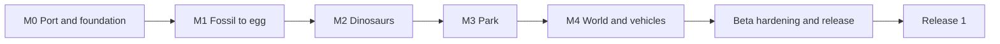

# Beta and Release 1 project plan

Mirror of the shared page tab "Beta and Release 1 project plan" (the master copy). Updated 2026-10-19.

The Beta is a survival Jurassic Park mod for Minecraft 26.2 on Fabric and NeoForge. The player finds fossils, clones and edits six dinosaur species, and keeps them in a powered, fenced, fed park.

- **Status:** no milestone is started. Nothing blocks M0.
- **Largest gap:** art. 431 of the 995 Beta art assets are missing or are placeholders. 270 more need importing, exporting, converting or checking in game.

## Roadmap

- Work runs left to right.
- Each milestone finishes all of its features together: screens, animations, sounds, recipes and art.
- A gate follows each step. The port must build and run on both loaders. Each milestone ends with a playtest that decides whether the next one starts.

## Milestones

| Milestone | When it ends, the player can | Features | Art: done · to check · to import or export · missing | Status |
| --- | --- | --- | --- | --- |
| M0 Port and foundation | Play the current mod on 26.2, on both loaders | Branch merge, CI, port to 26.2, config and species data | Not applicable | Not started |
| M1 Fossil to egg | Find fossils and amber, extract and edit DNA, print and incubate an egg, and hatch a baby | Fossils and amber, DNA from animals, Fossil Processor, Sequencer (sequencing, editing, synthesis), Egg Printer, Incubator, eggs and hatching, machine building, lab power, lab recipes | 50 · 12 · 31 · 92 | Not started |
| M2 Dinosaurs | Raise six species that eat, drink, rest, socialise, breed and react to the player | Behaviour model and contentment, species core, appearance, animations and sounds and effects, needs, herds and packs, the player, special genes | 192 · 11 · 186 · 277 | Not started |
| M3 Park | Hold dinosaurs in a powered, fenced paddock with feeders | Fences, power grid, feeders, park recipes | 9 · 0 · 22 · 36 | Not started |
| M4 World and vehicles | Find digsites and traders, build and drive the Jeep, run Ford Explorer tours | Digsites and maps, vehicles, guns (blocked) | 1 · 0 · 8 · 26 | Not started |
| Beta hardening | Play a fast, stable Beta on both loaders | Performance and cleanup, balance playtest, release | Not applicable | Not started |
| Release 1 | Plant a park, and clone four new species | Plants and wood sets, four species, their fossils | Not counted yet | Not started |

- **To check:** the asset is in the mod, but nobody has checked it in game.
- **Shared:** the 995 include 42 shared assets (skin layers both genders may share, generic machine sounds). The artist confirms them.
- **Not counted:** 1 asset that waits on a lead decision, and the guns, which are blocked.

## Waiting on you

Nothing blocks M0. No draft, reading or flag waits for you. The full lists are in the Feature specs and the Decisions register.

**Decisions that you parked**

1. Guns: which kinds and which models ship (D08). The guns stay blocked until you decide.
2. Animation speed that follows body size, and look-around clips on the second controller (D14). The plan does not build them.

**For the artist**

3. Which asset-repo folder holds the real T. rex sounds, and mod or REPO `hurt_1` (D91, Art list question 1)? Can both genders share the eye, teeth, nostril and claw layers (question 4)?
4. Art list questions 5, 7, 9, 10, 11, 12, 13, 14, 19 and 20:
    - the possible layer gaps per species
    - whether each raptor crest and quill variant is one texture layer or also a model part
    - the egg model findings
    - whether the Sorna and JP3 models can share the clip files, and which extra clips they need
    - the clips that name bones the model does not have
    - the upgrade texture swaps
    - the reach of the Incubator arm
    - the shared machine and carnivore eat sounds
    - the pylon head on a fence pole
    - the parts of each vehicle that take the dye tint.
5. New art from your answers is on the Art list. The raptor crouch-then-leap clip waits for later.
    - bloody claws for the T. rex and the Dilophosaurus, the generic pelvis set, the Wrench sprite
    - the Egg Printer lamp glow, a close clip for each feeder, the fence power-up and power-down sounds
    - 3 mood faces and 7 need icons, the lever switch, the Paleo-Illager skin, and the digsite and lab house structures from the team builder
    - the vehicle part sprites, the assembly-stage parts and the stop marker lamp.

## The other pages

- [Feature specs](plan/feature-specs.md): each feature in player terms. How it plays, screens, animations, sounds, numbers and open questions.
- [Art list](plan/art-list.md): every art asset by species, machine and block, with its status. For artists.
- [Engineering backlog](plan/engineering-backlog.md): work packages per milestone, with scope and acceptance tests. For developers and agents. It ends with the recipe table, the conflicts and the Decisions register.
- [Codebase analysis](codebase-analysis.md): the codebase analysis and the lead's design decisions (section 11).

## Rules this plan follows

- **Cloning parity.** The cloning system works 1:1 like the 2022 Cloning Guide video: flow, timings and screen contents. The newer spec (`_Cloning Process.docx`) and the lead's decisions win where they differ. The machines look like the current models, not the 2022 ones.
- **Fence parity.** The fence is 1:1 with the original 1.12.2 fence.
- **No stand-ins.** An asset counts only when it is the right one. A T. rex roar does not count for any other species. A copied file counts as missing.
- **Sources over code.** Requirements come from the design docs, the videos, the boards and the lead's decisions. Today's code shows only the current state.
